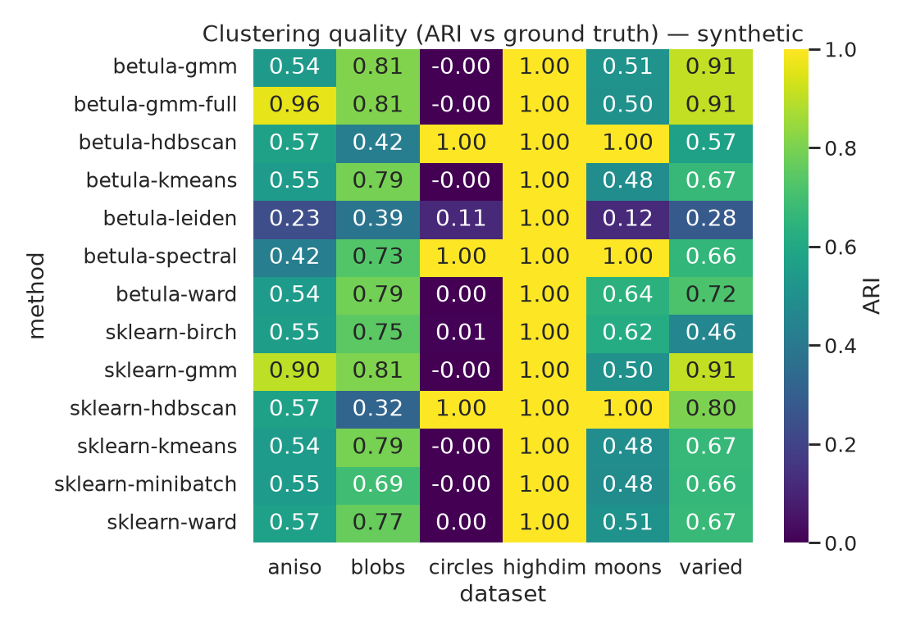
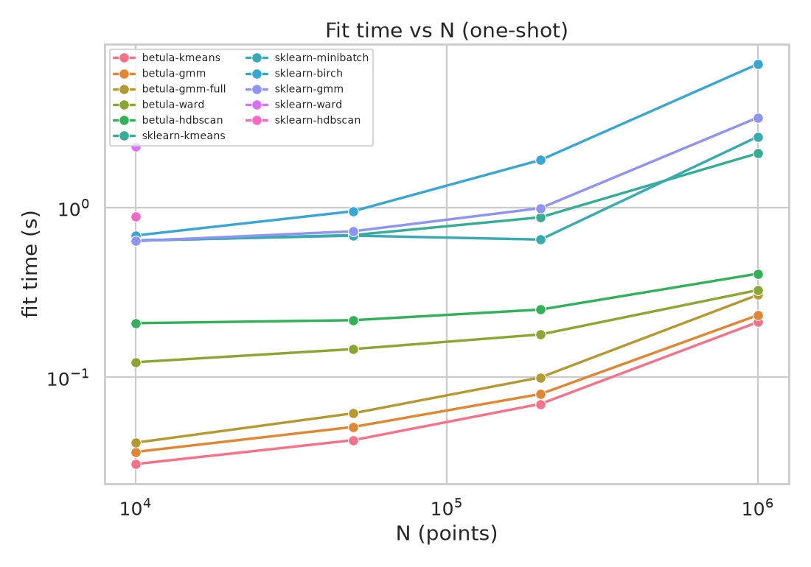
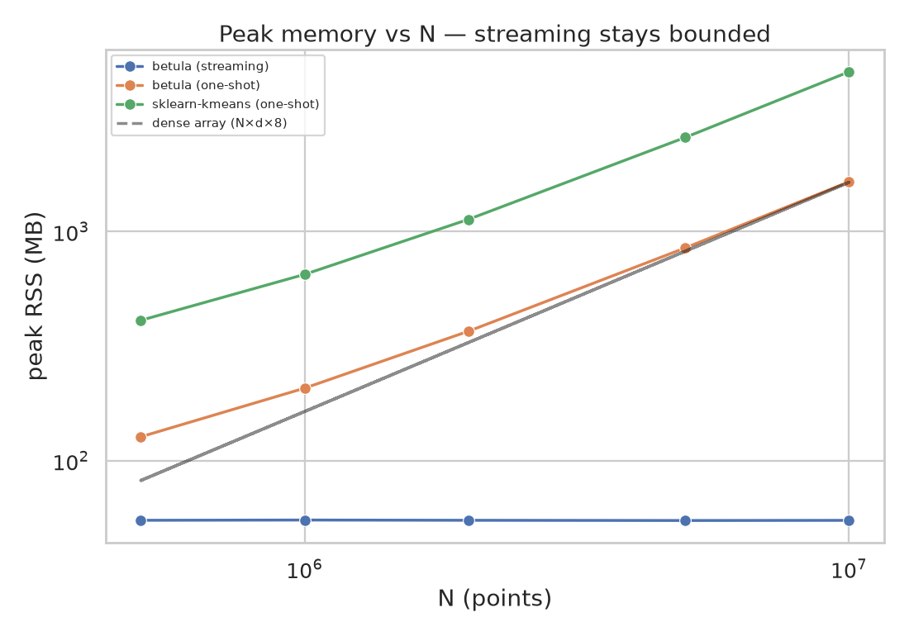
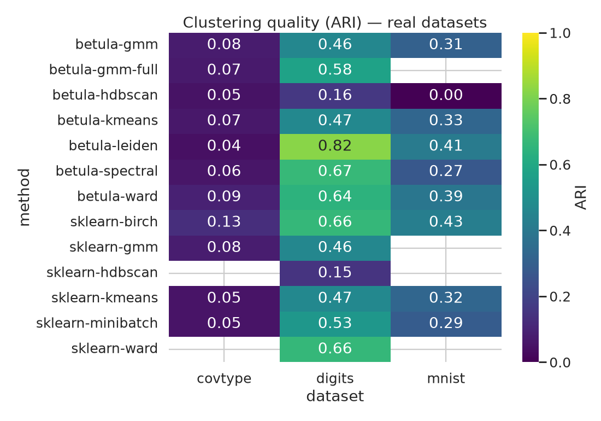

# Benchmark: betula-cluster against scikit-learn and the rest of the field — quality · speed · memory

> **Provenance — read before quoting a number.** The four **quality** tables (`results_quality`,
> `results_real`, `results_real_hires`, `results_real_normalize`) and the speed, memory, scale and
> sparse tables were measured **2026-10-29** on one build (`8f0bf78`, 1.5.0 plus `[Unreleased]`). The
> three leaf-level studies and the `leaf_refit` table are the **2026-09-10** edition's: `comprehensive.py`
> does not regenerate them. Every quality table is the **median of seeds 0, 1, 2**, and each ships its own
> min/median/max sidecar (`results_*_spread.csv`); the speed, memory, scale and sparse tables are a
> single run, since `bench/_worker.py` pins `seed=0` for them and they are seed-invariant by
> construction. This page is re-measured as a whole, not patched cell by cell.
>
> **A table that names no `results_*.csv` is not in a CSV.** Most study sections after *Quality
> against the leaf budget* report probes (`local/scratch/…`, or a `bench/` script that writes no file),
> each on the tree of its own date. Their numbers cannot be re-derived from the committed files.
>
> **The 2026-10-29 edition moved six quality rows, all `betula-spectral`, and all of them through one
> commit.** Of the 139 quality rows, the other 133 agree with the 2026-09-10 edition in every metric
> column to 1e-13 relative; the last-place differences fall on scikit-learn rows as often as on betula
> ones, so they are in the scoring arithmetic, not in the partitions. The six are the four synthetic
> spectral cells and the two real ones that use the approximate k-NN graph (`max_leaves = 4000`, above
> its 2 048-leaf switch), and `32aa279` — 1.2.0's graph built at twice its degree and cut back — is
> the change. An A/B of `32aa279^` against `32aa279` on the real cells reproduces the old medians
> (MNIST 0.335, covtype 0.0575) and the new ones (0.271, 0.0555) seed for seed; the synthetic cells
> were not A/B'd separately. **A more accurate graph made the MNIST cell worse**, 0.335 → 0.271; it
> is recorded where it appears. The win/tie/loss board re-derives the same 140 verdicts.
>
> **The speed column got faster on both sides, and on the scikit-learn side more.** At a million
> points betula reads 0.95–1.02× the 2026-09-10 edition and scikit-learn 0.87–0.96×; the in-core
> k-means of the memory suite reads 0.70–0.89×. This run is not that edition's machine state. It was
> taken under the `performance` governor (the earlier editions under `powersave`), on
> scikit-learn 1.9.1 and rustc 1.99.1, after `bench-ready.sh` read the machine idle (load 0.00, no
> swap; 35 → 82 °C over the run) rather than under the 15-second sampling gate described below. So
> the absolute shift is not attributed to either library, and the ratios that matter narrowed: k-means
> at 1 M is 9.9× scikit-learn's where it was 10.8×. Peak RSS rose 2–4 MB on every row of both
> libraries, which is the interpreter and library stack rather than the tree.
>
> **The 2026-09-10 edition re-ran the quality half for one engine change, and 56 of the 139 rows
> moved — every one of them a betula row.** `CFTree::rebuild` now ranks candidate merges by what they
> cost in within-cluster sum of squares instead of by how close the two leaves are, which changes the
> leaf set every head is handed (`[Unreleased]` in
> [CHANGELOG.md](https://github.com/ilgrad/betula-cluster/blob/main/CHANGELOG.md); the measurement is
> in [research/RESULTS-estep.md](https://github.com/ilgrad/betula-cluster/blob/main/research/RESULTS-estep.md)).
> **Zero non-betula rows moved** in any of the four tables, which is the control that says the
> harness, the fixtures and the scikit-learn baselines are the same ones — the difference is the
> library. The second control is the order study: it rewrote 50 of its 81 cells, by up to 0.43 ARI,
> and **all 27 `canonical_order=True` cells still read spread `0.0000` and pairwise ARI `1.0000`** —
> `bench/insertion_order.py` asserts that rather than reporting it, so the guarantee was re-proved on
> the new tree, not assumed. Six published conclusions change and are marked where they appear; the largest are MNIST
> k-means going from a recorded **loss** to a tie against scikit-learn (0.307 → 0.327 vs 0.324, and
> the only scoreboard verdict that moved), MNIST spectral 0.101 → 0.335, MNIST hdbscan 0.117 →
> **0.003**, and the covtype GMM's 16 000-leaf resolution win (0.104 vs 0.080) turning into an exact
> tie. **The speed and memory tables were then re-run under the same gate, and the prediction they
> were previously excused by held**: the change *removes* work — rebuilds fall from 27 to 5 on
> covtype-50k and 23 to 8 on digits — and betula's fit time at a million points fell to **0.763–0.816×**
> the 2026-09-07 edition across five heads while the scikit-learn column moved 0.952–0.984×, which is
> machine drift and the control. Resident memory did not move at four significant figures. The
> argument has been replaced by the numbers; both are below.
>
> **The quality column reproduced to the last digit; the speed column did not, and that is the
> finding.** Against the 2026-08-24/25 edition, **108 of the 117 rows in `results_quality.csv` + `results_real.csv` are byte-identical in every metric column**
> across 180 commits — every scikit-learn row, every `betula` row other than one head, and the whole
> of `results_real_hires.csv`, `results_real_normalize.csv` and `results_refit.csv`. The nine that
> moved are all `betula-spectral` and all belong to one commit; they are discussed where they appear.
> Nothing else moved by a single ulp, which is what makes the timing changes attributable to the
> commits that caused them rather than to the re-run.
>
> **This is the first edition measured under a contention gate, and the previous ones needed one.**
> This machine is shared with other long-running jobs, and the two libraries do not lose the same
> fraction to a competing process: scikit-learn's OpenMP loops lose more than betula's rayon does, so
> contention moves a *ratio* while leaving every label and every structural count bit-identical.
> Repetition cannot detect that — three consistent contended runs look exactly like a result. Each of
> the three measured steps below therefore waited for four consecutive clean 15-second samples before
> starting, was sampled every 10 seconds while running, and was **discarded and re-run** if any
> foreign process crossed 80 % of a core. The first step took three attempts.
>
> **One exception, closed 2026-08-30.** The two Toeplitz tables were a *single* run under this banner:
> `bench/toeplitz_ar_mixture.py` pinned `seed=1` and shipped no sidecar, so they sat in the gap between
> the banner's two categories. They are now the median of the same seeds 0/1/2 — driving the draw,
> betula's initialization and scikit-learn's `random_state` together — with
> `results_toeplitz.csv` / `results_toeplitz_spread.csv` beside them. The medians moved by up to 0.15,
> and the ordering *among the three Toeplitz rungs* turned out not to survive the spread below
> `d = 128`; see the section itself.
>
> The 2026-08-24/25 edition re-ran every table after the CF k-means++ sampling weight gained the leaf's
> own scatter term (Lang Eq. 5.4, `S_i + n_i·D²_i`). Cell-by-cell against the run before it, **only the
> seeded heads moved** — `kmeans`, `gmm`, `gmm-full` and `spectral`, plus the two sparse rows that
> cluster with `method="kmeans"`. The edition before that was a single run of 2026-07-18 against a
> **0.2.0** build; every number on it was replaced, several of them downwards.
>
> The previous edition re-ran the quality tables after the `min_samples` convention change (the head now
> counts the microcluster itself, matching `sklearn.cluster.HDBSCAN`). No table here
> exercises `method="vmf"` (verified by grep over every `results_*.csv`), so 0.7.0's vMF
> concentration-cap fix moves nothing on this page.

Reproduce: `python bench/comprehensive.py --quality-only --seed S --tag _sS` for S ∈ {1, 2}, then
`python bench/comprehensive.py --seed 0 --tag _s0` (the full run, which also writes
`results_{scaling,memory,real_scale,sparse}.csv`), then `python bench/median_of_seeds.py --seeds 0 1 2`
and finally `python bench/comprehensive.py --plots-only`. Order matters: `--plots-only` reads the
canonical CSVs, so run before the median step it draws one seed instead of the published medians.
**Do not export `OMP_NUM_THREADS=1`** — an earlier edition of this line said to, and it is wrong.
betula's own parallelism is rayon's, which `OMP_NUM_THREADS` does not reach, so pinning OpenMP gags
scikit-learn's Lloyd loop and leaves betula on every core. Every table here was in fact taken with
`OMP_NUM_THREADS=8`, inherited from the shell, which makes `comprehensive.py`'s
`os.environ.setdefault` a no-op for that one variable and leaves it pinning only
`OPENBLAS`/`MKL`/`NUMEXPR` — BLAS inside the harness rather than either library's own parallel loop.
Following the old instruction changes exactly one variable and slows *scikit-learn alone* by
2.2–2.7× wherever `d` is large enough for the Lloyd loop to matter: 1.03 s → 2.80 s on the memory
suite at `n = 500 000, d = 20`, 4.92 s → 10.86 s on full covtype, 1.03 s → 1.80 s on 20-newsgroups,
and — the control — no change at all on `results_scaling.csv`, whose blobs are two-dimensional. (Those
six numbers are an A/B pair each, taken on 2026-09-07 *before* the contention gate existed, which is
why their `OMP=8` arms match the old contended tables rather than the gated ones now published. The
pairing is what the paragraph rests on and contention does not invert it.)
Leave `OMP_NUM_THREADS` at the machine's value and `RAYON_NUM_THREADS` unset: both sides get the
machine, which is the only configuration in which a speed row means anything. The harness needs `scikit-learn pandas matplotlib scipy seaborn`; `seaborn` is imported only inside
`make_plots`, which runs *last*, so without it every CSV is still written and only the plot step
raises — check `plots/*.png` mtimes rather than trusting a run that printed its tables. The
supplementary studies are separate scripts: `bench/spectral_nonconvex.py` (spectral timing),
`bench/toeplitz_ar_mixture.py` (the `gmm-toeplitz` showcase) and `bench/nmf_cf_weighted.py`
(CF-weighted NMF). Every cell is guarded and failures are recorded, not hidden; both **wins and
losses** are reported below.

## TL;DR (honest)

- **Faster and lighter than scikit-learn at most published sizes; five speed cells are losses.**
  betula labels 1 M points in **0.21 s** (9.9× faster than scikit-learn KMeans, 16× vs
  GaussianMixture, 33× vs Birch) and streams 10 M in a flat **~55 MB** where an in-core KMeans needs
  **~5.0 GB** (**91× less**, and the gap grows without bound). That ratio is the stream's: handed
  the whole array, betula itself peaks at 1.65 GB, 3.0× below the same KMeans. This is what a
  bounded-memory compression engine is built to deliver. It is not unconditional. At 10 M rows the
  in-core KMeans is faster than the stream (5.71 s against 7.26 s; one row, two board cells, and a timing *Memory*
  calls unreliable). On sparse 20 newsgroups scikit-learn is faster on raw TF-IDF (0.56 s against 1.62 s) and on the SVD row (0.38 s against 1.45 s; two rows,
  three board cells). FAISS k-means at its defaults was faster at both sizes measured on 2026-10-20,
  where it does not recover the partition (*Specialist baselines*).
- **Quality is at parity on the centroid heads; the structured heads lead by margins the seeds do not
  resolve.** betula's k-means is at parity with scikit-learn (blobs 0.793 vs 0.794, `digits` 0.467 vs
  0.468, and MNIST 0.327 vs 0.324, which was a loss until the distortion-ranked rebuild).
  Full-covariance GMM reads **0.961 vs 0.902** on anisotropic data and **0.575 vs 0.463** on real
  64-D `digits` (via the high-dimensional covariance floor). Both are ties under this page's rule:
  scikit-learn's three seeds span 0.626–0.999 and 0.402–0.601. The **HDBSCAN** and **spectral** heads
  both hit ARI **1.00** on moons and circles.
- **One loss stated plainly, and one gap the seeds do not resolve.** On `covtype` `sklearn-birch`
  beats every betula head, 0.131 vs a best of 0.091. That is a loss on the merits (not a
  leaf-budget artefact, measured both ways) and the mechanism is now known: the leaf budget produces
  cells of far more unequal mass than a radius threshold does. On MNIST Birch reads 0.426 against
  betula-ward's 0.394, a tie under this page's rule (betula-ward's three seeds span 0.334–0.471). Most
  of that gap is the price of compression — Birch returns 20 000 subclusters for 20 000 points and
  compresses nothing, and at equal (non-)compression the 0.032 gap falls to 0.010. See *The `covtype`
  loss*. HDBSCAN-on-CF reads 0.568 against raw HDBSCAN's 0.802 on `varied` and 0.423 against 0.324 on
  blobs; both are ties, because the betula head's seeds span 0.042–0.757 and 0.142–0.456. It
  collapses outright on MNIST (0.003).
- **Against the rest of the field, more losses than wins on quality** (*The census*: quality and
  peak RSS only, one betula head per contest). Losses: density without k, where DelTriC and
  `hdbscan` average 0.657 and 0.652 ARI over seven fixtures against betula's `hdbscan` head at
  0.616; aniso given k, where lumbermark and Genie read 0.843 and 0.750 against the rows graph's
  0.545; MNIST-70k without k to UMAP + HDBSCAN, EVoC and PhenoGraph (0.777 against 0.920, 0.899 and
  0.821); 20 newsgroups embeddings to every layout + k-means under MiniLM (0.374 against UMAP +
  k-means 0.451) and to both UMAP pipelines under mpnet (0.433 against 0.472 and 0.459), and,
  without k, to PhenoGraph and kNN + Leiden under both models and to CoreSPECT under MiniLM;
  CIFAR-100 CLIP embeddings to UMAP and openTSNE + k-means (0.666 against 0.721 and 0.696) and,
  without k, to CoreSPECT, kNN + Leiden and PhenoGraph (0.370 against 0.626, 0.561 and 0.529). The
  density fixtures given k tie on the mean: `leiden` on the rows graph averages 0.838 against
  Genie's 0.839. Wins: `digits` given k against Genie and lumbermark (0.840 against 0.643 and
  0.656); MNIST-70k given k against openTSNE + k-means (0.835 against 0.745), with no layout step,
  where it ties UMAP and PaCMAP + k-means on a wide seed range (0.806–0.884); BERTopic's default
  pipeline on news (0.330 against 0.086); the AR mixture against tslearn's k-Shape (0.764 against
  0.057). MNIST-20k is a tie with every manifold pipeline but one: it beats UMAP + HDBSCAN on the
  UMAP docs' recipe (0.762 against 0.536). Peak RSS is below every manifold and graph rival's in
  each MNIST and embedding contest.
- **On Gagolewski's clustering benchmark suite (81 datasets, told k), level with the best, not ahead.**
  `leiden` with `resolution="auto"` ranks 6th of 213 configurations scored in every battery (suite
  mean NCA 0.774 against Lumbermark's 0.786 and GIc's 0.784; paired, ahead on 19 datasets and behind
  on 22–25), ahead of Genie at its default, ITM and scikit-learn's k-means and GMM, and it cannot
  hit K on 3 of the 81. On a GPU, cuML's UMAP + k-means and UMAP + HDBSCAN are a separate table that
  enters no total: the k-means pipelines find what their CPU versions find.
- **A capability no mainstream library ships:** `method="gmm-toeplitz"` — an AR/Toeplitz-structured
  covariance GMM for ordered stationary signals — recovers a mixture of AR processes that differ *only*
  in autocovariance (ARI **1.00** at long windows) exactly where both diagonal (blind) and full
  (singular at `N_k ≪ d`) score ≈ 0.

## Seed dependence — read this before comparing any two cells

Clustering quality is seed-dependent and EM is non-convex. On the synthetic sets **every** row moves
by more than 0.05 ARI across three seeds; `digits` `betula-kmeans` spans 0.443–0.571, and
`covtype` `betula-spectral` spans 0.014–0.101 — a 7× ratio. The previous edition of this page
published single runs, and in more than one place happened to publish the top of that range as the
result.

Every quality table below is therefore a **median of three seeds**, and the accompanying
`results_*_spread.csv` carries min/median/max per cell. Each row is one run, the seed whose ARI is
the median, so the cluster count, noise share and internal scores beside an ARI are that run's
(`bench/median_of_seeds.py`; to 2026-11-15 each column was its own median, and a row could print
one seed's ARI beside another seed's cluster count). A difference smaller than the two cells'
spreads is not a result. Where a comparison in this page turns on such a margin, it says so.

## Environment (reproducibility)

Absolute times vary by machine; the *ratios* far less.

| | |
|---|---|
| CPU | AMD Ryzen 7 5800HS (8 cores / 16 threads) |
| RAM | 38 GiB |
| OS / kernel | Fedora Linux 44, kernel 7.2.13 |
| CPU governor | `performance` (the editions up to 2026-09-10: `powersave`) |
| Python / NumPy / SciPy / scikit-learn | 3.14.8 / 2.5.2 / 1.18.1 / 1.9.1 |
| matplotlib / pandas | 3.11.2 / 3.1.0 |
| Rust | rustc 1.99.1 |
| betula-cluster | 1.5.0 plus `[Unreleased]` (`8f0bf78`), `maturin --release` (LTO, `codegen-units=1`) with the repository's `--inline-threshold=1000`, as the PyPI wheel is built; **portable** wheel (no `target-cpu=native`) |
| Threads | `OMP_NUM_THREADS=8` (the machine's, exported by the shell), `OPENBLAS/MKL/NUMEXPR_NUM_THREADS=1`, `RAYON_NUM_THREADS` unset — both libraries get the machine, which is the only configuration in which a speed row means anything. An earlier edition of this row read `1` for all four and was wrong about what the run had done; see the `Reproduce:` line above. |

## Methodology

- **Datasets** (fixed seed, `StandardScaler`-normalized so a single betula `threshold` is fair across
  all): `blobs` (6 Gaussians), `aniso` (sheared/anisotropic), `varied` (unequal variances), `moons`,
  `circles` (non-convex), `highdim` (20-D, 8 clusters).
- **Metrics** — external (vs ground truth): **ARI**, **AMI**, **V-measure**; internal: **silhouette**
  (on a 5 k sample), **Davies-Bouldin**, **Calinski-Harabasz** (all in `results_quality.csv`).
- **betula params:** `threshold=0`, `max_leaves=4000`, single-thread — the memory-bounded default —
  except `leiden`, which runs as a user gets it (the library's `max_leaves=2000` and `threshold=0`,
  passes until stable; to 2026-11-15 it ran one pass over 800 leaves at `threshold=0.4`), the speed and
  memory suites (`max_leaves=2000`) and the sparse suite (`max_leaves=2048`). **sklearn params:**
  library defaults (`KMeans n_init=10`, etc.), on the **full** `N` (the `O(N²)` Agglomerative /
  HDBSCAN baselines run at `N = 30 000` in the quality table; only the *scaling* table caps them,
  since they cannot reach 1 M).
- **Isolation:** every speed/memory point runs in its **own fresh `subprocess`**; peak RSS is the
  process's own `VmHWM`, reset when the measurement starts (`/proc/self/clear_refs`), with a
  14 GiB `RLIMIT_AS` cap and a timeout, so a method that explodes fails gracefully. Until
  2026-11-15 a thread sampled `/proc/self/statm` every 4 ms instead. It cannot run while a fit holds
  the GIL, and betula's heads hold it: on MNIST-70k it read 265 MiB where `VmHWM` read 565 MiB, and
  one `leiden` fit 660 MB on one seed and 973 MB on the next. The betula rows of the memory table and
  of the census harnesses (`rivals.py`, `density_rivals.py`, `head_references.py`) were re-read with
  `VmHWM` on 2026-11-15. Every rival row, and the betula rows of the scaling, sparse and real-scale
  tables, are still sampler readings until the timing campaign re-runs them. A sampler can only miss
  a peak, so such a cell flatters whichever side it measured.

## Which `covtype` is this? — the two real-data fixture rules

A "20 000-row draw from covtype" is not one thing, and the difference is not small: the same `ward`
head reads **0.0861** under one rule and **0.1416** under the other. Both rules are on this page and
both are defensible, so both are kept — but which one a table was measured under is part of the
table, not a detail.

| rule | rows | drawn how | the scaler was fitted on | used by |
|---|---:|---|---|---|
| **sub** | 20 000 | `rng(seed).choice` — moves with the seed | those 20 000 rows | `results_real.csv`, `results_real_hires.csv`, `results_real_normalize.csv`: the `covtype` and `mnist` rows of every quality table |
| **pop** | 20 000 / 10 000 | `rng(0).permutation[:n]` — fixed | all 581 012 covtype / 70 000 MNIST rows | `results_order.csv`, `results_budget.csv`, and the Zador fit |
| **raw** | 10 000 / 1797 | first `n` rows | *nothing — features are unscaled* | `results_refit.csv`: the `leaf_refit` table, whose subject is what the raw points do |
| *(full)* | 581 012 | no draw | all 581 012 | `results_real_scale.csv`: the full-covtype headline, labelled `covtype` |

**sub** is what a practitioner holding 20 000 rows has — there is no population to standardize
against, and the per-seed draw means a median-of-three-seeds cell averages over three subsamples as
well as three initializations. **pop** lets a 20 000-row cell and the full-covtype cell describe the
same geometry, and holds the data still while a study sweeps a knob. None of the three is a mistake.
Reading a **sub** number against a **pop** number is.

Both drawn rules *draw*: covtype's file is ordered in spatial blocks, so a head slice is a different
question wearing the same name — class 4 is 0.47 % of the data and **10.8 %** of the first 20 000
rows. OpenML MNIST is not like that (all ten classes in its first 10 000 rows, each within a few per
cent of its population share), which is the only reason the **raw** rule is allowed to take one.

**Reading the labels on this page:** `covtype-20k` and `mnist-10k` mean **pop** unless the row says
`(sub)`. Three sections built their fixture with `bench/comprehensive.py::load_real` — the **sub**
rule — and labelled it with a 20 k name anyway; those rows now carry `(sub)` explicitly. They are
"Where the leaf budget goes" (the mass-profile tables only — the `balance` tables further down that
same section are **pop**), the `n_init` restart section, and the `simplified_silhouette` section.

`bench/_fixtures.py` is now the only place any of the rules is defined, and every harness in `bench/`
loads through it. That is the fix rather than the documentation: the rules were originally spelled
out inline in five separate files, one-off scripts under `local/scratch/` then wrote further variants
of their own — one drawing without standardizing at all — and the label stopped tracking the data. A
one-off script written before 2026-09-10 may still use any of them; one written against `_fixtures`
has to name a rule to get a fixture.

## Quality — ARI vs ground truth (N = 30 000)



Median of seeds 0/1/2 (`results_quality.csv`; spreads in `results_quality_spread.csv`).

| method | blobs | aniso | varied | moons | circles | highdim |
|---|---|---|---|---|---|---|
| **betula-kmeans** | 0.793 | 0.545 | 0.670 | 0.485 | −0.000 | 1.00 |
| **betula-gmm** (diag) | 0.812 | 0.540 | **0.907** | 0.514 | −0.000 | 1.00 |
| **betula-gmm-full** | 0.811 | **0.961** | **0.907** | 0.503 | −0.000 | 1.00 |
| **betula-ward** | 0.787 | 0.544 | 0.718 | **0.637** | 0.003 | 1.00 |
| **betula-spectral** | 0.729 | 0.424 | 0.659 | **1.00** | **1.00** | 1.00 |
| **betula-leiden** (auto-`k`) | 0.385 | 0.235 | 0.279 | 0.119 | 0.112 | 1.00 |
| **betula-hdbscan** | 0.423 | 0.567 | 0.568 | **1.00** | **1.00** | 1.00 |
| sklearn-kmeans | 0.794 | 0.545 | 0.670 | 0.484 | −0.000 | 1.00 |
| sklearn-minibatch | 0.694 | 0.547 | 0.665 | 0.484 | −0.000 | 1.00 |
| sklearn-birch | 0.748 | 0.554 | 0.460 | 0.616 | 0.005 | 1.00 |
| sklearn-gmm (full) | 0.807 | 0.902 | **0.907** | 0.504 | −0.000 | 1.00 |
| sklearn-ward | 0.770 | 0.565 | 0.673 | 0.507 | 0.001 | 1.00 |
| sklearn-hdbscan | 0.324 | 0.567 | 0.802 | **1.00** | **1.00** | 1.00 |

Reading it honestly:

- **betula-kmeans ≡ sklearn-kmeans.** 0.793 vs 0.794 on blobs, 0.545 vs 0.545 on aniso, 0.670 vs
  0.670 on varied — three ties inside the seed spread. CF compression costs no quality at this
  resolution. (The previous edition read this as "*exact* parity, 0.861 = 0.861"; 0.861 is the top of
  the three-seed range, and the two heads agree at every point in it.)
- **betula-gmm-full reads 0.961 against sklearn's full GMM's 0.902 on the anisotropic case** — the
  case k-means cannot do at 0.545. It is a tie under this page's rule: scikit-learn's three seeds span
  0.626–0.999. On `varied` all three GMM variants tie at 0.907.
- **betula-ward** (bounded, 4 000 leaves) ties the **full-30 000** `sklearn-ward` on all four
  fixtures with structure: ahead on `varied` (0.718 vs 0.673), `moons` (0.637 vs 0.507) and blobs
  (0.787 vs 0.770), behind on `aniso` (0.544 vs 0.565), and each margin inside the wider three-seed
  range. Compression does not cost here. This is
  the row the distortion-ranked rebuild moved most on this table — `varied` +0.055 and blobs +0.012
  against the previous edition, `aniso` −0.030 — because the linkage reads the leaf masses directly
  and they are no longer half singletons.
- **betula-spectral and betula-hdbscan own the non-convex cases** — both **1.00** on moons and
  circles, where every centroid head sits at 0.48–0.51 and ≈ 0. The 2026-10-29 edition took the
  blob-like cells down a little (`blobs` 0.742 → 0.729, `aniso` 0.428 → 0.424, `varied` 0.664 →
  0.659), which is `32aa279`'s doubled k-NN graph — this head uses the approximate graph above 2 048
  leaves. None of the six survives its own spread — `blobs` spans 0.703–0.838, `aniso` 0.418–0.998
  and even `circles` 0.658–1.000 over the three seeds — so read the row as a regime rather than as six
  numbers. The
  cells where these heads are decidable are on the real datasets, below.
- **betula-leiden** discovers the community count with **no `k`**, and on five of these six fixtures
  it finds far too many: 16–20 communities where the truth is 2, 3 or 6, so blobs reads 0.385,
  `varied` 0.279 and moons 0.119. Only highdim, eight well-separated blobs in 20-D, comes back whole
  (1.00, eight communities). The row runs the head as a user gets it since 2026-11-15 — the
  library's 2 000 leaves at `threshold=0`, passes until stable — and the previous edition's 0.722 /
  0.465 / 0.633 / 0.512 on blobs / aniso / `varied` / moons were one pass over 800 leaves at
  `threshold=0.4`, a coarser graph no user is told to build. Given the count, `resolution="auto"`
  returns exactly `n_clusters`; without it, use a parametric or density head on 2-D
  blobs and spectral on manifolds.
- The honest weak spot: **HDBSCAN-on-CF on overlapping density.** `varied` 0.568 vs raw HDBSCAN's
  0.802 — the wrong tool for overlapping Gaussians. Under this page's rule it is a tie, but only
  because the betula cell's own range is so wide (below). On blobs the sign flipped this edition:
  0.142 → 0.423 against raw HDBSCAN's 0.324, also a tie, which is the same
  compaction change and the same reason as the ward row, since the density head is a function of the
  leaf masses too. Use a parametric head for blobs; HDBSCAN-CF / spectral for density / non-convex.
  These cells are also by far the least stable in the whole table — betula-hdbscan's three-seed range
  is 0.142–0.456 on blobs, 0.042–0.757 on `varied` and **0.424–0.993** on `aniso`, where the median
  0.567 sits between a near-total failure and a near-perfect recovery. Read the whole row as a regime
  without a stable answer rather than as six numbers.

### Non-convex: spectral clustering that scales (N = 30 000)

`method="spectral"` runs the Ng-Jordan-Weiss spectral pipeline on the ≤ `max_leaves` CF microclusters
rather than on all `N`, so its cost is bounded by the microcluster count and the same call scales to
`N = 1 M`, where scikit-learn's graph + eigensolve are `O(N)`+ in memory and effectively cap out around
30 k (`bench/spectral_nonconvex.py`).

| method | moons ARI | circles ARI | time (moons / circles) |
|---|---|---|---|
| **betula-spectral** | **1.00** | **1.00** | **0.240 s / 0.218 s** |
| sklearn-SpectralClustering (k-NN affinity) | 0.999 | **1.00** | 0.564 s / 0.547 s |
| betula-leiden | 0.116 | 0.127 | 0.156 s / 0.136 s |

Median of three gated repetitions, not in a CSV (`bench/spectral_nonconvex.py` prints the table and
writes no file). On this fixture it is barely a median: every ARI is identical
across the three and betula's times span 0.240–0.240 and 0.217–0.218.

**Both columns moved since the previous edition, in opposite directions, and only one of them is
ours.** betula went 0.373 → 0.240 s and 0.241 → 0.218 s, which is the 08-31 spectral rewrite — the
head now filters the Laplacian over every leaf instead of factoring it over 256 landmarks, and the
ARI is unchanged at 1.00 on both. scikit-learn went 0.389 → 0.564 s and 0.372 → 0.547 s, and this
page does not know why: the version is 1.9.0 in both editions, the machine was gated for this one,
and the arm is untouched code. It is recorded as an unexplained move in the baseline rather than
claimed as a speed-up. **The ratio is therefore 2.4× on moons and 2.5× on circles, and it should not
be quoted** — the previous edition read 1.04× and 1.54× on the same two arms, and a ratio whose
denominator moves 1.4× between runs it cannot account for is not a result. The durable claim is the
**scaling** one: betula's cost is set by `max_leaves`, not by `N`.

The ARI here reads 1.00, and so does the quality table above for the same head on the same
generators (medians 0.9999 and 1.0000, `results_quality.csv`). The two runs still differ: this table
is `max_leaves = 2000` at seed 0, and that one is the median of three seeds at `max_leaves = 4000` —
where `seed` also redraws the dataset, so the three cells are three different moons.

`method="leiden"` is included as an honest negative: it is built for community / blob structure, not
elongated manifolds — modularity chops each arc into ~19 segments (ARI ~0.12), exactly the
resolution-limit behaviour the docs warn about. Use spectral for manifolds, Leiden for communities.

## Speed — fit time at N = 1 000 000

Measured at `max_leaves = 2000` (the tight bound); the quality tables above use `4000`. The extra
leaves add only a small constant to Phase-3, which clusters the leaves rather than the `N` points, so
the scaling shape — `O(N)` build, flat memory — is unchanged.



| method | time @ 1 M | vs betula-kmeans |
|---|---|---|
| **betula-kmeans** | **0.212 s** | 1× |
| betula-gmm | 0.232 s | 1.1× |
| betula-gmm-full | 0.306 s | 1.4× |
| betula-ward | 0.327 s | 1.5× |
| betula-hdbscan | 0.408 s | 1.9× |
| sklearn-kmeans | 2.09 s | 9.9× |
| sklearn-minibatch | 2.62 s | 12.4× |
| sklearn-gmm | 3.39 s | 16.0× |
| sklearn-birch | 7.00 s | **33×** |
| sklearn-ward, sklearn-hdbscan | (O(N²) — cannot reach 1 M) | — |

All five betula heads finish a million points in **under 0.45 s**; full-covariance GMM runs **4 EM
restarts** (for robustness against local optima) **in parallel**, finishing in **0.306 s** — 11.1×
faster than scikit-learn's GMM. betula-ward does the equivalent of `O(N²)` agglomerative at 1 M in
**0.327 s**, where scikit-learn's Agglomerative cannot run past ~10 k at all.

This table is a **single run** — `bench/_worker.py` pins `seed=0` for the speed phase, so it is
seed-invariant by construction, but it is one timing sample. Quote the order of magnitude, not the
third digit.

### Re-timed 2026-10-29: a faster machine state, and scikit-learn gained more

Each cell is the 2026-10-29 time over the 2026-09-10 one:

| head | 10 k | 50 k | 200 k | 1 M |
|---|---|---|---|---|
| betula-kmeans | 0.929× | 0.932× | 0.944× | 0.979× |
| betula-gmm | 0.979× | 0.945× | 0.932× | 0.960× |
| betula-gmm-full | 0.803× | 0.949× | 0.978× | 1.020× |
| betula-ward | 0.903× | 0.974× | 0.918× | 0.949× |
| betula-hdbscan | 0.970× | 0.943× | 0.944× | 0.980× |
| *the four scikit-learn rows* | 0.893–0.910× | 0.883–0.911× | 0.884–0.938× | 0.871–0.958× |

Some betula changes between the two editions do reach this path — 1.2.0 inlined the routing
dispatch on the insert path whatever the build flags, and the batched route now labels the `ward` and
`hdbscan` rows' points. But the scikit-learn rows moved as much or more, and they changed version
(1.9.0 → 1.9.1) and governor (`powersave` → `performance`) along with everything else, with nothing to
separate the causes. So the table is recorded and not read as a betula speed-up; what it does show is that the published ratios narrowed — k-means at 1 M from 10.8× to 9.9×, Birch from 37×
to 33× — and that every betula head still finishes a million points in under 0.45 s.

### Re-timed 2026-09-10: the rebuild change is worth 18–24 % at a million points

The 2026-09-10 edition re-ran this suite because ranking rebuild merges by what they cost *removes*
work — rebuilds fall from 27 to 5 on covtype-50k and 23 to 8 on digits — and the previous edition
said so as an argument while publishing timings taken before it. Same contention gate, same quiet
machine, **zero contention sightings**, and the control is exact: over the 117 rows of
`results_quality.csv` + `results_real.csv` **every metric column reproduced bit for bit** and only
`time_s` moved, so this is a timing measurement and nothing else.

| head | 10 k | 50 k | 200 k | 1 M |
|---|---|---|---|---|
| betula-kmeans | 0.870× | 0.791× | 0.790× | **0.763×** |
| betula-gmm | 0.937× | 0.823× | 0.781× | **0.773×** |
| betula-gmm-full | 1.070× | 0.861× | 0.790× | **0.802×** |
| betula-ward | 1.133× | 0.911× | 0.946× | **0.816×** |
| betula-hdbscan | 1.016× | 0.919× | 0.948× | **0.806×** |
| *the four scikit-learn rows* | 0.944–0.980× | 0.959–0.977× | 0.957–0.985× | 0.952–0.984× |

**The scikit-learn row is the control and it is what makes the betula column readable.** Every
scikit-learn cell moved by the same 2–5 %, in every column, which is this machine being marginally
quicker today than on 2026-09-07 — nothing in this change can reach scikit-learn's code. The betula
rows sit at 0.76–0.82× at a million points, which is 14–20 points beyond that drift, and **the effect
grows with `N`**: at 10 000 points three of the five heads are *slower* (ward 1.133×, gmm-full
1.070×, hdbscan 1.016×), because a tree that small rebuilds a handful of times and the extra
distance per merged pair is not amortised against anything.

Two structural moves came with it, both consequences rather than timing. `betula-hdbscan`'s
automatic `k` goes **3 → 28** at 200 k and **3 → 25** at 1 M: a summary that is not a few heavy
leaves plus a tail of singletons gives the density head something to find. And on full covtype the
same head's ARI rises 0.070 → **0.087** while its time falls 1.006 → 0.746 s. Peak RSS did not move
anywhere — 38 of 44 rows changed by under 0.3 % — with one exception worth naming rather than
publishing: `sklearn-ward` at 10 000 read 968.8 MB then and 618.4 MB now, a 36 % swing on a row this
change cannot touch, so that cell is allocator high-water noise on an `O(N²)` peak and should not be
quoted to two digits.

**What the previous edition recorded here, kept because the reasoning still applies.**
`betula-hdbscan` had moved 0.801 s → 0.517 s when `06ad6b5` put ward's nearest-neighbour chain and
hdbscan's core-distance and Prim relaxation passes on rayon — 1.55× on this fixture, and 3.6× and
4.7× at 7 250 leaves of 784-dimensional data. And every other betula row had got 1 to 12 % *slower*
(`kmeans` 0.264 → 0.283 s, `gmm` 0.292 → 0.313, `gmm-full` 0.360 → 0.374, `ward` 0.417 → 0.422), a
uniform shift across two independent suites that the A/Bs below attribute mostly to the compiler
(rustc 1.98.0 → 1.98.1). The 2026-09-10 numbers above are *below* both of those baselines on every
head at 1 M, so that regression is now paid off with change to spare.

**Measured, 2026-09-08 — most of it is the compiler, and what is left is not the insert path.** Two
A/Bs, each varying one thing and holding the other fixed, both running `bench/_worker.py` directly so
the probe is the published cell rather than a proxy, both A-B-A-B under the same quiet gate as the
rest of this page, and both reading the arm back out of the built `.so` (`readelf -p .comment`)
rather than trusting the environment variable meant to select it.

*Same source, two toolchains* (HEAD, rebuilt per arm, ≥ 5 clean samples per cell):

| probe | rustc 1.98.1 | rustc 1.98.0 | ratio |
|---|---|---|---|
| `fit betula-kmeans blobs 1000000` | 0.2981 s | 0.2737 s | **1.089** |
| `fit betula-ward blobs 200000` | 0.2179 s | 0.2093 s | **1.041** |
| `stream 2000000 20 50000` | 1.8841 s | 1.7498 s | **1.077** |
| `fit betula-gmm blobs 1000000` | 0.3111 s | 0.3131 s | 0.993 |

*Same toolchain (1.98.0), two sources* — this edition's tree against `28d4e9f`, the commit the
previous edition was measured at, in a second worktree with its own venv built from the **same**
interpreter (a fresh `uv venv` resolves the repo's `3.14` pin to a free-threaded build, which would
have compared two different pyo3 configurations). Each era runs its own `bench/_worker.py`; the two
differ only by the `n_jobs` → `n_shards` rename of the same argument at the same value. 15 clean
samples per cell, **0 dirty of 120**:

| probe | 0.8.0 | 0.7.0 | ratio | per cycle | peak RSS 0.8.0 / 0.7.0 |
|---|---|---|---|---|---|
| `fit betula-kmeans blobs 1000000` | 0.2783 s | 0.2827 s | 0.985 | 1.048 · 0.947 · 0.968 | 88.1 / 91.4 MB |
| `fit betula-gmm blobs 1000000` | 0.3182 s | 0.3131 s | 1.016 | 1.021 · 0.974 · 1.067 | 88.2 / 95.5 MB |
| `fit betula-ward blobs 200000` | 0.2235 s | 0.2147 s | **1.041** | 1.045 · 1.013 · 1.056 | 52.0 / 54.8 MB |
| `stream 2000000 20 50000` | 1.8536 s | 1.8081 s | 1.025 | 0.996 · 1.044 · 1.026 | 52.9 / 60.1 MB |

So: **the toolchain bump costs 4–9 % on three of the four probes**, and the source change costs
**4.1 % on ward and ~2.5 % on streaming** — the only two cells whose per-cycle ratios keep their sign.
`kmeans` and `gmm` flip sign between cycles under a fixed compiler, which is what a wash looks like
when it is reported honestly rather than rounded to a trend. Together the two effects cover the
published band, and the direction of the residual is worth naming: this edition is **4–12 % lighter**
in peak RSS on every one of the four probes, so whatever the source change bought, it was not paid
for in memory.

The kernel is the one thing that could not be varied — 7.1.13 is what is booted — so it is not
excluded, merely unnecessary as an explanation. What *is* excluded is the reading the previous
edition of this paragraph pointed at: there is no uniform insert-path regression to bisect. `kmeans`,
the purest insert-bound probe here, is 1.5 % *faster* on the newer source.

## Memory — streaming stays bounded



Peak RSS (own process: `VmHWM` for the two betula columns, the `/proc/self/statm` sampler for
scikit-learn's), betula via chunked `partial_fit` (never materializing the array), the same betula
estimator handed the whole array, and an in-core KMeans that must hold all of `X` (20-D):

| N | betula (streaming) | betula (one-shot) | sklearn KMeans (one-shot) | streaming vs sklearn | one-shot vs sklearn |
|---|---|---|---|---|---|
| 500 k | 54.9 MB | 127 MB | 409 MB | 7.5× | 3.2× |
| 1 M | 55.1 MB | 207 MB | 649 MB | 11.8× | 3.1× |
| 2 M | 54.9 MB | 367 MB | 1.13 GB | 20.6× | 3.1× |
| 5 M | 54.8 MB | 847 MB | 2.57 GB | 46.9× | 3.0× |
| 10 M | **54.9 MB** | 1.65 GB | **4.97 GB** | **91×** | 3.0× |

**The 91× is what streaming saves, not what the library saves.** The one-shot betula column (added
2026-11-15, measured on that day's tree) fits the same `Betula` on the same rows, held in memory as
scikit-learn's `KMeans` holds them: it costs the `N × 20 × 8`-byte array plus 47 MB at every
size, and scikit-learn's one-shot holds about three times that. Like for like, betula is
3.0–3.2× lighter in memory. The learners of other libraries that stream are in the next paragraph.
Both betula columns were re-read with `VmHWM` on
2026-11-15, three runs a size, at most 0.33 % apart. The one-shot column moved by under 0.6 MB; the
streaming one fell by about 1 MB, the sampling thread's own pages (55.8–55.9 → 54.8–55.1 MB), which
moves the 10 M ratio from 89× to 91×. The one-shot column's
time cells are empty: the machine was not quiet, and the board reads a time it is given.

**The chunked learners of scikit-learn and BICO are flat in N too** (`results_memory.csv`, the same
chunks; added 2026-11-16, with no times, because the machine was not quiet). `MiniBatchKMeans` with
`partial_fit` peaks at 180–188 MB at every size, and BICO (`partial_fit`, then its coreset k-means)
at 175 MB. Most of each peak is the import: in the worker, importing scikit-learn's
`MiniBatchKMeans` alone peaks at 134 MB, BICO at 118 MB and betula at 38 MB. The work itself then
holds about 46, 57 and 17 MB. Streaming bounds the memory of all three; the 91× above is against a
method that does not stream. `Birch.partial_fit` at its defaults has no cell: it did not finish
500 000 rows within the harness's 540 s cap per run, at any size. Its CF tree has no leaf budget, and
at the default threshold (0.5) every row of this 20-D noise becomes its own subcluster. A probe
outside the CSV read 100 000 subclusters and a 241 MB peak at 100 000 rows, and then the default global step
(agglomerative clustering over the subclusters) ran out of memory.

betula's footprint is **flat in N** — the CF-tree is bounded by `max_leaves`, so it clusters streams
larger than RAM. Any in-core method's memory grows linearly with `N` (it must hold `X`), and
Agglomerative's pairwise-distance matrix is O(N²) — **~1 GB at just 10 k points**, OOM beyond.

**The betula column fell 60.2 MB → 52.9 MB, and the drop is one chunk.** This suite streams
`chunk = 50 000` rows of `d = 20` — 8.0 MB of `float64` — and until `06ad6b5` the ingest copied every
array it was handed, so a `partial_fit` call held the caller's chunk *and* betula's duplicate of it.
The ingest now borrows the numpy buffer when the array is already contiguous and of the requested
dtype, and the measured saving is 7.2–7.4 MB at every one of the five sizes: the same number at
500 k and at 10 M, because it is one chunk and not a function of `N`. Labels are bit-identical.

The RSS column did not move on the 2026-09-10 re-run: all ten cells reproduced to four significant
figures, betula flat at 52.84–52.95 MB and scikit-learn at 406.8 MB to 4.97 GB. On the 2026-10-29
re-run every cell rose by 2–3 MB on both sides — betula to 55.84–55.91 MB, scikit-learn by 1.9–2.7 MB
— which is the interpreter and its libraries, not the tree: the shift is the same on a row betula
cannot reach. betula is still flat in `N`, which is the whole claim of this section.

On that run scikit-learn's one-shot times read 0.70–0.74× the previous edition up to 5 M and 0.89× at
10 M, betula's streaming times 0.95–1.01×; the 10 M scikit-learn cell (5.71 s against 5.48 s at 5 M)
keeps the shape the next paragraph describes, and both 10 M speed cells stay losses.

**The time column moved the way *Speed* says it should, and it brought back a withdrawn artefact.**
betula's streaming time is 0.85 / 0.84 / 0.87 / 0.88 / 0.93× the 2026-09-07 edition across the five
sizes — the same 7–16 % the rebuild change buys elsewhere, and it does not touch memory. Against
that, scikit-learn's cells read 0.85 / 1.01 / 0.96 / 0.97 / **0.72×**, and that last one is a
finding rather than a speed-up: it puts the 10 M cell at **6.43 s against 7.80 s at 5 M**, i.e.
*faster on twice the data*. Two editions recorded exactly that shape and called it a reproducible
allocator artefact of the one-shot path; the following two did not reproduce it (8.00 s at 5 M,
8.96 s at 10 M) and it was withdrawn. It is now back in three editions of five, on a row this
library cannot reach. Read it as: **that single cell is not a reliable timing and should not be
quoted**, in either direction — the memory column beside it is the one this section is about.

It does have one recorded consequence. The scoreboard pairs this row on *speed* as well as on
memory, so the artefact's return flips both 10 M speed cells **win → loss** (7.66 s against
6.43 s) in a run where betula's own number improved — the two demotions in the 2026-09-10 board
below. They are accepted as measured rather than excused, and they are the reason the speed column
reads 30 rather than 32.

### What a leaf actually costs, and what `memory_budget_mb` thought it cost

The section above measures the footprint of one configuration. `memory_budget_mb` needs the
*marginal* cost of a leaf, because it divides a budget by it to choose `max_leaves` — and that number
had never been measured. [`bench/bytes_per_leaf.py`](https://github.com/ilgrad/betula-cluster/blob/main/bench/bytes_per_leaf.py)
fits at four leaf counts per `(feature, dim)` cell, one subprocess each, and regresses RSS on the
*realised* leaf count. The slope is the answer; the interpreter, the input array and the allocator's
arenas are constant across a sweep and cancel. Measured 2026-09-13, `method="kmeans"` throughout,
`RAYON_NUM_THREADS=1`, `r²` 0.978–1.0000 on every cell. Raw points in
[`bench/results_bytes_per_leaf.json`](https://github.com/ilgrad/betula-cluster/blob/main/bench/results_bytes_per_leaf.json).

| feature | `dim` | measured B/leaf | 1.0 formula | 1.0 error | 1.1 formula |
|---|---|---|---|---|---|
| `spherical` | 2 | 224 | 128 | 0.57× | 264 |
| `spherical` | 20 | 527 | 272 | 0.52× | 570 |
| `spherical` | 54 | 1 017 | 544 | 0.53× | 1 148 |
| `spherical` | 784 | 13 228 | 6 384 | 0.48× | 13 558 |
| `diagonal` | 2 | 321 | 144 | 0.45× | 342 |
| `diagonal` | 20 | 749 | 432 | 0.58× | 810 |
| `diagonal` | 54 | 1 563 | 976 | 0.62× | 1 694 |
| `diagonal` | 784 | 20 050 | 12 656 | 0.63× | 20 674 |
| `fd` | 2 | 376 | 144 | 0.38× | 516 |
| `fd` | 20 | 4 723 | 432 | **0.09×** | 5 070 |
| `fd` | 54 | 17 365 | 976 | **0.06×** | 20 052 |
| `fd` | 784 | 246 711 | 12 656 | **0.05×** | 285 042 |
| `full` | 2 | 351 | 136 | 0.39× | 380 |
| `full` | 20 | 2 309 | 1 936 | 0.84× | 2 630 |
| `full` | 54 | 14 302 | 12 408 | 0.87× | 15 720 |
| `full` | 784 | 2 888 602 | 2 468 128 | 0.85× | 3 085 370 |

Every cell was under-costed, so the budget was always overrun and never met — a 512 MB request bought
590 MB of tree at best and 10 GB at worst. Two causes, and only the second is a defect in the
formula. A resident leaf is more than the arrays its cluster feature declares: the feature is folded
into every ancestor node's feature too, a rebuild allocates a second tree whose small chunks glibc
keeps in its arena rather than returning, and each `Vec` costs a header plus malloc rounding — which
is the 1.15–2.6× on `spherical`, `diagonal` and `full`, and is why the 1.1 constants absorb it
empirically rather than deriving it. `fd` is the defect: it was costed as `diagonal`, so the
Frequent-Directions sketch — `min(32, dim)` rows of `dim` besides the mean — was not counted at all.

The 1.1 column sits 1.02–1.37× **above** every measured cell on purpose. A divisor that
under-predicts overruns the budget silently; one that over-predicts hands back a slightly smaller
tree than the caller could have afforded, which is the failure a caller can see and correct.

## Real datasets — bounded 4 000-leaf budget

Synthetic data can flatter a method, so the same comparison on real datasets loaded straight from
scikit-learn (`load_digits`, `fetch_openml("mnist_784")`, `fetch_covtype`), standardized. The large
ones are subsampled to 20 k for the all-methods table. The O(N²) baselines (`sklearn-ward`,
`sklearn-hdbscan`) are still skipped there, since the harness runs them only up to 5 000 rows, and
full-covariance GMM is skipped past ~100 dims — it is O(d³) per component; `—` below. Downloads are
best-effort. **Here betula runs at the tight `max_leaves = 4000`** (`leiden` at the library's
2 000, as it ships); the next section removes that self-handicap.



Median of seeds 0/1/2 (`results_real.csv`; spreads in `results_real_spread.csv`).

| method | digits (1797×64) | covtype (20k×54) | mnist (20k×784) |
|---|---|---|---|
| **betula-kmeans** | 0.467 | 0.066 | 0.327 |
| sklearn-kmeans | 0.468 | 0.054 | 0.324 |
| **betula-gmm** (diag) | 0.461 | 0.077 | 0.306 |
| **betula-gmm-full** | 0.575 | 0.069 | — |
| sklearn-gmm (full) | 0.463 | 0.080 | — |
| **betula-ward** | 0.643 | 0.091 | 0.394 |
| sklearn-ward | 0.664 | — | — |
| **betula-spectral** | 0.669 | 0.056 | 0.271 |
| **betula-leiden** | 0.822 | 0.041 | 0.411 |
| **betula-hdbscan** | **0.164** | 0.050 | 0.003 |
| sklearn-hdbscan | 0.149 | — | — |
| sklearn-birch | 0.664 | **0.131** | **0.426** |

Bold on a betula row = it beats its same-algorithm scikit-learn counterpart under the scoreboard's
tie rule. `sklearn-birch` is a
CF-tree method with no direct betula counterpart; it is shown for context and **it leads the
all-methods table on both large real sets**.

Reading it honestly:

- **digits (64-D):** k-means is a **tie** — 0.467 vs 0.468, well inside betula's 0.443–0.571 seed
  spread. The previous edition claimed a 0.568-vs-0.468 lead; 0.568 is the top of that range under
  `normalize=True`, not the raw-Euclidean median. The **full GMM reads 0.575 against scikit-learn's
  0.463**, where the high-dimensional covariance floor keeps all 10 components populated and an
  unregularized full GMM collapses one. It is still a tie under this page's rule: scikit-learn's three
  seeds span 0.402–0.601. `betula-leiden` leads the whole table at 0.822 with no `k` supplied. **HDBSCAN is now a win too — 0.164 against `sklearn-hdbscan`'s 0.149,
  both zero-spread across three seeds** — and it is the first edition where that comparison is
  like-for-like: betula used to exclude the object from its own `min_samples` neighbourhood, so
  `min_samples=5` acted like 6 and the published row compared an effective 11 against
  `sklearn.cluster.HDBSCAN`'s 10. Aligning the convention also cut the noise fraction from 0.620 to
  0.580.
- **covtype (54-D):** a genuinely hard set — every method scores low, and at `max_leaves=4000` the
  betula heads sit within one seed spread of each other and of scikit-learn. betula-kmeans ties
  sklearn-kmeans (0.066 vs 0.054, ranges 0.058–0.081 and 0.037–0.084); the diagonal GMM at 0.077 against scikit-learn's full GMM at
  0.080 is a **tie**, not the win an earlier edition claimed — the two three-seed ranges are
  0.059–0.097 and 0.055–0.102, i.e. almost coincident, and the margin either way is a fifth of the
  spread. The head to quote here is `ward` (0.091, range 0.086–0.093, the tightest on the table, and
  the one cell on this dataset the compaction change left alone). Every other covtype cell lost a few
  thousandths to it — kmeans 0.074 → 0.066, spectral 0.064 → 0.058 (0.056 since 2026-10-29), leiden 0.056 → 0.046 (0.041 at the library's
  defaults since 2026-11-15, in 46–48 communities for 7 classes) — all inside
  their own spreads, and all on the dataset where a merge-only compaction was already known not to
  help, because covtype's mass sits in heavy cells a merge cannot split. The **16 000-leaf** GMM
  separation the previous edition reported here (0.104 vs 0.080) did not survive the re-measure — it
  now reads 0.080 against 0.080, a tie; the section two below has the table.
  `sklearn-birch` at **0.131** still beats every betula head. See below.
- **MNIST (784-D) is where the distortion-ranked rebuild pays.** Raw Euclidean k-means reads
  **0.327** against scikit-learn's 0.324, a tie where the previous edition recorded a loss at 0.307 —
  the one scoreboard cell whose verdict changed, `loss → tie`. Four other heads move with it:
  spectral 0.101 → **0.335**, leiden 0.005 → **0.281** (0.411 at the library's defaults since
  2026-11-15), gmm 0.234 → 0.306, ward 0.377 → 0.394. In 784
  dimensions distances concentrate, so more than half of a 4 000-leaf budget used to go to singleton
  leaves (0.852 of them, leaf-mass Gini 0.793 — `local/scratch/e13_quality.py`); ranking merges by
  what they cost instead of by how close they are cuts those to 0.532 and 0.663, and the heads that
  read the summary follow.
  `normalize=True` no longer adds anything on the k-means row (two sections down). `sklearn-birch`
  still reads higher, 0.426 against betula-ward's 0.394, a tie under this page's rule — and at **20 000 subclusters for 20 000 points**,
  i.e. no compression at all against betula's 5.3×; give betula the same non-compression and it
  reaches 0.416. See below.
- **`betula-hdbscan` on MNIST went the other way: 0.117 → 0.003.** The density head is the one that
  loses from a balanced summary here, and it loses everything: with the singletons merged away the
  mutual-reachability graph over 3 847 leaves has no density contrast left to cut, and the head
  returns one cluster plus noise. It is a loss, recorded as one; the head was already the least
  stable row on the page (three-seed range 0.002–0.005 now, and it is the same head that gains
  +0.281 on `blobs` in the synthetic table).
- **`betula-leiden` runs as it ships since 2026-11-15** — the library's 2 000 leaves at
  `threshold=0`, passes until stable — and reads **0.822 on digits** (seeds 0.821–0.827, 14
  communities for 10 digits), 0.411 on MNIST (0.337–0.460, 16–19 communities) and 0.041 on covtype.
  The previous edition's 0.728 / 0.281 / 0.046 were one pass over 800 leaves at `threshold=0.4`.
  A 2 000-leaf budget does not compress digits' 1 797 rows at all; which of the two changes buys
  the gain was not separated. On the synthetic table the same change costs five of six cells (above).
- The MNIST `spectral` row was 0.203 three editions ago, 0.101 two ago (the every-leaf rewrite) and
  0.335 on 2026-09-10. **It reads 0.271 now** (seeds 0.223 / 0.301 / 0.271), and the whole move is
  `32aa279`, which builds the approximate k-NN graph at twice its degree and cuts it back: an A/B of
  that commit against its parent reproduces both medians seed for seed. The change raised the graph's
  recall of the true 10 nearest neighbours on MNIST leaves, and the cell went down. The new graph
  behaves as the exact one: across the 2 048-leaf switch between them there is no step (median of
  seeds 0/1/2: 0.26–0.27 on the exact graph at 1 900–2 000 leaves, 0.28 on the approximate one at
  2 150, `local/scratch/spec271/`). So nothing broke; the older, lower-recall graph scored higher on
  this dataset than the exact neighbourhoods do. It is recorded as a loss of this edition. On the
  same ~3 800 leaves the exact 10-NN graph reads 0.290; the exact graph at 15 or 20 neighbours reads
  0.340 / 0.338 — the old graph's misses acted as extra edges. No degree is a better default: at 15
  and 20 `digits` loses 0.007 / 0.031, covtype stays in its noise, two of the four non-convex
  fixtures lose at 16, and the approximate builder this budget uses reads 0.258 / 0.310, so an
  opt-in degree was built, measured and not shipped. The
  covtype cell moved with it, 0.058 → 0.056, inside its spread. The budget dependence is documented
  in [`docs/USAGE.md`](https://github.com/ilgrad/betula-cluster/blob/main/docs/USAGE.md); the opt-in
  `leaf_graph="mass"` (`[Unreleased]`) raised this head's median MNIST ARI by 0.06–0.25 across
  400–3 200 leaves in its own sweep.

### The `covtype` loss to `sklearn-birch` is real, not a budget artefact

`sklearn-birch` beating every betula head on `covtype` invites the obvious defence — that betula is
handicapped by its leaf budget while Birch's `threshold=0.5` default produces far more subclusters. It
does not survive measurement, tested in both directions:

- Raise Birch's `threshold` to 1.0 and it yields **4 222 subclusters — a 4.74 : 1 compression, the
  same ratio betula gets at `max_leaves=4000`** — and its ARI is unchanged at **0.132** vs 0.131.
- Hand betula Birch's own **11 774 leaves** and no head comes closer to Birch: kmeans 0.086, gmm
  0.077, ward 0.086 (an earlier edition's run of `local/scratch/covtype_birch_gap.py`, not in a
  CSV). Against the 4 000-leaf cells of `results_real.csv` (kmeans 0.066, gmm 0.077, ward 0.091) only
  `ward` gets worse.
- Across seeds Birch's minimum (0.119) exceeds every betula head's **median** and every head's
  **maximum** (0.097 for gmm, 0.093 for ward). An earlier edition had one exception, `spectral`, whose
  three seeds spanned −0.015 to 0.128; on 2026-10-29 they span 0.037–0.062, below Birch's floor like
  the rest.

So this is a loss on the merits, recorded as one. The mechanism is below — it *is* the absorption
criterion, and it is now measured rather than conjectured.

### The mechanism: cell **shape**, not weighting and not compression

A BIRCH-family pipeline has two parts, so a 2×2 isolates them (`local/scratch/birch_gap_mechanism.py`,
`max_leaves=4000`, seeds 0/1/2, both sides assigned by nearest centre so only one thing differs; not in
a CSV):

| | covtype | mnist |
|---|---|---|
| **A** betula leaves + mass-weighted (the shipped path) | 0.0861 | 0.3667 |
| **B** betula leaves + *unweighted* agglomerative | 0.0274 | 0.0125 |
| **C** Birch subclusters + unweighted (Birch, reproduced — ARI 1.0000 against its own labels) | 0.1306 | 0.4257 |

**Mass weighting is not our deficit, it is our largest asset.** Holding the leaf set fixed and only
removing the weights costs **−0.059** on covtype and **−0.354** on MNIST. The entire gap — and more —
sits in the *summary*: B → C moves +0.103 and +0.413.

Two further measurements say what is wrong with the summary (`local/scratch/birch_gap_followup.py`;
not in a CSV):

- **covtype — the leaf masses are far more skewed.** At matched cell counts (betula 3 602, Birch 4 222):

  | | median | p99 | max | singletons | Gini | mass in heaviest 1 % |
  |---|---|---|---|---|---|---|
  | Birch @ `threshold=1.0` | 3.0 | 24 | 63 | 23.4 % | 0.476 | **6.6 %** |
  | betula leaves | 2.0 | 70 | 295 | 45.3 % | 0.683 | **23.2 %** |

  A radius threshold produces cells of roughly equal *extent*; a leaf budget produces cells of wildly
  unequal *mass*. Nearly half of betula's budget goes to singleton leaves, which summarize nothing,
  while 36 cells hold a quarter of the data at a radius that blurs class boundaries. Cell purity
  differs by only 0.024 (0.7915 vs 0.8158) — far too little to explain 0.046 of outcome, so it is the
  shape and not the purity that the linkage is following.
- **MNIST — most of that "loss" is the cost of compression, and Birch pays none of it.** In 784
  standardized dimensions the typical pairwise distance is ≈ √(2·784) ≈ 39.6, so Birch's radius
  threshold absorbs nothing: it returns **20 000 subclusters for 20 000 points** at both
  `threshold=0.5` and `1.0`, purity 1.0000. It is not compressing MNIST at all. Give betula the same
  non-compression and the gap nearly closes:

  | betula-ward `max_leaves` | realised leaves | compression | ARI |
  |---|---|---|---|
  | 4 000 | 3 779 | 5.29× | 0.3667 |
  | 8 000 | 7 666 | 2.61× | 0.3591 |
  | 16 000 | 15 664 | 1.28× | 0.4069 |
  | 20 000 | 20 000 | 1.00× | **0.4159** |

  Against Birch's 0.4257 this table's **0.059 gap becomes 0.010 at equal compression** — so ~83 % of
  it is the price betula pays for a 5.3× summary that Birch never pays because it never builds one.
  The published cell comes from the harness, not from this script, and reads 0.394, not 0.3667
  (`results_real.csv`). So the published gap is 0.032, and the same arithmetic puts ~69 % of it on
  compression.

The actionable half of this is covtype's mass skew, which is a property of the leaf-budget criterion
and not of the CF or of the head. It is tracked as its own task (mass-balanced leaf budget); the
MNIST row is not a defect to fix but a comparison that has to be read with its compression ratios
attached.

### De-handicapped: betula at adequate leaf resolution

The 4 000-leaf cap exists for the **memory / scale** story — betula's footprint stays flat while
`N → 10 M`. On a **20 k-row eval set** that cap is a *self-handicap*, not a fair quality setting: there
is no memory pressure at 20 k. Re-running the same heads at `max_leaves = min(N, 16 000)` (still
bounded, still `O(N)`) — an honest de-handicap, not a tuned number (`results_real_hires.csv`):

| method | digits (64-D, `ml`=1797) | covtype (54-D, `ml`=16000) | mnist (784-D, `ml`=16000) |
|---|---|---|---|
| **betula-kmeans** | 0.467 | **0.064** | 0.313 |
| sklearn-kmeans | 0.468 | 0.054 | 0.324 |
| **betula-gmm** (diag) | 0.461 | 0.080 | 0.259 |
| **betula-gmm-full** | **0.575** | 0.080 | — |
| sklearn-gmm (full) | 0.463 | 0.080 | — |

- **The covtype GMM's resolution win is gone.** The previous edition read 0.104 at 16 000 leaves
  against 0.076 at 4 000 and called it the one cell where the head clears scikit-learn's full GMM by
  more than a seed spread. On the re-measured tree it reads **0.080 against scikit-learn's 0.080** —
  an exact tie — and the 4 000-leaf cell is 0.077, so the resolution gain is 0.003 rather than 0.028.
  `gmm-full` behaves the same way (0.103 → 0.080). Neither reaches `sklearn-birch`'s 0.131. covtype
  **k-means still goes the other way**, 0.066 → 0.064 — resolution is not monotone even within one
  dataset, but the effect is now a thousandth rather than a hundredth.
- **digits** is unchanged — its 1797 points already fit under 4 000 leaves, so at `max_leaves=1797`
  every leaf holds one point and the summary is lossless. That also means both digits columns are
  measured at **zero compression** and say nothing about summarization. The leaf-budget sweep below
  puts the k-means peak at **225 leaves** (0.548 against 0.467 at full resolution, an 8.5x summary
  beating the raw points); ward is the head that wants every leaf it can get, 0.643 at 1797 against
  0.617 at 225.
- **mnist k-means reads 0.313 against 0.324 — and is *worse* than the same head at 4 000 leaves**
  (0.327). The de-handicap now costs MNIST rather than paying for it: a distortion-ranked rebuild
  already spends the tighter budget well, and raising it to 16 000 leaves re-fragments what the
  compaction had merged. The diagonal GMM shows it too (0.306 at 4 000 against 0.259 here). Read this
  table as what a 4× budget buys, which on MNIST is now negative.

### `normalize=True` — a direction fix that no longer helps MNIST

`normalize=True` L2-normalizes rows so the heads cluster by *direction*. Each cell pair is one
seed's, the seed whose "on" ARI is the median of three, so off and on read the same 20 000-row
draw (`results_real_normalize.csv`; spread of the "on" column in
`results_real_normalize_spread.csv`). An "off" cell can therefore differ from the median in the
real-data table above. Until 2026-11-15 each column was its own median, and a row could set one
draw's "off" against another draw's "on".

| `normalize` off → **on** | betula-kmeans | betula-gmm (diag) | betula-ward |
|---|---|---|---|
| digits (64-D) | 0.443 → **0.569** | 0.461 → 0.387 | 0.643 → **0.699** |
| mnist (784-D) | 0.315 → 0.326 | 0.306 → 0.217 | 0.334 → 0.392 |
| covtype (54-D) | 0.058 → 0.002 | 0.059 → 0.075 | 0.091 → **−0.049** |

**Correction to the edition that reported MNIST k-means 0.203 → 0.334 as the flagship result.** The
0.203 baseline is gone: raw MNIST k-means is already 0.327 on this tree, and normalizing now reads
0.326 — paired by seed the flag moves that cell by −0.005, +0.035 and +0.012, a wash, where the
last edition still had it worth +0.039 inside a seed spread. Two tree changes removed it, the
`[Unreleased]` rebuild fix and the
distortion-ranked compaction; the diagonal GMM is the one row where normalizing is now clearly
*harmful* on MNIST (0.306 → 0.217; −0.016 to −0.107 over the three seeds). Reported as a wash on
k-means and a loss on gmm. MNIST ward is not resolved either way: +0.013, −0.096 and +0.058.

Where it still earns its place is `digits`: **k-means 0.443 → 0.569 and ward 0.643 → 0.699**. Ward
gains 0.057 on every seed, k-means 0.008, 0.126 and 0.100. And it remains **off by default on
purpose** — magnitude *is* signal on
ordinary tabular data, where unit-normalizing destroys the clustering (covtype ward 0.091 → −0.049,
i.e. worse than random).

### Real data at scale — full covtype (581 012 × 54)

Clustering a **real** half-million-row dataset, each run isolated in its own subprocess (peak RSS from
`/proc/self/statm`):

| method | time | peak RSS | ARI |
|---|---|---|---|
| **betula-kmeans** | **0.71 s** | 0.90 GB | **0.087** |
| sklearn-kmeans | 3.97 s | 0.93 GB | 0.049 |
| sklearn-birch | out of memory under the harness's address-space cap | — | — |

betula-kmeans clusters the full 581 k-row covtype **5.6× faster** than scikit-learn KMeans — at the
same memory and, on this run, a higher ARI (0.087 vs 0.049), on real data rather than blobs. This is
a single seed, like every row in the speed suite, and the 20 k subsample's three-seed spread
(0.058–0.081 for the same head, `results_real_spread.csv`) is wide enough that the ARI column here should be read as "not
worse", not as a lead of that size.

**Re-measured 2026-09-10.** This is the one cell in the speed suite where the rebuild change moves
quality as well as time: ARI **0.070 → 0.087** at 1.006 → **0.746 s** (0.74×), against scikit-learn's
unmoved 0.049 at 5.576 → 4.793 s (0.86×) — the same ~4 % machine drift the whole suite shows, so the
0.74 is 12 points of real speed-up on top of it. Peak RSS is flat (905.3 → 904.9 MB against an
unmoved 931 MB), which retires the +7.9 MB regression the previous edition recorded here: it did not
survive repetition then and it is not present now.

**Re-measured 2026-10-29.** Both ARIs are unchanged; betula 0.746 → 0.706 s, scikit-learn 4.793 →
3.973 s, so the ratio fell 6.4× → 5.6× on the machine-state shift the banner describes. The
`sklearn-birch` row is new to the table rather than new to the run: the harness now records a failed
cell instead of dropping it, and Birch at its default threshold exceeds the cap on 581 012 rows.

## Structured covariance — `gmm-toeplitz` / `gmm-toeplitz-full` on stationary signals

For **ordered, wide-sense-stationary** signals (fixed-length time-series windows, waveforms, sensor
traces) neither diagonal nor full covariance is the right prior: diagonal ignores the neighbour
correlation that *is* the signal, and full has `O(d²)` parameters and is singular exactly when
`N_k ≪ d`. `method="gmm-toeplitz"` models each component covariance as **AR(w) / Toeplitz-structured**
(Levinson-Durbin → exact Gohberg-Semencul precision, order by BIC), `O(w)` parameters; the companion
`method="gmm-toeplitz-full"` drops the AR order cap for a **general positive-definite Toeplitz**
covariance (dense, from the biased autocovariance); `method="gmm-toeplitz-gs"` is the rung between
them (GS-MLE precision at a capped order) — all positive-definite by construction, see
[ADR 001](../docs/adr/001-gmm-toeplitz.md).

The adversarial test (`bench/toeplitz_ar_mixture.py`): a 3-component mixture of AR processes that
differ **only** in autocovariance (each window rescaled to unit marginal variance, so the signal is
entirely in the covariance *structure*), 30 windows per component, ARI vs window length `d`, **median
of seeds 0/1/2** with the per-cell min/median/max in `results_toeplitz_spread.csv`:

| d (window) | N_k/d | **gmm-toeplitz** | **-toeplitz-full** | **-toeplitz-gs** | betula-diag | betula-full | sklearn-diag | sklearn-full |
|---|---|---|---|---|---|---|---|---|
| 32  | 0.94 | **0.531** | 0.501 | 0.530 |  0.058 | −0.001 |  0.077 | −0.009 |
| 64  | 0.47 | **0.699** | 0.573 | 0.637 |  0.010 |  0.011 |  0.002 | −0.010 |
| 128 | 0.23 | 0.934 | **0.966** | **0.966** |  0.010 | −0.005 | −0.012 | −0.011 |
| 256 | 0.12 | **1.000** | **1.000** | **1.000** | −0.015 |  0.023 | −0.000 | −0.012 |

All three Toeplitz rungs recover the components — **improving with `d`** to perfect separation,
precisely the regime (`N_k ≪ d`) where diagonal is blind and full is singular; every non-Toeplitz head
sits at chance.

**Which of these differences survive the seed.** The ordering *among the three rungs* does not, below
`d = 128`: the widest cell in the table is `-toeplitz-gs` at `d = 64` (0.583–0.764, range 0.180), and
`-toeplitz-full` at `d = 64` spans 0.566–0.721 — so the 0.699 / 0.573 / 0.637 column ordering at that
row is a single draw's worth of luck, not a ranking. What is seed-stable is the claim the table exists
to make: every rung is far above every non-Toeplitz head at every `d`, and by `d = 256` all three sit
at 1.000 with zero spread. Read the rungs as a group, not as a leaderboard.

**Where the general head is *required*.** AR(w) has a *banded* precision, so it cannot represent an
autocovariance whose support exceeds order `w`. A mixture whose components differ only by a **single
echo at lag `K ∈ {16, 28, 40}`** (all beyond the cap `w_max = 10`) is invisible to AR (same three
seeds; every cell here is seed-stable — the widest range in this table is 0.118, and `-toeplitz-gs`
holds its plateau to within 0.03):

| d (window) | N_k/d | gmm-toeplitz (AR) | **-toeplitz-full** | -toeplitz-gs | betula-diag |
|---|---|---|---|---|---|
| 64  | 0.47 | −0.005 | **0.731** | 0.376 |  0.002 |
| 96  | 0.31 | −0.012 | **0.934** | 0.482 |  0.021 |
| 128 | 0.23 | −0.010 | **1.000** | 0.500 | −0.010 |
| 192 | 0.16 |  0.001 | **1.000** | 0.523 | −0.007 |

The AR head is at chance (a lag-`K > w` spike is unreachable by any order-`w` model); the general head
climbs to **1.00**; `-toeplitz-gs` captures only the lags inside its order cap (≤ 16), which is why it
plateaus near 0.5. All three are **experimental / off by default** and scoped to ordered stationary
signals — on generic embeddings (no coordinate order) the structure is meaningless; use `gmm` /
`gmm-full` there. Guidance: reach for `gmm-toeplitz` first (`O(d·w)`, fast); switch to
`gmm-toeplitz-full` (`O(d³)`) when the structure lives beyond a low AR order.

## CF-weighted NMF — quality that is stable, speed that crosses over

`projection="weighted-nmf"` factorizes the ≤ `max_leaves` leaf centroids with their masses as weights
rather than all `N` points (`bench/nmf_cf_weighted.py`, nonnegative topic mixtures, d = 60, k = 4,
NMF rank 8 → k-means, median over 8 seeds; not in a CSV, the script prints the table and writes no
file):

| N | sklearn NMF → k-means | CF-weighted NMF | speed |
|---|---|---|---|
| 8 000 | ARI 0.812 ± 0.372 · 0.05 s | **ARI 1.000 ± 0.000** · 0.27 s | 0.2× |
| 40 000 | ARI 0.991 ± 0.372 · 0.27 s | **ARI 1.000 ± 0.000** · 0.41 s | 0.7× |
| 160 000 | ARI 0.967 ± 0.378 · 1.06 s | **ARI 1.000 ± 0.000** · 0.81 s | **1.3×** |

The quality result is the one that matters and it is about **determinism, not accuracy in the mean**:
NMF is invariant to `(W D, D⁻¹ H)`, so an unpinned split lets one component's arbitrary scale dominate
the Euclidean geometry the head then clusters — hence scikit-learn's ±0.37 seed spread against
betula's ±0.00. betula returns a canonical factorization (unit-L2 parts, energy-ordered).

**The speed column is a loss below the crossover and is printed as one.** The CF-weighted path is
*slower* at 8 k and 40 k and faster at 160 k, so the crossover sits between 40 000 and 160 000 on this
workload. Below it, reach for this for the reproducibility or for bounded memory at `N` beyond what a
dense NMF can hold — not for throughput.

**Second exception to the page banner, closed 2026-08-30.** The three timing cells above are a fresh
measurement (median of three runs, `OMP_NUM_THREADS=RAYON_NUM_THREADS=1`, same 8 seeds); every other
timing on this page is still the 2026-08-24 sweep. The previous edition of this row read 0.22 / 0.36 /
1.00 s for the CF column and concluded "a loss at every `N` measured … has not crossed by 160 k". The
scikit-learn column reproduces to within noise (0.92 → 1.06 s at 160 k is inside run-to-run spread; the
ARI cells are identical to three decimals), so the movement is in *our* column, not the machine, and
the direction is not uniform: 8 k and 40 k got slightly slower while 160 k got 19 % faster. That is the
signature of added fixed cost plus a faster per-point kernel, and several perf commits landed after the
2026-08-24 sweep (`2ecbb30` / `3cda564` AVX2-FMA distance kernels, `08ccc45` node-CF refold at
rebuild). Attribution to a specific commit is **not** measured — that needs an A/B of two builds, which
is filed rather than guessed.

## Sparse text — 20 newsgroups (TF-IDF)

18 846 documents × 2 000 TF-IDF features clustered into the 20 ground-truth topics, each method
isolated in its own subprocess (`bench/results_sparse.csv`):

| reduction | clusterer | time | ARI |
|---|---|---|---|
| raw 2 000-D (none) | betula `fit_predict_sparse` (O(nnz)) | 1.62 s | 0.038 |
| raw 2 000-D (none) | sklearn k-means | 0.56 s | 0.056 |
| **betula CF-weighted PCA(50)** | **betula** spherical k-means | 1.45 s | **0.200** |
| TruncatedSVD(50) | sklearn k-means | **0.38 s** | 0.130 |
| sklearn NMF(20) | **betula** k-means | 1.99 s | 0.128 |
| sklearn NMF(20) | sklearn k-means | 1.99 s | 0.124 |

*Re-measured 2026-10-29: all six ARIs are unchanged to three decimals, and every time is within
0.94–1.08× of the 2026-09-10 edition, inside the within-session spread the paragraphs below measure.*

*Re-measured 2026-09-10 with the rest of the speed suite. Five of the six ARI cells are unchanged to
three decimals and the sixth moves 0.130 → 0.128, so the rebuild change does not reach TF-IDF at this
resolution — the summary is already near-lossless at 18 846 documents. The time column moved the way
it does everywhere else, most of it on `betula-svd` (1.73 → 1.35 s, 0.78×). The paragraphs below are
the 2026-08-30 investigation of the previous edition's timings and are kept because their conclusion —
that a rival halving its time is a measurement question, not a result — is what this suite is gated
for.*

**Every ARI here is byte-identical to the 2026-08-30 edition and every time on it fell**, some by a
factor of two — `sklearn-kmeans` 1.03 → 0.53 s, `sklearn-svd` 0.74 → 0.41 s, `betula-sparse`
2.30 → 1.70. A rival halving its time while nothing about it changed is a measurement question, so
this row was re-taken three more times under the gate, the six arms interleaved A-B-A-B, on top of
the sweep's own sample. Version and threads are not the answer (scikit-learn is 1.9.0 in both
editions — the resolved wheel in the local cache since 2026-06-22 — and `OMP_NUM_THREADS` is 8 in
both), and the identical ARI column proves the partition is the same.

| arm | published | four gated samples | verdict |
|---|---|---|---|
| `betula-sparse` | 2.302 s | 1.702 · 1.839 · 1.888 · 2.213 | above the range |
| `sklearn-kmeans` | 1.033 s | 0.528 · 0.845 · 0.666 · 0.878 | above the range |
| `betula-svd` | 2.252 s | 1.732 · 1.610 · 1.608 · 1.731 | above the range |
| `sklearn-svd` | 0.740 s | 0.407 · 0.462 · 0.508 · 0.562 | above the range |
| `betula-nmf` | 2.637 s | 2.356 · 2.418 · 2.574 · 2.852 | **inside** the range |
| `sklearn-nmf` | 3.321 s | 2.258 · 2.462 · 2.744 · 2.956 | above the range |

**The absolute times say the machine was slower then; the ratio says nothing, and the page should
stop pretending otherwise.** Five of the six published values sit above the whole gated range, which
is what a busier machine looks like. But `betula-sparse / sklearn-kmeans` reads **2.18, 2.83, 2.52 and
3.22** across those same four gated samples, and the published pair's 2.23 sits inside that — four
samples do not resolve this ratio to two digits, and neither did one. Most of the spread is
within-session drift on a laptop: from the first interleaved rep to the third, every arm slows by
4–21 % while the machine stays gated, which is also why the sweep's own sample — taken first, after a
long wait for quiet — is the fastest of the four in five arms. **So read this table's ARI column, and
read its time column as an order of magnitude.**

The one pair four samples *do* resolve is `betula-nmf` against `sklearn-nmf`: gated, the ratio is
0.98 / 0.94 / 0.96 / 1.04 — a tie inside 6 % — against a published 0.79. That is the scoreboard
demotion recorded below, and it is a demotion of a number that was never resolved rather than of the
code, which has not changed: both sides spend most of that call inside the same scikit-learn NMF.

Task #104 — the sparse leader pass now caps how much of the mass one micro-cluster may hold, and the
centre-based heads label each row by its nearest cluster centroid rather than its nearest
micro-cluster — moved both betula ARIs when it landed: `betula-sparse` 0.004 → **0.038**, `betula-svd`
0.164 → **0.200**. Those are the values above and they have not moved since.

The `betula-svd` row changed meaning at 0.8.0. It used to call scikit-learn's `TruncatedSVD` and then
cluster with betula, so it measured scikit-learn's reducer; it now runs betula's own
`projection="svd"` — a CF-weighted PCA of the leaf summary — end to end in one call. Both NMF rows
run scikit-learn's `NMF`; the betula one clusters those codes with betula's k-means, so it compares
two k-means on the same codes, not two NMFs. Its CSV name says so since 2026-11-15:
`betula-kmeans-on-sklearn-nmf`, where `betula-nmf` read as betula's own `projection="weighted-nmf"`,
which this table does not run (*CF-weighted NMF* above measures it, on dense topic mixtures). The
rename moved no number.

Quality against the leaf budget, since the harness pins `max_leaves=2048` for every sparse row and
that is the whole cost here. Unlike the table above — which `bench/comprehensive.py` runs at `seed=0`
only, like every other sparse row — this sweep is the **median of seeds 0/1/2**, one BLAS thread, so
its 2048 cell reads lower than the 0.200 above: seed 0 is the top of that spread, not a different
measurement.

| `max_leaves` | ARI, before #104 | after | time |
|---|---|---|---|
| 128 | 0.097 | 0.083 | 0.15 s |
| 256 | 0.130 | 0.146 | 0.23 s |
| 512 | 0.143 | 0.136 | 0.46 s |
| 1024 | 0.150 | 0.178 | 0.86 s |
| 2048 | 0.152 | **0.195** [0.170, 0.200] | 1.94 s |

The mass cap is the whole of that column: this sweep runs through `projection="svd"`, whose labelling
`fit_predict_sparse` already did correctly, so the centre rule cannot reach it. Three budgets gain and
two lose, and the mechanism is worth stating because it is counter-intuitive. Uncapped, the forced
rows all pile into one leader, so the *other* 255 stay pure single documents — 255 real documents plus
one junk cluster reduce better than 256 averages of noise. The cap spreads that damage instead, which
is right when the forced assignment carries signal and wrong when it does not. It is set as loosely as
it can be and still forbid the runaway (32× the balanced share, swept 1 → 256 in `sparse.rs`); at that
setting no budget here is materially worse and the top of the sweep is the best number this table has
carried.

The time column is a fresh median-of-three on this build and is **not** comparable with the
before/after pair the #71 section below quotes: that pair was two builds of the *same* partition, and
#104 changed the partition.

Read honestly:

- **Raw high-dimensional TF-IDF is still the wrong input for any compression / fast clusterer.** At
  `d = 2 000` Euclidean distances concentrate, so the O(nnz) sparse-native path (0.038) and even raw
  sklearn k-means (0.056) barely beat chance — #104 lifted the betula row nine-fold and it is still a
  bad way to cluster text. The standard fix is **reduce-then-cluster**, and `projection="svd"` does it
  inside the same call.
- **On quality the leaf-summary PCA wins; on time it does not.** 0.200 against `sklearn-svd`'s 0.130
  at this budget, but 1.73 s against 0.41 s. Per the four gated samples above that ratio is somewhere
  in 3.1–4.3× and this page cannot narrow it further; what is not in doubt is that it is a loss of
  several times over. The basis is not the compromise — labelling raw rows in it
  scored 0.159 against 0.143 for `TruncatedSVD`'s own basis on the same rows (2026-08-24, **not**
  re-measured after #104, which moved the summary that basis is computed from), since the within-leaf
  scatter the summary discards is isotropic under the spherical cluster feature and so moves no
  direction. The time is the **leaf budget**: `max_leaves` 256 → 2048 moves it from 0.23 s to 1.94 s,
  because both sparse passes are flat scans that score each row against every micro-cluster. At 256
  leaves the same call is 0.146 ARI in 0.23 s — above scikit-learn's quality at close to its speed.

### The 20news rows were memory-bound, not compute-bound (task #71)

Historical, and read it that way: this is an A/B of two builds of the **same** partition, taken before
#104 changed what that partition is. Its "every label digest is unchanged" is a statement about the
#71 pair, not about the table above.

The scan is linear in the leaf budget by construction, so the budget sweep is the cheap test of where
the time goes: if the leader pass dominates, wall time is linear in `max_leaves`. It was worse than
linear. Doubling 512 → 1024 cost **6.3×**, and 128 → 2048 (16× the budget) cost 76×.

That elbow is not an algorithm, it is a cache. Each micro-cluster held its coordinate sum as its own
dense `Vec<f64>` of length `n_features`, so scoring one row against `L` of them pulled `L · nnz`
scattered cache lines out of `L · n_features · 8` bytes of state — 32 MB at `L = 2048` on this
fixture, none of it reused before eviction. The jump sits exactly where that working set leaves L3.

Both sparse passes now hold the coordinates **feature-major** — `[c · L + i]` rather than a vector per
cluster — so a row walks `nnz` contiguous runs of `L` doubles instead. The arithmetic is untouched and
deliberately so: for a fixed cluster the row's terms are still accumulated in row order, which is why
every label digest above is unchanged. Measured on the raw `method="kmeans"` path, seed 0:

| `max_leaves` | before | after | |
|---|---|---|---|
| 128 | 0.169 s | 0.081 s | 2.09× |
| 512 | 0.789 s | 0.315 s | 2.50× |
| 1024 | 4.942 s | 0.840 s | **5.88×** |
| 2048 | 12.764 s | 2.185 s | **5.84×** |

The super-linear elbow is gone (1024 → 2048 now costs 2.60×, against 2.58× at the low end where the
old layout was still cache-resident). The speedup is largest exactly where the old code fell out of
cache, which is what makes the diagnosis a mechanism rather than a story.

A `perf` profile taken between the two halves of the change is what kept it honest: after fixing the
summarisation pass alone the fit was only 1.5× faster, and the profile put **65% of remaining samples
in the row-labelling pass** and 6% in summarisation. The task named summarisation; the profile named
labelling. Both have the same defect and both are fixed, and the 3.4× on the headline row is mostly
the half the task did not ask for.
- **Use a cosine head on the codes.** `method="kmeans"` on the same codes scores 0.026 against
  `spherical-kmeans`'s 0.195: the leading principal direction of a TF-IDF corpus is document length,
  and only an angular objective ignores it.
- Net: `fit_predict_sparse` alone is a **scale / bounded-memory** tool, not a quality lever on high-`d`
  text. With `projection="svd"` it becomes the quality tool too, and the knob that matters is
  `max_leaves`.

## Specialist baselines — FAISS and `fast_hdbscan`

Everything above measures betula against scikit-learn, which is the right *default* comparison and
the wrong *hardest* one. `bench/external_baselines.py` asks three questions of the strongest
specialist on each axis instead. Neither library is a project dependency and neither may become one;
both are pulled per invocation:

```bash
uv run --with faiss-cpu --with fast-hdbscan --with scikit-learn --with pandas \
    python bench/external_baselines.py [--quality-only] [--contests=kmeans-speed,...]
```

Each row is one contest, size, row order and method, fitted once per seed, each fit in its own
subprocess so its peak RSS is its own. The CSV keeps the median-ARI fit whole, with the range over
all seeds beside it: eleven seeds for k-means, five for the two density contests. A seed is the
method's own (FAISS `seed`, scikit-learn `random_state`, betula `seed`); `fast_hdbscan` has none, so
its five fits are one fit repeated in label order, and the count-free contest reuses the HDBSCAN
contest's `fast_hdbscan` fits. `_worker.gen` stacks the clusters one after another, so the rows
arrive sorted by label. Every case therefore also runs on a seeded shuffle of them (permutation seed
`1000 + seed`), because the tree is built in row order. Both density methods get
`min_cluster_size = n/400` points and their own default `min_samples`; betula's `hdbscan` runs on
8 000 leaves, plain and with `canonical_order=True`. The `threads` column records what each library
ran with. The k-means contest runs at one thread (`RAYON_NUM_THREADS=1`, `OMP_NUM_THREADS=1`), so
its `instructions` column counts work and not waiting: an OpenMP pool spins while it waits, and the
spin retires instructions too. The density contests ran with `fast_hdbscan` on sixteen numba threads and
betula on its sixteen-thread rayon pool. The k-means contest also holds four betula arms that give
betula FAISS's protocol (*FAISS's protocol, given to betula*, below); this table keeps the four arms
that fit every row or FAISS's subsample.

| contest | n | rows | method | clusters | noise | ARI, median [range] | peak RSS | instructions |
|---|---:|---|---|---:|---:|---|---:|---:|
| k-means, `highdim`, k=8, 11 seeds | 200 000 | label | **betula-kmeans** | 8 | 0.0 % | **1.000** [1.000, 1.000] | 201 MB | 1.07 G |
|  |  |  | faiss-kmeans, defaults | 8 | 0.0 % | 0.835 [0.630, 1.000] | 210 MB | 0.16 G |
|  |  |  | faiss-kmeans-pp | 8 | 0.0 % | **1.000** [1.000, 1.000] | 211 MB | 0.16 G |
|  |  |  | sklearn-kmeans | 8 | 0.0 % | **1.000** [1.000, 1.000] | 270 MB | 4.68 G |
|  |  | shuffled | **betula-kmeans** | 8 | 0.0 % | **1.000** [1.000, 1.000] | 226 MB | 1.09 G |
|  |  |  | faiss-kmeans, defaults | 8 | 0.0 % | 0.717 [0.406, 1.000] | 232 MB | 0.18 G |
|  |  |  | faiss-kmeans-pp | 8 | 0.0 % | **1.000** [0.835, 1.000] | 232 MB | 0.18 G |
|  |  |  | sklearn-kmeans | 8 | 0.0 % | **1.000** [1.000, 1.000] | 292 MB | 4.68 G |
|  | 1 000 000 | label | **betula-kmeans** | 8 | 0.0 % | **1.000** [1.000, 1.000] | 543 MB | 4.92 G |
|  |  |  | faiss-kmeans, defaults | 8 | 0.0 % | 0.835 [0.606, 1.000] | 543 MB | 0.73 G |
|  |  |  | faiss-kmeans-pp | 8 | 0.0 % | **1.000** [1.000, 1.000] | 543 MB | 0.73 G |
|  |  |  | sklearn-kmeans | 8 | 0.0 % | **1.000** [1.000, 1.000] | 658 MB | 23.13 G |
|  |  | shuffled | **betula-kmeans** | 8 | 0.0 % | **1.000** [1.000, 1.000] | 543 MB | 5.22 G |
|  |  |  | faiss-kmeans, defaults | 8 | 0.0 % | 0.717 [0.497, 0.836] | 543 MB | 0.74 G |
|  |  |  | faiss-kmeans-pp | 8 | 0.0 % | **1.000** [0.835, 1.000] | 543 MB | 0.74 G |
|  |  |  | sklearn-kmeans | 8 | 0.0 % | **1.000** [1.000, 1.000] | 667 MB | 23.13 G |
| HDBSCAN, `blobs`, k=6, 5 seeds | 100 000 | label | betula-hdbscan | 5 | 2.9 % | 0.799 [0.799, 0.799] | 171 MB | — |
|  |  |  | betula-hdbscan-canonical | 6 | 7.8 % | 0.897 [0.897, 0.897] | 171 MB | — |
|  |  |  | fast-hdbscan | 6 | 6.7 % | **0.910** [0.910, 0.910] | 314 MB | — |
|  |  | shuffled | betula-hdbscan | 6 | 8.1 % | 0.895 [0.892, 0.901] | 172 MB | — |
|  |  |  | betula-hdbscan-canonical | 6 | 7.8 % | 0.897 [0.897, 0.897] | 172 MB | — |
|  |  |  | fast-hdbscan | 6 | 6.7 % | **0.910** [0.910, 0.910] | 315 MB | — |
|  | 500 000 | label | betula-hdbscan | 5 | 3.2 % | 0.796 [0.796, 0.796] | 184 MB | — |
|  |  |  | betula-hdbscan-canonical | 6 | 9.6 % | 0.876 [0.876, 0.876] | 184 MB | — |
|  |  |  | fast-hdbscan | 6 | 8.5 % | **0.892** [0.892, 0.892] | 421 MB | — |
|  |  | shuffled | betula-hdbscan | 6 | 9.1 % | 0.883 [0.798, 0.891] | 188 MB | — |
|  |  |  | betula-hdbscan-canonical | 6 | 9.6 % | 0.876 [0.876, 0.876] | 188 MB | — |
|  |  |  | fast-hdbscan | 6 | 8.5 % | **0.892** [0.892, 0.892] | 424 MB | — |
| no count given, `blobs`, k=6, 5 seeds | 100 000 | label | **betula-gmm-full-bic** | 6 | 0.0 % | **0.983** [0.983, 0.983] | 170 MB | — |
|  |  |  | betula-xmeans | 6 | 0.0 % | 0.977 [0.977, 0.977] | 167 MB | — |
|  |  |  | fast-hdbscan | 6 | 6.7 % | 0.910 [0.910, 0.910] | 314 MB | — |
|  |  | shuffled | **betula-gmm-full-bic** | 6 | 0.0 % | **0.983** [0.983, 0.983] | 173 MB | — |
|  |  |  | betula-xmeans | 6 | 0.0 % | 0.977 [0.977, 0.977] | 168 MB | — |
|  |  |  | fast-hdbscan | 6 | 6.7 % | 0.910 [0.910, 0.910] | 315 MB | — |
|  | 500 000 | label | **betula-gmm-full-bic** | 6 | 0.0 % | **0.983** [0.983, 0.983] | 183 MB | — |
|  |  |  | betula-xmeans | 6 | 0.0 % | 0.977 [0.977, 0.977] | 180 MB | — |
|  |  |  | fast-hdbscan | 6 | 8.5 % | 0.892 [0.892, 0.892] | 421 MB | — |
|  |  | shuffled | **betula-gmm-full-bic** | 6 | 0.0 % | **0.983** [0.983, 0.983] | 188 MB | — |
|  |  |  | betula-xmeans | 6 | 0.0 % | 0.977 [0.977, 0.977] | 184 MB | — |
|  |  |  | fast-hdbscan | 6 | 8.5 % | 0.892 [0.892, 0.892] | 424 MB | — |

The density contests are the 2026-11-16 run on `e984f2c` with the new harness not yet committed
(the `version` column's `.dirty`; no file under `src/` differed), faiss-cpu 1.16.0, fast-hdbscan
0.3.4 and scikit-learn 1.9.1. The k-means contest re-ran on 2026-11-18 (`--contests=kmeans-speed`,
on `e2a07f4` with this edition's harness, the same libraries) at one thread, to add the
`instructions` column and the four arms below. Its medians and ranges equal the 2026-11-16 run at
eight and sixteen threads in all sixteen cells; peak RSS moved by 2 MB at most. **The table carries
no times.** Both runs used `--quality-only` on a loaded machine, and the times are re-taken in the
timing campaign (task F-18). An instruction count is valid on a loaded machine: it is the
fit's own work, from the rows in memory to the labels, with the library already imported
(`import faiss` alone retires 0.16 G). The previous edition (2026-10-20, the
1.1.0 tree) was one seed in label order. Its arms differed: a FAISS arm fed every row with ten
random restarts, and a betula `hdbscan` arm at `min_samples = 10` on 2 000 leaves, which read
0.480 and 0.490. Its times belong to those arms and are not carried forward; FAISS's default arm and
betula's `kmeans` arm are unchanged, and the default arm was 3.1× and 6.1× faster then.

The three contests give three answers:

- **k-means: a tie on quality.** betula reads 1.000 on every seed, in both orders and at both sizes,
  as does scikit-learn's `KMeans`. FAISS at its defaults does not recover the partition: median
  0.835 in label order and 0.717 on shuffled rows, as low as 0.406. With k-means++ seeding and three
  restarts (`faiss-kmeans-pp`, next section) it reads 1.000 at the median, though a shuffled seed
  still lands at 0.835. Which of the three arms that recover the partition is fastest is open until
  F-18. In work done the order is clear: at 1 000 000 rows FAISS with k-means++ retires 0.73 G
  instructions, betula 4.92 G, scikit-learn 23.13 G. The three do different jobs: FAISS fits
  2 048 rows, betula summarises every row, scikit-learn runs ten restarts over every row. Given
  FAISS's protocol, betula reads 1.000 at 0.96–1.16 G (*FAISS's protocol, given to betula*).
- **HDBSCAN: a loss, by 0.013–0.015.** `fast_hdbscan` reads 0.910 at 100 000 rows and 0.892 at
  500 000. betula's best arm is `canonical_order=True`: 0.897 and 0.876, the same in either order.
  The default arm reads 0.799 and 0.796 in label order, where it finds five clusters, and 0.895 and
  0.883 on shuffled rows, where one 500 000-row seed falls to 0.798. The board nominates each side
  by its worst seed, so the canonical arm is betula's champion in all four cells. betula's peak RSS
  is 171–188 MB against `fast_hdbscan`'s 314–424 MB.
- **No count given: a win, by 0.07–0.09.** The `gmm-full` BIC sweep reads 0.983 and `xmeans` 0.977,
  six clusters each, at both sizes in both orders, against `fast_hdbscan`'s 0.910 and 0.892. The
  fixture is six Gaussian blobs, which is the mixture's own model. On the census's `circles` and
  `moons` the same sweep reads 0.105 and 0.114 (`results_density_rivals.csv`), so the win does not
  make it a density method.

Sorted input costs the default `hdbscan` arm 0.096 ARI at 100 000 rows and 0.087 at 500 000.
`canonical_order=True` cannot see the order: it reads 0.002 above the default arm's shuffled
median at 100 000 rows and 0.006 below it at 500 000. The k-means and count-free heads move by less
than 0.001.

### The FAISS rows: its defaults, and k-means++ on the same subsample

**At its own defaults FAISS does not recover the partition**: median 0.835 in label order and 0.717
on shuffled rows, against betula's 1.000. Task #73 asked whether the default row's speed is a
throughput gap worth closing. It is not, because two of the three things that make that row fast
are quality-costing shortcuts rather than engineering:

- **`faiss.Kmeans` defaults to `max_points_per_centroid = 256`.** At `k = 8` it trains on **2 048 of
  the n rows** and then assigns the rest: at 200 000 rows, a fit on 1 % of the data.
- **It seeds each restart from a random sample of the rows**, and runs `nredo = 1`, one restart.
- Only the third — at most 25 Lloyd iterations over float32 with hand-written SIMD kernels — is
  throughput.

**The previous editions said FAISS never seeds with k-means++. That was wrong.**
`ClusteringParameters.init_method` has taken `KMEANS_PLUS_PLUS` since FAISS 1.14.0
([`Clustering.h`](https://github.com/facebookresearch/faiss/blob/v1.16.0/faiss/Clustering.h#L62-L66)),
so the 1.15.1 wheel of the 2026-10-20 run had it too. The `faiss-kmeans-pp` arm sets it with
`nredo = 3`, the cheapest setting whose median reaches betula's on this fixture, and keeps the
2 048-row subsample. It reads 1.000 at the median in every cell, and 1.000 on all eleven seeds in
label order. It replaces the previous edition's `matched` arm, which fed FAISS every row with ten
random restarts and still read 0.835 at 1 000 000 rows. **The previous conclusion, that no budget
lets FAISS answer betula's question faster than betula does, rested on the `matched` arm and is
withdrawn.** k-means++ on 2 048 rows is a far smaller job than ten restarts on all of them, and it
is not yet timed (task F-18).

The ceiling is initialisation, and sklearn is the control that proves it. Same fixture, same `k`,
every row used, medians over seeds 0/1/2 (`local/scratch/faiss_mechanism.py`, not in a CSV):

| method | median time | median ARI | across seeds |
|---|---:|---:|---|
| betula-kmeans | 0.16 s | **1.000** | — |
| faiss, 2 048 train rows, `nredo=1` | 0.008 s | 0.693 | [0.630, 0.718] |
| faiss, all rows, `nredo=1` | 0.114 s | 0.835 | [0.692, 0.835] |
| faiss, all rows, `nredo=3` | 0.401 s | 0.835 | [0.835, 0.835] |
| faiss, all rows, `nredo=10` | 1.208 s | **1.000** | [0.835, 1.000] |
| sklearn, `init="random"`, `n_init=1` | 0.077 s | 0.692 | [0.692, 0.717] |
| sklearn, `init="random"`, `n_init=10` | 0.320 s | 0.835 | [0.835, 1.000] |
| sklearn, `init="k-means++"`, `n_init=1` | 0.107 s | **1.000** | [1.000, 1.000] |

Read the last two rows against each other: one random init reaches 0.69, ten reach 0.835, and **one
k-means++ init reaches 1.000 on every seed**. ARI 0.835 is not an unlucky draw, it is a persistent
local optimum — two of the eight blobs merged and one split — that random restarts land in and cannot
climb out of. Adding data does not help (all-rows `nredo=1` is no better than the 1% subsample);
adding iterations does not help (ARI is flat from `niter = 25` to `niter = 300`); only the seeding
rule helps.

That is the whole finding, and the `faiss-kmeans-pp` arm confirms it from the other side. betula's
quality here comes from the seeding rule, not from a faster kernel: it runs k-means++ on the exact
CF potential (`8cb3439`), on a leaf summary small enough that ten restarts are free. FAISS given the
same rule finds the same partition, so the quality contest is a tie and only the cost is left to
measure. **Task #73 is closed: the quality gap was never throughput.**

**Why the contest's betula arm changed: below the mass of one leaf, `min_samples` does nothing.**
The `blobs` fixture is not the easy case its name
suggests: six centres drawn uniformly from `[-10, 10]²` with unit spread, then standardized, leaves
the closest pair **0.37 apart at unit width** — heavily overlapping, which is the regime this page
already credits raw HDBSCAN with owning. Swept on n = 100 000 with `min_cluster_size = 250`:

| `min_samples` | 10 | 100 | 1 000 | 2 000 |
|---|---:|---:|---:|---:|
| fast-hdbscan | **0.910** (6) | 0.900 (6) | 0.845 (6) | 0.762 (5) |
| betula, `max_leaves` 2 000 | 0.480 (24) | 0.477 (24) | 0.784 (5) | 0.761 (6) |
| betula, `max_leaves` 8 000 | 0.569 (4) | 0.800 (5) | **0.849** (6) | 0.762 (5) |

The sweep is a probe, not in a CSV, and its rows are in label order like the contest's label rows.

The betula rows are the 1.0.0 tree; before its cost-ranked rebuild they read 0.478 (3), 0.566 (4),
0.785 (5), 0.762 (5) and 0.566 (4), 0.799 (5), 0.843 (6), 0.764 (5). So best-against-best in this sweep
the gap was 0.910 against 0.849, not the 0.910 against ~0.48 the previous contest arm showed — and
the shape of the table is the mechanism. HDBSCAN\* separates overlapping
densities through the core distance, the radius enclosing `min_samples` points. Over raw points that
radius is small and varies with local density; over leaf centroids a single leaf already holds
n/`max_leaves` = 50 points, so any `min_samples` below that is enclosed at **distance zero**, every
core distance collapses, and mutual reachability degenerates to plain distance — single linkage,
which chains straight through the overlap (on the 1.0.0 tree it also sheds two dozen small
clusters off it at 2 000 leaves). Raising `min_samples` past the leaf mass, or raising
`max_leaves` until the leaf mass drops below `min_samples`, restores the estimate; both columns of the
table move for that one reason.

That looked like it pointed at a fix rather than a tuning note: the leaf is not a point, and its own
mass should be enclosed at its own radius, which the cluster feature already carries as
`√(ssd/weight)`. **Measured on the tree before 1.0.0, it is not the mechanism.** Replacing the
self-pair's zero with the enclosed-mass radius of a uniform ball —
`ρ = r_rms·√((d+2)/d)·(m/w)^(1/d)`, the closed form behind Data Bubbles' `nnDist` — reproduces every
cell of the table above **to four decimals**, at `max_leaves` 200, 500, 2 000 and 8 000 and
`min_samples` 10, 100 and 1 000, over the same three seeds. Not a small improvement: no label moved
at all.

The scale is why. Mutual reachability is `max(core_i, core_j, dist(i,j))`, so a core distance only
matters if it exceeds the distance to the leaves it competes with, and the leaves here are far
smaller than the gaps between them — median RMS extent **0.0198 against a 0.0441 median
nearest-centroid distance** at 2 000 leaves, and 0.0075 against 0.0187 at 8 000. The own-mass radius
clears its own nearest neighbour for 8–18 % of leaves and never by enough to change an edge. The
within-leaf density is real, and it is simply not the quantity the overlap is decided by; what the
summary loses at these budgets is the *between*-leaf density contrast, which no per-leaf radius can
put back.

**The tuning note is now the default.** `min_samples=None` asks for the mass of ten average leaves
— the conventional ten-*point* default translated into the currency the head counts in, the same
translation the proximity-graph degree already made in the other direction. On the 1.0.0 tree it
reads **0.821** at `max_leaves = 2 000` and **0.822** at 8 000 (medians of seeds 0/1/2, against 0.612
and 0.717 for the fixed ten and `fast_hdbscan`'s 0.910 over the same seeds; not in a CSV). It was published at
0.820 and **0.896**, measured on the tree before the cost-ranked rebuild that shipped in the same
release. Only the 8 000-leaf median moved, but seed 0 fell at both budgets — 0.790 → 0.561 at
2 000 and 0.896 → 0.799 at 8 000 — losing one cluster at each. The plateau is still wide: 5 to 40
leaves are all inside the seed spread at both budgets, so the ten is the shape of the rule and not a
fit to this fixture. The contest now runs this default at 8 000 leaves: 0.799 and 0.796 in label
order, 0.895 and 0.883 on shuffled rows (medians of five seeds, the table above).

Checked against the six published quality fixtures at N = 30 000 (median of seeds 0/1/2, 1.0.0
tree; not in a CSV — the published quality and real tables run `min_samples=10`), the rule
costs nothing anywhere — `moons` 0.9999 → 0.9996, `circles` 1.0000 → 0.9999,
`highdim` 1.0000 → 1.0000, `aniso` 0.568 → 0.565, `blobs` 0.423 → 0.429 — and gains on `varied`,
**0.568 → 0.839**. (On the earlier tree the fixed ten also failed on `blobs`, 0.142 against the
rule's 0.444, and `varied` read 0.479 → 0.548.) Swept more widely (two- and six-blob fixtures ×
N ∈ {2 000, 10 000, 100 000} × `max_leaves` ∈ {200, 2 000, 8 000},
`local/scratch/q4_rule_grid.head.out`) it wins or ties in 16 of 18 cells — one win, fifteen ties —
and the two it loses are real losses: two overlapping blobs at N = 100 000, where the fixed ten reads
ARI 0.484 at 200 leaves and 0.452 at 2 000 against the rule's 0.000 and 0.337. On the earlier tree
(`local/scratch/q4_rule_grid.out`: three wins) the two losses sat at a 200-leaf budget between two
failures, 0.074 against 0.000; the cost-ranked rebuild lifted the fixed ten on this fixture and not
the rule. The committed rows of the default rule are the census ones: `results_density_rivals.csv`
reads blobs 0.376, aniso 0.469 and varied 0.302 on the seed-0 draw of each fixture, at the default
leaf budget.

The units trap found on the way is fixed as of this edition, and was the more serious half. On the
summary route `min_cluster_size` and `min_samples` used to be counted in **leaves**: `hdbscan.rs`
thresholded `node_size`, a leaf count, while stability used `node_mass`, a point count. The
point-level value a scikit-learn user passes — 1 250 at n = 500 000 — therefore asked for 1 250 of
2 000 leaves and returned **zero clusters, ARI 0.0000, with no warning**; it was also not scale-free,
since the threshold changed meaning whenever `max_leaves` did. Both arguments now count points. The
n = 500 000 row moved 0.000 → 0.478, which was exactly the n = 100 000 row: the same question got the
same answer at both scales. (On the 1.0.0 tree the two read 0.490 and 0.480 — one failure below the
leaf mass, fragmented differently at each scale. The contest has run the default `min_samples` since
the 2026-11-16 edition.)

One caveat for the timing campaign: `fast_hdbscan` is numba-compiled, so its first call in a fresh
environment pays the compile into its on-disk cache. The harness makes one unrecorded fit before the
first row, so every recorded row is warm-cache.

### FAISS's protocol, given to betula

The k-means rows above compare two jobs. FAISS at its defaults fits Lloyd on 2 048 of the rows and
labels the rest with one search; betula summarises every row. Four more betula arms in the same
contest, the same eleven seeds and both orders, give betula FAISS's shortcut, or split its own build
(task F-34). What each arm reads:

| arm | rows the centres are fitted on | how every row is labelled |
|---|---|---|
| `betula-kmeans` | every row, once, into a tree of at most 2 000 leaves, built in row order; k-means++ and restarts on the leaves | nearest centre |
| `betula-kmeans-shards8` | every row, split into eight shards, each built into its own tree, then merged | nearest centre |
| `betula-kmeans-sample-m` | a seeded sample of m = 2 048, 8 192 or 32 000 rows, kept in the input's order, through the estimator's `fit` | `predict`, nearest centre |
| `faiss-kmeans` | 2 048 rows (`max_points_per_centroid = 256` at k = 8), a random start, one restart | one search |
| `faiss-kmeans-pp` | the same 2 048 rows, k-means++, three restarts | one search |
| `sklearn-kmeans` | every row in every Lloyd iteration, k-means++, ten restarts | the fit's own labels |

Every betula arm reads ARI 1.000 on all eleven seeds, in both orders, at both sizes. The work each
one does, in user-space instructions at one thread (the CSV's median run, seed 5 for every betula
arm):

| arm | 200 000, label | 200 000, shuffled | 1 000 000, label | 1 000 000, shuffled |
|---|---:|---:|---:|---:|
| `betula-kmeans` | 1.07 G | 1.09 G | 4.92 G | 5.22 G |
| `betula-kmeans-shards8` | 0.89 G | 0.92 G | 4.01 G | 4.07 G |
| `betula-kmeans-sample-2048` | 0.25 G | 0.25 G | 0.96 G | 0.96 G |
| `betula-kmeans-sample-8192` | 0.31 G | 0.29 G | 1.02 G | 1.00 G |
| `betula-kmeans-sample-32000` | 0.44 G | 0.41 G | 1.16 G | 1.13 G |
| `faiss-kmeans`, defaults | 0.16 G | 0.18 G | 0.73 G | 0.74 G |
| `faiss-kmeans-pp` | 0.16 G | 0.18 G | 0.73 G | 0.74 G |

- **The label pass is now the cost.** Split by phase at seed 0 on 1 000 000 rows in label order
  (`local/scratch/f34/phases.py`, not in a CSV): the sample arm's `fit` retires 0.07, 0.12 and
  0.25 G at the three sample sizes, and its `predict` over every row 0.89 G, 77–93 % of the arm.
  FAISS's default arm spends 0.05 G converting the rows to `float32`, 0.22 G training and 0.46 G
  in its search. Per row, betula's label pass retires about 890 instructions and FAISS's search
  about 460, at d = 20 and k = 8. Given the same shortcut, betula does 1.3× FAISS's work, not 6.7×,
  and the remaining gap is the label pass.
- **Eight shards: 16–22 % fewer instructions, the same partition.** Measured at eight rayon
  threads over seeds 0–10 (`local/scratch/f34/shards.py`, not in a CSV), one shard against eight
  gave the same partition in 44 of 44 runs (two sizes, two orders). The median saving is 18.6 %
  and 19.4 % at 1 000 000 rows (label, shuffled; 17.5–22.1 % over seeds) and 16.5 % and 15.8 % at
  200 000. The thread count does not enter the count: 4.0065 G at eight threads against 4.0054 G at
  one, the same seed. Eight threads build the eight shards at once; the time is F-18's.
- **A rare cluster is where a sample stops being the same job.** The `highdim` fixture with a ninth
  cluster of 1 000 rows (0.1 % of 1 000 000), its centre drawn from the same box times a
  separation s, told k = 9, seeds 0–10 in both orders, 22 runs per arm
  (`local/scratch/f34/rare.py`, not in a CSV). "Found" is the rare cluster's F1 against its best
  predicted cluster: 1.000 in every run that finds it and 0.073 at most in every run that does not.

  | arm | rare rows in the sample | found, s = 2 | found, s = 1 |
  |---|---:|---:|---:|
  | `betula-kmeans` (every row) | 1 000 | **21 of 22** | 11 of 22 |
  | sample of 32 000 | 23–44 | 19 of 22 | 10 of 22 |
  | sample of 8 192 | 5–15 | 18 of 22 | 10 of 22 |
  | sample of 2 048 | 0–4 | 7 of 22 | 3 of 22 |

  ARI cannot see the rare cluster itself; it sees what the ninth centre does instead. A run that
  misses it splits a common cluster and reads 0.962–0.968 (one full fit 0.976), against 1.000. At
  s = 1 the full fit misses half the time too: the seeding, not the sample, decides there. At s = 2
  the 2 048-row sample, FAISS's own default, finds the cluster in 7 of 22 runs against the full
  fit's 21. No sample that held none of its rows found it, and one that held one row found it once
  in eight.

**Decision input: sample, freeze, parallel refit.** That design, not built, fits the tree on a row
sample, freezes it, folds every other row into its leaves in parallel, and inserts the rows that fit
no leaf one by one at the end. It goes ahead on three conditions: the sample arm ties the full fit
on this fixture, and on a set with a planted rare cluster, and F-19 puts the sequential build above
half of a fit at 10 M rows. The first holds at every sample size (1.000 on all seeds, at
0.96–1.16 G against 4.92–5.22 G). The second holds at 8 192 and 32 000 rows to within one to three
runs of 22, a difference this probe cannot separate from chance. It fails at 2 048 rows: there
most of the cluster's rows would reach the tree only through the design's repair step, which this
probe does not have. The third waits for F-19.

### The scoreboard

`bench/scoreboard.py` reads every committed `results_*.csv`, pairs each betula row against its rivals
four ways — `vs-same` (like-for-like algorithm), `vs-best` (each side's champion on a slice, chosen
by its **worst** seed so a lucky median cannot absorb a real gap), `vs-external` (the table above),
`vs-rival` (betula's best head against each rival of *The census*, told k and not told k apart) —
and prints one verdict per cell under the tie rule this page already states: a difference smaller than
the wider of the two cells' three-seed spreads is not a result. Tables with no spread sidecar are
single runs by construction and fall back to a per-axis tolerance.

```
## quality — 57 win · 106 tie · 42 loss
## speed   — 28 win · 1 tie · 5 loss
## memory  — 160 win · 7 tie · 1 loss
```

`bench/scoreboard.json` records those 407 verdicts: the 140 of the 2026-10-29 edition, which it
re-derives unchanged (three of them renamed on 2026-11-15), 166 `vs-rival` cells added with the
census on 2026-11-14 (eight of them re-paired on 2026-11-15), and five memory cells added on
2026-11-15 (both below; two memory verdicts moved on the `VmHWM` re-read the same day). On
2026-11-16 the external contest's re-run (*Specialist baselines*) dropped its four speed cells,
which carry no time until F-18, and added eight quality cells: the shuffled rows and the count-free
contest. The same day DBSCAN joined the density census and added six cells, and k-modes and aeon's
KASBA joined the head references with four, MNIST-70k's larger leaf budget moved three verdicts,
DelTriC and CoreSPECT joined the census with 40, and the two `evoc_bench_*` embedding
boards added 42 (one memory verdict moved with them). `--check` re-derives them and exits non-zero
if any cell got worse or vanished, and `--update` is the deliberate act of accepting a new board.
Seven of the quality losses are the `covtype` and `digits` rows discussed above, the raw-TF-IDF
`20news` row, and the four `fast_hdbscan` cells; the other 35, and the one memory loss
(scikit-fuzzy by 4 MB), are census cells, listed under *Every verdict, rival by rival*. The five
speed losses are the three `20news` rows the sparse scans own — 3.4× and 1.5× closer after task
#71, but still losses — and the two 10 M cells of the memory suite, which are one row counted twice
and are discussed under *Memory*.

**The ratchet fired on this edition, and it was right to.** Accepting the new board took one genuine
demotion and six vanished pairings, listed here because the whole point of the file is that a board is
accepted deliberately rather than overwritten:

- `results_sparse/speed/vs-same/20news/betula-nmf`: **win → tie.** The NMF pipeline went 2.30 s →
  2.08 s while scikit-learn's went 2.55 s → 2.19 s, which closes the margin below the single-run
  tolerance. Nothing got slower; the rival got faster by more than we did, on a row where both sides
  spend most of their time inside the same scikit-learn NMF call.
- Six `vs-best` pairings **vanished** rather than lost. `vs-best` names the rival in its key, and the
  non-betula champion changed identity: at 1 M `sklearn-kmeans` (2.45 s) is now faster than
  `sklearn-minibatch` (2.76 s), where the previous edition had them the other way round. The verdicts
  survive under the new rival's name, which is why the speed column moved *up* (31 → 32 wins) in the
  same run that reported six disappearances. A pairing key that embeds the opponent cannot tell
  "we lost" from "the opponent changed", so the tool reports both and leaves the call here.
- Task #71 moved the speed column to **33 win · 0 tie · 5 loss** and vanished two more pairings, both
  re-namings rather than regressions. `results_sparse/speed/vs-best/20news` names the *fastest betula*
  row in its key, and `betula-sparse` (6.57 s → 1.94 s) has overtaken `betula-nmf` (2.14 s) for that
  slot, so the cell survives as `betula-sparse-vs-sklearn-svd` and is still a loss.
  `results_sparse/memory/vs-best/20news` re-named for the opposite reason — the best non-betula RSS
  moved from `sklearn-nmf` to `sklearn-svd` by **0.004 MB**, which is the pairing key being more
  precise than the measurement. The one genuine promotion is `results_sparse/speed/vs-same/betula-nmf`
  **tie → win**, and it is not ours: `betula-nmf` went 2.08 s → 2.14 s while `sklearn-nmf` went 2.19 s
  → 2.42 s, so the margin re-opened because the rival got slower. Both sides sit inside the same
  scikit-learn NMF call; treat the cell as noise in both directions.
- Adding the `faiss-kmeans-matched` row **vanished** one more pairing the same way:
  `results_external/quality/vs-external/highdim/200000/…/betula-kmeans-vs-sklearn-kmeans`. The new
  row ties betula at ARI 1.000 and becomes the named rival for that cell, so the verdict survives as
  `…-vs-faiss-kmeans-matched`. The three column totals are unchanged (8/54/6, 32/1/5, 30/4/0): a
  configuration of FAISS that reaches betula's quality also costs 6.3× the time, so it converts a
  quality cell from tie-against-sklearn to tie-against-FAISS and adds nothing on speed.
- **2026-09-07, the contention-gated edition: three demotions, all ours, none a code regression.**
  The quality column did not move at all (8/54/6), which is the same statement as "108 of 117 quality
  rows are byte-identical". Speed went 33/0/5 → **32/1/5** on
  `results_sparse/speed/vs-same/20news/betula-nmf`, **win → tie**: four gated samples put the two
  within 6 % of each other (ratio 0.94–1.04) against a published 0.79, and both sides spend most of
  that call inside the same scikit-learn NMF. The demotion is of a margin that four samples say was
  never there, not of the code, which has not changed. Memory went
  30/4/0 → **28/6/0** on the two full-`covtype` cells (`vs-best` and `vs-same/betula-kmeans`), also
  **win → tie**: betula's peak RSS on 581 012 × 54 rose 905.3 → 913.3 MB while scikit-learn's stayed
  at 931 MB, and 18 MB of margin on a 913 MB cell is inside the single-run tolerance.

  **The +7.9 MB itself does not survive repetition (re-measured 2026-09-08).** Eight paired runs of
  `bench/_worker.py real_fit betula-kmeans covtype`, alternating this tree against `28d4e9f` in a
  second worktree — the same two builds the *Speed* section's source arm uses — put the peak-RSS
  medians at **884.7 MB against 882.6 MB, a difference of 2.1 MB**, inside a within-arm spread of
  9.6 MB on one side and 15.3 MB on the other. A single sample against a single sample cannot resolve
  8 MB on this cell, and the previous edition's reading of that number as "a real, reproducible move
  in the wrong direction" was the single-sample artefact it warns about two paragraphs earlier.
  Absolute levels in that re-measure sit ~20 MB below the table because the probe was run with only
  NumPy, scikit-learn and SciPy imported, where `comprehensive.py` spawns the worker from its own
  interpreter with pandas and matplotlib already resident; only the paired difference is comparable,
  which is the statistic in question.

  The same eight pairs make the *time* move larger than published rather than softer: **1.005 s
  against 1.158 s**, a 13 % gain for this tree, where the table's single samples read 1.06 → 1.01 s.
  The scoreboard cell stays a tie on the recorded numbers, which are what it ratchets against.

- **2026-09-10, re-timing the speed half: two demotions and two promotions, and neither pair is a
  code change.** Quality did not move (8/55/5) — the ranking change's quality edition had already
  been accepted, and re-timing cannot touch a metric column. Speed went 32/1/5 → **30/1/7** on the
  two 10 M cells of the memory suite (`vs-best/10000000` and `vs-same/10000000/betula (streaming)`,
  which are one row counted twice), **win → loss**, and betula got *faster* on that row: 8.26 s →
  7.66 s, against scikit-learn's 8.96 s → **6.43 s**. That rival cell is the withdrawn one-shot
  allocator artefact described under *Memory* — it reads faster at 10 M than at 5 M — so the
  ratchet is recording a rival number this page says should not be quoted. It is accepted rather
  than argued away because the board ratchets on the recorded CSV, not on the reading, and the row
  it demotes is a *speed* row in a table whose subject is memory, where betula still wins 94×.
  Memory went 28/6/0 → **30/4/0**, the two full-`covtype` cells returning to **tie → win**: betula's
  peak RSS on 581 012 × 54 read 904.9 MB against scikit-learn's 931.1 MB, a 26.2 MB margin against
  an 18.6 MB tolerance. That retires the +7.9 MB regression the 2026-09-07 edition recorded and the
  2026-09-08 re-measure above already refuted — the gated re-run agrees with the eight paired runs,
  not with the single sample.
- **2026-11-15, the density contest gains the arms a user would pick: one demotion, three
  promotions.** Told k, the board's rule now picks `leiden` with `leaf_graph="rows"` and
  `resolution="auto"` over `dc-median` (worst-seed mean 0.821 against 0.734), which re-pairs the
  fourteen told-k density cells against Genie and lumbermark. Quality went 27/94/30 →
  **28/96/27**. `blobs/told-k/genieclust-genie` went **win → tie**: the rows graph reads 0.829
  (0.827–0.846) against Genie's 0.840, where `dc-median` read 0.854 with no seed spread. `digits`
  went **loss → win** against both rivals (0.840 against 0.643 and 0.656), and `varied` against
  Genie **loss → tie** (0.651, seeds 0.583–0.700, against 0.641). aniso stays a loss to both. The
  fourteen memory cells stay wins at 170–185 MB against 200–217 MB.
- **2026-11-15, rows that measured something else: no verdict moved, three cells renamed, five
  added.** The `20news` row that runs scikit-learn's NMF before betula's k-means is
  `betula-kmeans-on-sklearn-nmf`, no longer `betula-nmf`, so its three `vs-same` cells vanished
  and came back under the new name with the same numbers and the same three ties. The memory suite
  gained `betula (one-shot)`, paired with scikit-learn's one-shot `KMeans`: five memory wins at
  128 MB – 1.65 GB against 409 MB – 4.97 GB. Its time cells are empty, so it adds no speed cell.
  Memory went 110/6/1 → **115/6/1**. `leiden` now runs at the library's defaults until stable,
  and it is betula's champion on two real-data `vs-best` slices: `digits` stays a win over
  `sklearn-birch` at 0.822 (was 0.728), and MNIST stays a tie at 0.411 against 0.426 (the champion
  was `betula-ward` at 0.394). It is no slice's champion on the synthetic table.
- **2026-11-15, betula's peak memory read from `VmHWM`: two memory verdicts moved.** The sampling
  thread that read peak RSS cannot run while a head holds the GIL (*Isolation*, above), so the
  betula rows of the memory table and of `rivals.py`, `density_rivals.py` and `head_references.py`
  were re-run with the kernel's high-water mark on the current tree, which also carries the
  float32 row-copy and leaf-graph memory work of the same week. No ARI moved in any of the 357
  re-run census rows; the three seeds of an arm agree within 1.6 % (7.2 % for the `gmm-full-merge` recipe on
  `digits`, whose seeds fit different component counts). `news-minilm/told-k` against
  scikit-learn's `KMeans` went **win → loss**: `vmf` with `kappa="shared"` peaks at 279 MB where the
  sampler had read 244 MB, against `KMeans`'s 259 MB; the directional heads still hold a float64
  unit-normalised copy of the rows (17 901 × 384 × 8 bytes = 55 MB). `mnist/20000/told-k` against
  the same rival went **tie → win**: the rows graph read 365.0 MB against 364.9 MB and now peaks at
  293 MB, because a float32 fit no longer copies its rows. Memory went 115/6/1 → **115/5/2**. The
  rival cells are still sampler readings.
- **2026-11-16, the external contest re-run with seeds and both row orders: four speed cells gone,
  eight quality cells added, no verdict demoted** (*Specialist baselines*). The four timed cells — two
  losses to FAISS's defaults, two wins over `fast_hdbscan` — vanished, because the run carries no
  times until the timing campaign. The two label-order k-means cells stay ties, now against
  `faiss-kmeans-pp`. The two label-order HDBSCAN cells stay losses, now by 0.013 and 0.015 instead
  of 0.43 and 0.40, with the `canonical_order=True` arm as betula's champion. New are the four
  shuffled-row cells (two k-means ties, two HDBSCAN losses) and the four count-free cells, wins by
  0.07–0.09. Quality went 28/96/27 → **32/98/29**, speed 30/1/7 → **28/1/5**.
- **2026-11-16, DBSCAN on the density census: six cells added, none moved.** At its default `eps`
  neither implementation finds structure on any fixture, so they add no cell. At a k-distance `eps`
  scikit-learn's `DBSCAN` reads 0.921, 0.911 and 0.998 on moons, circles and `highdim`, against
  betula's `hdbscan` head at 1.000: wins on the rings, a tie on `highdim`, and three memory wins
  (167–175 MB against 191–433 MB). Quality went to **34/99/29**, memory to **118/5/2**.
- **2026-11-16, k-modes and aeon's KASBA in the head references: four cells added, none moved.**
  betula's k-modes ties `kmodes.KModes` on soybean in quality and memory. `gmm-toeplitz` beats KASBA
  on the AR mixture (0.764 against 0.207); the memory cell is a tie, because KASBA's numba compile
  on its first seed widens its spread to 249 MB. Re-running the k-means and k-medoids rows to record
  their objective re-read the rival rows' memory with `VmHWM`; no verdict moved. Quality went to
  **35/100/29**, memory to **118/7/2**.
- **2026-11-16, MNIST-70k at five rows per leaf: three quality verdicts moved, every median rose.**
  The harness gave 70 000 rows 8 000 leaves under a comment that said five rows per leaf; it now
  gives them 14 000 (*What the leaf budget buys at 70 000 rows*, below). Told k, the rows graph
  rose from 0.788 to 0.835, but its seeds now spread from 0.806 to 0.884, so UMAP + k-means
  (0.769) went **win → tie**. Not told k, it rose from 0.769 to 0.777 and its spread narrowed from
  0.058 to 0.014, so PhenoGraph (0.821) went **tie → loss** and kNN + Leiden (0.711) **tie →
  win**. Quality went to **35/99/30**.
- **2026-11-16, DelTriC and CoreSPECT in the census: 40 cells added, none moved.** The two newest
  count-free methods with a package (`deltric` 0.4.2, `cplearn` 0.2.1) ran on the density fixtures,
  MNIST and the news embeddings. On quality betula wins 14 of the 20 cells, ties three (aniso
  against DelTriC, `highdim` against both) and loses three: `digits` to both (0.164 against 0.727
  and 0.683), and the news embeddings to CoreSPECT (0.330 against 0.360). It wins all 20 memory
  cells. Quality went to **49/102/33**, memory to **138/7/2**.
- **2026-11-16, two embedding boards and one contest over both sentence models: 42 cells added,
  one memory verdict moved.** `news-mpnet` (20 newsgroups under all-mpnet-base-v2) and
  `cifar100-clip` (CIFAR-100 under CLIP) join `results_rivals.csv` with 22 and 20 cells (DelTriC
  runs out of memory on CIFAR-100): quality 8 win · 4 tie · 9 loss over the two, memory 21 wins.
  The two sentence-embedding sets are one contest (`KIND` in `bench/scoreboard.py`): a user with
  20 newsgroups under either model picks one head, and picking `vmf` for one model and the rows
  graph for the other would need the labels. Told k, the contest's head is now `leiden` with
  `leaf_graph="rows"` and `resolution="auto"` (worst-seed mean ARI 0.398 over the two models,
  against `vmf`'s 0.387), which re-pairs the ten told-k `news-minilm` cells. The five quality
  verdicts stay as they were: a tie with scikit-learn's `KMeans` (0.374 against 0.389, where `vmf`
  read 0.382) and four losses to the layouts. `news-minilm/told-k` against `KMeans` on memory went
  **loss → win**: the rows graph peaks at 243 MB against 259 MB, where `vmf` peaked at 279 MB. The
  move comes from the contest's choice of head, not from a change of code. Quality went to
  **57/106/42**, memory to **160/7/1**.

## The census — every method a user would reach for, not only scikit-learn (2026-11-14)

The tables above answer "betula or scikit-learn?". A user choosing a clustering method also has
UMAP, PaCMAP or openTSNE + k-means, UMAP + HDBSCAN, EVoC, BERTopic's defaults, a kNN graph +
Leiden (the scanpy recipe), PhenoGraph, FasterPAM, scikit-fuzzy, kmodes, tslearn, aeon, and the density
and hierarchy specialists. Three harnesses run them on the same rows and seeds, each method in its
own process. Each rival is pulled per invocation (`--with`), so none of them is a dependency, the
GPL ones (leidenalg, python-igraph) included:

| harness | contest | CSV |
|---|---|---|
| `bench/rivals.py` | manifold and embedding pipelines, graph clustering: raw MNIST (/255) at 20 000 and 70 000 rows; three unit-norm embedding sets: 20 newsgroups as all-MiniLM-L6-v2 embeddings (17 901 posts, `bench/embed_news.py`), and the two `evoc_bench_*` sets of the EVoC benchmark (`bench/embed_evoc.py`): 20 newsgroups under all-mpnet-base-v2 (`news-mpnet`, 18 119 × 768, 20 classes) and CIFAR-100 as CLIP image embeddings (`cifar100-clip`, 59 999 × 1 280, 100 classes) | `results_rivals.csv` |
| `bench/head_references.py` | one outside implementation per betula head that had none: k-medoids, fuzzy c-means, k-prototypes, k-modes, the Toeplitz mixture | `results_head_refs.csv` |
| `bench/density_rivals.py` | density and hierarchy heads against `hdbscan`, `fast_hdbscan`, OPTICS, DBSCAN (scikit-learn and the `dbscan` package), CLASSIX, DenMune, FINCH, DelTriC, CoreSPECT, genieclust, lumbermark, on the quality fixtures at 30 000 rows and `digits` | `results_density_rivals.csv` |

Four more stand apart and enter no board total, at the end of this section: `bench/gpu_rivals.py`
runs cuML on the GPU (a different hardware budget); `bench/clustbench_suite.py` runs the told-k
heads on Gagolewski's benchmark suite with its own data, metric and published results;
`bench/stream_vs_refit.py` measures a stream against refits; `bench/rust_rivals.py` runs the
Rust crates.

Versions, as `--with` resolved them on 2026-11-14: scikit-learn 1.9.1, umap-learn 0.6.0, hdbscan
0.8.44, fast_hdbscan 0.3.4, EVoC 0.3.2, leidenalg 0.12.0, python-igraph 1.0.0, pynndescent 0.7.0,
PaCMAP 0.9.1, openTSNE 1.0.4, PhenoGraph 1.5.7, BERTopic 0.17.4, CLASSIX 1.5.3, DenMune 1.17.1,
FINCH 0.2.3, genieclust 1.3.0, lumbermark 0.9.1, kmedoids 0.5.5, scikit-fuzzy 0.5.0, kmodes 0.12.2,
tslearn 0.10.0, numba 0.68.1; dbscan 1.0.0, aeon 1.6.0 (on numba 0.63.1, which it pins), PyOD 3.6.8,
deltric 0.4.2 and cplearn 0.2.1 on 2026-11-16. From 2026-11-16 every harness row also records the
libraries its arm ran, read in the arm's own process (`version`; betula's carries the build's commit
when `BETULA_GIT_REV` names it). Rows written before the column existed leave it empty, and their
versions are the ones listed here.

**Read these rules first.**

- **Quality and peak RSS only.** The runs shared the machine with other work, so every row records
  `timing_valid = False`, and no wall time from them is quoted here. Timing waits for a quiet
  machine: `bench/timings.py` re-times every arm of these harnesses and of three of the four below
  (the GPU, stream and Rust tables; it has no stage for Gagolewski's suite), in rounds of shuffled
  order with a control workload after each case, and keeps the first fit (with
  imports, JIT compilation and device set-up) apart from the second.
- **Peak RSS is the whole process**, the method's own import stack included (numba, for
  instance). A betula process starts at about 165 MB. A memory cell is what a user's
  process pays, not what the algorithm's data structures hold.
- **Told k and not told k are separate contests.** A method given the cluster count and one that has
  to find it answer different questions; the tables never rank one against the other.
- **ARI is over every row, with noise as one more label**, and the noise share is printed beside it:
  a method that marks a third of the rows as noise is not scored on the other two thirds.
- **Seeds 0, 1, 2; median (min–max).** A rival with a seed runs on all three; a deterministic one
  runs once. Each method runs at its documented defaults, except a minimum cluster size, which is
  the same for all that take one. UMAP + HDBSCAN on MNIST uses the setting the UMAP documentation
  gives for MNIST, and says so in its name.
- **A difference smaller than the wider of the two seed ranges is a tie**, as everywhere on this page.
- **One betula head per contest.** The board pairs every rival with one betula head per contest,
  the one with the best mean of its worst-seed ARI over the contest's slices, as a user picks one
  method for one kind of data: for all seven density fixtures, and separately for MNIST, for the
  two sentence-embedding sets (one corpus under two models) and for the CLIP image embeddings.
  Picking the best of a dozen heads afresh for each fixture needs the labels, and
  under that rule every density fixture read as a betula win while `hdbscan` led on the mean. The
  tables show every head; a better head for one fixture is written as that, not as a win.
- **The leaf budget is about five rows per leaf.** Every betula arm gets 4 000 leaves at 20 000 rows
  and on the news embeddings, and 14 000 at 70 000 rows (8 000 before 2026-11-16). On MNIST-70k the
  two rows-graph arms also run at 8 000 and 20 000 leaves, and their names say so. They exist on
  one slice only, so the board never picks them as betula's head.
- **An upper bound is not the count.** `xmeans`, the `gmm` and `gmm-full` BIC sweeps and
  scikit-learn's `BayesianGaussianMixture` take a ceiling on the count; each gets 20, never the true count, and
  sits with the methods that choose the count.
- **A rival runs as its own documentation runs it.** FINCH defaults to the cosine metric, which it
  recommends for real-world data; its toy-data example passes `distance="euclidean"`, the geometry
  of every fixture here, and so does this harness. CLASSIX's documentation says to tune `radius`
  down from 1 until the count is slightly above the expected one: that needs the count, so CLASSIX
  runs at its default `radius=0.5` and is reported as such.
- **DBSCAN has no default that fits.** Its `eps` is an absolute distance. At the default 0.5 both
  scikit-learn's `DBSCAN` and the `dbscan` package return one cluster on the five 2-D fixtures and
  mark every row noise on `highdim` (scikit-learn's also on `digits`; the package refuses more than
  20 dimensions). Both run with `min_samples = min_points(n)`, as OPTICS does. A third arm,
  `sklearn-dbscan-kdist`, derives both parameters from the data as the DBSCAN literature does:
  `minPts = 2·d` (Schubert et al., TODS 2017) and `eps` at the elbow of the sorted distances to the
  `minPts`-th neighbour. That rule is the harness's own, not a package default. On scikit-learn's
  DBSCAN example it finds 5 clusters at ARI 0.860, where the example's hand-set parameters find 3
  at 0.952 (not in a CSV).
- **A rival that finds no structure is not scored.** A rival whose median ARI on a slice is below
  0.01 gives no board cell there. That removes 31 (rival, slice) pairs, all in the density contest
  without k. In 21 the rival returns one cluster (CLASSIX on five fixtures, OPTICS on four, DenMune
  on one, DBSCAN at its default `eps` on five in each implementation, DBSCAN at a k-distance `eps`
  on `digits`). In 3 it marks every row noise (DBSCAN at its default `eps` on `highdim` in both
  implementations, and scikit-learn's on `digits`). In the other 7 it returns two or more clusters
  at ARI 0.004 or less (CLASSIX on `digits`, DenMune on blobs and aniso, FINCH on circles, DBSCAN at
  a k-distance `eps` on blobs, aniso and `varied` with 19–74 clusters). That measures a parameter
  against data it was not set for, not the method, so those cells are in the tables and not on the
  board. The rule removes 31 betula quality wins and 31 memory wins; 6 of the first 14 memory cells
  were ties until the `VmHWM` re-read of 2026-11-15.

**Each rival reproduces its own documentation first** (`bench/rival_reproductions.py`): the example
the package publishes, called as published, against the published output. 15 of 17 match. The
two that do not are stable across runs and are traced to the documentation, not to the call.
lumbermark, EVoC, DelTriC (`deltric`) and CoreSPECT (`cplearn`) publish no numeric output, so they
have no row; read theirs with that in mind. The DelTriC and CoreSPECT papers report numbers on
protocols this harness does not run (MNIST at 10 000 rows; averages over 19 datasets), and
`deltric` states no licence.
The other census packages have no check either, and are not exempt by any rule: umap-learn, PaCMAP,
openTSNE, leidenalg with igraph (kNN + Leiden), BERTopic's default pipeline, kmedoids, scikit-fuzzy,
kmodes and tslearn. Their rows rest on the documented call alone.

| rival | published | reproduced | |
|---|---|---|---|
| CLASSIX 1.5.3 | 7 | 7 | yes |
| genieclust 1.3.0 | 1.0 | 1.0 | yes |
| DenMune 1.17.1 | 1.0 | 1.0 | yes |
| FINCH 0.2.3 | [92, 29, 14, 12] | [92, 25, 7, 2] | no — the finest partition (92) reproduces; the coarser ones do not |
| hdbscan 0.8.44 | 3 | 3 | yes |
| fast_hdbscan 0.3.4 (PLSCAN) | 1 | 3 | no — the docstring's output is wrong: 3 layers on every run |
| scikit-learn 1.9.1 OPTICS | [0, 0, 0, 1, 1, 1] | [0, 0, 0, 1, 1, 1] | yes |
| PhenoGraph 1.5.7 | (3, 0.66) | (3, 0.66) | yes |
| scikit-learn 1.9.1 DBSCAN | (3, 18, 0.952) | (3, 18, 0.952) | yes |
| dbscan 1.0.0 | 3 | 3 | yes |
| PyOD 3.6.8 KNN | (0.9992, 0.95) | (0.9992, 0.95) | yes |
| scikit-learn 1.9.1 MiniBatchKMeans | (((3.375, 3.0), (0.75, 0.5)), [1, 0]) | (((3.375, 3.0), (0.75, 0.5)), [1, 0]) | yes |
| scikit-learn 1.9.1 Birch | [0, 0, 0, 1, 1, 1] | [0, 0, 0, 1, 1, 1] | yes |
| BICO 0.1.8 | (0.46892639, 0.41968333, 0.47302945, 0.51782955, 0.39390839, 0.56209413, 0.4481691, 0.49521457, 0.31394509, 0.5104331) | (0.46892639, 0.41968333, 0.47302945, 0.51782955, 0.39390839, 0.56209413, 0.4481691, 0.49521457, 0.31394509, 0.5104331) | yes |
| River 0.27.0 DBSTREAM | [0, 1, 2] | [0, 1, 2] | yes |
| River 0.27.0 DenStream | [0, 2, 1, 3] | [0, 2, 1, 3] | yes |
| CluProp recipe (pynndescent 0.7.0, python-igraph 1.0.0) | ARI 0.87 ± 0.01, 12 ± 1 clusters | (0.865, 13) | yes |

The CluProp row is a paper's number, not a package's example: the paper (arXiv 2605.00390)
publishes no code, so the row reruns the recipe on its data, raw MNIST-70k at seed 0, and
accepts a result inside the published spread (*Where betula is the right choice*, below).

**Rival families with no row, and why.** Every rival a user would reach for is named, measured or
not. These have no row in any committed CSV:

| family | named, not measured | reason |
|---|---|---|
| no CPython 3.14 wheel | fastcluster, scikit-learn-extra, trimap, SuperKMeans, ClustPy | the bench runs on CPython 3.14, and without a wheel the arm needs a compiler; fastcluster's Ward enters only as a published vector of Gagolewski's suite |
| GPU | cuML `DBSCAN`, cuML `HDBSCAN` on the raw rows, `cuml.accel`, cuVS k-means, FAISS on a GPU, fastkmeans, flash-kmeans, rapids-singlecell, TorchDR | not yet run; the GPU table holds cuML's k-means and UMAP pipelines |
| Rust | `kno10/fuel` (Schubert; PyO3 bindings, AGPL-3.0; GMM, von Mises–Fisher, spherical k-means, HDBSCAN, FasterPAM; no CF-tree) | not yet run; the Rust table holds linfa-clustering, clump and the `hdbscan` crate |
| deep clustering | ClustPy, the deep methods of CLUBench | by design: a deep method learns the representation, and betula clusters vectors it is given. The fair contest is the same embedding with another clusterer, which the news rows run. CLUBench (arXiv 2605.29933; 24 algorithms, 131 datasets) reports that deep clustering does not clearly beat the best conventional methods on average |
| papers with no package | Torque Clustering (TPAMI 2025) | no pip package: the official code is MATLAB p-code over an n × n distance matrix, and the Python port is clone-only |

### Where betula is the right choice, and where it is not

- **Graphs and manifolds, k not given (MNIST, raw pixels).** `leiden` with `leaf_graph="rows"` reads
  0.762 at 20 000 rows. By the tie rule that is level with EVoC (0.815), PhenoGraph (0.766) and
  kNN + Leiden (0.687), because its own seed range is wide (0.680–0.766). It beats UMAP + HDBSCAN on
  the UMAP docs' recipe (0.536), which merges digits at this size. **At 70 000 rows it loses** to
  UMAP + HDBSCAN (0.920), EVoC (0.899) and PhenoGraph (0.821) with 0.777 at 14 000 leaves. Its peak
  RSS is below every rival's at both sizes: 292 MB at 20 000 rows, 563 MB at 70 000 against
  1 096–1 408 MB for the three rivals ahead of it. For a 70 000-row image set with an unknown count,
  use UMAP + HDBSCAN or EVoC if the memory is there. The two newest count-free methods trail it at
  both sizes: CoreSPECT reads 0.510 and 0.462 with 23 and 36 clusters, and DelTriC 0.483 and 0.485
  with 49 and 93 clusters and a peak of 3.5 and 10.6 GB.
- **The row-level reference, k not given: the CluProp recipe is ahead on all five slices.** CluProp
  (Zheng, Phibbs, Pham, arXiv 2605.00390 v2, ICDM 2026) runs Leiden modularity at resolution 1 on
  the union kNN graph, k = 8, cosine: the rows graph with a row in place of each leaf. Its paper
  reports ARI 0.87 ± 0.01 and 12 ± 1 clusters on raw MNIST-70k (Table 1, five runs), and publishes
  no code. The arm (`rivals._cluprop`; pynndescent 0.7.0, python-igraph 1.0.0) makes the three
  choices the text leaves open: eight neighbours besides the row itself, an edge weighted by the
  cosine similarity `1 − d`, and igraph's `community_leiden` at its defaults. It reads 0.865
  (0.864–0.866) with 13 clusters there, inside the published spread. The other readings miss it
  (a scratch study, seeds 0/1/2, not in a CSV): the text's "a weight proportional to d", taken as
  the distance, reads 0.783 with 15–16 clusters, and seven neighbours (k = 8 counting the row
  itself) read 0.780–0.820 under any of the three weights.

  | slice, k not given | CluProp recipe | clusters | betula `leiden`, rows graph | clusters |
  |---|---|---|---|---|
  | MNIST, 20 000 | 0.854 (0.837–0.858) | 12 | 0.762 (0.680–0.766) | 10 |
  | MNIST, 70 000 | 0.865 (0.864–0.866) | 13 | 0.777 (0.777–0.791) | 13 |
  | news, MiniLM | 0.419 (0.413–0.423) | 25 | 0.330 (0.321–0.340) | 13 |
  | news, mpnet | 0.426 (0.418–0.434) | 30 | 0.367 (0.366–0.370) | 14 |
  | CIFAR-100, CLIP | 0.464 (0.454–0.478) | 63 | 0.370 (0.358–0.386) | 51 |

  Each is a quality loss for betula, by 0.09 on four slices and 0.06 on mpnet, and a memory win:
  243–689 MB against 539–1 114 MB. On MNIST both find 10–13 communities, so the gap there is the
  price of the leaf summaries at γ = 1. On the sentence sets the recipe finds 25–30 communities for
  20 classes and the rows graph 13–14: there the gap is mostly the count. Among the rivals the
  recipe is the best method without a count on MiniLM (PhenoGraph 0.395) and level with EVoC on
  MNIST-20k and with PhenoGraph on mpnet; at 70 000 rows EVoC is ahead of it and UMAP + HDBSCAN
  level, and on CIFAR-100 CoreSPECT, kNN + Leiden and PhenoGraph are ahead.
- **Told k.** `leiden` with `resolution="auto"` reads 0.762 on MNIST-20k, level with PaCMAP +
  k-means (0.751), openTSNE + k-means (0.740) and both UMAP pipelines (0.73). At 70 000 rows and
  14 000 leaves it reads 0.835, above every rival's median, but its seeds spread from 0.806 to
  0.884. By the tie rule it is level with UMAP 0.6 + k-means (0.804), PaCMAP + k-means (0.795) and
  UMAP 0.5 + k-means (0.769), and ahead of openTSNE + k-means (0.745). It has no layout step;
  k-means, betula's or scikit-learn's, reads 0.36–0.38 on the same rows.
- **What the leaf budget buys at 70 000 rows.** The two rows-graph arms at three budgets, MNIST-70k,
  seeds 0/1/2:

  | `max_leaves` | rows per leaf | told k, `resolution="auto"` | k not given | peak RSS MB |
  |---|---|---|---|---|
  | 8 000 | 8.8 | 0.788 (0.781–0.789) | 0.769 (0.757–0.815) | 496 |
  | 14 000 | 5.0 | 0.835 (0.806–0.884) | 0.777 (0.777–0.791) | 562–563 |
  | 20 000 | 3.5 | 0.881 (0.875–0.884) | 0.788 (0.771–0.841) | 614–620 |

  Told the count, 20 000 leaves gain 0.09 over 8 000, ahead of every rival's median, for 124 MB
  more. Not told the count, the gain is 0.02: Leiden at γ = 1 finds 12–14 communities at every
  budget, and the count, not the leaf partition, is the limit there. The 8 000-leaf rows reproduce
  the earlier 8 000-leaf budget's rows to the last digit. Which budget the docs recommend waits for
  the time-to-quality curve of the timing campaign, since the seconds a budget costs are not
  measured here. A label vote among each row's 15 nearest rows after the head
  (`local/scratch/f23/vote.py`, a probe on the raw rows, not in a CSV) moves told k at 14 000
  leaves from 0.835 to 0.846 in one round (median of seven runs: seeds 0/1/2 and four more row
  orders of seed 0), +0.011 to +0.020 per run, and γ = 1 from 0.777 to 0.792; more rounds add at
  most 0.003. The gain is a seventh of the seed range and it reads every row a second time, so it
  ships as neither a head nor a recipe. Seed 0 alone spreads from 0.805 to 0.882 over five row
  orders: the wide told-k range is the build order as much as the seed.
- **Sentence embeddings (20 newsgroups under MiniLM and under mpnet). A loss.** One contest over
  both models. Told k, the board's rule picks `leiden` with the rows graph and `resolution="auto"`
  (worst-seed mean 0.398 against `vmf` 0.387 and `spherical-kmeans` 0.384). Under MiniLM, UMAP +
  k-means (0.451) and every other layout + k-means beat it (0.374); scikit-learn's k-means on the
  raw embeddings ties it (0.389), and `vmf` reads 0.382. Under mpnet it reads 0.433: both UMAP
  pipelines beat it (0.472 and 0.459), PaCMAP and openTSNE + k-means tie it (0.443 and 0.429), and
  it beats scikit-learn's k-means (0.404). Not told k, PhenoGraph and kNN + Leiden beat `leiden`
  with the rows graph under both models (0.395 and 0.386 against 0.330; 0.429 and 0.397 against
  0.367).
  CoreSPECT beats it under MiniLM (0.360, 36 clusters) and loses to it under mpnet (0.354, 50
  clusters). BERTopic's default pipeline reads 0.086 and 0.081, with 37 % and 34 % of the posts
  marked noise and 218 and 252 topics; EVoC 0.207 and 0.252, with 30 % and 25 % noise; DelTriC
  0.174 and 0.213, with 33 and 43 clusters. The USAGE guide shows `vmf` in BERTopic's cluster slot.
- **Image embeddings (CIFAR-100 under CLIP, 59 999 × 1 280, 100 classes). Told k: a loss to two
  layouts; not told k: a loss.** Told k, `leiden` with the rows graph and `resolution="auto"` reads
  0.666. UMAP + k-means (0.721) and openTSNE + k-means (0.696) beat it; UMAP 0.6 + k-means (0.667)
  and scikit-learn's k-means (0.637, seeds 0.601–0.644) tie it; it beats PaCMAP + k-means (0.634).
  betula's own `kmeans`, `vmf` and `spherical-kmeans` read 0.55–0.59. Not told k, CoreSPECT (0.626,
  125 clusters), kNN + Leiden (0.561) and PhenoGraph (0.529) beat the rows graph (0.370), which
  stops at 51 communities for 100 classes. EVoC reads 0.198 over all rows with 21 % marked noise,
  and 0.835 over the rows it clusters; BERTopic's pipeline 0.176. DelTriC does not finish: it runs
  out of memory under the run's 13 GB cap. betula's process peaks at 689–690 MB against
  1 052–1 649 MB for every rival.
- **Density, k not given. A loss on the mean.** One method over all seven fixtures, mean ARI:
  DelTriC 0.657, `hdbscan` 0.652, `fast_hdbscan` 0.638, betula's `hdbscan` head 0.616, `scale-space`
  0.609, the `gmm-full` BIC sweep 0.556, DenMune 0.540, the `gmm` BIC sweep 0.498, FINCH 0.484,
  `BayesianGaussianMixture` 0.417, `leiden` 0.413, DBSCAN at a k-distance `eps` 0.405, `leiden` on
  the rows graph 0.399, CoreSPECT 0.266, DBSCAN at its default `eps` 0.000 (both implementations).
  DelTriC's lead is `digits` alone (0.727 against `hdbscan`'s 0.087); it trails `hdbscan` on five of
  the other six fixtures and ties `highdim`, and betula's head beats it on blobs, `varied`, moons
  and circles. CoreSPECT, at its quickstart's settings, splits every 2-D fixture into 111–139
  clusters (0.017–0.084), and reads 1.000 on `highdim` and 0.683 on `digits`. The board's
  rule keeps betula's `hdbscan` head (worst-seed mean 0.616 against `scale-space` 0.609 and the
  `gmm-full` sweep 0.556). It loses blobs, aniso and `varied` to `hdbscan` (0.376, 0.469 and 0.302
  against 0.472, 0.500 and 0.505), wins `digits` (0.164 against 0.087), and ties moons, circles and
  highdim at 1.000. FINCH, which needs no parameter at all, beats it on blobs, aniso, `varied` and
  `digits` (0.617, 0.522, 0.462, 0.333) and fails on the rings. No one head serves both kinds of
  cluster on this board. Gaussian clusters (blobs, aniso, `varied`): the `gmm-full` sweep reads
  0.863, 0.902 and 0.757 with the right count, ahead of every rival without k. Connected shapes
  (moons, circles): `hdbscan` and `scale-space` read 1.000, and the sweep over-splits them into
  18–20 components (0.11). `digits`: `leiden` reads 0.811 and the rows graph 0.750, with 17–19
  communities; the `gmm-full` sweep stops at 4 components (0.152). Picking per fixture needs the
  labels. DenMune reads 0.786 on `digits`; it clusters its own 2-D t-SNE of any input that is not
  2-D, so that is t-SNE followed by density clustering, not density on the 64 pixels.
- **Density fixtures, told k (the hierarchy contest). A tie on the mean, one loss.** Mean ARI over
  the seven fixtures: Genie 0.839, `leiden` with `leaf_graph="rows"` and `resolution="auto"` 0.838,
  lumbermark 0.790, `dc-median` 0.734, `gmm-full` 0.657, `ward` 0.582, `kmeans` 0.557. The board's
  rule picks the rows graph (worst-seed mean 0.821 against `dc-median` 0.734). It wins `digits`
  against both rivals (0.840, seeds 0.803–0.855, against 0.643 and 0.656) and `varied` against
  lumbermark (0.651 against 0.184). It ties `varied` against Genie (0.651, seeds 0.583–0.700,
  against 0.641), and blobs, moons, circles and highdim against both. It loses aniso to both (0.545
  against 0.843 and 0.750); `gmm-full` told k reads 0.902 there. For aniso-like data given k, use
  `gmm-full` or lumbermark.
- **A recipe, not a head: the `gmm-full` BIC fit merged to the count.** Fit `gmm-full` with
  `n_clusters=0`, then merge its components down to k on the row posteriors of `predict_proba` (the
  entropy criterion of Baudry et al. 2010; *Merging an over-fitted mixture to a known count* in the
  USAGE guide). It reads a mean of 0.871: 0.863, 0.902 and 0.757 on blobs, aniso and `varied`, as
  `gmm-full` told k does, and 1.000 on moons, circles and highdim, where `gmm-full` told k reads
  0.504 and 0.000 on the rings. On `digits` the sweep stops at 4 components, below the count, so
  there is nothing to merge and the recipe returns the told-k fit: 0.575. It is two calls and a
  merge loop, not one `method=`, so the table prints it as a recipe row and the board does not
  choose it as betula's arm.
- **A count under a ceiling.** Given the same ceiling of 20, the `gmm` BIC sweep finds blobs and
  `varied` (0.865 and 0.756) where `BayesianGaussianMixture` keeps 19–20 components and reads 0.543
  and 0.248. The `gmm-full` sweep finds blobs, aniso and `varied` with the right count (0.863, 0.902,
  0.757). On `digits` `BayesianGaussianMixture` reads 0.617 against the `gmm` sweep's 0.444,
  `xmeans`' 0.587 and the `gmm-full` sweep's 0.152. On rings (moons, circles) every Gaussian method
  fails, both libraries' alike.
- **The heads with an outside reference.** `kmedoids` matches FasterPAM (0.651 against 0.650);
  `fuzzy-cmeans` ties scikit-fuzzy (0.206 against 0.216, both unstable over seeds); `KPrototypes`
  ties kmodes' Huang implementation on mixed covtype (0.028 against 0.022, both near 0), and on the
  all-categorical soybean table, where it is k-modes, ties `kmodes.KModes` (both 1.000 at the
  median). `gmm-toeplitz` recovers the AR mixture (0.764) where aeon's KASBA (0.207), tslearn's
  k-Shape (0.057) and a diagonal GMM (0.018) do not. On the cost both sides minimise, FasterPAM and
  scikit-learn's `KMeans` land 0.07 % and 0.04 % below betula.
- **Told k on small and medium benchmark sets.** On Gagolewski's suite `leiden` with
  `resolution="auto"` is level with the best of 387 published configurations, and loses its
  `graves`, `other`, `sipu` and MNIST batteries. For a K it cannot reach, use `spectral` (rank 21,
  misses K on 2 dataset-K pairs against `leiden`'s 3).
- **A stream of embeddings.** `partial_fit` reads what a refit reads at every checkpoint, with no
  refit; UMAP + k-means refitted at each checkpoint wins from 60 % of the stream on (0.448 against
  0.383 at the end), and UMAP + HDBSCAN degrades as the stream grows (*A stream against refits*).
  Every rival that learns in chunks reads below it at every checkpoint: BICO 0.345–0.364,
  `MiniBatchKMeans` 0.320–0.347, `Birch` 0.299–0.349, BERTopic's online recipe 0.21–0.22, River
  0.18 at best.

### The tables

Bold rows are betula's. `bench/rivals.py --arms=a,b` and `bench/density_rivals.py --arms=a,b` re-run the named arms and replace their rows.

#### Manifold, embedding and graph contests (`results_rivals.csv`)

**mnist, n = 20 000, told k**

| method | ARI median (min–max) | clusters | noise | peak RSS MB |
|---|---|---|---|---|
| **betula-leiden-rows-auto** | 0.762 (0.718–0.766) | 10 | 0.00 | 293 |
| pacmap+kmeans | 0.751 (0.750–0.798) | 10 | 0.00 | 514 |
| opentsne+kmeans | 0.740 (0.737–0.742) | 10 | 0.00 | 626 |
| umap+kmeans | 0.734 (0.731–0.738) | 10 | 0.00 | 678 |
| umap-0.6+kmeans | 0.731 (0.717–0.755) | 10 | 0.00 | 889 |
| **betula-spectral-mass** | 0.625 (0.607–0.627) | 10 | 0.00 | 291 |
| **betula-kmeans** | 0.367 (0.359–0.401) | 10 | 0.00 | 286 |
| sklearn-kmeans | 0.359 (0.358–0.359) | 10 | 0.00 | 365 |

**mnist, n = 20 000, k not given**

| method | ARI median (min–max) | clusters | noise | peak RSS MB |
|---|---|---|---|---|
| cluprop recipe (union knn-8 + leiden) | 0.854 (0.837–0.858) | 12 | 0.00 | 608 |
| evoc | 0.815 (0.748–0.816) | 11 | 0.09 | 1028 |
| phenograph | 0.766 (0.744–0.776) | 14 | 0.00 | 447 |
| **betula-leiden-rows** | 0.762 (0.680–0.766) | 10 | 0.00 | 292 |
| knn+leiden (scanpy recipe) | 0.687 (0.662–0.739) | 19 | 0.00 | 619 |
| **betula-leiden** | 0.687 (0.672–0.694) | 12 | 0.00 | 280 |
| **betula-leiden-mass** | 0.646 (0.639–0.656) | 12 | 0.00 | 280 |
| umap+hdbscan (umap docs' mnist recipe) | 0.536 (0.535–0.641) | 6 | 0.00 | 680 |
| cplearn-corespect | 0.510 (0.505–0.512) | 23 | 0.00 | 558 |
| deltric | 0.483 (0.483–0.483) | 49 | 0.01 | 3452 |
| **betula-hdbscan** | 0.037 (0.037–0.037) | 929 | 0.14 | 280 |

**news-minilm, n = 17 901, told k**

| method | ARI median (min–max) | clusters | noise | peak RSS MB |
|---|---|---|---|---|
| umap+kmeans | 0.451 (0.449–0.455) | 20 | 0.00 | 640 |
| umap-0.6+kmeans | 0.430 (0.405–0.431) | 20 | 0.00 | 737 |
| opentsne+kmeans | 0.416 (0.412–0.428) | 20 | 0.00 | 537 |
| pacmap+kmeans | 0.412 (0.410–0.413) | 20 | 0.00 | 397 |
| sklearn-kmeans | 0.389 (0.382–0.407) | 20 | 0.00 | 259 |
| **betula-vmf-shared** | 0.382 (0.374–0.386) | 20 | 0.00 | 279 |
| **betula-leiden-rows-auto** | 0.374 (0.366–0.375) | 20 | 0.00 | 243 |
| **betula-kmeans** | 0.372 (0.351–0.374) | 20 | 0.00 | 236 |
| **betula-spherical-kmeans** | 0.371 (0.365–0.391) | 20 | 0.00 | 236 |

**news-minilm, n = 17 901, k not given**

| method | ARI median (min–max) | clusters | noise | peak RSS MB |
|---|---|---|---|---|
| cluprop recipe (union knn-8 + leiden) | 0.419 (0.413–0.423) | 25 | 0.00 | 539 |
| phenograph | 0.395 (0.386–0.404) | 29 | 0.00 | 386 |
| knn+leiden (scanpy recipe) | 0.386 (0.382–0.400) | 38 | 0.00 | 575 |
| cplearn-corespect | 0.360 (0.359–0.369) | 36 | 0.00 | 540 |
| **betula-leiden-rows** | 0.330 (0.321–0.340) | 13 | 0.00 | 243 |
| **betula-leiden** | 0.292 (0.290–0.293) | 10 | 0.00 | 244 |
| **betula-leiden-mass** | 0.261 (0.260–0.283) | 8 | 0.00 | 244 |
| evoc | 0.207 (0.118–0.256) | 15 | 0.30 | 929 |
| deltric | 0.174 (0.174–0.174) | 33 | 0.00 | 1907 |
| bertopic default (umap+hdbscan mcs=10) | 0.086 (0.050–0.091) | 218 | 0.37 | 640 |
| **betula-hdbscan** | 0.070 (0.070–0.070) | 424 | 0.13 | 244 |

**mnist, n = 70 000, told k**

| method | ARI median (min–max) | clusters | noise | peak RSS MB |
|---|---|---|---|---|
| **betula-leiden-rows-auto (20000 leaves)** | 0.881 (0.875–0.884) | 10 | 0.00 | 620 |
| **betula-leiden-rows-auto** | 0.835 (0.806–0.884) | 10 | 0.00 | 562 |
| umap-0.6+kmeans | 0.804 (0.804–0.931) | 10 | 0.00 | 1115 |
| pacmap+kmeans | 0.795 (0.791–0.796) | 10 | 0.00 | 1046 |
| **betula-leiden-rows-auto (8000 leaves)** | 0.788 (0.781–0.789) | 10 | 0.00 | 496 |
| umap+kmeans | 0.769 (0.762–0.774) | 10 | 0.00 | 1097 |
| opentsne+kmeans | 0.745 (0.741–0.756) | 10 | 0.00 | 1272 |
| **betula-spectral-mass** | 0.671 (0.669–0.672) | 10 | 0.00 | 541 |
| **betula-kmeans** | 0.375 (0.368–0.376) | 10 | 0.00 | 523 |
| sklearn-kmeans | 0.367 (0.365–0.367) | 10 | 0.00 | 836 |

**mnist, n = 70 000, k not given**

| method | ARI median (min–max) | clusters | noise | peak RSS MB |
|---|---|---|---|---|
| umap+hdbscan (umap docs' mnist recipe) | 0.920 (0.850–0.926) | 10 | 0.01 | 1096 |
| evoc | 0.899 (0.896–0.902) | 10 | 0.05 | 1408 |
| cluprop recipe (union knn-8 + leiden) | 0.865 (0.864–0.866) | 13 | 0.00 | 940 |
| phenograph | 0.821 (0.809–0.842) | 15 | 0.00 | 1104 |
| **betula-leiden-rows (20000 leaves)** | 0.788 (0.771–0.841) | 13 | 0.00 | 614 |
| **betula-leiden-rows** | 0.777 (0.777–0.791) | 13 | 0.00 | 563 |
| **betula-leiden-rows (8000 leaves)** | 0.769 (0.757–0.815) | 12 | 0.00 | 496 |
| **betula-leiden** | 0.746 (0.721–0.746) | 11 | 0.00 | 575 |
| knn+leiden (scanpy recipe) | 0.711 (0.704–0.722) | 19 | 0.00 | 962 |
| **betula-leiden-mass** | 0.708 (0.693–0.709) | 13 | 0.00 | 575 |
| deltric | 0.485 (0.485–0.485) | 93 | 0.01 | 10590 |
| cplearn-corespect | 0.462 (0.460–0.463) | 36 | 0.00 | 1083 |
| **betula-hdbscan** | 0.024 (0.024–0.024) | 2722 | 0.12 | 574 |

The two `evoc_bench_*` boards below were added on 2026-11-16 with the same arms, seeds and versions;
betula's rows ran on build `3772c4a`, with DelTriC and CoreSPECT added the same day. Their leaf
budget keeps about five rows per leaf: 4 000 leaves at 18 119 rows, 12 000 at 59 999. The CIFAR-100
file publishes 60 000 rows, of which the last is all zeros; the cache drops it. Every row of these
two boards, the rivals' included, reads peak RSS as `VmHWM`; on the boards above only betula's rows
do (*Isolation*, under *Methodology*), so a memory cell here is the first in which both sides are
read by the same instrument.

**news-mpnet, n = 18 119, told k**

| method | ARI median (min–max) | clusters | noise | peak RSS MB |
|---|---|---|---|---|
| umap+kmeans | 0.472 (0.470–0.477) | 20 | 0.00 | 694 |
| umap-0.6+kmeans | 0.459 (0.458–0.464) | 20 | 0.00 | 927 |
| pacmap+kmeans | 0.443 (0.439–0.456) | 20 | 0.00 | 489 |
| **betula-leiden-rows-auto** | 0.433 (0.429–0.433) | 20 | 0.00 | 276 |
| opentsne+kmeans | 0.429 (0.423–0.430) | 20 | 0.00 | 605 |
| **betula-spherical-kmeans** | 0.408 (0.403–0.421) | 20 | 0.00 | 308 |
| sklearn-kmeans | 0.404 (0.388–0.409) | 20 | 0.00 | 343 |
| **betula-vmf-shared** | 0.400 (0.399–0.447) | 20 | 0.00 | 394 |
| **betula-kmeans** | 0.378 (0.365–0.381) | 20 | 0.00 | 272 |

**news-mpnet, n = 18 119, k not given**

| method | ARI median (min–max) | clusters | noise | peak RSS MB |
|---|---|---|---|---|
| phenograph | 0.429 (0.419–0.430) | 30 | 0.00 | 417 |
| cluprop recipe (union knn-8 + leiden) | 0.426 (0.418–0.434) | 30 | 0.00 | 595 |
| knn+leiden (scanpy recipe) | 0.397 (0.392–0.398) | 45 | 0.00 | 606 |
| **betula-leiden-rows** | 0.367 (0.366–0.370) | 14 | 0.00 | 275 |
| cplearn-corespect | 0.354 (0.351–0.356) | 50 | 0.00 | 590 |
| **betula-leiden** | 0.353 (0.351–0.357) | 12 | 0.00 | 267 |
| **betula-leiden-mass** | 0.267 (0.267–0.272) | 8 | 0.00 | 267 |
| evoc | 0.252 (0.233–0.263) | 11 | 0.25 | 956 |
| deltric | 0.213 (0.213–0.213) | 43 | 0.00 | 3125 |
| **betula-hdbscan** | 0.093 (0.093–0.093) | 494 | 0.14 | 267 |
| bertopic default (umap+hdbscan mcs=10) | 0.081 (0.051–0.084) | 252 | 0.34 | 695 |

**cifar100-clip, n = 59 999, told k**

| method | ARI median (min–max) | clusters | noise | peak RSS MB |
|---|---|---|---|---|
| umap+kmeans | 0.721 (0.697–0.721) | 100 | 0.00 | 1369 |
| opentsne+kmeans | 0.696 (0.694–0.711) | 100 | 0.00 | 1533 |
| umap-0.6+kmeans | 0.667 (0.660–0.670) | 100 | 0.00 | 1649 |
| **betula-leiden-rows-auto** | 0.666 (0.664–0.672) | 100 | 0.00 | 690 |
| sklearn-kmeans | 0.637 (0.601–0.644) | 100 | 0.00 | 1098 |
| pacmap+kmeans | 0.634 (0.628–0.642) | 100 | 0.00 | 1296 |
| **betula-kmeans** | 0.592 (0.583–0.625) | 100 | 0.00 | 664 |
| **betula-vmf-shared** | 0.572 (0.566–0.573) | 100 | 0.00 | 1391 |
| **betula-spherical-kmeans** | 0.551 (0.529–0.579) | 100 | 0.00 | 962 |

**cifar100-clip, n = 59 999, k not given**

| method | ARI median (min–max) | clusters | noise | peak RSS MB |
|---|---|---|---|---|
| cplearn-corespect | 0.626 (0.624–0.635) | 125 | 0.00 | 1556 |
| knn+leiden (scanpy recipe) | 0.561 (0.556–0.580) | 78 | 0.00 | 1052 |
| phenograph | 0.529 (0.505–0.540) | 75 | 0.00 | 1109 |
| cluprop recipe (union knn-8 + leiden) | 0.464 (0.454–0.478) | 63 | 0.00 | 1114 |
| **betula-leiden-rows** | 0.370 (0.358–0.386) | 51 | 0.00 | 689 |
| **betula-leiden-mass** | 0.322 (0.321–0.323) | 47 | 0.00 | 722 |
| **betula-leiden** | 0.230 (0.219–0.273) | 34 | 0.00 | 721 |
| evoc | 0.198 (0.193–0.238) | 106 | 0.21 | 1347 |
| bertopic default (umap+hdbscan mcs=10) | 0.176 (0.173–0.195) | 331 | 0.19 | 1368 |
| **betula-hdbscan** | 0.164 (0.164–0.164) | 1345 | 0.11 | 720 |
| deltric | DNF (rc=1: numpy._core._exceptions._ArrayMemoryError: Unable to allocate 1.72 GiB for an array with shape (179972, 1280) and data type float64) | | | |

On CIFAR-100 `spherical-kmeans` peaks 298 MB above `kmeans` and `vmf` 727 MB above it (a float32
copy of the rows is 307 MB): the directional heads put the rows on the sphere in a copy of their
own, so the float32 fit that maps the rows without copying them does not reach them.

#### Density and hierarchy contests (`results_density_rivals.csv`)

**blobs, n = 30 000, k not given**

| method | ARI median (min–max) | clusters | noise | peak RSS MB |
|---|---|---|---|---|
| **betula-gmm-bic** | 0.865 (0.865–0.865) | 6 | 0.00 | 170 |
| **betula-gmm-full-bic** | 0.863 (0.863–0.863) | 6 | 0.00 | 169 |
| **betula-xmeans** | 0.861 (0.861–0.861) | 6 | 0.00 | 165 |
| **betula-scale-space** | 0.739 (0.739–0.739) | 5 | 0.00 | 165 |
| finch | 0.617 | 4 | 0.00 | 2012 |
| sklearn-bgmm | 0.543 (0.526–0.549) | 19 | 0.00 | 216 |
| hdbscan | 0.472 | 4 | 0.10 | 278 |
| **betula-leiden-rows** | 0.433 (0.411–0.439) | 18 | 0.00 | 172 |
| **betula-leiden** | 0.432 (0.380–0.473) | 17 | 0.00 | 165 |
| fast-hdbscan | 0.432 | 5 | 0.29 | 326 |
| **betula-hdbscan** | 0.376 (0.376–0.376) | 6 | 0.34 | 166 |
| deltric | 0.276 (0.276–0.276) | 43 | 0.07 | 454 |
| cplearn-corespect | 0.084 (0.083–0.084) | 115 | 0.00 | 779 |
| denmune | 0.000 | 2 | 0.00 | 672 |
| sklearn-optics | 0.000 | 1 | 0.00 | 255 |
| classix | 0.000 | 1 | 0.00 | 172 |
| sklearn-dbscan | 0.000 | 1 | 0.00 | 1544 |
| dbscan | 0.000 | 1 | 0.00 | 188 |
| sklearn-dbscan-kdist | 0.000 | 74 | 0.02 | 197 |

**blobs, n = 30 000, told k**

| method | ARI median (min–max) | clusters | noise | peak RSS MB |
|---|---|---|---|---|
| **betula-gmm-full** | 0.863 (0.863–0.863) | 6 | 0.00 | 165 |
| **betula-gmm-full-merge** (recipe) | 0.863 (0.863–0.863) | 6 | 0.00 | 172 |
| **betula-kmeans** | 0.861 (0.861–0.861) | 6 | 0.00 | 164 |
| **betula-dc-median** | 0.854 (0.854–0.854) | 6 | 0.00 | 166 |
| lumbermark | 0.845 | 6 | 0.00 | 207 |
| genieclust-genie | 0.840 | 6 | 0.00 | 205 |
| **betula-leiden-rows-auto** | 0.829 (0.827–0.846) | 6 | 0.00 | 172 |
| **betula-ward** | 0.811 (0.811–0.811) | 6 | 0.00 | 164 |

**aniso, n = 30 000, k not given**

| method | ARI median (min–max) | clusters | noise | peak RSS MB |
|---|---|---|---|---|
| **betula-gmm-full-bic** | 0.902 (0.902–0.902) | 3 | 0.00 | 169 |
| **betula-scale-space** | 0.525 (0.525–0.525) | 2 | 0.00 | 165 |
| finch | 0.522 | 2 | 0.00 | 1883 |
| hdbscan | 0.500 | 2 | 0.06 | 278 |
| **betula-hdbscan** | 0.469 (0.469–0.469) | 2 | 0.11 | 166 |
| deltric | 0.461 (0.461–0.461) | 51 | 0.08 | 453 |
| fast-hdbscan | 0.447 | 2 | 0.14 | 326 |
| sklearn-bgmm | 0.300 (0.300–0.314) | 19 | 0.00 | 215 |
| **betula-leiden** | 0.232 (0.221–0.239) | 17 | 0.00 | 166 |
| **betula-leiden-rows** | 0.210 (0.207–0.223) | 17 | 0.00 | 172 |
| **betula-xmeans** | 0.196 (0.195–0.196) | 20 | 0.00 | 165 |
| **betula-gmm-bic** | 0.180 (0.180–0.180) | 20 | 0.00 | 170 |
| cplearn-corespect | 0.031 (0.031–0.032) | 134 | 0.00 | 839 |
| denmune | 0.000 | 2 | 0.00 | 672 |
| sklearn-optics | 0.000 | 1 | 0.00 | 237 |
| classix | 0.000 | 1 | 0.00 | 172 |
| sklearn-dbscan | 0.000 | 1 | 0.00 | 2670 |
| dbscan | 0.000 | 1 | 0.00 | 188 |
| sklearn-dbscan-kdist | 0.000 | 19 | 0.01 | 208 |

**aniso, n = 30 000, told k**

| method | ARI median (min–max) | clusters | noise | peak RSS MB |
|---|---|---|---|---|
| **betula-gmm-full** | 0.902 (0.902–0.902) | 3 | 0.00 | 166 |
| **betula-gmm-full-merge** (recipe) | 0.902 (0.902–0.902) | 3 | 0.00 | 171 |
| lumbermark | 0.843 | 3 | 0.00 | 207 |
| genieclust-genie | 0.750 | 3 | 0.00 | 206 |
| **betula-dc-median** | 0.637 (0.637–0.637) | 3 | 0.00 | 166 |
| **betula-leiden-rows-auto** | 0.545 (0.537–0.548) | 3 | 0.00 | 172 |
| **betula-kmeans** | 0.545 (0.545–0.545) | 3 | 0.00 | 165 |
| **betula-ward** | 0.410 (0.410–0.410) | 3 | 0.00 | 165 |

**varied, n = 30 000, k not given**

| method | ARI median (min–max) | clusters | noise | peak RSS MB |
|---|---|---|---|---|
| **betula-gmm-full-bic** | 0.757 (0.757–0.757) | 3 | 0.00 | 169 |
| **betula-gmm-bic** | 0.756 (0.756–0.756) | 3 | 0.00 | 168 |
| **betula-xmeans** | 0.548 (0.548–0.548) | 4 | 0.00 | 165 |
| hdbscan | 0.505 | 3 | 0.48 | 280 |
| fast-hdbscan | 0.503 | 3 | 0.48 | 325 |
| finch | 0.462 | 2 | 0.00 | 1859 |
| **betula-hdbscan** | 0.302 (0.302–0.302) | 3 | 0.29 | 166 |
| deltric | 0.270 (0.270–0.270) | 80 | 0.23 | 454 |
| sklearn-bgmm | 0.248 (0.244–0.257) | 20 | 0.00 | 216 |
| **betula-leiden-rows** | 0.194 (0.168–0.208) | 16 | 0.00 | 173 |
| **betula-leiden** | 0.184 (0.176–0.225) | 19 | 0.00 | 166 |
| cplearn-corespect | 0.031 (0.031–0.031) | 111 | 0.00 | 766 |
| sklearn-dbscan-kdist | 0.002 | 44 | 0.02 | 268 |
| denmune | 0.000 | 1 | 0.00 | 672 |
| **betula-scale-space** | 0.000 (0.000–0.000) | 2 | 0.00 | 165 |
| sklearn-optics | 0.000 | 1 | 0.00 | 247 |
| classix | 0.000 | 1 | 0.00 | 172 |
| sklearn-dbscan | 0.000 | 1 | 0.01 | 1641 |
| dbscan | 0.000 | 1 | 0.01 | 187 |

**varied, n = 30 000, told k**

| method | ARI median (min–max) | clusters | noise | peak RSS MB |
|---|---|---|---|---|
| **betula-gmm-full** | 0.757 (0.757–0.757) | 3 | 0.00 | 166 |
| **betula-gmm-full-merge** (recipe) | 0.757 (0.757–0.757) | 3 | 0.00 | 170 |
| **betula-leiden-rows-auto** | 0.651 (0.583–0.700) | 3 | 0.00 | 173 |
| genieclust-genie | 0.641 | 3 | 0.00 | 205 |
| **betula-ward** | 0.575 (0.575–0.575) | 3 | 0.00 | 165 |
| **betula-kmeans** | 0.541 (0.541–0.541) | 3 | 0.00 | 165 |
| **betula-dc-median** | 0.383 (0.383–0.383) | 3 | 0.00 | 167 |
| lumbermark | 0.184 | 3 | 0.00 | 207 |

**moons, n = 30 000, k not given**

| method | ARI median (min–max) | clusters | noise | peak RSS MB |
|---|---|---|---|---|
| sklearn-optics | 1.000 | 2 | 0.00 | 255 |
| hdbscan | 1.000 | 2 | 0.00 | 281 |
| **betula-scale-space** | 1.000 (1.000–1.000) | 2 | 0.00 | 165 |
| **betula-hdbscan** | 1.000 (1.000–1.000) | 2 | 0.00 | 167 |
| fast-hdbscan | 1.000 | 2 | 0.00 | 326 |
| denmune | 0.997 | 2 | 0.00 | 671 |
| deltric | 0.924 (0.924–0.924) | 16 | 0.03 | 453 |
| sklearn-dbscan-kdist | 0.921 | 61 | 0.03 | 191 |
| finch | 0.451 | 2 | 0.00 | 1858 |
| **betula-leiden** | 0.122 (0.113–0.142) | 18 | 0.00 | 165 |
| **betula-gmm-bic** | 0.118 (0.117–0.118) | 20 | 0.00 | 170 |
| **betula-gmm-full-bic** | 0.114 (0.114–0.115) | 18 | 0.00 | 171 |
| **betula-leiden-rows** | 0.112 (0.110–0.117) | 19 | 0.00 | 173 |
| sklearn-bgmm | 0.108 (0.101–0.109) | 19 | 0.00 | 216 |
| **betula-xmeans** | 0.104 (0.104–0.104) | 20 | 0.00 | 166 |
| cplearn-corespect | 0.017 (0.017–0.017) | 138 | 0.00 | 856 |
| classix | 0.000 | 1 | 0.00 | 172 |
| sklearn-dbscan | 0.000 | 1 | 0.00 | 1411 |
| dbscan | 0.000 | 1 | 0.00 | 187 |

**moons, n = 30 000, told k**

| method | ARI median (min–max) | clusters | noise | peak RSS MB |
|---|---|---|---|---|
| **betula-leiden-rows-auto** | 1.000 (1.000–1.000) | 2 | 0.00 | 173 |
| **betula-gmm-full-merge** (recipe) | 1.000 (1.000–1.000) | 2 | 0.00 | 177 |
| genieclust-genie | 1.000 | 2 | 0.00 | 205 |
| lumbermark | 1.000 | 2 | 0.00 | 207 |
| **betula-dc-median** | 1.000 (1.000–1.000) | 2 | 0.00 | 167 |
| **betula-ward** | 0.633 (0.633–0.633) | 2 | 0.00 | 165 |
| **betula-gmm-full** | 0.504 (0.504–0.504) | 2 | 0.00 | 167 |
| **betula-kmeans** | 0.485 (0.485–0.485) | 2 | 0.00 | 165 |

**circles, n = 30 000, k not given**

| method | ARI median (min–max) | clusters | noise | peak RSS MB |
|---|---|---|---|---|
| **betula-scale-space** | 1.000 (1.000–1.000) | 2 | 0.00 | 165 |
| hdbscan | 1.000 | 2 | 0.00 | 275 |
| sklearn-optics | 1.000 | 2 | 0.00 | 248 |
| **betula-hdbscan** | 1.000 (1.000–1.000) | 2 | 0.00 | 167 |
| fast-hdbscan | 1.000 | 2 | 0.00 | 326 |
| denmune | 0.999 | 2 | 0.00 | 671 |
| deltric | 0.943 (0.943–0.943) | 16 | 0.02 | 454 |
| sklearn-dbscan-kdist | 0.911 | 69 | 0.03 | 191 |
| **betula-gmm-bic** | 0.126 (0.126–0.126) | 20 | 0.00 | 172 |
| **betula-leiden** | 0.109 (0.107–0.110) | 20 | 0.00 | 166 |
| **betula-gmm-full-bic** | 0.105 (0.101–0.105) | 20 | 0.00 | 173 |
| sklearn-bgmm | 0.104 (0.104–0.110) | 20 | 0.00 | 216 |
| **betula-leiden-rows** | 0.096 (0.096–0.099) | 22 | 0.00 | 173 |
| cplearn-corespect | 0.018 (0.018–0.018) | 139 | 0.00 | 858 |
| finch | 0.004 | 3 | 0.00 | 1849 |
| classix | 0.000 | 1 | 0.00 | 172 |
| **betula-xmeans** | -0.000 (-0.000–-0.000) | 4 | 0.00 | 166 |
| sklearn-dbscan | 0.000 | 1 | 0.00 | 924 |
| dbscan | 0.000 | 1 | 0.00 | 187 |

**circles, n = 30 000, told k**

| method | ARI median (min–max) | clusters | noise | peak RSS MB |
|---|---|---|---|---|
| genieclust-genie | 1.000 | 2 | 0.00 | 206 |
| lumbermark | 1.000 | 2 | 0.00 | 207 |
| **betula-leiden-rows-auto** | 1.000 (1.000–1.000) | 2 | 0.00 | 173 |
| **betula-gmm-full-merge** (recipe) | 1.000 (1.000–1.000) | 2 | 0.00 | 179 |
| **betula-dc-median** | 1.000 (1.000–1.000) | 2 | 0.00 | 167 |
| **betula-ward** | 0.000 (0.000–0.000) | 2 | 0.00 | 165 |
| **betula-gmm-full** | -0.000 (-0.000–-0.000) | 2 | 0.00 | 167 |
| **betula-kmeans** | -0.000 (-0.000–-0.000) | 2 | 0.00 | 166 |

**highdim, n = 30 000, k not given**

| method | ARI median (min–max) | clusters | noise | peak RSS MB |
|---|---|---|---|---|
| **betula-hdbscan** | 1.000 (1.000–1.000) | 8 | 0.00 | 175 |
| **betula-scale-space** | 1.000 (1.000–1.000) | 8 | 0.00 | 173 |
| hdbscan | 1.000 | 8 | 0.00 | 286 |
| fast-hdbscan | 1.000 | 8 | 0.00 | 333 |
| sklearn-optics | 1.000 | 8 | 0.00 | 227 |
| classix | 1.000 | 8 | 0.00 | 188 |
| **betula-leiden** | 1.000 (1.000–1.000) | 8 | 0.00 | 173 |
| **betula-gmm-bic** | 1.000 (1.000–1.000) | 8 | 0.00 | 178 |
| finch | 1.000 | 8 | 0.00 | 805 |
| **betula-gmm-full-bic** | 1.000 (1.000–1.000) | 8 | 0.00 | 181 |
| **betula-leiden-rows** | 1.000 (1.000–1.000) | 8 | 0.00 | 184 |
| deltric | 1.000 (1.000–1.000) | 8 | 0.00 | 718 |
| cplearn-corespect | 1.000 (1.000–1.000) | 8 | 0.00 | 635 |
| denmune | 0.999 | 8 | 0.00 | 688 |
| sklearn-dbscan-kdist | 0.998 | 8 | 0.00 | 433 |
| sklearn-bgmm | 0.997 (0.997–0.998) | 20 | 0.00 | 224 |
| **betula-xmeans** | 0.964 (0.926–0.964) | 9 | 0.00 | 174 |
| sklearn-dbscan | 0.000 | 0 | 1.00 | 194 |
| dbscan | 0.000 | 0 | 1.00 | 220 |

**highdim, n = 30 000, told k**

| method | ARI median (min–max) | clusters | noise | peak RSS MB |
|---|---|---|---|---|
| **betula-dc-median** | 1.000 (1.000–1.000) | 8 | 0.00 | 175 |
| **betula-ward** | 1.000 (1.000–1.000) | 8 | 0.00 | 174 |
| genieclust-genie | 1.000 | 8 | 0.00 | 213 |
| lumbermark | 1.000 | 8 | 0.00 | 217 |
| **betula-leiden-rows-auto** | 1.000 (1.000–1.000) | 8 | 0.00 | 184 |
| **betula-gmm-full** | 1.000 (1.000–1.000) | 8 | 0.00 | 176 |
| **betula-kmeans** | 1.000 (1.000–1.000) | 8 | 0.00 | 174 |
| **betula-gmm-full-merge** (recipe) | 1.000 (1.000–1.000) | 8 | 0.00 | 181 |

**digits, n = 1 797, k not given**

| method | ARI median (min–max) | clusters | noise | peak RSS MB |
|---|---|---|---|---|
| **betula-leiden** | 0.811 (0.801–0.834) | 13 | 0.00 | 168 |
| denmune | 0.786 | 10 | 0.01 | 252 |
| **betula-leiden-rows** | 0.750 (0.749–0.784) | 18 | 0.00 | 170 |
| deltric | 0.727 (0.727–0.727) | 16 | 0.01 | 473 |
| cplearn-corespect | 0.683 (0.680–0.686) | 12 | 0.00 | 376 |
| sklearn-bgmm | 0.617 (0.606–0.665) | 20 | 0.00 | 193 |
| **betula-xmeans** | 0.587 (0.570–0.611) | 20 | 0.00 | 168 |
| **betula-gmm-bic** | 0.444 (0.444–0.444) | 20 | 0.00 | 178 |
| finch | 0.333 | 5 | 0.00 | 337 |
| **betula-hdbscan** | 0.164 (0.164–0.164) | 7 | 0.58 | 169 |
| **betula-gmm-full-bic** | 0.152 (0.152–0.200) | 4 | 0.00 | 190 |
| hdbscan | 0.087 | 6 | 0.70 | 186 |
| fast-hdbscan | 0.087 | 6 | 0.70 | 938 |
| classix | 0.001 | 2 | 0.00 | 173 |
| sklearn-optics | 0.001 | 1 | 0.99 | 187 |
| **betula-scale-space** | 0.000 (0.000–0.000) | 3 | 0.00 | 168 |
| sklearn-dbscan | 0.000 | 0 | 1.00 | 183 |
| sklearn-dbscan-kdist | 0.000 | 1 | 0.02 | 261 |
| dbscan | DNF (ValueError: DBSCAN: dimension >20 is not supported) | | | |

**digits, n = 1 797, told k**

| method | ARI median (min–max) | clusters | noise | peak RSS MB |
|---|---|---|---|---|
| **betula-leiden-rows-auto** | 0.840 (0.803–0.855) | 10 | 0.00 | 170 |
| lumbermark | 0.656 | 10 | 0.00 | 200 |
| **betula-ward** | 0.643 (0.643–0.643) | 10 | 0.00 | 169 |
| genieclust-genie | 0.643 | 10 | 0.00 | 201 |
| **betula-gmm-full** | 0.575 (0.575–0.575) | 10 | 0.00 | 175 |
| **betula-gmm-full-merge** (recipe) | 0.575 (0.575–0.575) | 10 | 0.00 | 201 |
| **betula-kmeans** | 0.467 (0.443–0.571) | 10 | 0.00 | 167 |
| **betula-dc-median** | 0.266 (0.266–0.266) | 8 | 0.00 | 169 |

#### Head references (`results_head_refs.csv`)

**digits, n = 1 797, told k**

| method | ARI median (min–max) | clusters | noise | peak RSS MB | objective, median |
|---|---|---|---|---|---|
| **betula-kmeans** | 0.668 (0.660–0.671) | 10 | 0.00 | 167 | 1 165 751.1 |
| sklearn-kmeans | 0.664 (0.657–0.667) | 10 | 0.00 | 181 | 1 165 248.4 |
| **betula-kmedoids** | 0.651 (0.651–0.651) | 10 | 0.00 | 166 | 51 228.4 |
| kmedoids (fasterpam) | 0.650 (0.650–0.650) | 10 | 0.00 | 217 | 51 194.7 |
| sklearn-bisecting-kmeans | 0.548 (0.544–0.569) | 10 | 0.00 | 181 | 1 222 568.3 |
| skfuzzy-cmeans | 0.216 (0.156–0.244) | 6 | 0.00 | 163 | |
| **betula-fuzzy-cmeans** | 0.206 (0.187–0.225) | 5 | 0.00 | 166 | |

**covtype-mixed, n = 10 000, told k**

| method | ARI median (min–max) | clusters | noise | peak RSS MB |
|---|---|---|---|---|
| **betula-kprototypes** | 0.028 (0.020–0.035) | 7 | 0.00 | 166 |
| kmodes-kprototypes | 0.022 (0.022–0.034) | 7 | 0.00 | 171 |

**soybean, n = 47, told k**

| method | ARI median (min–max) | clusters | noise | peak RSS MB | objective, median |
|---|---|---|---|---|---|
| **betula-kmodes** | 1.000 (0.770–1.000) | 4 | 0.00 | 162 | 199.0 |
| kmodes-kmodes | 1.000 (1.000–1.000) | 4 | 0.00 | 159 | 199.0 |

**ar-mixture, n = 90, told k**

| method | ARI median (min–max) | clusters | noise | peak RSS MB |
|---|---|---|---|---|
| **betula-gmm-toeplitz** | 0.764 (0.764–0.764) | 3 | 0.00 | 177 |
| **betula-gmm-toeplitz-full** | 0.566 (0.566–0.566) | 3 | 0.00 | 178 |
| aeon-kasba | 0.207 (0.116–0.335) | 3 | 0.00 | 320 |
| tslearn-kshape | 0.057 (0.012–0.177) | 3 | 0.00 | 461 |
| sklearn-gmm-diag | 0.018 (0.006–0.031) | 3 | 0.00 | 174 |

`objective` is the partition's cost with each cluster's best representative, computed from the
labels alone for the methods that optimise it: the within-cluster sum of squares (k-means), the sum
of distances to the best medoid (k-medoids), mismatches to the per-column mode (k-modes). It equals
what scikit-learn's `inertia_`, FasterPAM's `inertia_` and kmodes' `cost_` report for the same fit.
Lower is better: FasterPAM's partition costs 0.07 % less than betula's, scikit-learn's k-means
partition 0.04 % less, and on soybean both k-modes implementations reach 199 at the median (betula's
seed 1 stops in a worse optimum, ARI 0.770). aeon's KASBA compiles with numba on its first fit; seed
0 carries that compile in its 569 MB, the other seeds read 320 MB.

### Every verdict, rival by rival

Generated by `uv run --with pandas python bench/scoreboard.py --claims`; `--claims-check
bench/RESULTS.md` fails when this block differs from what the CSVs produce, so no sentence here is
written by hand. A win names its rival, slice and axis; a loss is written the same way. The betula
side of every cell is the one head its contest chose (see the rules above).

<!-- --8<-- [start:claims] -->
<!-- claims:begin -->
- **aeon-kasba** — 1 win · 1 tie · 0 loss
  - win, quality, `ar-mixture/90/told-k` (head_refs): betula 0.764 ARI (`betula-gmm-toeplitz`) against 0.207 ARI
  - tie, memory, `ar-mixture/90/told-k` (head_refs): betula 177 MB (`betula-gmm-toeplitz`) against 320 MB
- **bertopic default (umap+hdbscan mcs=10)** — 6 win · 0 tie · 0 loss
  - win, memory, `cifar100-clip/59999/no-k` (rivals): betula 689 MB (`betula-leiden-rows`) against 1368 MB
  - win, memory, `news-minilm/17901/no-k` (rivals): betula 243 MB (`betula-leiden-rows`) against 640 MB
  - win, memory, `news-mpnet/18119/no-k` (rivals): betula 275 MB (`betula-leiden-rows`) against 695 MB
  - win, quality, `cifar100-clip/59999/no-k` (rivals): betula 0.370 ARI (`betula-leiden-rows`) against 0.176 ARI
  - win, quality, `news-minilm/17901/no-k` (rivals): betula 0.330 ARI (`betula-leiden-rows`) against 0.086 ARI
  - win, quality, `news-mpnet/18119/no-k` (rivals): betula 0.367 ARI (`betula-leiden-rows`) against 0.081 ARI
- **bico (streaming)** — 5 win · 0 tie · 0 loss
  - win, memory, `1000000` (memory): betula 55 MB (`betula (streaming)`) against 175 MB
  - win, memory, `10000000` (memory): betula 55 MB (`betula (streaming)`) against 175 MB
  - win, memory, `2000000` (memory): betula 55 MB (`betula (streaming)`) against 175 MB
  - win, memory, `500000` (memory): betula 55 MB (`betula (streaming)`) against 175 MB
  - win, memory, `5000000` (memory): betula 55 MB (`betula (streaming)`) against 175 MB
- **classix** — 1 win · 1 tie · 0 loss
  - win, memory, `highdim/30000/no-k` (density_rivals): betula 175 MB (`betula-hdbscan`) against 188 MB
  - tie, quality, `highdim/30000/no-k` (density_rivals): betula 1.000 ARI (`betula-hdbscan`) against 1.000 ARI
- **cplearn-corespect** — 20 win · 1 tie · 3 loss
  - win, memory, `aniso/30000/no-k` (density_rivals): betula 166 MB (`betula-hdbscan`) against 839 MB
  - win, memory, `blobs/30000/no-k` (density_rivals): betula 166 MB (`betula-hdbscan`) against 779 MB
  - win, memory, `circles/30000/no-k` (density_rivals): betula 167 MB (`betula-hdbscan`) against 858 MB
  - win, memory, `digits/1797/no-k` (density_rivals): betula 169 MB (`betula-hdbscan`) against 376 MB
  - win, memory, `highdim/30000/no-k` (density_rivals): betula 175 MB (`betula-hdbscan`) against 635 MB
  - win, memory, `moons/30000/no-k` (density_rivals): betula 167 MB (`betula-hdbscan`) against 856 MB
  - win, memory, `varied/30000/no-k` (density_rivals): betula 166 MB (`betula-hdbscan`) against 766 MB
  - win, memory, `cifar100-clip/59999/no-k` (rivals): betula 689 MB (`betula-leiden-rows`) against 1556 MB
  - win, memory, `mnist/20000/no-k` (rivals): betula 292 MB (`betula-leiden-rows`) against 558 MB
  - win, memory, `mnist/70000/no-k` (rivals): betula 563 MB (`betula-leiden-rows`) against 1083 MB
  - win, memory, `news-minilm/17901/no-k` (rivals): betula 243 MB (`betula-leiden-rows`) against 540 MB
  - win, memory, `news-mpnet/18119/no-k` (rivals): betula 275 MB (`betula-leiden-rows`) against 590 MB
  - win, quality, `aniso/30000/no-k` (density_rivals): betula 0.469 ARI (`betula-hdbscan`) against 0.031 ARI
  - win, quality, `blobs/30000/no-k` (density_rivals): betula 0.376 ARI (`betula-hdbscan`) against 0.084 ARI
  - win, quality, `circles/30000/no-k` (density_rivals): betula 1.000 ARI (`betula-hdbscan`) against 0.018 ARI
  - win, quality, `moons/30000/no-k` (density_rivals): betula 1.000 ARI (`betula-hdbscan`) against 0.017 ARI
  - win, quality, `varied/30000/no-k` (density_rivals): betula 0.302 ARI (`betula-hdbscan`) against 0.031 ARI
  - win, quality, `mnist/20000/no-k` (rivals): betula 0.762 ARI (`betula-leiden-rows`) against 0.510 ARI
  - win, quality, `mnist/70000/no-k` (rivals): betula 0.777 ARI (`betula-leiden-rows`) against 0.462 ARI
  - win, quality, `news-mpnet/18119/no-k` (rivals): betula 0.367 ARI (`betula-leiden-rows`) against 0.354 ARI
  - tie, quality, `highdim/30000/no-k` (density_rivals): betula 1.000 ARI (`betula-hdbscan`) against 1.000 ARI
  - loss, quality, `digits/1797/no-k` (density_rivals): betula 0.164 ARI (`betula-hdbscan`) against 0.683 ARI
  - loss, quality, `cifar100-clip/59999/no-k` (rivals): betula 0.370 ARI (`betula-leiden-rows`) against 0.626 ARI
  - loss, quality, `news-minilm/17901/no-k` (rivals): betula 0.330 ARI (`betula-leiden-rows`) against 0.360 ARI
- **deltric** — 19 win · 2 tie · 1 loss
  - win, memory, `aniso/30000/no-k` (density_rivals): betula 166 MB (`betula-hdbscan`) against 453 MB
  - win, memory, `blobs/30000/no-k` (density_rivals): betula 166 MB (`betula-hdbscan`) against 454 MB
  - win, memory, `circles/30000/no-k` (density_rivals): betula 167 MB (`betula-hdbscan`) against 454 MB
  - win, memory, `digits/1797/no-k` (density_rivals): betula 169 MB (`betula-hdbscan`) against 473 MB
  - win, memory, `highdim/30000/no-k` (density_rivals): betula 175 MB (`betula-hdbscan`) against 718 MB
  - win, memory, `moons/30000/no-k` (density_rivals): betula 167 MB (`betula-hdbscan`) against 453 MB
  - win, memory, `varied/30000/no-k` (density_rivals): betula 166 MB (`betula-hdbscan`) against 454 MB
  - win, memory, `mnist/20000/no-k` (rivals): betula 292 MB (`betula-leiden-rows`) against 3452 MB
  - win, memory, `mnist/70000/no-k` (rivals): betula 563 MB (`betula-leiden-rows`) against 10590 MB
  - win, memory, `news-minilm/17901/no-k` (rivals): betula 243 MB (`betula-leiden-rows`) against 1907 MB
  - win, memory, `news-mpnet/18119/no-k` (rivals): betula 275 MB (`betula-leiden-rows`) against 3125 MB
  - win, quality, `blobs/30000/no-k` (density_rivals): betula 0.376 ARI (`betula-hdbscan`) against 0.276 ARI
  - win, quality, `circles/30000/no-k` (density_rivals): betula 1.000 ARI (`betula-hdbscan`) against 0.943 ARI
  - win, quality, `moons/30000/no-k` (density_rivals): betula 1.000 ARI (`betula-hdbscan`) against 0.924 ARI
  - win, quality, `varied/30000/no-k` (density_rivals): betula 0.302 ARI (`betula-hdbscan`) against 0.270 ARI
  - win, quality, `mnist/20000/no-k` (rivals): betula 0.762 ARI (`betula-leiden-rows`) against 0.483 ARI
  - win, quality, `mnist/70000/no-k` (rivals): betula 0.777 ARI (`betula-leiden-rows`) against 0.485 ARI
  - win, quality, `news-minilm/17901/no-k` (rivals): betula 0.330 ARI (`betula-leiden-rows`) against 0.174 ARI
  - win, quality, `news-mpnet/18119/no-k` (rivals): betula 0.367 ARI (`betula-leiden-rows`) against 0.213 ARI
  - tie, quality, `aniso/30000/no-k` (density_rivals): betula 0.469 ARI (`betula-hdbscan`) against 0.461 ARI
  - tie, quality, `highdim/30000/no-k` (density_rivals): betula 1.000 ARI (`betula-hdbscan`) against 1.000 ARI
  - loss, quality, `digits/1797/no-k` (density_rivals): betula 0.164 ARI (`betula-hdbscan`) against 0.727 ARI
- **denmune** — 4 win · 3 tie · 1 loss
  - win, memory, `circles/30000/no-k` (density_rivals): betula 167 MB (`betula-hdbscan`) against 671 MB
  - win, memory, `digits/1797/no-k` (density_rivals): betula 169 MB (`betula-hdbscan`) against 252 MB
  - win, memory, `highdim/30000/no-k` (density_rivals): betula 175 MB (`betula-hdbscan`) against 688 MB
  - win, memory, `moons/30000/no-k` (density_rivals): betula 167 MB (`betula-hdbscan`) against 671 MB
  - tie, quality, `circles/30000/no-k` (density_rivals): betula 1.000 ARI (`betula-hdbscan`) against 0.999 ARI
  - tie, quality, `highdim/30000/no-k` (density_rivals): betula 1.000 ARI (`betula-hdbscan`) against 0.999 ARI
  - tie, quality, `moons/30000/no-k` (density_rivals): betula 1.000 ARI (`betula-hdbscan`) against 0.997 ARI
  - loss, quality, `digits/1797/no-k` (density_rivals): betula 0.164 ARI (`betula-hdbscan`) against 0.786 ARI
- **evoc** — 7 win · 2 tie · 1 loss
  - win, memory, `cifar100-clip/59999/no-k` (rivals): betula 689 MB (`betula-leiden-rows`) against 1347 MB
  - win, memory, `mnist/20000/no-k` (rivals): betula 292 MB (`betula-leiden-rows`) against 1028 MB
  - win, memory, `mnist/70000/no-k` (rivals): betula 563 MB (`betula-leiden-rows`) against 1408 MB
  - win, memory, `news-minilm/17901/no-k` (rivals): betula 243 MB (`betula-leiden-rows`) against 929 MB
  - win, memory, `news-mpnet/18119/no-k` (rivals): betula 275 MB (`betula-leiden-rows`) against 956 MB
  - win, quality, `cifar100-clip/59999/no-k` (rivals): betula 0.370 ARI (`betula-leiden-rows`) against 0.198 ARI
  - win, quality, `news-mpnet/18119/no-k` (rivals): betula 0.367 ARI (`betula-leiden-rows`) against 0.252 ARI
  - tie, quality, `mnist/20000/no-k` (rivals): betula 0.762 ARI (`betula-leiden-rows`) against 0.815 ARI
  - tie, quality, `news-minilm/17901/no-k` (rivals): betula 0.330 ARI (`betula-leiden-rows`) against 0.207 ARI
  - loss, quality, `mnist/70000/no-k` (rivals): betula 0.777 ARI (`betula-leiden-rows`) against 0.899 ARI
- **faiss-kmeans-pp** — 0 win · 2 tie · 0 loss
  - tie, quality, `highdim/1000000/kmeans-speed` (external): betula 1.000 ARI (`betula-kmeans`) against 1.000 ARI
  - tie, quality, `highdim/200000/kmeans-speed` (external): betula 1.000 ARI (`betula-kmeans`) against 1.000 ARI
- **fast-hdbscan** — 13 win · 3 tie · 6 loss
  - win, memory, `aniso/30000/no-k` (density_rivals): betula 166 MB (`betula-hdbscan`) against 326 MB
  - win, memory, `blobs/30000/no-k` (density_rivals): betula 166 MB (`betula-hdbscan`) against 326 MB
  - win, memory, `circles/30000/no-k` (density_rivals): betula 167 MB (`betula-hdbscan`) against 326 MB
  - win, memory, `digits/1797/no-k` (density_rivals): betula 169 MB (`betula-hdbscan`) against 938 MB
  - win, memory, `highdim/30000/no-k` (density_rivals): betula 175 MB (`betula-hdbscan`) against 333 MB
  - win, memory, `moons/30000/no-k` (density_rivals): betula 167 MB (`betula-hdbscan`) against 326 MB
  - win, memory, `varied/30000/no-k` (density_rivals): betula 166 MB (`betula-hdbscan`) against 325 MB
  - win, quality, `aniso/30000/no-k` (density_rivals): betula 0.469 ARI (`betula-hdbscan`) against 0.447 ARI
  - win, quality, `digits/1797/no-k` (density_rivals): betula 0.164 ARI (`betula-hdbscan`) against 0.087 ARI
  - win, quality, `blobs/100000/countfree-scale` (external): betula 0.983 ARI (`betula-gmm-full-bic`) against 0.910 ARI
  - win, quality, `blobs/100000/countfree-scale/shuffled` (external): betula 0.983 ARI (`betula-gmm-full-bic`) against 0.910 ARI
  - win, quality, `blobs/500000/countfree-scale` (external): betula 0.983 ARI (`betula-gmm-full-bic`) against 0.892 ARI
  - win, quality, `blobs/500000/countfree-scale/shuffled` (external): betula 0.983 ARI (`betula-gmm-full-bic`) against 0.892 ARI
  - tie, quality, `circles/30000/no-k` (density_rivals): betula 1.000 ARI (`betula-hdbscan`) against 1.000 ARI
  - tie, quality, `highdim/30000/no-k` (density_rivals): betula 1.000 ARI (`betula-hdbscan`) against 1.000 ARI
  - tie, quality, `moons/30000/no-k` (density_rivals): betula 1.000 ARI (`betula-hdbscan`) against 1.000 ARI
  - loss, quality, `blobs/30000/no-k` (density_rivals): betula 0.376 ARI (`betula-hdbscan`) against 0.432 ARI
  - loss, quality, `varied/30000/no-k` (density_rivals): betula 0.302 ARI (`betula-hdbscan`) against 0.503 ARI
  - loss, quality, `blobs/100000/hdbscan-scale` (external): betula 0.897 ARI (`betula-hdbscan-canonical`) against 0.910 ARI
  - loss, quality, `blobs/100000/hdbscan-scale/shuffled` (external): betula 0.897 ARI (`betula-hdbscan-canonical`) against 0.910 ARI
  - loss, quality, `blobs/500000/hdbscan-scale` (external): betula 0.876 ARI (`betula-hdbscan-canonical`) against 0.892 ARI
  - loss, quality, `blobs/500000/hdbscan-scale/shuffled` (external): betula 0.876 ARI (`betula-hdbscan-canonical`) against 0.892 ARI
- **finch** — 7 win · 1 tie · 4 loss
  - win, memory, `aniso/30000/no-k` (density_rivals): betula 166 MB (`betula-hdbscan`) against 1883 MB
  - win, memory, `blobs/30000/no-k` (density_rivals): betula 166 MB (`betula-hdbscan`) against 2012 MB
  - win, memory, `digits/1797/no-k` (density_rivals): betula 169 MB (`betula-hdbscan`) against 337 MB
  - win, memory, `highdim/30000/no-k` (density_rivals): betula 175 MB (`betula-hdbscan`) against 805 MB
  - win, memory, `moons/30000/no-k` (density_rivals): betula 167 MB (`betula-hdbscan`) against 1858 MB
  - win, memory, `varied/30000/no-k` (density_rivals): betula 166 MB (`betula-hdbscan`) against 1859 MB
  - win, quality, `moons/30000/no-k` (density_rivals): betula 1.000 ARI (`betula-hdbscan`) against 0.451 ARI
  - tie, quality, `highdim/30000/no-k` (density_rivals): betula 1.000 ARI (`betula-hdbscan`) against 1.000 ARI
  - loss, quality, `aniso/30000/no-k` (density_rivals): betula 0.469 ARI (`betula-hdbscan`) against 0.522 ARI
  - loss, quality, `blobs/30000/no-k` (density_rivals): betula 0.376 ARI (`betula-hdbscan`) against 0.617 ARI
  - loss, quality, `digits/1797/no-k` (density_rivals): betula 0.164 ARI (`betula-hdbscan`) against 0.333 ARI
  - loss, quality, `varied/30000/no-k` (density_rivals): betula 0.302 ARI (`betula-hdbscan`) against 0.462 ARI
- **genieclust-genie** — 8 win · 5 tie · 1 loss
  - win, memory, `aniso/30000/told-k` (density_rivals): betula 172 MB (`betula-leiden-rows-auto`) against 206 MB
  - win, memory, `blobs/30000/told-k` (density_rivals): betula 172 MB (`betula-leiden-rows-auto`) against 205 MB
  - win, memory, `circles/30000/told-k` (density_rivals): betula 173 MB (`betula-leiden-rows-auto`) against 206 MB
  - win, memory, `digits/1797/told-k` (density_rivals): betula 170 MB (`betula-leiden-rows-auto`) against 201 MB
  - win, memory, `highdim/30000/told-k` (density_rivals): betula 184 MB (`betula-leiden-rows-auto`) against 213 MB
  - win, memory, `moons/30000/told-k` (density_rivals): betula 173 MB (`betula-leiden-rows-auto`) against 205 MB
  - win, memory, `varied/30000/told-k` (density_rivals): betula 173 MB (`betula-leiden-rows-auto`) against 205 MB
  - win, quality, `digits/1797/told-k` (density_rivals): betula 0.840 ARI (`betula-leiden-rows-auto`) against 0.643 ARI
  - tie, quality, `blobs/30000/told-k` (density_rivals): betula 0.829 ARI (`betula-leiden-rows-auto`) against 0.840 ARI
  - tie, quality, `circles/30000/told-k` (density_rivals): betula 1.000 ARI (`betula-leiden-rows-auto`) against 1.000 ARI
  - tie, quality, `highdim/30000/told-k` (density_rivals): betula 1.000 ARI (`betula-leiden-rows-auto`) against 1.000 ARI
  - tie, quality, `moons/30000/told-k` (density_rivals): betula 1.000 ARI (`betula-leiden-rows-auto`) against 1.000 ARI
  - tie, quality, `varied/30000/told-k` (density_rivals): betula 0.651 ARI (`betula-leiden-rows-auto`) against 0.641 ARI
  - loss, quality, `aniso/30000/told-k` (density_rivals): betula 0.545 ARI (`betula-leiden-rows-auto`) against 0.750 ARI
- **hdbscan** — 8 win · 3 tie · 3 loss
  - win, memory, `aniso/30000/no-k` (density_rivals): betula 166 MB (`betula-hdbscan`) against 278 MB
  - win, memory, `blobs/30000/no-k` (density_rivals): betula 166 MB (`betula-hdbscan`) against 278 MB
  - win, memory, `circles/30000/no-k` (density_rivals): betula 167 MB (`betula-hdbscan`) against 275 MB
  - win, memory, `digits/1797/no-k` (density_rivals): betula 169 MB (`betula-hdbscan`) against 186 MB
  - win, memory, `highdim/30000/no-k` (density_rivals): betula 175 MB (`betula-hdbscan`) against 286 MB
  - win, memory, `moons/30000/no-k` (density_rivals): betula 167 MB (`betula-hdbscan`) against 281 MB
  - win, memory, `varied/30000/no-k` (density_rivals): betula 166 MB (`betula-hdbscan`) against 280 MB
  - win, quality, `digits/1797/no-k` (density_rivals): betula 0.164 ARI (`betula-hdbscan`) against 0.087 ARI
  - tie, quality, `circles/30000/no-k` (density_rivals): betula 1.000 ARI (`betula-hdbscan`) against 1.000 ARI
  - tie, quality, `highdim/30000/no-k` (density_rivals): betula 1.000 ARI (`betula-hdbscan`) against 1.000 ARI
  - tie, quality, `moons/30000/no-k` (density_rivals): betula 1.000 ARI (`betula-hdbscan`) against 1.000 ARI
  - loss, quality, `aniso/30000/no-k` (density_rivals): betula 0.469 ARI (`betula-hdbscan`) against 0.500 ARI
  - loss, quality, `blobs/30000/no-k` (density_rivals): betula 0.376 ARI (`betula-hdbscan`) against 0.472 ARI
  - loss, quality, `varied/30000/no-k` (density_rivals): betula 0.302 ARI (`betula-hdbscan`) against 0.505 ARI
- **kmedoids (fasterpam)** — 1 win · 1 tie · 0 loss
  - win, memory, `digits/1797/told-k` (head_refs): betula 166 MB (`betula-kmedoids`) against 217 MB
  - tie, quality, `digits/1797/told-k` (head_refs): betula 0.651 ARI (`betula-kmedoids`) against 0.650 ARI
- **kmodes-kmodes** — 0 win · 2 tie · 0 loss
  - tie, memory, `soybean/47/told-k` (head_refs): betula 162 MB (`betula-kmodes`) against 159 MB
  - tie, quality, `soybean/47/told-k` (head_refs): betula 1.000 ARI (`betula-kmodes`) against 1.000 ARI
- **kmodes-kprototypes** — 1 win · 1 tie · 0 loss
  - win, memory, `covtype-mixed/10000/told-k` (head_refs): betula 166 MB (`betula-kprototypes`) against 171 MB
  - tie, quality, `covtype-mixed/10000/told-k` (head_refs): betula 0.028 ARI (`betula-kprototypes`) against 0.022 ARI
- **knn+leiden (scanpy recipe)** — 6 win · 1 tie · 3 loss
  - win, memory, `cifar100-clip/59999/no-k` (rivals): betula 689 MB (`betula-leiden-rows`) against 1052 MB
  - win, memory, `mnist/20000/no-k` (rivals): betula 292 MB (`betula-leiden-rows`) against 619 MB
  - win, memory, `mnist/70000/no-k` (rivals): betula 563 MB (`betula-leiden-rows`) against 962 MB
  - win, memory, `news-minilm/17901/no-k` (rivals): betula 243 MB (`betula-leiden-rows`) against 575 MB
  - win, memory, `news-mpnet/18119/no-k` (rivals): betula 275 MB (`betula-leiden-rows`) against 606 MB
  - win, quality, `mnist/70000/no-k` (rivals): betula 0.777 ARI (`betula-leiden-rows`) against 0.711 ARI
  - tie, quality, `mnist/20000/no-k` (rivals): betula 0.762 ARI (`betula-leiden-rows`) against 0.687 ARI
  - loss, quality, `cifar100-clip/59999/no-k` (rivals): betula 0.370 ARI (`betula-leiden-rows`) against 0.561 ARI
  - loss, quality, `news-minilm/17901/no-k` (rivals): betula 0.330 ARI (`betula-leiden-rows`) against 0.386 ARI
  - loss, quality, `news-mpnet/18119/no-k` (rivals): betula 0.367 ARI (`betula-leiden-rows`) against 0.397 ARI
- **lumbermark** — 9 win · 4 tie · 1 loss
  - win, memory, `aniso/30000/told-k` (density_rivals): betula 172 MB (`betula-leiden-rows-auto`) against 207 MB
  - win, memory, `blobs/30000/told-k` (density_rivals): betula 172 MB (`betula-leiden-rows-auto`) against 207 MB
  - win, memory, `circles/30000/told-k` (density_rivals): betula 173 MB (`betula-leiden-rows-auto`) against 207 MB
  - win, memory, `digits/1797/told-k` (density_rivals): betula 170 MB (`betula-leiden-rows-auto`) against 200 MB
  - win, memory, `highdim/30000/told-k` (density_rivals): betula 184 MB (`betula-leiden-rows-auto`) against 217 MB
  - win, memory, `moons/30000/told-k` (density_rivals): betula 173 MB (`betula-leiden-rows-auto`) against 207 MB
  - win, memory, `varied/30000/told-k` (density_rivals): betula 173 MB (`betula-leiden-rows-auto`) against 207 MB
  - win, quality, `digits/1797/told-k` (density_rivals): betula 0.840 ARI (`betula-leiden-rows-auto`) against 0.656 ARI
  - win, quality, `varied/30000/told-k` (density_rivals): betula 0.651 ARI (`betula-leiden-rows-auto`) against 0.184 ARI
  - tie, quality, `blobs/30000/told-k` (density_rivals): betula 0.829 ARI (`betula-leiden-rows-auto`) against 0.845 ARI
  - tie, quality, `circles/30000/told-k` (density_rivals): betula 1.000 ARI (`betula-leiden-rows-auto`) against 1.000 ARI
  - tie, quality, `highdim/30000/told-k` (density_rivals): betula 1.000 ARI (`betula-leiden-rows-auto`) against 1.000 ARI
  - tie, quality, `moons/30000/told-k` (density_rivals): betula 1.000 ARI (`betula-leiden-rows-auto`) against 1.000 ARI
  - loss, quality, `aniso/30000/told-k` (density_rivals): betula 0.545 ARI (`betula-leiden-rows-auto`) against 0.843 ARI
- **opentsne+kmeans** — 6 win · 2 tie · 2 loss
  - win, memory, `cifar100-clip/59999/told-k` (rivals): betula 690 MB (`betula-leiden-rows-auto`) against 1533 MB
  - win, memory, `mnist/20000/told-k` (rivals): betula 293 MB (`betula-leiden-rows-auto`) against 626 MB
  - win, memory, `mnist/70000/told-k` (rivals): betula 562 MB (`betula-leiden-rows-auto`) against 1272 MB
  - win, memory, `news-minilm/17901/told-k` (rivals): betula 243 MB (`betula-leiden-rows-auto`) against 537 MB
  - win, memory, `news-mpnet/18119/told-k` (rivals): betula 276 MB (`betula-leiden-rows-auto`) against 605 MB
  - win, quality, `mnist/70000/told-k` (rivals): betula 0.835 ARI (`betula-leiden-rows-auto`) against 0.745 ARI
  - tie, quality, `mnist/20000/told-k` (rivals): betula 0.762 ARI (`betula-leiden-rows-auto`) against 0.740 ARI
  - tie, quality, `news-mpnet/18119/told-k` (rivals): betula 0.433 ARI (`betula-leiden-rows-auto`) against 0.429 ARI
  - loss, quality, `cifar100-clip/59999/told-k` (rivals): betula 0.666 ARI (`betula-leiden-rows-auto`) against 0.696 ARI
  - loss, quality, `news-minilm/17901/told-k` (rivals): betula 0.374 ARI (`betula-leiden-rows-auto`) against 0.416 ARI
- **pacmap+kmeans** — 6 win · 3 tie · 1 loss
  - win, memory, `cifar100-clip/59999/told-k` (rivals): betula 690 MB (`betula-leiden-rows-auto`) against 1296 MB
  - win, memory, `mnist/20000/told-k` (rivals): betula 293 MB (`betula-leiden-rows-auto`) against 514 MB
  - win, memory, `mnist/70000/told-k` (rivals): betula 562 MB (`betula-leiden-rows-auto`) against 1046 MB
  - win, memory, `news-minilm/17901/told-k` (rivals): betula 243 MB (`betula-leiden-rows-auto`) against 397 MB
  - win, memory, `news-mpnet/18119/told-k` (rivals): betula 276 MB (`betula-leiden-rows-auto`) against 489 MB
  - win, quality, `cifar100-clip/59999/told-k` (rivals): betula 0.666 ARI (`betula-leiden-rows-auto`) against 0.634 ARI
  - tie, quality, `mnist/20000/told-k` (rivals): betula 0.762 ARI (`betula-leiden-rows-auto`) against 0.751 ARI
  - tie, quality, `mnist/70000/told-k` (rivals): betula 0.835 ARI (`betula-leiden-rows-auto`) against 0.795 ARI
  - tie, quality, `news-mpnet/18119/told-k` (rivals): betula 0.433 ARI (`betula-leiden-rows-auto`) against 0.443 ARI
  - loss, quality, `news-minilm/17901/told-k` (rivals): betula 0.374 ARI (`betula-leiden-rows-auto`) against 0.412 ARI
- **phenograph** — 5 win · 1 tie · 4 loss
  - win, memory, `cifar100-clip/59999/no-k` (rivals): betula 689 MB (`betula-leiden-rows`) against 1109 MB
  - win, memory, `mnist/20000/no-k` (rivals): betula 292 MB (`betula-leiden-rows`) against 447 MB
  - win, memory, `mnist/70000/no-k` (rivals): betula 563 MB (`betula-leiden-rows`) against 1104 MB
  - win, memory, `news-minilm/17901/no-k` (rivals): betula 243 MB (`betula-leiden-rows`) against 386 MB
  - win, memory, `news-mpnet/18119/no-k` (rivals): betula 275 MB (`betula-leiden-rows`) against 417 MB
  - tie, quality, `mnist/20000/no-k` (rivals): betula 0.762 ARI (`betula-leiden-rows`) against 0.766 ARI
  - loss, quality, `cifar100-clip/59999/no-k` (rivals): betula 0.370 ARI (`betula-leiden-rows`) against 0.529 ARI
  - loss, quality, `mnist/70000/no-k` (rivals): betula 0.777 ARI (`betula-leiden-rows`) against 0.821 ARI
  - loss, quality, `news-minilm/17901/no-k` (rivals): betula 0.330 ARI (`betula-leiden-rows`) against 0.395 ARI
  - loss, quality, `news-mpnet/18119/no-k` (rivals): betula 0.367 ARI (`betula-leiden-rows`) against 0.429 ARI
- **skfuzzy-cmeans** — 0 win · 1 tie · 1 loss
  - tie, quality, `digits/1797/told-k` (head_refs): betula 0.206 ARI (`betula-fuzzy-cmeans`) against 0.216 ARI
  - loss, memory, `digits/1797/told-k` (head_refs): betula 166 MB (`betula-fuzzy-cmeans`) against 163 MB
- **sklearn-bgmm** — 11 win · 1 tie · 2 loss
  - win, memory, `aniso/30000/no-k` (density_rivals): betula 166 MB (`betula-hdbscan`) against 215 MB
  - win, memory, `blobs/30000/no-k` (density_rivals): betula 166 MB (`betula-hdbscan`) against 216 MB
  - win, memory, `circles/30000/no-k` (density_rivals): betula 167 MB (`betula-hdbscan`) against 216 MB
  - win, memory, `digits/1797/no-k` (density_rivals): betula 169 MB (`betula-hdbscan`) against 193 MB
  - win, memory, `highdim/30000/no-k` (density_rivals): betula 175 MB (`betula-hdbscan`) against 224 MB
  - win, memory, `moons/30000/no-k` (density_rivals): betula 167 MB (`betula-hdbscan`) against 216 MB
  - win, memory, `varied/30000/no-k` (density_rivals): betula 166 MB (`betula-hdbscan`) against 216 MB
  - win, quality, `aniso/30000/no-k` (density_rivals): betula 0.469 ARI (`betula-hdbscan`) against 0.300 ARI
  - win, quality, `circles/30000/no-k` (density_rivals): betula 1.000 ARI (`betula-hdbscan`) against 0.104 ARI
  - win, quality, `moons/30000/no-k` (density_rivals): betula 1.000 ARI (`betula-hdbscan`) against 0.108 ARI
  - win, quality, `varied/30000/no-k` (density_rivals): betula 0.302 ARI (`betula-hdbscan`) against 0.248 ARI
  - tie, quality, `highdim/30000/no-k` (density_rivals): betula 1.000 ARI (`betula-hdbscan`) against 0.997 ARI
  - loss, quality, `blobs/30000/no-k` (density_rivals): betula 0.376 ARI (`betula-hdbscan`) against 0.543 ARI
  - loss, quality, `digits/1797/no-k` (density_rivals): betula 0.164 ARI (`betula-hdbscan`) against 0.617 ARI
- **sklearn-birch** — 4 win · 1 tie · 1 loss
  - win, memory, `10000` (scaling): betula 50 MB (`betula-kmeans`) against 172 MB
  - win, memory, `1000000` (scaling): betula 91 MB (`betula-hdbscan`) against 213 MB
  - win, memory, `200000` (scaling): betula 57 MB (`betula-kmeans`) against 181 MB
  - win, quality, `digits/1797` (real): betula 0.822 ARI (`betula-leiden`) against 0.664 ARI
  - tie, quality, `mnist/20000` (real): betula 0.411 ARI (`betula-leiden`) against 0.426 ARI
  - loss, quality, `covtype/20000` (real): betula 0.091 ARI (`betula-ward`) against 0.131 ARI
- **sklearn-bisecting-kmeans** — 2 win · 0 tie · 0 loss
  - win, memory, `digits/1797/told-k` (head_refs): betula 167 MB (`betula-kmeans`) against 181 MB
  - win, quality, `digits/1797/told-k` (head_refs): betula 0.668 ARI (`betula-kmeans`) against 0.548 ARI
- **sklearn-dbscan-kdist** — 5 win · 1 tie · 0 loss
  - win, memory, `circles/30000/no-k` (density_rivals): betula 167 MB (`betula-hdbscan`) against 191 MB
  - win, memory, `highdim/30000/no-k` (density_rivals): betula 175 MB (`betula-hdbscan`) against 433 MB
  - win, memory, `moons/30000/no-k` (density_rivals): betula 167 MB (`betula-hdbscan`) against 191 MB
  - win, quality, `circles/30000/no-k` (density_rivals): betula 1.000 ARI (`betula-hdbscan`) against 0.911 ARI
  - win, quality, `moons/30000/no-k` (density_rivals): betula 1.000 ARI (`betula-hdbscan`) against 0.921 ARI
  - tie, quality, `highdim/30000/no-k` (density_rivals): betula 1.000 ARI (`betula-hdbscan`) against 0.998 ARI
- **sklearn-gmm** — 18 win · 23 tie · 0 loss
  - win, memory, `10000/betula-gmm` (scaling): betula 54 MB (`betula-gmm`) against 176 MB
  - win, memory, `10000/betula-gmm-full` (scaling): betula 57 MB (`betula-gmm-full`) against 176 MB
  - win, memory, `1000000/betula-gmm` (scaling): betula 91 MB (`betula-gmm`) against 541 MB
  - win, memory, `1000000/betula-gmm-full` (scaling): betula 91 MB (`betula-gmm-full`) against 541 MB
  - win, memory, `200000/betula-gmm` (scaling): betula 61 MB (`betula-gmm`) against 240 MB
  - win, memory, `200000/betula-gmm-full` (scaling): betula 63 MB (`betula-gmm-full`) against 240 MB
  - win, memory, `50000/betula-gmm` (scaling): betula 55 MB (`betula-gmm`) against 189 MB
  - win, memory, `50000/betula-gmm-full` (scaling): betula 58 MB (`betula-gmm-full`) against 189 MB
  - win, quality, `moons/betula-gmm` (quality): betula 0.514 ARI (`betula-gmm`) against 0.504 ARI
  - win, speed, `10000` (scaling): betula 0.03 s (`betula-kmeans`) against 0.63 s
  - win, speed, `10000/betula-gmm` (scaling): betula 0.04 s (`betula-gmm`) against 0.63 s
  - win, speed, `10000/betula-gmm-full` (scaling): betula 0.04 s (`betula-gmm-full`) against 0.63 s
  - win, speed, `1000000/betula-gmm` (scaling): betula 0.23 s (`betula-gmm`) against 3.39 s
  - win, speed, `1000000/betula-gmm-full` (scaling): betula 0.31 s (`betula-gmm-full`) against 3.39 s
  - win, speed, `200000/betula-gmm` (scaling): betula 0.08 s (`betula-gmm`) against 0.99 s
  - win, speed, `200000/betula-gmm-full` (scaling): betula 0.10 s (`betula-gmm-full`) against 0.99 s
  - win, speed, `50000/betula-gmm` (scaling): betula 0.05 s (`betula-gmm`) against 0.72 s
  - win, speed, `50000/betula-gmm-full` (scaling): betula 0.06 s (`betula-gmm-full`) against 0.72 s
  - tie, quality, `aniso` (quality): betula 0.961 ARI (`betula-gmm-full`) against 0.902 ARI
  - tie, quality, `blobs` (quality): betula 0.793 ARI (`betula-kmeans`) against 0.807 ARI
  - tie, quality, `varied` (quality): betula 0.906 ARI (`betula-gmm-full`) against 0.907 ARI
  - tie, quality, `aniso/betula-gmm` (quality): betula 0.540 ARI (`betula-gmm`) against 0.902 ARI
  - tie, quality, `aniso/betula-gmm-full` (quality): betula 0.961 ARI (`betula-gmm-full`) against 0.902 ARI
  - tie, quality, `blobs/betula-gmm` (quality): betula 0.812 ARI (`betula-gmm`) against 0.807 ARI
  - tie, quality, `blobs/betula-gmm-full` (quality): betula 0.811 ARI (`betula-gmm-full`) against 0.807 ARI
  - tie, quality, `circles/betula-gmm` (quality): betula -0.000 ARI (`betula-gmm`) against -0.000 ARI
  - tie, quality, `circles/betula-gmm-full` (quality): betula -0.000 ARI (`betula-gmm-full`) against -0.000 ARI
  - tie, quality, `highdim/betula-gmm` (quality): betula 1.000 ARI (`betula-gmm`) against 1.000 ARI
  - tie, quality, `highdim/betula-gmm-full` (quality): betula 1.000 ARI (`betula-gmm-full`) against 1.000 ARI
  - tie, quality, `moons/betula-gmm-full` (quality): betula 0.503 ARI (`betula-gmm-full`) against 0.504 ARI
  - tie, quality, `varied/betula-gmm` (quality): betula 0.907 ARI (`betula-gmm`) against 0.907 ARI
  - tie, quality, `varied/betula-gmm-full` (quality): betula 0.906 ARI (`betula-gmm-full`) against 0.907 ARI
  - tie, quality, `covtype/20000/betula-gmm` (real): betula 0.077 ARI (`betula-gmm`) against 0.080 ARI
  - tie, quality, `covtype/20000/betula-gmm-full` (real): betula 0.069 ARI (`betula-gmm-full`) against 0.080 ARI
  - tie, quality, `digits/1797/betula-gmm` (real): betula 0.461 ARI (`betula-gmm`) against 0.463 ARI
  - tie, quality, `digits/1797/betula-gmm-full` (real): betula 0.575 ARI (`betula-gmm-full`) against 0.463 ARI
  - tie, quality, `covtype/20000/16000` (real_hires): betula 0.080 ARI (`betula-gmm-full`) against 0.080 ARI
  - tie, quality, `covtype/20000/16000/betula-gmm` (real_hires): betula 0.080 ARI (`betula-gmm`) against 0.080 ARI
  - tie, quality, `covtype/20000/16000/betula-gmm-full` (real_hires): betula 0.080 ARI (`betula-gmm-full`) against 0.080 ARI
  - tie, quality, `digits/1797/1797/betula-gmm` (real_hires): betula 0.461 ARI (`betula-gmm`) against 0.463 ARI
  - tie, quality, `digits/1797/1797/betula-gmm-full` (real_hires): betula 0.575 ARI (`betula-gmm-full`) against 0.463 ARI
- **sklearn-gmm-diag** — 1 win · 1 tie · 0 loss
  - win, quality, `ar-mixture/90/told-k` (head_refs): betula 0.764 ARI (`betula-gmm-toeplitz`) against 0.018 ARI
  - tie, memory, `ar-mixture/90/told-k` (head_refs): betula 177 MB (`betula-gmm-toeplitz`) against 174 MB
- **sklearn-hdbscan** — 3 win · 8 tie · 0 loss
  - win, memory, `10000/betula-hdbscan` (scaling): betula 53 MB (`betula-hdbscan`) against 173 MB
  - win, quality, `digits/1797/betula-hdbscan` (real): betula 0.164 ARI (`betula-hdbscan`) against 0.149 ARI
  - win, speed, `10000/betula-hdbscan` (scaling): betula 0.21 s (`betula-hdbscan`) against 0.89 s
  - tie, quality, `circles` (quality): betula 1.000 ARI (`betula-hdbscan`) against 1.000 ARI
  - tie, quality, `moons` (quality): betula 1.000 ARI (`betula-spectral`) against 1.000 ARI
  - tie, quality, `aniso/betula-hdbscan` (quality): betula 0.567 ARI (`betula-hdbscan`) against 0.567 ARI
  - tie, quality, `blobs/betula-hdbscan` (quality): betula 0.423 ARI (`betula-hdbscan`) against 0.324 ARI
  - tie, quality, `circles/betula-hdbscan` (quality): betula 1.000 ARI (`betula-hdbscan`) against 1.000 ARI
  - tie, quality, `highdim/betula-hdbscan` (quality): betula 1.000 ARI (`betula-hdbscan`) against 1.000 ARI
  - tie, quality, `moons/betula-hdbscan` (quality): betula 1.000 ARI (`betula-hdbscan`) against 1.000 ARI
  - tie, quality, `varied/betula-hdbscan` (quality): betula 0.568 ARI (`betula-hdbscan`) against 0.802 ARI
- **sklearn-kmeans** — 25 win · 20 tie · 2 loss
  - win, memory, `digits/1797/told-k` (head_refs): betula 167 MB (`betula-kmeans`) against 181 MB
  - win, memory, `covtype` (real_scale): betula 897 MB (`betula-kmeans`) against 934 MB
  - win, memory, `covtype/betula-kmeans` (real_scale): betula 897 MB (`betula-kmeans`) against 934 MB
  - win, memory, `cifar100-clip/59999/told-k` (rivals): betula 690 MB (`betula-leiden-rows-auto`) against 1098 MB
  - win, memory, `mnist/20000/told-k` (rivals): betula 293 MB (`betula-leiden-rows-auto`) against 365 MB
  - win, memory, `mnist/70000/told-k` (rivals): betula 562 MB (`betula-leiden-rows-auto`) against 836 MB
  - win, memory, `news-minilm/17901/told-k` (rivals): betula 243 MB (`betula-leiden-rows-auto`) against 259 MB
  - win, memory, `news-mpnet/18119/told-k` (rivals): betula 276 MB (`betula-leiden-rows-auto`) against 343 MB
  - win, memory, `10000/betula-kmeans` (scaling): betula 50 MB (`betula-kmeans`) against 173 MB
  - win, memory, `1000000/betula-kmeans` (scaling): betula 91 MB (`betula-kmeans`) against 320 MB
  - win, memory, `200000/betula-kmeans` (scaling): betula 57 MB (`betula-kmeans`) against 202 MB
  - win, memory, `50000/betula-kmeans` (scaling): betula 51 MB (`betula-kmeans`) against 180 MB
  - win, quality, `digits/1797/1797` (real_hires): betula 0.575 ARI (`betula-gmm-full`) against 0.468 ARI
  - win, quality, `covtype` (real_scale): betula 0.087 ARI (`betula-kmeans`) against 0.049 ARI
  - win, quality, `covtype/betula-kmeans` (real_scale): betula 0.087 ARI (`betula-kmeans`) against 0.049 ARI
  - win, quality, `mnist/20000/told-k` (rivals): betula 0.762 ARI (`betula-leiden-rows-auto`) against 0.359 ARI
  - win, quality, `mnist/70000/told-k` (rivals): betula 0.835 ARI (`betula-leiden-rows-auto`) against 0.367 ARI
  - win, quality, `news-mpnet/18119/told-k` (rivals): betula 0.433 ARI (`betula-leiden-rows-auto`) against 0.404 ARI
  - win, speed, `covtype` (real_scale): betula 0.71 s (`betula-kmeans`) against 3.97 s
  - win, speed, `covtype/betula-kmeans` (real_scale): betula 0.71 s (`betula-kmeans`) against 3.97 s
  - win, speed, `1000000` (scaling): betula 0.21 s (`betula-kmeans`) against 2.09 s
  - win, speed, `10000/betula-kmeans` (scaling): betula 0.03 s (`betula-kmeans`) against 0.64 s
  - win, speed, `1000000/betula-kmeans` (scaling): betula 0.21 s (`betula-kmeans`) against 2.09 s
  - win, speed, `200000/betula-kmeans` (scaling): betula 0.07 s (`betula-kmeans`) against 0.88 s
  - win, speed, `50000/betula-kmeans` (scaling): betula 0.04 s (`betula-kmeans`) against 0.69 s
  - tie, memory, `20news/betula-sparse` (sparse): betula 335 MB (`betula-sparse`) against 335 MB
  - tie, quality, `highdim/1000000/kmeans-speed/shuffled` (external): betula 1.000 ARI (`betula-kmeans`) against 1.000 ARI
  - tie, quality, `highdim/200000/kmeans-speed/shuffled` (external): betula 1.000 ARI (`betula-kmeans`) against 1.000 ARI
  - tie, quality, `digits/1797/told-k` (head_refs): betula 0.668 ARI (`betula-kmeans`) against 0.664 ARI
  - tie, quality, `highdim` (quality): betula 1.000 ARI (`betula-kmeans`) against 1.000 ARI
  - tie, quality, `aniso/betula-kmeans` (quality): betula 0.545 ARI (`betula-kmeans`) against 0.545 ARI
  - tie, quality, `blobs/betula-kmeans` (quality): betula 0.793 ARI (`betula-kmeans`) against 0.794 ARI
  - tie, quality, `circles/betula-kmeans` (quality): betula -0.000 ARI (`betula-kmeans`) against -0.000 ARI
  - tie, quality, `highdim/betula-kmeans` (quality): betula 1.000 ARI (`betula-kmeans`) against 1.000 ARI
  - tie, quality, `moons/betula-kmeans` (quality): betula 0.485 ARI (`betula-kmeans`) against 0.484 ARI
  - tie, quality, `varied/betula-kmeans` (quality): betula 0.670 ARI (`betula-kmeans`) against 0.670 ARI
  - tie, quality, `covtype/20000/betula-kmeans` (real): betula 0.066 ARI (`betula-kmeans`) against 0.054 ARI
  - tie, quality, `digits/1797/betula-kmeans` (real): betula 0.467 ARI (`betula-kmeans`) against 0.468 ARI
  - tie, quality, `mnist/20000/betula-kmeans` (real): betula 0.327 ARI (`betula-kmeans`) against 0.324 ARI
  - tie, quality, `mnist/20000/16000` (real_hires): betula 0.313 ARI (`betula-kmeans`) against 0.324 ARI
  - tie, quality, `covtype/20000/16000/betula-kmeans` (real_hires): betula 0.064 ARI (`betula-kmeans`) against 0.054 ARI
  - tie, quality, `digits/1797/1797/betula-kmeans` (real_hires): betula 0.467 ARI (`betula-kmeans`) against 0.468 ARI
  - tie, quality, `mnist/20000/16000/betula-kmeans` (real_hires): betula 0.313 ARI (`betula-kmeans`) against 0.324 ARI
  - tie, quality, `cifar100-clip/59999/told-k` (rivals): betula 0.666 ARI (`betula-leiden-rows-auto`) against 0.637 ARI
  - tie, quality, `news-minilm/17901/told-k` (rivals): betula 0.374 ARI (`betula-leiden-rows-auto`) against 0.389 ARI
  - loss, quality, `20news/betula-sparse` (sparse): betula 0.038 ARI (`betula-sparse`) against 0.056 ARI
  - loss, speed, `20news/betula-sparse` (sparse): betula 1.62 s (`betula-sparse`) against 0.56 s
- **sklearn-kmeans (one-shot)** — 18 win · 0 tie · 2 loss
  - win, memory, `1000000/betula (one-shot)` (memory): betula 207 MB (`betula (one-shot)`) against 649 MB
  - win, memory, `1000000/betula (streaming)` (memory): betula 55 MB (`betula (streaming)`) against 649 MB
  - win, memory, `10000000/betula (one-shot)` (memory): betula 1647 MB (`betula (one-shot)`) against 4969 MB
  - win, memory, `10000000/betula (streaming)` (memory): betula 55 MB (`betula (streaming)`) against 4969 MB
  - win, memory, `2000000/betula (one-shot)` (memory): betula 367 MB (`betula (one-shot)`) against 1129 MB
  - win, memory, `2000000/betula (streaming)` (memory): betula 55 MB (`betula (streaming)`) against 1129 MB
  - win, memory, `500000/betula (one-shot)` (memory): betula 127 MB (`betula (one-shot)`) against 409 MB
  - win, memory, `500000/betula (streaming)` (memory): betula 55 MB (`betula (streaming)`) against 409 MB
  - win, memory, `5000000/betula (one-shot)` (memory): betula 847 MB (`betula (one-shot)`) against 2569 MB
  - win, memory, `5000000/betula (streaming)` (memory): betula 55 MB (`betula (streaming)`) against 2569 MB
  - win, speed, `1000000` (memory): betula 0.76 s (`betula (streaming)`) against 1.68 s
  - win, speed, `2000000` (memory): betula 1.50 s (`betula (streaming)`) against 3.30 s
  - win, speed, `500000` (memory): betula 0.41 s (`betula (streaming)`) against 0.73 s
  - win, speed, `5000000` (memory): betula 3.71 s (`betula (streaming)`) against 5.48 s
  - win, speed, `1000000/betula (streaming)` (memory): betula 0.76 s (`betula (streaming)`) against 1.68 s
  - win, speed, `2000000/betula (streaming)` (memory): betula 1.50 s (`betula (streaming)`) against 3.30 s
  - win, speed, `500000/betula (streaming)` (memory): betula 0.41 s (`betula (streaming)`) against 0.73 s
  - win, speed, `5000000/betula (streaming)` (memory): betula 3.71 s (`betula (streaming)`) against 5.48 s
  - loss, speed, `10000000` (memory): betula 7.26 s (`betula (streaming)`) against 5.71 s
  - loss, speed, `10000000/betula (streaming)` (memory): betula 7.26 s (`betula (streaming)`) against 5.71 s
- **sklearn-minibatch** — 3 win · 0 tie · 0 loss
  - win, memory, `50000` (scaling): betula 51 MB (`betula-kmeans`) against 174 MB
  - win, speed, `200000` (scaling): betula 0.07 s (`betula-kmeans`) against 0.65 s
  - win, speed, `50000` (scaling): betula 0.04 s (`betula-kmeans`) against 0.68 s
- **sklearn-nmf** — 0 win · 4 tie · 0 loss
  - tie, memory, `20news` (sparse): betula 334 MB (`betula-kmeans-on-sklearn-nmf`) against 335 MB
  - tie, memory, `20news/betula-kmeans-on-sklearn-nmf` (sparse): betula 334 MB (`betula-kmeans-on-sklearn-nmf`) against 335 MB
  - tie, quality, `20news/betula-kmeans-on-sklearn-nmf` (sparse): betula 0.128 ARI (`betula-kmeans-on-sklearn-nmf`) against 0.124 ARI
  - tie, speed, `20news/betula-kmeans-on-sklearn-nmf` (sparse): betula 1.99 s (`betula-kmeans-on-sklearn-nmf`) against 1.99 s
- **sklearn-optics** — 3 win · 3 tie · 0 loss
  - win, memory, `circles/30000/no-k` (density_rivals): betula 167 MB (`betula-hdbscan`) against 248 MB
  - win, memory, `highdim/30000/no-k` (density_rivals): betula 175 MB (`betula-hdbscan`) against 227 MB
  - win, memory, `moons/30000/no-k` (density_rivals): betula 167 MB (`betula-hdbscan`) against 255 MB
  - tie, quality, `circles/30000/no-k` (density_rivals): betula 1.000 ARI (`betula-hdbscan`) against 1.000 ARI
  - tie, quality, `highdim/30000/no-k` (density_rivals): betula 1.000 ARI (`betula-hdbscan`) against 1.000 ARI
  - tie, quality, `moons/30000/no-k` (density_rivals): betula 1.000 ARI (`betula-hdbscan`) against 1.000 ARI
- **sklearn-svd** — 2 win · 1 tie · 2 loss
  - win, quality, `20news` (sparse): betula 0.200 ARI (`betula-svd`) against 0.130 ARI
  - win, quality, `20news/betula-svd` (sparse): betula 0.200 ARI (`betula-svd`) against 0.130 ARI
  - tie, memory, `20news/betula-svd` (sparse): betula 335 MB (`betula-svd`) against 335 MB
  - loss, speed, `20news` (sparse): betula 1.45 s (`betula-svd`) against 0.38 s
  - loss, speed, `20news/betula-svd` (sparse): betula 1.45 s (`betula-svd`) against 0.38 s
- **sklearn-ward** — 2 win · 6 tie · 1 loss
  - win, memory, `10000/betula-ward` (scaling): betula 51 MB (`betula-ward`) against 971 MB
  - win, speed, `10000/betula-ward` (scaling): betula 0.12 s (`betula-ward`) against 2.29 s
  - tie, quality, `aniso/betula-ward` (quality): betula 0.544 ARI (`betula-ward`) against 0.565 ARI
  - tie, quality, `blobs/betula-ward` (quality): betula 0.787 ARI (`betula-ward`) against 0.770 ARI
  - tie, quality, `circles/betula-ward` (quality): betula 0.003 ARI (`betula-ward`) against 0.001 ARI
  - tie, quality, `highdim/betula-ward` (quality): betula 1.000 ARI (`betula-ward`) against 1.000 ARI
  - tie, quality, `moons/betula-ward` (quality): betula 0.637 ARI (`betula-ward`) against 0.507 ARI
  - tie, quality, `varied/betula-ward` (quality): betula 0.718 ARI (`betula-ward`) against 0.673 ARI
  - loss, quality, `digits/1797/betula-ward` (real): betula 0.643 ARI (`betula-ward`) against 0.664 ARI
- **tslearn-kshape** — 2 win · 0 tie · 0 loss
  - win, memory, `ar-mixture/90/told-k` (head_refs): betula 177 MB (`betula-gmm-toeplitz`) against 461 MB
  - win, quality, `ar-mixture/90/told-k` (head_refs): betula 0.764 ARI (`betula-gmm-toeplitz`) against 0.057 ARI
- **umap+hdbscan (umap docs' mnist recipe)** — 3 win · 0 tie · 1 loss
  - win, memory, `mnist/20000/no-k` (rivals): betula 292 MB (`betula-leiden-rows`) against 680 MB
  - win, memory, `mnist/70000/no-k` (rivals): betula 563 MB (`betula-leiden-rows`) against 1096 MB
  - win, quality, `mnist/20000/no-k` (rivals): betula 0.762 ARI (`betula-leiden-rows`) against 0.536 ARI
  - loss, quality, `mnist/70000/no-k` (rivals): betula 0.777 ARI (`betula-leiden-rows`) against 0.920 ARI
- **umap+kmeans** — 5 win · 2 tie · 3 loss
  - win, memory, `cifar100-clip/59999/told-k` (rivals): betula 690 MB (`betula-leiden-rows-auto`) against 1369 MB
  - win, memory, `mnist/20000/told-k` (rivals): betula 293 MB (`betula-leiden-rows-auto`) against 678 MB
  - win, memory, `mnist/70000/told-k` (rivals): betula 562 MB (`betula-leiden-rows-auto`) against 1097 MB
  - win, memory, `news-minilm/17901/told-k` (rivals): betula 243 MB (`betula-leiden-rows-auto`) against 640 MB
  - win, memory, `news-mpnet/18119/told-k` (rivals): betula 276 MB (`betula-leiden-rows-auto`) against 694 MB
  - tie, quality, `mnist/20000/told-k` (rivals): betula 0.762 ARI (`betula-leiden-rows-auto`) against 0.734 ARI
  - tie, quality, `mnist/70000/told-k` (rivals): betula 0.835 ARI (`betula-leiden-rows-auto`) against 0.769 ARI
  - loss, quality, `cifar100-clip/59999/told-k` (rivals): betula 0.666 ARI (`betula-leiden-rows-auto`) against 0.721 ARI
  - loss, quality, `news-minilm/17901/told-k` (rivals): betula 0.374 ARI (`betula-leiden-rows-auto`) against 0.451 ARI
  - loss, quality, `news-mpnet/18119/told-k` (rivals): betula 0.433 ARI (`betula-leiden-rows-auto`) against 0.472 ARI
- **umap-0.6+kmeans** — 5 win · 3 tie · 2 loss
  - win, memory, `cifar100-clip/59999/told-k` (rivals): betula 690 MB (`betula-leiden-rows-auto`) against 1649 MB
  - win, memory, `mnist/20000/told-k` (rivals): betula 293 MB (`betula-leiden-rows-auto`) against 889 MB
  - win, memory, `mnist/70000/told-k` (rivals): betula 562 MB (`betula-leiden-rows-auto`) against 1115 MB
  - win, memory, `news-minilm/17901/told-k` (rivals): betula 243 MB (`betula-leiden-rows-auto`) against 737 MB
  - win, memory, `news-mpnet/18119/told-k` (rivals): betula 276 MB (`betula-leiden-rows-auto`) against 927 MB
  - tie, quality, `cifar100-clip/59999/told-k` (rivals): betula 0.666 ARI (`betula-leiden-rows-auto`) against 0.667 ARI
  - tie, quality, `mnist/20000/told-k` (rivals): betula 0.762 ARI (`betula-leiden-rows-auto`) against 0.731 ARI
  - tie, quality, `mnist/70000/told-k` (rivals): betula 0.835 ARI (`betula-leiden-rows-auto`) against 0.804 ARI
  - loss, quality, `news-minilm/17901/told-k` (rivals): betula 0.374 ARI (`betula-leiden-rows-auto`) against 0.430 ARI
  - loss, quality, `news-mpnet/18119/told-k` (rivals): betula 0.433 ARI (`betula-leiden-rows-auto`) against 0.459 ARI
<!-- claims:end -->
<!-- --8<-- [end:claims] -->

### GPU rivals — a different hardware budget (`results_gpu_rivals.csv`)

`bench/gpu_rivals.py` runs RAPIDS cuML's k-means, UMAP + k-means and UMAP + HDBSCAN on an RTX 3080
Laptop GPU (8 GB, driver 620.70.06; cuML 26.10.0, CuPy 14.2.0, CPython 3.14.8), on the rows, seeds
and scoring of `bench/rivals.py`, with the CPU table's UMAP and HDBSCAN settings. cuML lives in a
scratch environment, not in any dependency list. Before any row the harness reproduces the
`cuml.KMeans` docstring example (labels `[0, 0, 1, 1]`, centres (1, 1.5) and (3.5, 2.5)); it does.

A GPU arm is never paired with a CPU cell and never enters the board's totals: a user with this
card answers a different question. The quality columns compare across the two tables, since the
rows, seeds and metric are the same. **Device MB** is the peak `nvidia-smi` reading above the one
taken before the arm starts, CUDA context included; **peak RSS** is the host process, measured as
the CPU table measures it. Wall times are recorded with `timing_valid = False` and not quoted.

| contest | cuML arm | ARI median (min–max) | clusters | noise | peak RSS MB | device MB | the same method on the CPU | betula's head in the contest |
|---|---|---|---|---|---|---|---|---|
| mnist 20 000, told k | k-means | 0.365 (0.362–0.397) | 10 | 0.00 | 1 022 | 232 | scikit-learn 0.359 | — |
| mnist 20 000, told k | UMAP + k-means | 0.720 (0.715–0.768) | 10 | 0.00 | 1 307 | 340 | umap-learn 0.5 / 0.6: 0.734 / 0.731 | **0.762** (0.718–0.766), tie |
| mnist 20 000, k not given | UMAP + HDBSCAN | 0.638 (0.638–0.640) | 7 | 0.00 | 1 327 | 340 | umap-learn + hdbscan 0.536 | **0.762** (0.680–0.766), betula ahead |
| mnist 70 000, told k | k-means | 0.363 (0.323–0.367) | 10 | 0.00 | 1 381 | 384 | scikit-learn 0.367 | — |
| mnist 70 000, told k | UMAP + k-means | 0.768 (0.728–0.778) | 10 | 0.00 | 1 727 | 546 | umap-learn 0.5 / 0.6: 0.769 / 0.804 | **0.835** (0.806–0.884), tie |
| mnist 70 000, k not given | UMAP + HDBSCAN | 0.841 (0.654–0.913) | 9 | 0.01 | 1 731 | 546 | umap-learn + hdbscan 0.920 | **0.777** (0.777–0.791), tie |
| news 17 901, told k | k-means | 0.389 (0.388–0.399) | 20 | 0.00 | 953 | 200 | scikit-learn 0.389 | — |
| news 17 901, told k | UMAP + k-means | 0.455 (0.432–0.463) | 20 | 0.00 | 1 240 | 292 | umap-learn 0.5 / 0.6: 0.451 / 0.430 | **0.382** (0.374–0.386), **cuML ahead** |
| news 17 901, k not given | UMAP + HDBSCAN | 0.100 (0.089–0.106) | 164 | 0.36 | 1 254 | 330 | BERTopic's default 0.086 | **0.330** (0.321–0.340), betula ahead |

- **Moving k-means or UMAP + k-means to the GPU does not change what it finds.** Every cuML k-means
  and UMAP + k-means median ties the CPU implementation's by the tie rule above.
- **cuML's UMAP + HDBSCAN is not umap-learn + hdbscan.** On MNIST-20k it merges less (7 clusters,
  0.638, against 6 and 0.536); at 70 000 rows its seeds spread from 0.654 to 0.913, where the CPU
  pipeline's spread from 0.850 to 0.926. betula's head, the rows graph, is ahead of it at 20 000 rows
  and level with it at 70 000.
- **On the news embeddings told k, cuML's UMAP + k-means wins**, as umap-learn's does on the CPU.
- A cuML process holds 0.95–1.73 GB of host memory and 0.20–0.55 GB on the device, against
  betula's 292–293 MB (MNIST-20k) and 562–563 MB (MNIST-70k, 14 000 leaves) on the CPU.

### Gagolewski's clustering benchmark suite — told k, 81 datasets (`results_clustbench.csv`)

The suite (Gagolewski, *A framework for benchmarking clustering algorithms*, SoftwareX 20, 2022,
https://doi.org/10.1016/j.softx.2022.101270; data v1.2.0,
https://doi.org/10.5281/zenodo.23563578) publishes reference partitions for 81 datasets in seven
batteries (`wut`, `fcps`, `graves`, `uci`, `mnist`, `sipu`, `other`) and the label vectors of
387 method configurations on them. `bench/clustbench_suite.py` runs six betula heads on the same
data and scores them and the published vectors with the suite's own rules: data preprocessed as
the framework prescribes, every K a reference names, normalised clustering accuracy (NCA) over
non-noise points, the best of the alternative references. The data and the published results are
AGPL-3.0 and are not copied here; the harness reads a local clone of each, and the CSV holds
betula's own rows.

**Read with these rules.** One run per method at seed 0, as the published vectors are one run; no
seed range, so a gap under 0.02 NCA is not read as a ranking. A method that returns another count
than K is absent for that K, the framework's rule for every method. One configuration per method
for the whole suite: the mean over the seven batteries of each battery's mean, for the 213
configurations (betula's six included) scored in all seven. The published side takes the best of each family's
configurations by the same rule (Lumbermark has 56, Genie 54), and the betula side the best of six
heads.

**genieclust 1.3.0 cannot score this suite as published.** Its NCA raises when the predicted vector
holds fewer labels than the reference, which a K-partition restricted to non-noise points can, and
`clustbench.get_score` then raises on 1 313 of the 27 020 published vectors (13 datasets in five
batteries). genieclust 1.1.6 and 1.2.0 return a value; the harness passes 1.3.0 a square confusion
matrix, which gives the 1.2.0 value exactly (300 random cases, largest difference 0.0).

| rank of 213 | configuration | suite mean NCA | fcps | graves | mnist | other | sipu | uci | wut |
|---|---|---|---|---|---|---|---|---|---|
| 1 | Lumbermark_f0.5_M0 | 0.786 | 0.981 | 0.889 | 0.629 | 0.854 | 0.876 | 0.459 | 0.811 |
| 2 | GIc | 0.784 | 0.990 | 0.960 | 0.586 | 0.858 | 0.860 | 0.421 | 0.813 |
| 3 | Lumbermark_f0.5_M1 | 0.782 | 0.977 | 0.889 | 0.637 | 0.853 | 0.870 | 0.435 | 0.809 |
| 6 | **betula `leiden`, `resolution="auto"`** | **0.774** | 0.991 | 0.900 | 0.588 | 0.793 | 0.849 | 0.448 | 0.852 |
| 7 | Genie_G0.1_M3 | 0.770 | 0.990 | 0.933 | 0.590 | 0.774 | 0.840 | 0.455 | 0.810 |
| 18 | ITM | 0.750 | 0.983 | 0.890 | 0.686 | 0.743 | 0.740 | 0.455 | 0.753 |
| 21 | **betula `spectral`** | **0.747** | 0.968 | 0.920 | 0.499 | 0.770 | 0.816 | 0.434 | 0.826 |
| 57 | **betula `dc-median`** | **0.692** | 0.967 | 0.928 | 0.398 | 0.769 | 0.825 | 0.187 | 0.768 |
| 82 | **betula `gmm`** | **0.661** | 0.947 | 0.559 | 0.426 | 0.669 | 0.824 | 0.525 | 0.675 |
| 107 | **betula `ward`** | **0.628** | 0.782 | 0.599 | 0.523 | 0.718 | 0.759 | 0.378 | 0.639 |
| 116 | **betula `kmeans`** | **0.621** | 0.791 | 0.570 | 0.475 | 0.644 | 0.805 | 0.417 | 0.643 |

- **`leiden` with `resolution="auto"` is level with the best configurations, not ahead of them.**
  Paired on the 78 datasets both scored, it averages 0.812 against Lumbermark_f0.5_M0's 0.810 and
  GIc's 0.811, and is ahead on 19 datasets and behind on 25 and 22. It is ahead of Genie at
  genieclust's default `gini_threshold=0.3` (0.787; ahead on 21, behind on 19), ITM (0.757),
  scikit-learn's `GaussianMixture` (0.712, on the 74 datasets those two share, where `leiden` averages
  0.829) and `KMeans` (0.658), and Ward linkage (0.657).
- **It misses K on 3 dataset-K pairs, as `gmm`, `ward` and `dc-median` do.** On `sipu`'s a1, birch1
  and birch2 (K = 20, 100, 100) the partition it reaches holds fewer than K communities of any size,
  and it returns 19, 99 and 90. Those are absent from its means. `spectral` misses 2, `kmeans`
  none.
- **Where it loses:** `graves` (0.900 against GIc's 0.960), `other` (0.793 against 0.858), the
  suite's `mnist` battery (0.588 against ITM's 0.686) and `sipu` (0.849 against the best
  configuration's 0.902 on the same 17 datasets; worms_2 and worms_64 read 0.403 and 0.482).
  **Where it is level with the best:** `wut` (0.852 against Genie_G0.3_M3's 0.848) and `fcps`
  (0.991 against 0.996).
- **The centroid heads rank where centroid methods rank.** betula's `kmeans` (0.621, rank 116) and
  `ward` (0.628, rank 107) sit with scikit-learn's `KMeans` (0.630, rank 105) and fastcluster's Ward
  (0.636, rank 97). On the `uci` battery `gmm` is level with scikit-learn's `GaussianMixture`, the
  best published configuration there (0.525 against 0.515).

### A stream against refits and other streams — 20 newsgroups (`results_stream_refit.csv`)

`bench/stream_vs_refit.py` feeds the MiniLM embeddings of 20 newsgroups in five random orders. At
20, 40, 60, 80 and 100 % of the stream every arm labels the rows seen so far. betula's `vmf`
(`kappa="shared"`, 20 clusters, 4 000 leaves) does it by `partial_fit` on the new chunk and no
refit. The rivals that cannot stream are refitted from scratch. The rivals that learn in chunks
are fed the new chunk as their documentation streams, then asked for the labels of every row seen:
scikit-learn's `MiniBatchKMeans` (`partial_fit` per mini-batch of its 1 024 rows) and `Birch` (its
defaults and the told count), BICO (its README's recipe, 200 coreset points per cluster), BERTopic's
online recipe (`IncrementalPCA` to 5 dimensions, then `MiniBatchKMeans`, in chunks of 1 000) and
River's `DBSTREAM` and `DenStream`. River runs at its defaults and at the setting that read the best
ARI on the first chunk of order 0 (an oracle choice, generous to River; the grid is in the harness).
Each streaming rival first reproduces its documented example (*Each rival reproduces its own
documentation first*). Seeds 0, 1, 2, and one run per order for an arm with no seed; each cell is
the median over seeds, then the median (min–max) over the five orders. Quality only: the streaming
arms' cost waits for the timing campaign.

| arm | 20 % (3 580) | 40 % | 60 % | 80 % | 100 % (17 901) | clusters | noise |
|---|---|---|---|---|---|---|---|
| **betula, `partial_fit`** | 0.391 (0.370–0.409) | 0.398 (0.388–0.398) | 0.392 (0.385–0.401) | 0.390 (0.382–0.406) | 0.383 (0.371–0.394) | 20 | 0.00 |
| **betula, refitted** | 0.391 (0.370–0.409) | 0.398 (0.388–0.398) | 0.392 (0.385–0.401) | 0.390 (0.382–0.406) | 0.383 (0.371–0.394) | 20 | 0.00 |
| UMAP + k-means, refitted | 0.410 (0.390–0.418) | 0.417 (0.394–0.438) | 0.431 (0.415–0.443) | 0.429 (0.417–0.439) | 0.448 (0.425–0.452) | 20 | 0.00 |
| scikit-learn k-means, refitted | 0.364 (0.331–0.375) | 0.376 (0.368–0.384) | 0.372 (0.346–0.384) | 0.376 (0.371–0.378) | 0.369 (0.359–0.380) | 20 | 0.00 |
| UMAP + HDBSCAN, refitted | 0.186 (0.020–0.207) | 0.136 (0.117–0.138) | 0.120 (0.080–0.155) | 0.085 (0.082–0.106) | 0.089 (0.082–0.090) | 43 → 213 | 0.29–0.37 |
| EVoC, refitted | 0.215 (0.193–0.234) | 0.197 (0.173–0.265) | 0.184 (0.156–0.202) | 0.208 (0.187–0.222) | 0.202 (0.163–0.212) | 11–18 | 0.27–0.33 |
| BICO, `partial_fit` | 0.364 (0.331–0.375) | 0.356 (0.336–0.361) | 0.348 (0.330–0.376) | 0.345 (0.343–0.382) | 0.359 (0.324–0.369) | 20 | 0.00 |
| scikit-learn `MiniBatchKMeans`, `partial_fit` | 0.320 (0.288–0.334) | 0.331 (0.308–0.347) | 0.343 (0.317–0.353) | 0.343 (0.320–0.358) | 0.347 (0.324–0.363) | 20 | 0.00 |
| scikit-learn `Birch`, `partial_fit` | 0.299 (0.289–0.347) | 0.322 (0.316–0.342) | 0.325 (0.314–0.333) | 0.319 (0.306–0.331) | 0.349 (0.339–0.365) | 20 | 0.00 |
| BERTopic's online recipe | 0.216 (0.188–0.221) | 0.209 (0.192–0.235) | 0.218 (0.162–0.239) | 0.222 (0.184–0.239) | 0.218 (0.192–0.238) | 19–20 | 0.00 |
| River `DenStream`, radius 0.5 | 0.159 (0.125–0.181) | 0.175 (0.138–0.188) | 0.174 (0.147–0.185) | 0.170 (0.158–0.200) | 0.181 (0.162–0.192) | 14–68 | 0.00 |
| River `DBSTREAM`, radius 0.9, fading 0.0001 | 0.031 (0.015–0.071) | 0.017 (0.011–0.063) | 0.088 (0.004–0.128) | 0.063 (0.007–0.098) | 0.044 (0.009–0.082) | 2–11 | 0.00 |
| River `DBSTREAM`, defaults | 0.015 (0.004–0.024) | 0.020 (0.007–0.044) | 0.019 (0.013–0.040) | 0.016 (0.005–0.025) | 0.031 (0.000–0.067) | 2–4 | 0.00 |
| River `DenStream`, defaults | 0.000 (0.000–0.000) | 0.000 (0.000–0.000) | 0.000 (0.000–0.000) | 0.000 (0.000–0.000) | 0.000 (0.000–0.000) | 0–1 | 0.00–1.00 |

- **Streaming costs nothing in quality here.** At all 75 checkpoints (five orders, three seeds,
  five fractions) `partial_fit` gives the same ARI as a refit on every row seen, to the last digit:
  the tree receives the rows in the same order either way. What the stream saves is the refit.
- **UMAP + k-means wins from 60 % of the stream on**, by 0.039–0.065, and is level before that. It
  pays a full refit, layout included, at each checkpoint.
- **UMAP + HDBSCAN, BERTopic's cluster step, gets worse as posts arrive**: its topic count grows from
  43 to 213 and its ARI falls from 0.186 to 0.089. betula is ahead of it, and of EVoC, at every
  checkpoint. scikit-learn's k-means is level with betula at four checkpoints and behind it at 40 %
  (0.376 against 0.398).
- **Every rival that learns in chunks reads below betula's stream, at every checkpoint of every
  order** (25 of 25 cells, each the median over seeds). BICO is the closest: 0.031–0.045 behind at
  the five medians, 0.002–0.061 in any one order. `MiniBatchKMeans` is 0.046–0.076 behind and
  `Birch` 0.044–0.085. BERTopic's online recipe reads 0.21–0.22, ahead of its batch cluster step
  (UMAP + HDBSCAN) at every checkpoint but 0.17 behind betula.
- **River's density streams find no topics here.** At their defaults `DBSTREAM` keeps 2–4 clusters
  (ARI at most 0.067) and `DenStream` marks almost every row noise. The best setting on the first
  chunk lifts `DenStream` to 0.16–0.18 with 14–68 clusters; no `DBSTREAM` setting tried found more
  than 11. Their defaults are sized for low-dimensional streams, where the River reference table
  (*The streaming heads against River*) runs them.

### Rust crates — linfa-clustering, clump, `hdbscan` (`results_rust_rivals.csv`)

A user who calls betula from Rust compares it with the Rust crates, not with scikit-learn.
`bench/rust_rivals/` is a crate of its own, outside betula-cluster's manifest, so none of the rivals
enters its dependency tree; `bench/rust_rivals.py` drives it, one process per run, on the density
fixtures above (30 000 rows, standardised, and `digits`). betula is built as the Rust section of
`docs/USAGE.md` builds it (branching 32, threshold 0, 2 000 leaves, `Model::fit`), on the leaf
feature the Python wrapper builds for each head: `Spherical` for `kmeans`, `Diagonal` for `gmm` and
`gmm-full`, which the wrapper refuses on `Spherical`. Until 2026-11-15 the two mixtures ran on
`Spherical`; re-run on `Diagonal`, no ARI cell moves by more than 0.0001 and each peak RSS rises by
0.3–1.6 MB, the per-dimension scatter the feature keeps. Each crate runs
at its documented defaults, with the shared minimum cluster size where it takes one. Versions:
linfa-clustering 0.8.1, clump 0.7.2, `hdbscan` 0.12.0. Peak RSS is each process's own `VmHWM`,
the rows included. Seeded arms run on seeds 0, 1, 2; a single value means all three agree.

**Told k**

| arm | blobs | aniso | varied | moons | circles | highdim | digits | mean | peak RSS MB |
|---|---|---|---|---|---|---|---|---|---|
| **betula `kmeans`** | 0.861 | 0.545 | 0.541 | 0.485 | 0.000 | 1.000 | 0.467 (0.443–0.571) | 0.557 | 7–23 |
| linfa `KMeans` | 0.862 | 0.545 | 0.539 | 0.485 | 0.000 | 1.000 | 0.555 (0.526–0.570) | 0.569 | 7–23 |
| clump `Kmeans` | 0.861 | 0.545 | 0.539 (0.536–0.539) | 0.485 | 0.000 | 1.000 (0.835–1.000) | 0.495 (0.399–0.564) | 0.561 | 6–23 |
| **betula `gmm-full`** | 0.863 | 0.902 | 0.757 | 0.504 | 0.000 | 1.000 | 0.575 | 0.657 | 9–23 |
| linfa `GaussianMixtureModel` (full) | 0.864 | 0.902 | 0.752 | 0.507 | 0.000 | 1.000 | 0.421 (0.378–0.613) | 0.635 | 10–35 |
| **betula `gmm`** (diagonal) | 0.865 | 0.540 | 0.756 | 0.519 | 0.000 | 1.000 | 0.461 | 0.592 | 9–23 |

**k not given**

| arm | blobs | aniso | varied | moons | circles | highdim | digits | mean | peak RSS MB |
|---|---|---|---|---|---|---|---|---|---|
| `hdbscan` crate | 0.434 | 0.449 | 0.507 | 1.000 | 1.000 | 1.000 | 0.091 | 0.640 | 6–23 |
| clump `Hdbscan` | 0.000 | 0.000 | 0.000 | 1.000 | 1.000 | 1.000 | 0.000 | 0.429 | 12–24 |
| **betula `hdbscan`** (the table above, Python) | 0.376 | 0.469 | 0.302 | 1.000 | 1.000 | 1.000 | 0.164 | 0.616 | — |

- **k-means is a three-way tie.** The three implementations agree to the third digit on four
  fixtures and within 0.002 on blobs and `varied`; on `digits` all three spread over seeds and
  overlap.
- **Full-covariance GMM: a tie on quality, and on memory.** betula's `gmm-full` and linfa's
  mixture match on six fixtures. On `digits` betula reads 0.575 on every seed and linfa 0.378–0.613,
  a tie by the rule. betula's process peaks at 16 MB there against linfa's 10 MB. On the `Spherical`
  tree it peaked at 15 MB, and at 12, 13 and 15 MB at `RAYON_NUM_THREADS` 1, 2 and 8 (one run
  each, not in a CSV; the committed rows ran at 8). Up to 1.5.0 it peaked at 259 MB: the head kept a
  dense 64 × 64 matrix per leaf for each restart that ran at once, where the leaf's covariance is a
  diagonal.
- **No count given, the `hdbscan` crate is ahead on the mean** (0.640 against betula's 0.616): it
  wins blobs and `varied`, betula wins aniso and `digits`. clump's `Hdbscan` returns one cluster on
  four fixtures at its defaults, so by the rule above it is not scored there.
- betula's `hdbscan` head has no one-call Rust function, so its row is the Python table's; its
  memory is not comparable with a Rust process's and is not shown.
- Not run: linfa's `Dbscan` and clump's `Dbscan` take a radius with no default, and linfa's `Optics`
  returns a reachability ordering, not labels. These tables are not on the board.

## Neighbour smoothing of embeddings: the guard fails (task F-24)

On the MiniLM embeddings of 20 newsgroups, one row order and three seeds, two steps around
k-means each read about +0.05 ARI: replacing every row by the normalised mean of itself and its
15 nearest cosine neighbours before k-means (0.380 → 0.441), and a plurality vote among the same
neighbours after it (0.380 → 0.427). The published form of the first step (Fettal, Labiod and
Nadif, EACL 2024) reports about +0.01 on five other corpora, and a loss on two of them. Before
either step becomes a recipe or a head option, it has to hold on data it was not found on.

**The rule, fixed before the first run** (the QL-1 rule, adapted to seven sets). Per set, Δ is the
median ARI of the arm minus that of plain k-means over 15 runs, and the range of an arm is its
max − min over them. A **win** is Δ ≥ +0.02 *and* Δ larger than the wider of the two ranges. A
**loss** is Δ < −0.01, whatever the ranges: the guard protects data the step was not tuned on. An
arm **passes** if it wins on at least four of the seven sets and loses on none.

**Arms.** (a) scikit-learn `KMeans(n_clusters=k, n_init=10)` on the raw unit rows, told the count;
(b) one round of smoothing, `x ← unit(x + Σ of its 15 nearest rows)` (exact cosine neighbours, the
row itself excluded), then the same k-means; (c) (a), then one synchronous vote: every row takes
the plurality label of itself and its 15 neighbours, and a tie keeps its own label; (d) (b), then
the vote. **Sets:** `news-mpnet` and `cifar100-clip` of the census, and five small labelled corpora
from the paper's archive, embedded with all-MiniLM-L6-v2 as `news-minilm` is
(`bench/embed_corpora.py`). `news-minilm` is shown for reference and not counted: the effect was
found on it. **Runs:** five row orders (permutation seeds 1000–1004) × k-means seeds 0, 1, 2.
Median ARI [min, max]; Δ against (a) in brackets.

| set | rows, classes | (a) k-means | (b) smoothed + k-means | (c) k-means + vote | (d) both |
|---|---|---|---|---|---|
| `news-mpnet` | 18 119, 20 | 0.407 [0.393, 0.424] | 0.459 [0.446, 0.473] (+0.052, win) | 0.455 [0.438, 0.475] (+0.048, win) | 0.465 [0.455, 0.479] (+0.058, win) |
| `ag_news` | 8 000, 4 | 0.600 [0.598, 0.600] | 0.632 [0.631, 0.632] (+0.032, win) | 0.631 [0.629, 0.632] (+0.032, win) | 0.636 [0.635, 0.637] (+0.036, win) |
| `bbc` | 2 225, 5 | 0.895 [0.893, 0.897] | 0.865 [0.864, 0.866] (−0.030, **loss**) | 0.885 [0.884, 0.885] (−0.010, tie) | 0.863 [0.863, 0.863] (−0.032, **loss**) |
| `classic3` | 3 891, 3 | 0.978 [0.977, 0.978] | 0.992 [0.992, 0.992] (+0.015, tie) | 0.992 [0.992, 0.992] (+0.015, tie) | 0.993 [0.993, 0.993] (+0.015, tie) |
| `classic4` | 7 095, 4 | 0.823 [0.823, 0.825] | 0.856 [0.854, 0.856] (+0.032, win) | 0.842 [0.842, 0.843] (+0.019, tie) | 0.859 [0.857, 0.859] (+0.035, win) |
| `dbpedia` | 12 000, 14 | 0.728 [0.666, 0.746] | 0.655 [0.606, 0.702] (−0.072, **loss**) | 0.727 [0.669, 0.744] (−0.000, tie) | 0.656 [0.608, 0.704] (−0.071, **loss**) |
| `cifar100-clip` | 59 999, 100 | 0.629 [0.611, 0.651] | 0.642 [0.622, 0.672] (+0.013, tie) | 0.670 [0.653, 0.693] (+0.041, win) | 0.657 [0.638, 0.687] (+0.028, tie) |
| **verdict** | | | 3 win · 2 tie · 2 loss: **fails** | 3 win · 4 tie · 0 loss: **fails** | 3 win · 2 tie · 2 loss: **fails** |
| `news-minilm` (reference) | 17 901, 20 | 0.391 [0.361, 0.409] | 0.422 [0.409, 0.439] (+0.032) | 0.437 [0.407, 0.454] (+0.046) | 0.432 [0.420, 0.447] (+0.041) |

**Verdict: no arm passes.** Smoothing (b) wins on `classic4`, `ag_news` and `news-mpnet` (+0.03 to
+0.05) and loses on `bbc` (−0.030, against ranges of 0.004) and `dbpedia` (−0.072); smoothing and
the vote together (d) do the same. The vote alone (c) loses nowhere (−0.010 on `bbc` is the
largest drop) but wins on three sets of seven, not four, and the CIFAR-100 win clears the range by
0.001. In every run the vote kept all k labels. The published picture holds: about +0.03 on most
corpora, a loss on BBC News and DBpedia. Over five row orders the reference set itself
reads +0.032 for smoothing and +0.046 for the vote, both inside k-means' own range of 0.048 there:
the +0.06 of the one-order screen was partly that order.

So step 2 of F-24 does not start: neither form ships as a recipe in the docs, and the leaf-level
option for the centroid heads is not built. The guard's script and runs are local, beside the
plan; the corpora have no licence, so nothing derived from their text is committed but these
scores.

## Where the leaf budget goes — geometry, not mass (tasks #70 and #77)

Two open questions about the budget, settled together because one measurement answers both.

**Is the budget under-used?** No — that claim was about ELKI and does not transfer. Realised leaves
over `max_leaves`, medians of seeds 0/1/2, `threshold=0`:

| dataset | 250 | 500 | 1000 | 2000 | 4000 |
|---|---|---|---|---|---|
| covtype-20k (sub) | 1.00 | 0.95 | 0.94 | 0.91 | 0.95 |
| mnist-20k (sub) | 0.92 | 0.94 | 0.92 | 0.98 | 0.96 |
| blobs-100k | 0.97 | 0.96 | 0.90 | 0.94 | 0.91 |
| highdim-100k | 0.91 | 0.90 | 0.90 | 0.90 | 0.92 |

The tree fills **90–100%** of its budget everywhere. There is no unused-budget lever here.

**Is the budget well *spent*? It was not, and that was the real defect. It is the defect the
2026-09-10 rebuild change fixed.** The same run, share of total mass in the heaviest leaf (`top1`)
and the heaviest 10% of leaves (`top10`), re-measured with the published fixtures
(`local/scratch/e13_massprofile.py`), with the numbers this page carried before it in the last
column:

| dataset | budget | Gini | top1 | top10 | heaviest leaf | before (Gini / top1 / heaviest) |
|---|---:|---:|---:|---:|---:|---|
| mnist-20k (sub) | 250 | 0.772 | 0.055 | 0.592 | 1 106 of 20 000 | 0.979 / **0.831** / 16 625 |
| mnist-20k (sub) | 1000 | 0.749 | 0.034 | 0.586 | 672 | 0.938 / 0.360 / 7 193 |
| covtype-20k (sub) | 500 | 0.557 | 0.024 | 0.344 | 480 | 0.886 / 0.149 / 2 976 |
| covtype-20k (sub) | 4000 | 0.490 | 0.003 | 0.326 | 60 | 0.683 / 0.015 / 295 |
| imbalanced-100k | 4000 | 0.875 | 0.010 | 0.877 | 1 046 | 0.949 / **0.800** / **80 000** |

The `imbalanced` fixture is the clean case: 80 000 points in a tight core, 20 000 spread across five
diffuse minorities ten times wider. **The entire core used to land in one leaf at every budget from
250 to 4000** — 3 791 of 3 792 leaves went to the 20 % of the mass that happens to be spread out. It
no longer does: the heaviest leaf holds 1 046 points, one and a half per mille of the mass, and the
head recovers the two clusters hidden inside that core at ARI 1.0000 (next table). What did not
change is `top10`, still 0.33–0.88 — the top tenth of the leaves still carries most of the mass,
because that is a property of the data's density and not of the budget. The defect was the *single
heaviest cell*, and the mechanism was that compaction ranked merges by distance, which is blind to
what a merge destroys.

**The mechanism was the single global threshold, and how compaction spent it.** The rebuild raises
one absorption radius until the leaf count fits under `max_leaves` and stops as soon as it does; one
global radius cannot serve two densities, and at `max_leaves=4000` it settled at 0.705, wider than
the core's whole diameter. That is still true of the threshold. What changed is which pairs the
rebuild spends its merges on: while it merged the *closest* pair it drove the core together (the
closest pairs in the data are inside the densest region), and the threshold followed them upward.
Ranking by the merge cost makes the core the *last* thing it merges, because fusing two heavy leaves
is the most expensive thing it can do. The radius argument was a correct description of a symptom.

**What it cost.** `structured` gives the core internal structure — two true clusters inside it — so
collapsing it to one leaf makes them unrecoverable by *any* Phase-3 head. `flat` is the control with
the same mass profile and no internal structure. Medians of seeds 0/1/2:

| fixture | sklearn-kmeans (raw points) | betula @250 | @1000 | @4000 |
|---|---:|---:|---:|---:|
| structured (k=7) | **1.0000** | **1.0000** | **1.0000** | **1.0000** |
| flat (k=6) | 1.0000 | **1.0000** | 1.0000 | 1.0000 |
| structured, before 2026-09-10 | 1.0000 | 0.4174 | 0.4174 | 0.4174 |

**This is the row the distortion-ranked rebuild fixed, and it is the largest single move on this
page.** Every `structured` cell read 0.4174 at every budget — sixteen times the budget bought
*nothing*, and `kmeans` / `ward` / `gmm` agreed to three decimals, because the summary no longer
contained the answer. Ranking compaction merges by the within-cluster sum of squares they cost
instead of by how close the pair is takes `top1` from **0.800 to 0.064** at 250 leaves and every one
of those cells to **1.0000**. The ARI of 45 of the 128 betula rows in `results_imbalance.csv` moved
(the file at `7e5471f` against its parent) and none of the 10 scikit-learn rows did. Of the 83 betula
rows that did not move, 75 were already at 1.0000, the `ward` absorption arms among them, where the
gap *was* the merge cost all along. That is the same built-in control as the ELKI
D4/R row.

The one thing compaction still cannot do is *split* a leaf, so a genuinely degenerate core — every
point within 1e-6 of the same coordinates — still lands in one leaf whatever the ranking, and
`tree_report()` still says so. What has changed is that a merely *dense* region is no longer treated
like a degenerate one.

### `balance` — the fix that came first, and now has much less left to fix

> **The tables in this subsection are from before 2026-09-10 and their `off` column no longer
> reproduces.** `balance` was built to bound the heaviest leaf when compaction would not; the rebuild
> now bounds it on its own, so every `off` cell below that reads 0.4174 reads 1.0000 today and the
> `top1 off` column is an order of magnitude smaller. They are kept, dated, rather than
> half-corrected. **The 27-cell grid was re-run on the new tree — see "Where it went" at the end of
> this subsection**, which is where the current numbers are.

`balance = b` caps a leaf at `b × (mass / max_leaves)`, refusing absorption into a full leaf and
skipping the same pairs at compaction; `max_leaves` stays a hard bound. On the fixture that motivated
it, `kmeans`, medians of seeds 0/1/2, **as measured before 2026-09-10**:

| budget | off | b=8 | b=4 | b=2 | b=1 |
|---|---:|---:|---:|---:|---:|
| structured @250 | 0.4174 | 1.0000 | 1.0000 | 1.0000 | 1.0000 (one seed 0.4191) |
| structured @1000 | 0.4174 | 1.0000 | 1.0000 | 1.0000 | 1.0000 |
| structured @4000 | 0.4174 | 1.0000 | 1.0000 | 1.0000 | 1.0000 |
| flat @250–4000 | 1.0000 | 1.0000 | 1.0000 | 1.0000 | 1.0000 |

`top1` falls from 0.800 to 0.001–0.03 and the realised leaf count barely moves, so this is the same
budget spent differently rather than a larger one. `b = 1` asks for perfect balance and is the only
setting that is ever unstable; 2–8 are indistinguishable here.

**On data that is not built to expose it, it is a lever and not a free win.** All three exact heads,
`feature="spherical"`, medians of seeds 0/1/2, `balance=4` against `balance=None` — 19 of 27 cells
improve, but read the `top1` column, not the average:

| dataset | budget | top1 off → on | kmeans | ward | gmm |
|---|---:|---|---:|---:|---:|
| mnist-10k | 250 | 0.594 → 0.016 | **+0.1676** | **+0.2514** | **+0.1873** |
| mnist-10k | 500 | 0.520 → 0.008 | **+0.1167** | **+0.0785** | **+0.2090** |
| mnist-10k | 2000 | 0.108 → 0.002 | +0.0219 | −0.0407 | +0.0346 |
| covtype-20k | 250 | 0.176 → 0.016 | −0.0078 | +0.0001 | −0.0247 |
| covtype-20k | 1000 | 0.069 → 0.004 | +0.0065 | +0.0007 | +0.0029 |
| covtype-20k | 4000 | 0.011 → 0.001 | +0.0247 | +0.0004 | −0.0448 |
| digits | 225 | 0.135 → 0.017 | −0.0424 | +0.1894 | +0.1261 |
| digits | 450 | 0.089 → 0.008 | +0.0379 | −0.0656 | +0.2444 |
| digits | 900 | 0.030 → 0.004 | −0.0684 | −0.0004 | +0.2164 |

The rule the table gives is **the heaviest leaf's share of the mass predicts the gain**. Every cell
where `top1 ≥ 0.5` improves, by +0.08 to +0.25 with all three heads agreeing; where `top1 < 0.1` the
change is within seed noise in both directions. That is the diagnostic to run before reaching for the
parameter — `max(microcluster_weights_) / sum(...)` — and it is why the default stays off: on a
well-spread summary the cap trades geometry for balance and buys nothing.

One cross-effect worth naming rather than claiming: the large `gmm` gains on `digits` (+0.216 at 900
leaves, +0.244 at 450) are in the *low*-`top1` regime, and they are the isotropic-scatter collapse
from the section below — a lighter leaf carries less `ssd`, so there is less isotropic variance to
inflate every dimension with. That is a side-effect of the cap, not the mass-balance argument for it.

**`balance="auto"` is that rule, executed.** The estimator builds once, reads `top1` off the finished
tree, and re-summarises the same rows with the cap only when it passes 0.5. Re-run over the same 27
cells, it reproduces the table exactly: **bit-identical labels to `balance=None` in all 21 cells
where `top1 < 0.5`**, and the `balance=4` column in all six where it fires. The extra pass is paid
only in those six.

Two limits, both measured rather than assumed. A stream cannot be summarised twice, so `partial_fit`
instead lets the tree arm the cap from inside its own build — which is weaker for a reason worth
stating, since a cluster feature cannot be split back into points: a leaf that has already absorbed
the core keeps it, and the arming recovers **+0.006 to +0.037** on mnist-10k at 250 leaves where the
two-pass recovers +0.167 to +0.251. And the parameter does *not* reach the `covtype` / `ward` cell it
was once hoped to: in the published configuration that cell's `top1` is **0.041** and a fixed cap
moves its ARI by **−0.0001**, so whatever the 0.086-against-0.131 gap is, it is not this.

#### Where it went (2026-09-10)

The 27-cell grid above was re-run on the tree that ranks rebuild merges by cost. **The predictor
fires in none of the 27 cells**: `top1` reads **0.005–0.046** across the grid where it once reached
0.594, and `balance="auto"` is bit-identical to `balance=None` in every cell. On the `structured`
fixture the whole comparison collapses — `off`, `b=4` and `"auto"` all read ARI **1.0000** at 250,
1000 and 4000 leaves, so the fixture the feature was built on no longer poses the problem.

It has not stopped working; the regime moved. Sweeping the same three datasets two decades tighter
(`kmeans` and `ward`, `max_leaves ∈ {8, 16, 32, 64}`, medians of seeds 0/1/2) the predictor fires on
three configurations, and its decision is **exact in all 24 cells** — `auto` reproduces `balance=4.0`
where it fires and `balance=None` where it does not, to the last bit:

| cell | `top1` | off | `b=4` = `"auto"` |
|---|---:|---:|---:|
| mnist-10k @16, kmeans | 0.998 | −0.0000 | **0.2280** |
| mnist-10k @16, ward | 0.998 | −0.0000 | **0.2282** |
| mnist-10k @8, kmeans / ward | 0.859 | 0.0296 | 0.1030 |
| covtype-20k @8, kmeans / ward | 0.889 | 0.1489 | **0.0859** |

Two results, and the second is the one that matters for the parameter's guidance. **The predictor is
sound and the rule it encodes is not**: `top1 > 0.5` selects the right cells on mnist and the wrong
one on covtype, where capping a genuinely dense majority costs 0.063. And the largest gains a fixed
cap now offers are in cells the predictor does not select at all — **+0.0900** on digits at 64 leaves
(`top1` 0.056) and **+0.0757** on mnist-10k at 32 (`top1` 0.212) — with losses of 0.024–0.042 one
budget further out on the same two datasets. Concentration was a good proxy for "the cap will help"
on the old tree because the old tree produced concentration for one reason; on this tree the two
questions have come apart, and the honest guidance is the A/B, not the share.

#### What the `covtype` / `ward` gap actually is (2026-09-09)

Four candidates were separated, each on the published fixture (`feature="diagonal"`,
`method="ward"`, `max_leaves=4000`, medians of seeds 0/1/2), and three of them are not it:

- **Not the leaf budget.** 500 / 1000 / 2000 / 4000 / 8000 / 16000 leaves read 0.0862, 0.0900,
  0.0862, 0.0861, 0.0861, 0.0857 — flat over a 32× range, with `top1` falling 0.149 → 0.001.
- **Not the leaf feature.** `spherical` and `diagonal` agree to four decimals at every budget, which
  is expected: the ward linkage reads mass, mean and total scatter, none of which the feature
  changes.
- **Not the absorption criterion, within the radius family.** All six of `euclidean`, `manhattan`,
  `average`, `diameter`, `ward` and `radius` read **0.0859–0.0864**. The two mass-invariant gates do
  move it: `chi2` (and `subspace`, which falls back to it) reads **0.1199 with 46 leaves** against
  the radius family's ~3 600 — the rival's score at a 78× smaller summary, and a lever worth knowing
  about on data of this shape.
- **It is the fixture, and the sensitivity is ours alone.** `bench/leaf_budget.py` reads
  **0.1412–0.1430** for a ward head on "covtype-20k" at every budget it sweeps, which is *above* the
  rival. The two harnesses build that fixture differently: `bench/comprehensive.py` draws 20 000
  rows with `rng(0).choice` and standardises *those rows*; `bench/_worker.py` standardises all
  581 012 and then takes `rng(0).permutation(...)[:20000]`. Crossing the two choices, ward reads:

  | draw | standardised on | ward | `sklearn-birch` |
  |---|---|---|---|
  | `choice` | the 20 000 subsample *(published)* | 0.0861 | 0.1306 |
  | `choice` | all 581 012 | 0.1176 | 0.1265 |
  | `permutation` | the 20 000 subsample | 0.1059 | 0.1267 |
  | `permutation` | all 581 012 | **0.1416** | 0.1278 |

  Both ingredients matter and they are roughly additive (+0.031 for the population scaler, +0.020
  for the draw). **Birch does not move at all** (0.1265–0.1306 over the four), so this is not "a
  harder or easier subsample"; it is our arm reacting to a re-scaling that the rival absorbs. The 44
  binary one-hot columns are what carries it: on the 10 continuous columns alone both arms collapse
  to 0.010–0.027 and the fixture effect goes with them.

The scoreboard cell stands as published — the rival is measured on the same rows, so the comparison
is fair — but the mechanism on record is now this rather than mass imbalance, and the open question
it leaves is why a ward head over 44 rare binary columns is that sensitive to whose σ scaled them.
Probes: `local/scratch/t22_covtype_*.py`.

### It is the CF-tree family, not this implementation (task #47)

scikit-learn's Birch issue #22854 reports the same shape from the other implementation, so the
comparison belongs in the benchmark rather than in a footnote. `bench/size_imbalance.py`, both
fixtures, medians of seeds 0/1/2 for the betula rows (Birch is deterministic and runs once):

| fixture | method | budget | leaves | ARI | top1 |
|---|---|---:|---:|---:|---:|
| structured | sklearn-kmeans (raw points) | — | — | **1.0000** | — |
| structured | sklearn-birch (defaults, `threshold=0.5`) | — | 7 140 | 0.3600 | 0.800 |
| structured | sklearn-birch, threshold matched to the budget | 250 | 210 | 0.4180 | 0.800 |
| structured | sklearn-birch, threshold matched to the budget | 1000 | 971 | 0.3535 | 0.800 |
| structured | sklearn-birch, threshold matched to the budget | 4000 | 4 183 | 0.3266 | 0.800 |
| structured | betula-kmeans | 250 / 1000 / 4000 | 246 / 937 / 3 746 | **1.0000** | 0.064 / 0.033 / 0.013 |
| flat | sklearn-birch (defaults) | — | 7 162 | 0.8519 | 0.800 |
| flat | sklearn-birch, matched | 1000 | 987 | 0.8521 | 0.800 |
| flat | betula-kmeans | 250 / 1000 / 4000 | 235 / 965 / 3 700 | **1.0000** | 0.046 / 0.019 / 0.011 |

Three things this settles. **`top1 = 0.800` in every Birch row**: Birch puts the entire core in one
leaf at every threshold. Before 2026-09-10 betula did the same (ARI 0.4174 and `top1` 0.800 at all
three budgets, *What it cost* above), so the mis-allocation was a property of the shared design — one
global absorption radius — and not of either implementation. **Birch is measured at its defaults *and* matched**, because its
default threshold produced ~7 000 subclusters against budgets of 250–4 000, and a rival compared only
at its defaults is a rival misreported (the same discipline as the FAISS row above). **More leaves
make Birch worse** on `structured` — 0.4180 → 0.3266 as its subcluster count goes 210 → 4 183 —
which is what mis-allocation looks like when the extra budget goes to the minorities.

Since the distortion-ranked rebuild betula recovers both fixtures exactly at every budget, where
Birch reads 0.33–0.42 on `structured` and 0.85 on `flat` at its defaults. This row is still not a win
claimed over a fixed rival: betula had the same failure until 2026-09-10, and Birch has it today.

### It is D0, not the CF-tree — the correction (task #65)

> **The table and the prose of this subsection are from before 2026-09-10 and no longer reproduce.**
> On the current tree every `structured` and `flat` cell of all eight criteria reads a median of
> 1.0000 at 250, 1 000 and 4 000 leaves, with `top1` 0.008–0.234 (`results_imbalance.csv`, the
> `betula-kmeans/<criterion>` rows). They are kept, dated, as the record of what the radius criteria
> did before the rebuild ranked merges by their cost.

The paragraph above says the mis-allocation is "a property of the shared design — one global
absorption radius". The mechanism is right; the scope was too wide. The rows above all run the
shipped default `absorb="euclidean"`, which is D0 — a raw centroid radius. Hold the tree, the budget,
the feature model, the head and the seeds fixed and change **only** the absorption criterion:

`structured`, `kmeans`, medians of seeds 0/1/2, **as measured before 2026-09-10**, cells are
**ARI / realised leaves / `top1`**:

| `absorb=` | @250 | @1000 | @4000 |
|---|---|---|---|
| `euclidean` D0 *(default)* | 0.4174 / 241 / 0.80 | 0.4174 / 914 / 0.80 | 0.4174 / 3 767 / 0.80 |
| `manhattan` D1 | 0.4174 / 239 / 0.80 | 0.4174 / 993 / 0.80 | **1.0000** / 3 996 / 0.40 |
| `average` D2 | 0.4174 / 240 / 0.80 | 0.4174 / 962 / 0.80 | 0.4174 / 3 797 / 0.80 |
| `diameter` D3 | 0.4175 / 235 / 0.81 | 0.4174 / 968 / 0.81 | **1.0000** / 3 935 / 0.40 |
| **`ward` D4** | **1.0000** / 247 / 0.11 | **1.0000** / 937 / 0.03 | **1.0000** / 3 746 / 0.01 |
| `radius` R | 0.4174 / 250 / 0.81 | 0.4174 / 939 / 0.81 | **1.0000** / 3 622 / 0.40 |
| **`chi2`** | **1.0000** / 129 / 0.17 | **1.0000** / 129 / 0.17 | **1.0000** / 129 / 0.17 |
| **`subspace`** | **1.0000** / 129 / 0.17 | **1.0000** / 129 / 0.17 | **1.0000** / 129 / 0.17 |

`flat` stays at 1.0000 for all eight at all three budgets, as the control must. The `gmm` head agrees
on all 24 verdicts and differs only in the third decimal inside the failing band (0.4174 → 0.4181–
0.4191), so the criterion, not the head, is what decides this. (`subspace` reads `chi2` unless
`feature="fd"`, so its row being identical is the expected fallback, not a coincidence.)

**Only D4 and the χ² gate are immune at every budget.** D1, D3 and R recover at 4 000 leaves and not
below — `top1` 0.81 → 0.40 says the core splits in two rather than being resolved. D0 and D2 never
recover: sixteen times the budget moves nothing. D4 is immune at 250 with the *same* realised leaf
count as the default (247 against 241), so this is not a bigger budget, it is the same budget spent
by a criterion that does not measure a radius. χ² reaches the same answer with **half the leaves**,
because a mass-invariant gate stops subdividing the diffuse minorities once they are described.

Two corrections fall out. The generalisation above — a property of "the shared design" — is really a
property of **D0**, and of D2 and (below 4 000 leaves) the radius family; the crate ships one
criterion that is immune outright and another that is immune and cheaper. And `docs/USAGE.md` used to
say the variance-minimising criteria "inherit BIRCH's size-imbalance bug": D4 *is* the
variance-minimising criterion and it is the best cell in this table. Both are now fixed.

So this fixture has two independent fixes, `absorb=` and `balance=`, and `absorb=` is the cheaper.
A bigger budget is **not** a third: it rescues D1, D3 and R at 4 000 leaves, and under the default D0
sixteen times the budget still buys nothing. None of this makes the D0 rows wrong — BIRCH's published
criterion is a radius, scikit-learn implements a radius, and that comparison is the row.

`bench/size_imbalance.py` sweeps all eight criteria. It reproduces the current cells quoted in the
banner of this subsection, not the dated table.

## Quality against the leaf budget — the knob the tables never varied

`bench/leaf_budget.py`, median of seeds 0/1/2, `threshold=0.0`, crossed over the four routing
distances; `bench/results_budget.csv` holds all 252 cells, **last re-run 2026-09-10** (`7e5471f`,
the rebuild that ranks merges by their cost). The feature is
`spherical` for the centroid heads and `diagonal` for `gmm`, which is the pair the library now
accepts — the earlier edition of this table put `gmm` on `spherical` too, and the difference is the
subject of the two subsections below. Every table above this
one fixes `max_leaves` and varies the head, which answers the wrong question for a summarization
library: the user's knob is the budget.

**The `digits` rows above run at zero compression, and that is a defect in the record.** At
`max_leaves=4000` against `n=1797` the sweep measures 1797 leaves, ×1.0, maximum leaf weight **1**,
mean squared radius **0** — every leaf is a single point. Re-running at `max_leaves=1797` reproduces
those cells to the digit. That row is raw-point clustering behind a betula wrapper and cannot support
any claim about summarization.

Compression does not help the centroid heads there; only `gmm` gains from it:

| `max_leaves` | leaves | compression | max leaf weight | mean sq radius | ward | k-means | gmm |
|---|---|---|---|---|---|---|---|
| 4000 / 1797 | 1797 | ×1.0 | 1 | 0.000 | **0.6428** | 0.4670 | 0.4613 |
| 900 | 833 | ×2.2 | 22 | 4.609 | 0.5087 | 0.4774 | 0.4636 |
| 450 | 441 | ×4.1 | 40 | 8.929 | 0.4574 | 0.5143 | 0.5359 |
| 225 | 211 | ×8.5 | 83 | 13.33 | 0.6169 | 0.5477 | **0.5475** |
| 112 | 107 | ×16.8 | 92 | 18.10 | 0.5725 | 0.5011 | 0.5159 |
| 90 | 81 | ×22.2 | 96 | 19.83 | 0.5406 | 0.5018 | 0.5099 |
| 45 | 41 | ×43.8 | 156 | 24.32 | 0.4691 | 0.5352 | 0.5039 |

`ward` is best at ×1.0, and every compressed `ward` cell is below it (its seed range is zero in
every row). `k-means` is level at every budget: its best, 0.5477 at ×8.5, is inside the ×1.0
cell's seed range (0.443–0.571). `gmm` gains: 0.5475 at ×8.5 and 0.5359 at ×4.1 against 0.4613,
outside both seed ranges. The 2026-09-09 edition read an interior optimum for `ward` and `k-means`
at ×2.0 (0.6819 and 0.5600); the cost-ranked rebuild of 2026-09-10 removed it.

`covtype-20k` behaves differently and more usefully: the `ward` head holds 0.1417–0.1418 from ×10.9
to ×87, and the order study below reads 0.1416 for the same head at ×1.0 — an order of magnitude of
compression costs nothing measurable. At ×204 (98 leaves, maximum leaf weight 1351) it drops to
0.1354, a loss under the seed rule. The best `covtype` cell in the whole sweep (0.1439, `average`
routing, 91 leaves) is the *most* compressed one.

> **These `covtype-20k` cells are not the `covtype` rows of the quality tables, and must not be read
> against them.** This sweep and the order study are the **pop** rule; the quality tables are
> **sub**. The same ward head reads **0.1416** here and **0.0861** there, and the difference is the
> fixture, not the budget: see "Which `covtype` is this?" for both rules, and "What the `covtype` /
> `ward` gap actually is" above for the cross that isolates it. `mnist-10k` holds k-means to ×5.4 (0.2900 → 0.2962), then drops it to 0.2306 at ×11, where it
stays to ×100 (0.23–0.24). The `ward` head has no ×1.0 cell; it reads 0.3428 at ×5.4 and 0.3404 at
×11, and falls off a cliff to 0.1835 at ×21.5.

Two further readings the sweep settles:

- **The `gmm` head was the fragile one, and the cause was a feature/head mismatch (task #89) that
  is now refused.** On `feature="spherical"` it collapsed to 0.0088 on `digits` at ×2.0 and to
  0.0618 / 0.0512 on MNIST at ×5.5 / ×10, in cells where k-means and ward were near their best; on
  the `diagonal` feature the nearest cells of the current sweep read **0.4636** (×2.2) and
  **0.2704 / 0.2568** (×5.4 / ×11). The collapse was the pair, not the head, and the re-run is the
  confirmation: with a per-dimension scatter to read, `gmm` is the best head on `digits` at ×4.1
  (0.5359 against k-means 0.5143, a tie, and ward 0.4574). On MNIST it beats k-means at ×11 (0.2568
  against 0.2306), ties it at ×21.5 and ×42, and beats ward at ×21.5 (0.3193 against 0.1835). Nothing in the
  fixed-budget tables exposed either fact, because they never crossed the region where it happens.
  The mechanism is below.

### Why `gmm` collapsed under compression, and why `k-means` did not

**Every number in this subsection is `feature="spherical"`, measured before the pair was refused
(2026-09-09).** It is kept because it is the evidence for the refusal, not because it describes a
fit anyone can run today: `method="gmm"` with `feature="spherical"` now raises.

Three measurements, each ruling out the previous explanation.

**It is not a degenerate fit.** At the 0.0088 cell the fitted model has ten non-empty components, the
largest holding 30% of the points, and cluster radii in the same range as every healthy cell. No
variance spike, no merged blob, no empty component.

**It is not the summary.** Labelling the *same* points three ways off the *same* fitted model:

| leaf budget | maximum posterior | nearest fitted centre | via each point's leaf |
|---|---|---|---|
| 1797 (×1.0) | 0.4613 | 0.5132 | 0.5178 |
| 898 (×2.0) | **0.0088** | 0.5288 | 0.5296 |
| 484 (×3.7) | **0.0104** | 0.4988 | 0.5267 |
| 296 (×6.1) | 0.4650 | 0.5004 | 0.4849 |

The centres are healthy at every budget. Only the posterior collapses, and the only thing the
posterior uses that a nearest-centre rule does not is the fitted covariance.

**It is the covariance, and one line of code says why.** `Spherical::variance(_d)` ignores its
argument — it returns `ssd / (w · dim)`, one **isotropic** number for every dimension, because a
spherical cluster feature carries a scalar scatter and cannot carry more. The diagonal M-step adds
that number to all `dim` per-component variances. At ×1.0 every leaf is a singleton, `ssd = 0`, and
nothing is added. Under compression each component is inflated **equally in every dimension** by
however much leaf scatter it happens to cover, so a dimension with genuinely near-zero variance
(`digits` has constant border pixels) is lifted to the isotropic average. In 64 dimensions the
maximum-posterior argmax is dominated by `ln|Σ_c| = Σ_d ln σ²_cd`; a nearest-centre rule ignores `Σ`
entirely. That is the whole difference between the columns above.

The prediction that follows — features carrying *per-dimension* scatter must not show it — and its
test, medians of seeds 0/1/2 on `digits`:

| leaf budget | `spherical` | `fd` | `full` |
|---|---|---|---|
| 1797 (×1.0) | 0.4613 | 0.4613 | 0.4613 |
| 1200 | **0.0439** | 0.4427 | 0.4427 |
| 900 | **0.0088** | 0.4386 | 0.4403 |
| 500 | **0.0104** | 0.4959 | 0.5083 |
| 300 | 0.4650 | 0.4601 | 0.3943 |

(The `fd` column was re-measured after task #75 restored the sketch's discarded scatter; the other
two columns are unchanged to the digit, which is the control — neither feature touches `FdSketch`.)

The ×1.0 row is the control: with no scatter to add, all three agree to the digit. `gmm-full` on the
spherical feature collapses the same way (0.0096 at 1200 leaves, 0.0115 at 500 — both reproduced on
2026-09-09) and never does on `feature="full"`, since `cov_dense`'s default is the same isotropic
diagonal.

So `method="gmm"` with `feature="spherical"` is a mismatch as soon as the tree compresses: the head
asks for a per-dimension covariance and the feature has none.

**The other covariance heads were then measured rather than assumed, and the pair is now refused
rather than warned about.** Digits, medians of seeds 0/1/2, `spherical` against `full` at leaf
budgets 1797 / 1200 / 900 / 500 / 300 (`local/scratch/q9_budget_sweep.out`):

| head | `spherical` | `full` | verdict |
|---|---|---|---|
| `gmm` | 0.0097 at ×2.0 | 0.4343 | **refused** |
| `gmm-full` | 0.0096 (1200), 0.0115 (500), healthy at the other three | 0.6220, 0.5131 | **refused** |
| `mfa` | 0.0086 at ×2.0 | 0.4949 | **refused** |
| `mppca` | 0.5197 / 0.6381 / 0.5945 / 0.4888 / 0.4596 | 0.5197 / 0.6346 / 0.5876 / 0.4773 / 0.4468 | allowed |
| `gmm-toeplitz`, `-full` | identical to four decimals on both features, all five budgets | — | allowed |
| `gmm-toeplitz-gs` | 0.0911 = 0.0911 at ×2.0, the one budget it was measured on | — | allowed |

`mppca` is the interesting row and its mechanism is the reason it stays: its model *is* a low-rank
subspace plus isotropic noise, so an isotropic addition is exactly what its own `σ²` term is there to
explain. The Toeplitz family reads its covariance off the between-leaf structure and never touches
`variance(d)` in a way the feature can change. `gmm-full` is the reason the refusal is unconditional
rather than budget-dependent: an answer that is right at three budgets and near zero at two is worse
than no answer, and the caller cannot tell which they got.

The three studies that swept `("kmeans", "gmm", "ward")` on `feature="spherical"` —
`bench/leaf_budget.py`, `bench/size_imbalance.py`, `bench/insertion_order.py` — now put the `gmm`
head on `feature="diagonal"`, and **all three were re-run on 2026-09-09**. What moved is exactly the
`gmm` cells and nothing else, which is also the control: of the 252 budget cells, 76 of the 92 `gmm`
cells changed and **0 of the 160 others**, to the last digit. (All three were then re-run *again* on
2026-09-10 for the rebuild-ranking change, and that is the edition the tables below carry; the
counts in this list are the 09-09 `spherical` → `diagonal` deltas and are kept as the evidence for
the refusal.)

- **`results_budget.csv`** — the large moves are the collapses reversing (`digits` at 900 leaves
  0.0088 → 0.4403, at 450 0.2139 → 0.5485; MNIST at 2000 0.0618 → 0.2850), against losses of at
  most 0.053 elsewhere. Median change over the 92 cells: +0.0009.
- **`results_imbalance.csv`** — six `gmm` cells moved, all by ≤ 0.0015. The fixture's finding is
  about the absorption criterion and does not touch the leaf feature, so this is the expected
  result and the section is unchanged.
- **`results_order.csv`** — 18 of 81 cells moved, all `gmm`, and this one **changes a published
  conclusion**: see "The cure — `canonical_order=True`" below.
- **The routing distance only exists under compression, mechanically.** At ×1.0 the spread across
  `euclidean` / `manhattan` / `ward` / `average` is exactly **0.0000** for `kmeans` and `gmm` on all
  three datasets: the four distances build the identical singleton leaf set. The one exception is
  the `digits` `ward` head, 0.0350, which is the routing descent the order study below describes.
  Under compression the spread reaches 0.1978 (`digits` gmm at ×22.2) and 0.2467 (MNIST ward at
  ×42). Task 27 measured the routing lever at one budget and found it small; this says the budget
  it was measured at is the regime where it matters least. Counting the routing with the highest
  median per cell (a tie counts for each distance in it), `ward` routing leads on `digits` (11 of
  23 cells) and MNIST (10 of 19), and `euclidean` on `covtype` (10 of 21). The default stays `euclidean`; the recommendation is now data-dependent and measured.

The `mean_sq_radius` column is Σᵢwᵢrᵢ²/n, the summary's mean squared quantization error, and it is
the input to task #60's Zador-form fit. It is monotone in the leaf count on all three datasets and is
label-free, so it can be reported for data with no ground truth at all.

## The FD sketch was reporting a third less scatter than it holds (task #75)

`FdSketch` approximates a leaf's scatter by a Frequent-Directions sketch, and the shrink step
subtracts the lower-median squared singular value from every direction. That subtracted mass was
discarded outright, so `ssd()` — the number the radius, the absorption gate, D2/D3 and the k-means++
potential all read — under-reported the leaf. How much is not a rounding question:

| `d` | `ℓ` | fraction of the true scatter still reported |
|---:|---:|---:|
| 64 | 16 | 0.670 |
| 64 | 32 | 0.820 |
| 784 | 16 | 0.660 |
| 784 | 64 | 0.897 |

(uniform-ish synthetic rows, `n = 5000`; the ratio is stable in `n` past a few hundred points.)

The fix banks the discarded trace, so `ssd()` is now exact — asserted against the `Full` feature over
the same points in both a unit test and a property test, both of which fail on revert.

**Giving the trace back to the *shape* is a separate question, and it was measured, not assumed.**
The sketch destroyed the directions along with the magnitudes, so two completions are available:
scale the retained directions up to carry the trace, or spread it isotropically over all `d`. Median
ARI of seeds 0/1/2, `feature="fd"`:

| dataset | head | budget | no fix | isotropic | proportional |
|---|---|---:|---:|---:|---:|
| digits | gmm | 900 | 0.3840 | 0.3828 | **0.4386** |
| digits | gmm | 450 | 0.4538 | 0.1346 | **0.5456** |
| digits | gmm | 225 | 0.4179 | 0.3081 | **0.4929** |
| mnist-10k | gmm | 2000 | **0.2736** | 0.1247 | 0.2363 |
| mnist-10k | gmm | 500 | **0.2512** | 0.1718 | 0.1580 |
| mnist-10k | gmm | 250 | **0.1841** | 0.1286 | 0.1393 |

Three things the table settles:

- **Isotropic is refuted.** It loses in all six cells, by up to 0.32 ARI. The mechanism is visible in
  the shape of the two datasets: on MNIST it spreads a third of the leaf's mass across 784
  directions when the sketch only ever saw 32, filling 752 directions that hold no data at all.
- **The shipped completion is proportional**, and its sign is dimension-dependent: +0.05…+0.09 on
  64-dimensional `digits`, −0.04…−0.09 on 784-dimensional MNIST. At `d ≫ ℓ` it concentrates the
  recovered mass in too few directions, which is the opposite error and a smaller one. There is no
  completion that is right for both, because the sketch no longer holds the information that would
  decide between them; the trace is the only part it can track exactly, and now does.
- **Only the `gmm` head can see any of this.** `ward` is byte-identical across all three variants
  (D4 is a pure centroid measure), and `kmeans` moves only within its own seed spread. The leaf
  counts are identical in every cell, so the tree itself — absorption and routing — is unchanged by
  the exact trace at these budgets.

## LS++ local search: better seeds, and Lloyd erases them (task #85, refuted)

Lattanzi & Sohler (ICML 2019) prove that k-means++ followed by `O(k log log k)` local-search swaps
gives an expected `O(1)`-approximation where plain k-means++ is `Θ(log k)`. The leaf summary makes
that affordable — a swap costs `O(m·d + m·k)` on `m ≤ 8000` leaves rather than `O(N·d)` on points —
so the guarantee was implemented against the exact CF potential the seeding already samples from,
`S_i + n_i·D²_i`, and measured before being kept.

It was not kept. Point-level SSE (the objective k-means minimises, not a proxy), median of seeds
0/1/2, `n_init = 4` on both sides, identical k-means++ draws on both sides:

| dataset | budget | 1 Lloyd pass: off → LS++ | 100 passes: off → LS++ |
|---|---:|---|---|
| digits | 900 | 7.2151e4 → **6.9966e4** (−3.03 %) | 7.0113e4 → 6.9807e4 (−0.44 %) |
| digits | 225 | 7.1273e4 → 7.1139e4 (−0.19 %) | 7.0939e4 → 7.1128e4 (+0.27 %) |
| covtype-20k | 4000 | 8.6861e5 → **8.6217e5** (−0.74 %) | 8.6450e5 → 8.6076e5 (−0.43 %) |
| covtype-20k | 250 | 8.6498e5 → 8.6198e5 (−0.35 %) | 8.6505e5 → 8.6195e5 (−0.36 %) |
| mnist-10k | 2000 | 6.5650e6 → **6.4901e6** (−1.14 %) | 6.4857e6 → 6.4894e6 (+0.06 %) |
| mnist-10k | 250 | 6.6480e6 → 6.6507e6 (+0.04 %) | 6.6283e6 → 6.6503e6 (+0.33 %) |
| blobs (k=40) | 4000 / 400 | identical | identical |

**The swaps work, and they do not survive.** At one Lloyd pass — the column that is essentially the
seeding — LS++ is ahead in five of six cells, by up to 3 %. At a hundred passes the spread collapses
to ±0.4 % with the sign split three-three. The restarts are not what erases it: both columns run the
same four, so the eraser is Lloyd itself.

Two conditions make the guarantee non-binding here, and both are properties of the leaf instance
rather than of the implementation. The head already runs **greedy** k-means++ with `2 + ⌊ln k⌋`
candidates per centre — the trials scheme a 2025 beyond-worst-case analysis justifies precisely on
well-separated instances — and a CF-tree leaf set *is* a well-separated instance by construction, since
the tree spent its whole budget making it one. The `k = 40` synthetic makes the point at the limit:
both arms return bit-identical SSE at every budget, because there is nothing to swap.

The implementation is therefore not shipped: an off-by-default knob whose documentation would have
to read "no measured effect" is API debt, and on-by-default would change every label for a coin flip.
What is kept is the measurement — and the note that a swap costs `O(m·d + m·k)`, so if a future leaf
model produces a genuinely adversarial instance, the guarantee is one function away.

## Exact HAC below a height bound: 7.9× at 32 000 leaves, and one linkage that gets nothing (task #87)

An agglomerative run over `m` leaves costs `O(m²·d)` because it looks at every pair. It does not have
to: if only the merges *below* some height `h_max` are wanted — which is what a cut at `k` clusters
is — then a candidate graph of pairs within a radius suffices, and the result is **exact**, not
approximate. The whole argument is one inequality, `min over cross pairs ≤ mean over cross pairs`,
and the mean is `‖Δμ‖² + S_A/n_A + S_B/n_B` for any pair of clusters. Per linkage:

| linkage | value | certificate radius |
|---|---|---|
| average (UPGMA), weighted (WPGMA) | *is* that mean | `r² = h` |
| Ward | `2·(n_A n_B/(n_A+n_B))·‖Δμ‖²`, and `S_A ≤ (m_A−1)h/2` | `r² = h/w_min` |
| centroid (UPGMC), median (WPGMC) | `‖Δμ‖²` alone | **none, at any height** |

Cross-checked numerically at every merge of 150 random instances (`d ∈ 1..6`, weighted and unit
masses): the first three come out at a worst ratio of exactly `1.0000` — the bounds are *attained*,
not merely valid — and centroid/median exceed theirs at 1.30 and 1.41, which is the counterexample,
not a slack constant. Two concentric shells have coincident centroids and no close cross pair at all.
`dendrogram_below` returns `CertificateError::NoRadius` for those two rather than a wrong dendrogram.

Wall clock on Gaussian blobs (`d = 8`, 25 centres, 3 points per leaf, seed 7), median of 3 runs, cut
at the height that leaves 25 clusters:

| leaves `m` | dense Anderberg | `dendrogram_below` | speed-up | graph density | merges |
|---:|---:|---:|---:|---:|---|
| 2 000 | 147 ms | **25 ms** | 5.9× | 3.95 % | 1975 / 1999 |
| 8 000 | 3 626 ms | **476 ms** | 7.6× | 3.99 % | 7975 / 7999 |
| 32 000 | 81 926 ms | **10 317 ms** | 7.9× | 4.00 % | 31 975 / 31 999 |

**The graph density is set by the cluster structure, not by the height.** Sweeping the cut from
`k = 25` to `k = 1600` at `m = 8000` moves the density from 3.988 % to 3.977 % and the time from
476 ms to 443 ms — because the radius stays wider than a blob's own diameter, so the edge count is
essentially "pairs inside the same true cluster", `≈ 1/25`. That is the regime a CF-tree leaf set is
*in* by construction, which is why the certificate pays here at all; on data with one blob it would
buy nothing, and `BoundedDendrogram::complete` is reported so the caller can see which happened.

**Where the remaining 8× of the theoretical 25× goes.** The radius graph is still an `O(m²·d)` scan —
an exact radius query has no sublinear structure at these dimensions, and an approximate k-NN index is
*not* a substitute, because one missing edge is precisely the edge the certificate was resting on.
Measured share of `dendrogram_below`'s own time:

| leaves `m` | graph build | merge loop | build share |
|---:|---:|---:|---:|
| 2 000 | 11 ms | 15 ms | 42 % |
| 8 000 | 182 ms | 310 ms | 37 % |
| 32 000 | 2 785 ms | 8 085 ms | 26 % |

So the build is a floor of roughly a quarter to a half, and the sparsity only buys the merge loop.

**A sparse driver without a nearest-neighbour cache is slower than the dense one, not faster** — by
30× at `m = 32 000`. The first implementation rescanned the whole adjacency for the global minimum at
every step, `O(m·|E|)`: 427 ms / 38 882 ms / 2 449 501 ms against the dense 147 / 3 626 / 81 926. The
fix is Anderberg's cache over adjacency lists rather than over all `m` clusters, with the lists
resolved through union-find on read (so the relation stays symmetric for free) and deduplicated by a
stamp array (a `contains` scan makes the union quadratic in the degree, which on a 4 %-dense graph of
32 000 leaves *is* the running time). Sparsity is a data structure, not a smaller number of pairs.

## The `scale-space` head returns one cluster in three quarters of its own parameter space (task #54)

This head had no row in this file until now. It has one because the first attempt to measure a change
to it found something larger than the change: **on `digits`, 38 of 52 `(dimension, leaf budget)` cells
return `k = 1`**, and on `covtype-20k` every cell either returns `k = 1` or returns modes whose ARI is
*negative*. The head is documented, exported and untested against ground truth.

The change under test was a correction. The head advertises the density modes of the *data*, but it was
building the kernel density of the leaf **centroids** — `ρ_h(x) = Σ_j n_j exp(−‖x−μ_j‖²/2h²)`, one point
per leaf. A leaf is a cloud, and convolving that cloud with the kernel is what the data's own density
is: `N(μ_j, Σ_j) * N(0, h²I) = N(μ_j, Σ_j + h²I)`. With `σ²_j = S_j/(n_j·d)` from the summary the head
now gives every leaf its own width `s²_j = h² + σ²_j` and its own amplitude `s_j^(−d)`, which is what
stops a fat leaf peaking as high as a tight one. At zero leaf scatter `s_j = h`, the amplitude becomes a
constant that cancels in every ratio the head takes, and the two are bit-identical — asserted as a test.

`digits`, PCA to `d`, ARI against the ten digit classes, seeds 0/1/2 (the head is deterministic given
the tree, so all three agree exactly — which is itself worth stating):

| cells | mollified better | point-kernel better | tie |
|---|---:|---:|---:|
| 52 (`d ∈ 2..14` × `max_leaves ∈ {300, 600, 900, 1400}`) | 7 | 7 | 38 |

Seven-all, and 38 of the ties are `k = 1` on both sides. The wins are knife-edges, not regions:

| cell | mollified | point kernel |
|---|---|---|
| `d=8`, 300 | 0.0000 (`k=1`) | **0.5897** (`k=12`) |
| `d=8`, 600 | 0.0000 (`k=1`) | 0.0000 (`k=1`) |
| `d=8`, 900 | 0.1713 (`k=4`) | **0.5530** (`k=9`) |
| `d=8`, 1400 | 0.5391 (`k=9`) | 0.5392 (`k=9`) |
| `d=5`, 300 | **0.4412** (`k=8`) | 0.0000 (`k=1`) |
| `d=6`, 600 | 0.0000 (`k=1`) | **0.2987** (`k=7`) |
| `d=12`, 300 | **0.4764** (`k=7`) | 0.0000 (`k=1`) |

The best cell in the whole grid, ARI 0.59, sits next to a `k=1` cell one budget away. On `covtype-20k`
the mollified arm manufactures 4–10 modes at ARI −0.04 to −0.05 where the point kernel returns one at
0.00: structure that anti-correlates with the labels is worse than no structure at all.

**The fragile part is the selector, not the kernel.** The scale is chosen as the widest plateau of the
mode-count-versus-`log h` curve over a 15-point grid whose ends come from the centroid geometry —
`h_min` = half the median nearest-neighbour gap, `h_max` = half the diameter. Two consequences the
numbers show. A plateau is a *count* of grid points, so it moves when the grid moves, and adding
`σ²_j` to `h²` moves the whole curve: with equal leaf widths `s² = h² + σ²` is a monotone
reparameterisation of the sweep, which is exactly why 72 synthetic cells (`grid_micros` at four cell
sizes, and two blobs summarised at deliberately different resolutions) came back with **identical
labels** in both arms — a uniform leaf radius is invisible to a plateau count. And a CF-tree at one
global threshold gives near-uniform leaf radii by construction, so the correction can only bite where
the radii vary, which on this data is where the sweep is already unstable.

The mollification ships because it is the model the head documents and it costs nothing, not because it
measures better — it does not. What the grid actually indicts is the plateau selector, filed as its own
task rather than smuggled into this one, and answered in the next section.

## The plateau selector was measuring the trivial tail (task #93)

The section above left the head answering `k = 1` in 42 of 52 `digits` cells. The cause is visible the
moment the mode-count curve is printed rather than reduced to a plateau. At `d = 8, max_leaves = 300`
the 15-point sweep reads

```text
counts = [10, 9, 7, 3, 1, 1, 1, 1, 1, 1, 1, 1, 1, 1, 1]
```

The swept range is `h ∈ [½·median nearest-leaf gap, ½·diameter]`, and the last two clusters merge far
below that ceiling — so eleven of fifteen points sit in the fully-merged tail. The selector ranks flat
runs, the curve is decreasing, and **the longest flat run of a decreasing curve is always its tail**.
The cascade is not degenerate; it is simply never given more grid points than the trivial answer. The
selector had one job and the grid it was handed made the job unwinnable.

Two changes, both in the sweep rather than the ranking. The sweep **stops at the first single-mode
bandwidth**, which leaves the trivial run exactly one point long and lets any plateau in the cascade
outrank it. The surviving range is then **narrowed onto the cascade and re-swept once**, so the cascade
gets fifteen points instead of four. Narrowing is guarded on having seen at least two multi-mode
scales, because refining below the merge scale *manufactures* structure: a single Gaussian blob's
refined curve reads `[3,3,3,2,2,2,2,2,2,2,2,1]` over a 3 % span of `h`, and without the guard the
one-blob test returns two clusters.

`digits`, PCA to `d`, ARI against the ten digit classes, `seed=0` (the head is deterministic given the
tree), 52 cells (`d ∈ 2..14` × `max_leaves ∈ {300, 600, 900, 1400}`):

| | win | loss | tie | mean ARI | cells returning `k = 1` |
|---|---:|---:|---:|---:|---:|
| two-pass sweep vs single grid | **46** | 3 | 3 | **0.3845** vs 0.0710 | **3** vs 42 |

The wins are the cells the tail was eating, and the three losses are small:

| cell | single grid | two-pass |
|---|---|---|
| `d=11`, 900 | 0.0000 (`k=1`) | **0.5813** (`k=11`) |
| `d=8`, 300 | 0.0000 (`k=1`) | **0.5765** (`k=9`) |
| `d=13`, 600 | 0.0000 (`k=1`) | **0.5595** (`k=9`) |
| `d=9`, 600 | **0.5076** (`k=8`) | 0.4090 (`k=7`) |
| `d=12`, 300 | **0.4764** (`k=7`) | 0.3786 (`k=7`) |
| `d=3`, 1400 | **0.3331** (`k=6`) | 0.2893 (`k=6`) |

**The tie-break inside the ranking is load-bearing and was measured, not reasoned.** Preferring the
finer (earlier) of two equally long plateaus scores mean ARI **0.3845**; preferring the coarser scores
**0.3509** on the same 52 cells. The rule that reads as an arbitrary comparison operator is worth 10 %
of the head's quality, so it is now stated in the source as a measurement rather than a convention.

**Cost: ×2.45 on the median cell** (`bench`-side wall clock, `digits` and `covtype-20k` at `d ∈ {2, 3,
5, 8, 16}` × `max_leaves ∈ {300, 900}`, 20 cells), range ×2.21–2.81 — two sweeps instead of one, minus
what truncation saves. One cell runs **×0.24**, i.e. four times *faster*: `digits`, `d=16`,
`max_leaves=300` merges at the second bandwidth, so the truncated sweep stops after two mean-shift runs
where the old one did fifteen.

**`covtype-20k` is not fixed and is not claimed to be.** The selector change moves it from "one cluster
or negative-ARI modes" to negative-ARI modes in every one of its ten cells (−0.0138 to −0.0475). The
head finds structure there that anti-correlates with the cover-type labels, which is a statement about
the head on that data, not about the selector; `k = 1` was never the better answer, only the emptier
one. Prefer `hdbscan` or `kmeans` on `covtype`.

## PLSCAN: the minimum cluster size is worth choosing when clusters differ in density, not in size (task #86)

`Selection::Persistence` (Rust API) replaces HDBSCAN\*'s fixed `min_cluster_size` with the rule from
Bot, McInnes & Aerts, *Persistent Multiscale Density-based Clustering*, arXiv:2512.16558. The trick it
rests on is a monotonicity: raising the minimum cluster size never moves a merge, it only prunes
branches that fail to reach the size. One dendrogram therefore already contains every clustering the
parameter can produce, and each segment has a size interval `(s_min, s_max]` over which it is a *leaf*
cluster. Summing those lifetimes rates a candidate size; the run reports the clustering at the argmax.

Measured with
`cargo test --lib measure_persistence_against_excess_of_mass -- --ignored --nocapture`. Two fixture
families of 695 points and four clusters, each summarised at five grid resolutions so the mean leaf
mass sweeps from 1 point (the raw-point regime the paper measures in) to ~9; `min_samples` swept over
`{3, 5, 10, 15, 25, 40, 60, 100}` with the excess-of-mass arm tied to `min_cluster_size = min_samples`,
as the paper ties them; medians of seeds 7/11/23/31/47. **spread** is the ARI range across that
`min_samples` sweep — the paper's own claim is that its arm has less of it.

| fixture | leaf mass | EOM ARI | EOM spread | persistence ARI | persistence spread |
|---|---:|---:|---:|---:|---:|
| sizes 400/200/70/25 | 1.00 | **0.979** | 0.156 | 0.862 | 0.157 |
| ” | 1.84 | **0.998** | **0.015** | 0.862 | 0.567 |
| ” | 8.80 | **0.998** | **0.015** | 0.483 | 0.863 |
| spreads 0.4/0.8/1.6/3.2 | 1.01 | 0.959 | 0.154 | **0.988** | **0.050** |
| ” | 1.49 | 0.972 | 0.148 | **0.988** | **0.047** |
| ” | 3.91 | 0.989 | 0.047 | 0.989 | 0.047 |

Over all 25 cells per family: on **density** imbalance the persistence arm wins 14 and loses **0**
(11 exact ties), and its `min_samples` spread is smaller in the same 14 and never larger. On **size**
imbalance it wins 3 and loses 22, with the spread worse in 20. The paper's insensitivity claim is
real, and it is a claim about the density axis.

**The CF tree has already bought part of it.** Read the `leaf mass` column down each family. On the
density fixture the two arms *converge* as leaves get heavier — identical in every seed at mass 3.9 —
because a leaf of `w` points cannot express a cluster finer than `w`, which is the same smoothing the
minimum cluster size was being tuned for. So the summary is doing the job the parameter search would
have done, and the search has less left to win. On the size fixture the opposite happens: excess of
mass locks onto ARI 0.998 with spread 0.015 from mass 1.8 upward, while the persistence arm degrades
to 0.483 — leaf-cluster selection keeps splitting the 400-point blob that a stability rule holds
together, and heavier leaves make each spurious split cost more.

**Two implementation points the paper leaves open, both forced by weighted leaves.** A single feature
can carry more than the minimum cluster size and so be a cluster on its own — impossible for an
unweighted point, where `m_c ≥ 2`. It is admitted here as a segment that never splits, and on unit
weights it drops out automatically because its `s_max ≤ 1 < min_samples`. And the paper's `(s_min,
s_max]` prose and its Alg. C3's `[birth, death)` disagree; the interval derived here is `(s_min,
s_max]` — a segment exists while its parent's split is admitted, `t ≤ s_max`, and is a leaf once every
split inside it is not, `t > s_min` — and the barcode is checked against an independent pruning of the
same dendrogram at every integer size from 1 to 700.

It ships as a Rust-only `Selection`, with the default untouched and no Python surface: a conditional
win needs the condition stated at the call site, and a `method=` string cannot carry one.

## What the leaf budget actually buys: the Zador slope, and why it is not the intrinsic dimension (task #60)

`bench/leaf_budget.py` records the summary's mean squared quantization error alongside the realised
leaf count. Zador's theorem gives the asymptotics of an optimal `m`-point quantizer of a source of
intrinsic dimension `d`, `D(m) ~ C·m^(−2/d)`, so the slope of `log D` against `log m` estimates
`−2/d` **without ever seeing a label**. `bench/zador_fit.py` fits it, and cross-checks against TWO-NN
(Facco et al., Sci. Rep. 7, 2017), which estimates the same quantity from nearest-neighbour ratios
and knows nothing about quantizers:

| dataset | routing | budgets | slope | `d_eff` | TWO-NN | ambient |
|---|---|---:|---:|---:|---:|---:|
| covtype-20k | euclidean | 7 (98–7776) | −0.668 ± 0.049 | 2.99 ± 0.22 | 5.28 | 54 |
| covtype-20k | ward | 7 (93–7641) | −0.685 ± 0.041 | 2.92 ± 0.17 | 5.28 | 54 |
| digits | euclidean | 6 (41–833) | −0.536 ± 0.062 | **3.73 ± 0.43** | 12.94 | 64 |
| digits | ward | 6 (41–875) | −0.577 ± 0.065 | 3.47 ± 0.39 | 12.94 | 64 |
| mnist-10k | euclidean | 6 (100–3937) | −0.431 ± 0.055 | 4.64 ± 0.59 | 18.50 | 784 |
| mnist-10k | ward | 6 (97–3776) | −0.431 ± 0.048 | 4.64 ± 0.52 | 18.50 | 784 |

Re-fitted 2026-09-10 against the `results_budget.csv` the rebuild change rewrote, and the TWO-NN
column with it: the control used to build its own draw — unstandardized, and `rng(0).choice` against
the sweep's `rng(0).permutation`, with MNIST taken off the front of the file rather than drawn at all
— so it described data no cell in the table had seen. It now loads through `bench/insertion_order.py`,
the loader `bench/leaf_budget.py` itself fits, which moves it 4.61 → **5.28** on covtype,
12.91 → 12.94 on digits and 18.65 → **18.50** on MNIST.

`R²` is 0.93–0.99 across all twelve `(dataset × routing)` fits, so the power law itself is a good
description over the range users operate in. What it is *not* is an intrinsic-dimension estimate:
TWO-NN says 5.3 / 12.9 / 18.5 and the Zador slope says 3.0 / 3.7 / 4.6, a gap that widens with
dimension and is far outside the fitted uncertainty. **The disagreement is the result, not noise.**

The error falls *faster* than a uniform `d`-dimensional source allows, because at these budgets the
tree is not resolving a manifold — it is still eating between-cluster variance. Zador's law is
asymptotic in `m`, and resolving `d` dimensions needs `m ≫ 2^d`; at `m = 833` and `d = 12.9`,
`m^(1/d) = 1.7`, under two cells per axis. So the number to quote is not "the intrinsic dimension of
`digits` is 3.73" — it is the operational statement the slope licenses directly: **doubling the leaf
budget divides the quantization error by `2^(2/d_eff)`**, which is 1.45× on `digits` and 1.35× on
`mnist-10k`. Had the exponent been the true intrinsic dimension, doubling would have bought 1.11×
and 1.08× — the budget knob is a great deal more useful than an ID-based estimate would predict, and
this is why the quality-vs-budget curves saturate as early as they do.

**One row used to stand out here, and it no longer does.** The previous edition read `digits` `ward`
as the shallowest slope of the four — `d_eff` 3.67 ± 0.48 against euclidean's 2.85 ± 0.42 — and took
it as the covtype mass-balancing lever seen from the other side. On the rebuilt tree the ordering is
reversed and the separation is gone: euclidean 3.73 ± 0.43 against ward's 3.47 ± 0.39, a 0.26 gap
against standard errors of about 0.4. It was 1.3 standard errors before and is well under one now,
so the honest reading is that this fit never resolved a routing effect on `digits`. Nothing follows
for the covtype `ward` finding, which is measured directly and elsewhere on this page — it loses a
corroborating instance, not its evidence.

## A label-free fidelity number that finds the knee the quantization error hides (task #55)

`mean_sq_radius` — the mass-weighted `Σ S_i / N` the budget sweep already records — is the exact
k-means fidelity of the summary, and it falls monotonically as the budget grows. That monotonicity is
the problem: it never says *where the budget stopped buying anything*, because it keeps improving long
after the clustering has stopped changing.

`betula_cluster::fidelity::summary_mmd` asks the distributional question instead. The leaf surrogate
is the Gaussian mixture `Σ (n_i/N)·N(μ_i, s_i I)` with `s_i = S_i/(n_i·d)` — the same isotropic leaf
cloud the scale-space head mollifies with — and the expected Gaussian kernel between two such clouds
has a closed form, so the maximum mean discrepancy against the raw sample needs no sampling at all.
The form was verified against Monte Carlo before use: worst |z| = 3.02 over 24 stochastic cells at
4·10⁶ draws, the 8 deterministic cells exact to 10⁻¹².

Medians of seeds 31/32/33, `n = 4800`, six Gaussian components, `k = 6` `kmeans` head, ARI against the
generating component:

| budget | leaves | `mean_sq_radius` | `summary_mmd` | ARI |
|---:|---:|---:|---:|---:|
| **d = 2, separated** ||||
| 8 | 8 | 1.9898 | 0.005354 | 0.9945 |
| 16 | 15 | 1.8997 | 0.006342 | 0.9906 |
| 32 | 32 | 1.4739 | **0.009206** | **0.9824** |
| 64 | 62 | 0.7089 | 0.007864 | 0.9925 |
| 128 | 124 | 0.3060 | 0.002870 | 0.9955 |
| 256 | 233 | 0.1467 | 0.001397 | 0.9955 |
| 512 | 479 | 0.0547 | 0.000343 | 0.9970 |
| 1024 | 1007 | 0.0164 | 0.000092 | 0.9980 |
| **d = 16, separated** ||||
| 8 | 8 | 16.0023 | 0.006435 | 1.0000 |
| 64 | 58 | 15.5806 | 0.006347 | 1.0000 |
| 256 | 246 | 13.6452 | 0.006758 | 1.0000 |
| 1024 | 948 | 9.0348 | 0.005066 | 1.0000 |
| **d = 16, overlapping** ||||
| 8 | 8 | 211.8354 | 0.085270 | 0.5662 |
| 16 | 16 | 194.3765 | 0.066547 | 0.5933 |
| 32 | 32 | 157.2365 | 0.029797 | 0.9755 |
| 64 | 60 | 140.1105 | 0.006509 | 0.9885 |
| 128 | 121 | 133.0676 | 0.006627 | 0.9866 |
| 256 | 236 | 123.2606 | 0.006672 | 0.9846 |
| 512 | 487 | 107.2091 | 0.006337 | 0.9955 |
| 1024 | 1009 | 79.6516 | 0.005029 | 0.9921 |

**The knee.** In the overlapping high-dimensional block ARI jumps from 0.593 to 0.976 between budgets
16 and 32 and is then flat. `summary_mmd` falls 0.0665 → 0.0298 → 0.0065 across the same two steps and
is then flat to within ±5% for the remaining five budgets. `mean_sq_radius` slides smoothly from 212
to 80 with no feature at the knee at all: read it alone and 1024 leaves look four times better than
16, when the clustering has been unchanged since 32.

**The degenerate direction says the same thing.** In the separated `d = 16` block ARI is 1.0000 at
every budget. `summary_mmd` is flat there too (0.0064 ± 3%), while `mean_sq_radius` still halves. The
quantization error keeps reporting progress on a summary whose quality never changed — which is the
crate's own high-dimensional result (`m ≫ 2^d` is what resolving `d` dimensions would take) showing up
in a number that needs no labels to see it.

**It is not a monotone axis, and must not be read as one.** In `d = 2` the value *rises* from 0.0054
at 8 leaves to 0.0092 at 32 before falling to 0.000092 at 1007. Two errors compete: coarsening loses
the ability to place mass where the data is, but it also lets a leaf's isotropic ball be a better
model of a genuinely Gaussian blob than a two-point leaf whose ball is fitted to a single gap. The
rise is asserted in `src/fidelity.rs`, not tolerated — and the ARI column agrees with it, dipping to
its own minimum of 0.9824 at exactly that budget.

So in all three fixtures the MMD ranking agrees with ARI, and `mean_sq_radius` agrees only where the
data is two-dimensional. Two caveats bound that: the fixtures are Gaussian, which is precisely where
the isotropic leaf surrogate is exactly right, so the number scores *the crate's leaf model* rather
than the data; and it costs `O(m² + m·M + M²)` kernel evaluations, which is a diagnostic to run at a
few budgets rather than anything to put inside a fit.

Harness: `cargo test --lib fidelity::measure -- --ignored --nocapture`.

## Diffusion-maps α-normalization on the spectral head: measured and refuted (task #53)

The spectral head builds its Laplacian over **mass-weighted** leaves, so sampling density enters
twice: where the data is dense the tree puts more leaves *and* each leaf is tighter. Coifman & Lafon
(*Diffusion maps*, ACHA 21(1), 2006, §3) is the standard answer — replace `A_ij` by
`A_ij / (q_i^α q_j^α)` with `q_i = Σ_j A_ij` before the symmetric normalization, so that `α = 1`
divides the sampling density out entirely and the limit operator is the Laplace–Beltrami of the
manifold, `α = 0` is the density-biased normalized Laplacian the head already had, and `α = 1/2` is
the Fokker–Planck point between them.

Median ARI of seeds 0/1/2, leaves from a grid summary of the raw points:

| fixture | leaves | α = 0 | α = 0.5 | α = 1 |
|---|---:|---:|---:|---:|
| two-moons | 193 | 1.0000 | 1.0000 | 1.0000 |
| lopsided-moons (1:4) | 157 | 1.0000 | 1.0000 | 1.0000 |
| circles | 307 | 1.0000 | 1.0000 | 1.0000 |
| aniso (3 sheared ribbons) | 334 | **0.8892** | 0.7516 | 0.6903 |

The three easy fixtures do not discriminate, so the sweep was pushed into the regime α exists for —
two moons with one sampled `thin` times more sparsely than the other:

| imbalance | noise | α = 0 | α = 0.5 | α = 1 |
|---|---:|---:|---:|---:|
| 1:4 | 0.06 | 1.0000 | 1.0000 | 1.0000 |
| 1:4 | 0.10 | 0.0964 | 0.0964 | 0.0964 |
| 1:4 | 0.14 | 0.1136 | 0.1136 | 0.1136 |
| 1:10 | 0.06 | **0.0871** | 0.0514 | 0.0425 |
| 1:10 | 0.10 | **−0.0008** | −0.0048 | −0.0061 |
| 1:10 | 0.14 | −0.0035 | −0.0035 | −0.0035 |
| 1:25 | 0.06 | **0.0034** | 0.0012 | 0.0012 |
| 1:25 | 0.10 | −0.0097 | −0.0097 | −0.0097 |
| 1:25 | 0.14 | −0.0041 | −0.0041 | −0.0041 |

**α never wins a cell.** In every row where the three columns differ at all, `α = 0 ≥ α = 0.5 ≥
α = 1` — including at 1:25, the most density-imbalanced case measured, which is precisely what
α-normalization is for.

The mechanism is that the correction is already applied. The affinity is **self-tuning** (local
scaling of Zelnik-Manor & Perona, NIPS 2004): the kernel is
`exp(−d²_ij / (σ_i σ_j))` with `σ_i` the distance to the leaf's 7th nearest neighbour, and that σ *is*
a local density estimate. Coifman–Lafon's α is derived for a **fixed**-bandwidth kernel, where the
density bias is still in the affinity. Stacking the two divides the same bias out twice, and the
over-correction inflates edges in the sparse region until leaves link across the gap the head was
supposed to find — which is exactly what the sheared-ribbon row shows, ARI 0.8892 falling to 0.6903.

The default is unchanged at `α = 0`, and the constant now records that as a measurement rather than
an inheritance. **What was not run**: the `covtype` spectral cell (ARI 0.037, the head's weakest real
one), because reaching it needs the α path through the Python benchmark harness, and the mechanism
above is a property of the kernel rather than of any dataset. If a fixed-bandwidth affinity is ever
adopted — the Γ-convergence scaling of García Trillos & Slepčev is the citable candidate — α becomes
live again and this row has to be re-measured, not inherited.

Harness: `cargo test --lib clustering::spectral::tests::measure_alpha -- --ignored --nocapture`.

### The neighbour count *is* load-bearing, and the shipped one is defensible but not optimal

The other half of the same question: the graph keeps `knn_degree(n) = (n/10)` clamped to `[4, 10]`
neighbours per node, a constant nothing had ever measured. Same fixtures, same three seeds, degree
forced:

| fixture | nodes | k = 3 | k = 5 | k = 7 | **k = 10** | k = 16 | k = 24 |
|---|---:|---:|---:|---:|---:|---:|---:|
| two-moons | 193 | 1.0000 | 1.0000 | 1.0000 | **1.0000** | 1.0000 | 1.0000 |
| lopsided-moons | 157 | 1.0000 | 1.0000 | 1.0000 | **1.0000** | 0.9817 | 0.7320 |
| circles | 256 | 1.0000 | 1.0000 | 1.0000 | **1.0000** | 1.0000 | 1.0000 |
| aniso | 256 | 0.8041 | **0.9464** | 0.9300 | **0.8892** | 0.8259 | 0.7447 |

Two things follow. Going *up* is unambiguously bad — at `k = 24` two of four fixtures collapse, which
is the graph bridging the gap it was built to respect. Going down helps on the one fixture that
discriminates: `k = 5` scores 0.9464 and `k = 7` scores 0.9300 against the shipped 0.8892, and both
tie at 1.0000 everywhere else.

Which of those is a *defensible* default is where the citation earns its place. García Trillos &
Slepčev (*A variational approach to the consistency of spectral clustering*, ACHA 45(2), 2018) show
the graph Laplacian Γ-converges to the continuum Dirichlet energy only above a connectivity
threshold — for a k-NN graph, `k_n / log n → ∞` — below which the graph fragments and its spectrum
stops describing the manifold. This sweep ran when the spectral head still capped its node count at
256, so `log n ≈ 5.5`: the shipped `k = 10` sat at `1.8 log n`, `k = 7` at `1.3 log n`, and `k = 5`
*below* the threshold. So `k = 5`'s extra 0.016 on one fixture is exactly the kind of win the theory
says not to bank, and `k = 7` is the candidate. (The cap is gone as of task #82, which makes the
threshold argument sharper rather than weaker — at 20 000 nodes `k = 10` is `1.0 log n`, and the
section below measures what happens there.)

**The default stays at 10 anyway, and the reason is scope rather than doubt.** `knn_affinity` is
shared with the community (Leiden) head, so the constant is label-changing for two heads at once, and
four synthetic fixtures at three seeds is not the evidence base for that — the real-dataset quality
tables (`digits`, `covtype`, `mnist`, and the `20news` sparse rows) would have to move too, and those
run through the Python benchmark harness rather than here. What the measurement *does* settle is that
the constant is not free: it is worth 0.04 ARI on anisotropic shapes, it degrades sharply above 16,
and it now has a floor with a citation instead of a round number.

Harness: `cargo test --lib clustering::spectral::tests::measure_graph_degree -- --ignored --nocapture`.

## The spectral head stopped throwing away leaves, and got faster doing it (task #82)

Above 256 microclusters the head used to reduce them to 256 weighted k-means landmarks, cluster
those, and let every leaf inherit its landmark's label — a second lossy summarisation stacked on the
one the tree had already done, and one the user never asked for. The `O(M³)` cyclic-Jacobi
eigensolver is what forced it.

It is replaced by **Chebyshev-filtered subspace iteration** on the sparse graph. The only thing the
iteration needs of `P = D^{-1/2}AD^{-1/2}` is the product `P x`, which is `O(nnz)`; a degree-12
Chebyshev polynomial in `P`, evaluated by the three-term recurrence, multiplies the wanted end of the
spectrum by `cosh(12 · arccosh σ)` while staying bounded by 1 on the damped interval, and the
Rayleigh–Ritz step runs on a `(k+4)×(k+4)` matrix. Nothing `M×M` is formed. Past 2048 nodes the graph
comes from the bounded-degree beam-search index as well, since the `O(M²)` distance matrix is the
next thing to become unaffordable.

A/B on identical trees, both sides rebuilt, `feature="spherical"`, `threshold=0`, median of seeds
0/1/2. Below 256 nodes the two paths are the same code and the rows agree exactly, which is the
control:

| fixture | `max_leaves` | leaves | landmark ARI | Chebyshev ARI | landmark s | Chebyshev s |
|---|---|---|---|---|---|---|
| two-moons, N=20 000 | 256 | 253 | 0.830 | 0.830 | 0.34 | 0.36 |
| | 500 | 452 | 1.000 | 1.000 | 0.34 | **0.02** |
| | 1000 | 973 | 1.000 | 1.000 | 0.21 | 0.09 |
| | 2000 | 1801 | 1.000 | 1.000 | 0.25 | 0.22 |
| | 5000 | 4842 | 1.000 | 1.000 | 0.43 | 0.36 |
| two-circles, N=20 000 | 500 | 454 | 1.000 | 1.000 | 0.20 | **0.03** |
| | 1000 | 937 | 1.000 | 1.000 | 0.21 | 0.08 |
| | 2000 | 1823 | 1.000 | 1.000 | 0.26 | 0.22 |
| | 5000 | 4677 | 1.000 | 1.000 | 0.42 | 0.35 |
| `digits`-PCA20 | 256 | 238 | 0.532 | 0.532 | 0.26 | 0.28 |
| | 500 | 470 | 0.660 | **0.779** | 0.36 | **0.03** |
| | 1000 | 910 | 0.786 | **0.801** | 0.40 | 0.06 |
| | 1797 | 1797 | **0.766** | 0.735 | 0.50 | 0.19 |
| `covtype`-20k | 1000 | 917 | −0.004 | −0.008 | 0.48 | 0.11 |
| | 2000 | 1815 | 0.001 | −0.002 | 0.71 | 0.23 |

Two wins on `digits`, one loss at one leaf per point, ties everywhere the non-convex fixtures are
already saturated, and 2–12× off the wall clock. `covtype` is within ±0.01 of zero on both paths;
that is the head's documented failure case, not a comparison.

**Where it stops, and the control that says why.** At 10 000 leaves the head still returns ARI 1.000
on both non-convex fixtures, in 0.70 s and 0.78 s. At 20 000 — one leaf per point — it falls to
**0.600** and **0.625**. The obvious suspect is the approximate graph, and the obvious suspect is
wrong: forcing the *exact* `O(M²)` affinity at the same 20 000 nodes returns **0.603** and **0.594**,
the same answer for 17.2 s instead of 1.7. What breaks is the fixed `KNN = 10`. It is `1.0 · log n`
at 20 000 nodes — at the García Trillos–Slepčev connectivity threshold below which a k-NN Laplacian's
spectrum stops describing the manifold, and the section above measured that the constant is not free.
No eigensolver recovers a graph that has already fragmented.

The eigenvectors themselves are checked against the exact solver by **subspace angle**, not by ARI:
`the_chebyshev_solver_finds_the_subspace_the_exact_one_does` asserts Davis–Kahan's
`sin θ_max ≤ ‖R‖_F / gap` on three fixtures whose eigengaps span an order of magnitude
(`1.6·10⁻³` to `1.2·10⁻²`), where the measured angle tracks the gap from `1.5·10⁻⁸` to `1.5·10⁻⁵`.
A fixed tolerance would pass a broken solver on one fixture and fail a correct one on another.

Harness: `local/scratch/measure_spectral_cheb.py` and `local/scratch/spectral_scale.py`.

## The directional block buys the per-row normalisation, and nothing else (task #49)

`KPrototypes` grew a third block: `directional=` columns are L2-normalised per row and summarised by
the resultant `R = Σ w_i u_i`, prototype `R/‖R‖`, cost `γ_dir · (2 − 2 uᵀc)`.

**The baseline has to be given the same knob.** A user who has an angle already writes it as
`(cos θ, sin θ)` in two numeric columns, and on unit rows `‖u − c‖² = 2 − 2 uᵀc` **exactly** — the
same objective. Scaling those two columns by `s` multiplies their contribution to a numeric distance
by `s²`, so column scaling *is* `γ_dir`. Every "as numeric" row below is therefore swept over
`s = √γ` on the same grid the block's own weights use. The first version of this harness was not, and
reported a 0.630-vs-0.999 gap that was entirely the unscaled columns' units. That number was never
published; this one replaces it.

**Fixture.** Four groups of 1500: cols 0–1 numeric, col 2 categorical, cols 3–4 the direction. The
numeric block splits {A,B} from {C,D}, the category is the only thing separating C from D, and the
direction the only thing separating A from B. `threshold=0`, `max_leaves=2000`, median of seeds
0/1/2 with the across-seed range, every configuration at its own best `(γ_cat, γ_dir)` over
`{0.25, 1, 4, 16, 64, 256}²`. Harness: `local/scratch/three_block_bench.py`.

**A. Unit rows, a wide angular gap — the control, where the block should win nothing.**

| configuration | ARI | [min, max] |
|---|---|---|
| three-block | 0.999 | [0.999, 1.000] |
| direction as numeric, scaled | 0.999 | [0.999, 1.000] |
| direction as numeric, unit + scaled | 0.999 | [0.999, 1.000] |
| angle binned to 8 categories | 0.509 | [0.502, 0.515] |

It wins nothing, to three digits, which is what the algebra says it should do. The binning row is the
other thing people reach for and it gives up half the score to quantisation — that part is a real
loss, and it is the one case where the block's answer is simply better than the obvious alternative.

**B. Non-unit rows — lognormal amplitude `σ = 0.8`, at a narrow gap of 0.5 rad.**

| configuration | ARI | [min, max] |
|---|---|---|
| three-block | **0.964** | [0.963, 0.968] |
| direction as numeric, scaled | 0.693 | [0.689, 0.694] |
| direction as numeric, unit + scaled | **0.964** | [0.963, 0.968] |
| angle binned to 8 categories | 0.518 | [0.513, 0.521] |

**This is the whole win, and it is exactly one thing: the per-row normalisation.** Against the naive
encoding it is +0.271, because the magnitude spread swamps a 0.5 rad gap. Against the user who knows
to normalise those two columns by hand it is a **tie to three digits**. `directional=` is not a
better model than that user's — it is that user's preprocessing moved to the boundary, where
forgetting it stops being possible, plus a named weight instead of an implicit column scale and a
`cluster_directions_` you can read as an angle.

**C. Where the mechanism said it should also win, and did not.** The other argument for the block is
that a numeric prototype is the *mean* of unit vectors, whose length shrinks with the cluster's
spread: `‖u − μ‖² = 1 − 2 uᵀμ + ‖μ‖²`, and the `‖μ‖²` constant makes a diffuse cluster cheaper for
every point. The directional prototype has `‖c‖ = 1` for every cluster, so the constant cancels — a
difference no amount of pre-normalising the *rows* can reproduce, because it is the *prototype*. Two
adjacent groups at 1.0 rad, 1500 points each, rows exactly unit, one held at `κ = 40`:

| other group's `κ` | three-block | direction as numeric, scaled |
|---|---|---|
| 40 | 0.999 | 0.999 |
| 8 | 0.815 | **0.826** |
| 2 | 0.429 | **0.440** |

At equal concentration they tie, as they must. Where they differ, the **numeric encoding is ahead**,
by the same 0.011 in both rows. The bias is real but it points the right way: for two von Mises–Fisher
components of unequal concentration the Bayes boundary is *not* the angular midpoint — the diffuse
component genuinely should claim the tails — and `+‖μ‖²` moves the boundary towards it. So the
argument that motivated the block cuts against it here. Recorded as a loss, not filed away.

**What to take.** Use `directional=` because it normalises the rows for you, prices the block
explicitly, and reports a unit prototype — not because it clusters better than the same columns
scaled by hand, which on unit rows it provably cannot.

## The hyperbolic head wins invariance, and loses ARI to a chart change (task #78)

`method="hyperbolic"` clusters points of `H^d` in Lorentz coordinates under the squared Lorentzian
distance `d_L² = −2 − 2⟨x,y⟩_L`. The reason it can live on a cluster feature is that `d_L²` is
**affine**: a leaf enters only through `(n_i, R_i)`, with no scatter term at all.

**Fixture.** A 4-ary tree of depth 4 laid out in geodesic polar coordinates — depth sets the
hyperbolic radius (`τ = 1.6` per level), each node owns an angular interval its children subdivide —
60 points per tree leaf, **15 360 points**, ground truth the depth-2 subtree (**16 groups**).
`threshold=0`, `max_leaves=2000`, median of seeds 0/1/2, ARI.
Harness: `local/scratch/hyperbolic_bench.py`.

**The same points in three charts.** A hyperbolic embedding is handed over in one of three coordinate
systems and all three are things people feed a clustering routine:

| chart | `hyperbolic` | `kmeans` | `gmm` | `gmm-full` | `ward` |
|---|---|---|---|---|---|
| Lorentz | **0.731** | 0.407 | 0.223 | 0.663 | 0.389 |
| Poincaré ball | — | 0.575 | 0.584 | **0.817** | 0.598 |
| tangent at the origin | — | 0.767 | 0.581 | 0.530 | 0.632 |

The honest headline is the second row: **on a centred embedding, converting to the Poincaré ball and
running `gmm-full` beats this head.** The ball keeps angle and compresses radius by `tanh(r/2)`,
which is what a Euclidean head needs, and this fixture's class structure is angular. What the head
wins is the Lorentz column, where `sinh r` outranks angle and a Euclidean head loses half its score.

**Then boost it.** A Lorentz boost is an isometry of `H^d`: the same points, the same hyperbolic
distances, a different origin. A clustering that moves under it was answering about the chart.

| rapidity `φ` | `hyperbolic` | Poincaré + `kmeans` | Poincaré + `gmm-full` | tangent + `kmeans` |
|---|---|---|---|---|
| 0.0 | 0.731 | 0.575 | **0.817** | 0.767 |
| 0.5 | **0.653** | 0.618 | 0.637 | 0.647 |
| 1.0 | **0.675** | 0.577 | 0.584 | 0.590 |
| 2.0 | **0.614** | 0.478 | 0.513 | 0.523 |
| 3.0 | **0.596** | 0.348 | 0.311 | 0.375 |

The ball route gives up 0.51 of its ARI, the head 0.14. For a *learned* embedding you do not know
where the origin ended up, so the `φ = 0` column is the one you cannot count on.

**And the 0.14 is the tree's, not the head's.** Both Lloyd steps read only `(n_i, R_i)`, and a boost
`Λ` is linear with `|ΛR|_L = |R|_L`, so over a fixed leaf set the partition is *exactly*
boost-invariant — asserted in `tests/equivariance.rs`, with an ambient shift as the control. What
moves is the CF-tree, which routes and absorbs in the ambient Euclidean coordinates. Raise the budget
until every point is its own leaf and the drift is gone:

| `max_leaves` | `φ=0` | `φ=1` | `φ=3` |
|---|---|---|---|
| 500 | 0.634 | 0.569 | 0.576 |
| 2000 | 0.731 | 0.675 | 0.596 |
| 8000 | 0.809 | 0.583 | 0.696 |
| 20000 (one leaf per point) | **0.772** | **0.772** | **0.772** |

That is the feature's boundary: **the head is hyperbolic, the tree is not.** A Lorentz-aware routing
distance would close it and is not built.

**The affineness, measured.** Because there is no scatter term, the leaf model cannot matter — and
does not. Seed 0, `k = 16`, `max_leaves=2000`:

| `feature` | ARI |
|---|---|
| `spherical` | 0.6911 |
| `diagonal` | 0.6911 |
| `full` | 0.6911 |

Identical to four digits, because they are the same computation. Take `spherical`.

## A drift number that reads the drift, where the labels read nothing at all (task #56)

`summary_w2` is the mixture-Wasserstein distance `MW₂` (Delon & Desolneux, SIAM J. Imaging Sci.
13(2), 2020) between two models' leaf summaries: every leaf is the same isotropic Gaussian
`summary_mmd` reads, the pair cost is the closed-form Bures `W₂`, and the transport over the
`k_a × k_b` grid is solved exactly. No labels, no shared points, no common `k`.

The question a drift metric has to answer is not "did the number move" but "did it move further than
it moves when nothing happened", so every cell is measured against a null — the same law, resampled
and refitted. 6000 points, four blobs of spread 0.6, `max_leaves=200`, median of seeds 0/1/2. The
comparison column is the ARI between the two models' labellings of one shared probe sample, which is
what a drift check without this metric would have to use.

| scenario | MW₂ | × null | closed form | label ARI |
|---|---:|---:|---:|---:|
| null: resample, same law | 0.3392 | 1.00 | — | 1.0000 |
| all four blobs shift by 0.1 | 0.3543 | 1.04 | 0.3537 | 1.0000 |
| all four blobs shift by 0.25 | 0.4245 | 1.25 | 0.4214 | 1.0000 |
| all four blobs shift by 0.5 | 0.6094 | 1.80 | 0.6042 | 1.0000 |
| all four blobs shift by 1.0 | 1.0623 | 3.13 | 1.0560 | 1.0000 |
| all four blobs shift by 3.0 | 3.0241 | 8.91 | 3.0191 | 0.9933 |
| one blob shifts by 0.5 | 0.4320 | 1.27 | 0.4214 | 1.0000 |
| one blob shifts by 1.0 | 0.6190 | 1.82 | 0.6042 | 1.0000 |
| one blob shifts by 3.0 | 1.5554 | 4.59 | 1.5379 | 1.0000 |
| same means, spread 0.75 | 0.4313 | 1.27 | — | 1.0000 |
| same means, spread 1.2 | 0.9648 | 2.84 | — | 1.0000 |
| same means, spread 2.0 | 2.0140 | 5.94 | — | 1.0000 |
| one blob loses 80% of its mass | 3.8670 | 11.40 | — | 1.0000 |

**The label column is 1.0000 in twelve of thirteen rows.** That is not a defect of ARI; it is what
ARI is for. The partition never changes — four blobs stay four blobs however far they slide — so a
label-based drift check is blind to every scenario here except the one that starts to blur two
blobs together. `MW₂` reads all of them, including the two that no partition metric can express at
all: a distribution that spreads without moving, and a component that loses mass without moving.

**The floor and the signal add in quadrature, and the closed form says by how much.** The `closed
form` column is `√(w·δ² + null²)` — the mass moved times the square of how far it moved, plus the
null as a variance. Every row it applies to lands within 0.6–2.5% of it, including the one-blob rows
where only a quarter of the mass travels. Two consequences worth stating plainly:

- The null is not noise in the estimator, it is the **quantization floor of the leaf summary**: 200
  leaves over 6000 points cannot place mass more finely than that, and refitting on a fresh sample
  reshuffles the placement. Raising `max_leaves` lowers the floor; it does not lower the signal.
- Because the two add in quadrature rather than linearly, the resolution of the diagnostic is
  exactly the null level. A drift of 0.1 against a floor of 0.34 shows up as a 4% change and is not
  detectable; a drift of 0.34 is a factor of √2. Measure the null for your own budget and data
  before reading any single value as drift.

Harness: `local/scratch/mw2_drift.py` (untracked). Cross-checked against an independent solver:
`local/scratch/mw2_crosscheck.py` re-solves twelve random instances with scipy's HiGHS linear
programme and `scipy.linalg.sqrtm`, sharing no code with the crate — worst relative difference
3.8e-16.

## Mapper chaining: the second moments fix it, but only the unbounded one does (task #62)

Mapper linked microclusters inside a cover bin by centroid distance, which sees the gap between two
leaves and nothing else. A leaf's own radius is a local density estimate, and the cluster features
carry it for free, so the note behind this task proposed dividing by it — as a Bhattacharyya
distance, or as the bounded Hellinger distance the same coefficient gives.

The fixture is a dumbbell inserted into a real CF-tree (two dense round lobes, a sparse straight
bridge, `threshold=0.6`), so the leaves are the tree's own. A run is **chained** when one linked
component holds leaves from both lobes; **blob pieces** counts how many components the two lobes are
broken into between them, because refusing to cross the bridge is trivial if nothing links at all.
Median of seeds 0/1/2, one cover bin so the cover cannot do the separating.

| bridge | link | s=0.5 | s=0.75 | s=1 | s=1.25 | s=1.5 | s=2 | s=3 |
|---|---|---|---|---|---|---|---|---|
| 12 pts | centroid | 0/3 [16] | 0/3 [16] | 0/3 [11] | 0/3 [3] | 0/3 [3] | 0/3 [2] | **1/3** [2] |
| 12 pts | Hellinger | 0/3 [16] | 0/3 [16] | 0/3 [10] | **2/3** [1] | **3/3** [1] | **3/3** [1] | **3/3** [1] |
| 12 pts | Bhattacharyya | 0/3 [16] | 0/3 [15] | 0/3 [10] | 0/3 [5] | 0/3 [3] | 0/3 [3] | 0/3 [3] |
| 25 pts | centroid | 0/3 [16] | 0/3 [16] | 0/3 [11] | 0/3 [3] | 0/3 [3] | 0/3 [2] | **2/3** [1] |
| 25 pts | Hellinger | 0/3 [16] | 0/3 [16] | 0/3 [10] | **2/3** [1] | **3/3** [1] | **3/3** [1] | **3/3** [1] |
| 25 pts | Bhattacharyya | 0/3 [16] | 0/3 [15] | 0/3 [10] | 0/3 [5] | 0/3 [3] | 0/3 [3] | 0/3 [2] |
| 60 pts | centroid | 0/3 [17] | 0/3 [17] | 0/3 [11] | 0/3 [3] | 0/3 [2] | 0/3 [2] | **3/3** [1] |
| 60 pts | Hellinger | 0/3 [17] | 0/3 [17] | 0/3 [10] | **3/3** [1] | **3/3** [1] | **3/3** [1] | **3/3** [1] |
| 60 pts | Bhattacharyya | 0/3 [17] | 0/3 [15] | 0/3 [10] | 0/3 [6] | 0/3 [4] | 0/3 [3] | 0/3 [2] |

**Bhattacharyya chains in none of the 63 runs**, and at `link_scale = 3` with the widest bridge it
lands on exactly the right answer — two lobes, two pieces, bridge refused — where the centroid rule
merges everything into one on all three seeds. That is both halves of the acceptance: the bridge
edge drops below the threshold and the intra-lobe edges survive. It is shipped as
`link="bhattacharyya"`, with `"centroid"` still the default.

**Hellinger is refuted, and the mechanism is saturation.** `√(1 − BC)` is bounded by 1, which is
what made it attractive for a threshold. But at the leaf spacing a CF-tree actually produces,
neighbouring leaves barely overlap: `BC ≈ 0` for almost every pair, so the median nearest-neighbour
distance is already ≈ 1, and `link_scale × median` crosses the metric's own maximum at
`link_scale ≈ 1.1`. Past that the threshold exceeds every possible distance and the whole bin links
— which is exactly what the table shows, from `s = 1.25` onward, in every row. It loses to plain
centroid distance in every cell it differs in, so it is not in the API; the harness keeps its
definition so the refutation stays reproducible.

**The cost of the fix, stated plainly.** A leaf holding one point has no spread, so a
spread-normalised distance sends every pair involving it to a huge value. That is precisely why the
bridge fragments — and it means a genuinely sparse *cluster* fragments the same way. Bhattacharyya
also keeps more pieces than centroid distance at every scale (5–6 against 3 at `s = 1.25`), so it
trades some over-merging for some over-splitting rather than being free.

A control in the harness surfaced a separate defect while this was being measured: the cover
recomputed the last bin's upper edge as `lo + resolution·step`, and `lo + (hi − lo)` is not
guaranteed to reproduce `hi` in floating point. One seed in three had the microcluster holding the
maximum lens value land one ulp outside every bin and vanish from the skeleton entirely. The outer
edges are now the observed range.

Harness: `cargo test --lib topology::tests::measure_chaining_linkage -- --ignored --nocapture`.

## What the blocking costs the near-duplicate miner, and what buys it back (task #63)

`near_duplicate_pairs` scores exact cosine inside each leaf, which is what makes it `O(N·leaf_size)`
instead of `O(N²)`. The price is invisible by construction: a duplicate pair whose two rows were
absorbed into *different* leaves is never scored at all. `neighbors=k` scores each leaf against its
`k` nearest leaves by centroid distance too — the same geometry that split the pair.

20 000 rows in 32 dimensions, 400 planted pairs (a row plus a Gaussian perturbation),
`max_leaves=2000`, `threshold=0.9`, median of seeds 0/1/2. **recall split** is the recall restricted
to the planted pairs the tree actually split, which is the quantity the lever exists for.

| jitter | above 0.9 | split | `neighbors` | recall all | recall split |
|---|---:|---:|---:|---:|---:|
| 0.05 | 400/400 | 17 | 0 | 0.9575 | 0.0000 |
| | | | 2 | 0.9700 | 0.2000 |
| | | | 8 | 0.9850 | 0.4000 |
| 0.15 | 400/400 | 64 | 0 | 0.8400 | 0.0000 |
| | | | 2 | 0.8550 | 0.1447 |
| | | | 8 | 0.9000 | 0.4286 |
| 0.30 | 396/400 | 135 | 0 | 0.6550 | 0.0000 |
| | | | 2 | 0.7050 | 0.1481 |
| | | | 8 | 0.7850 | 0.3852 |

Three things the table settles.

**The loss really is all blocking.** At jitter 0.3, 396 planted pairs clear the threshold and 135 of
them are split; the within-leaf scan finds 262, against 261 unsplit findable pairs. Within a block
the scan is exact, and every miss is a pair the tree separated.

**`neighbors` recovers a predictable fraction of it, not all of it.** Eight neighbours buy back
about 40% of the split pairs at every jitter — the two rows of a split pair are usually in *adjacent*
leaves, but "adjacent" by centroid distance is not the same as "adjacent" by cosine, which is what
the scoring asks. Raising `neighbors` further keeps paying, at linear cost in the number of blocks.

**The exhaustive scan is still the only complete answer.** A blocked all-pairs cosine over the same
20 000 rows recovers 0.9900 — every planted pair that clears the threshold — and costs 2.96 s against
0.04 s for the within-leaf scan, a factor of 74 (median of three runs on an idle box; the recall
columns came back identical in all three, as exact counts should). What it does not do is scale:
`neighbors` multiplies the number of blocks, while the all-pairs cost is quadratic in `N` outright.

One caveat about the asymptotics, because it is easy to state the complexity wrongly. At a **fixed**
`max_leaves`, leaf size grows with `N`, so both the within-leaf and the cross-leaf scans are
`Θ(N²/M)` — quadratic in `N`, beating all-pairs only by the constant `M`. The blocking is
asymptotically better only if the leaf budget grows with the data, which is what a fractional
`max_leaves` (task #68) expresses: `max_leaves=0.1` holds leaf size constant and the scan linear.

Harness: `local/scratch/dup_recall.py` (untracked).

## Outlier detection on the DAMI 2025 axes: one decisive win, one named loss (task #61)

Sanchez Vinces, Schubert, Zimek and Cordeiro (*Clustering-based outlier detection*, DAMI 2025)
endorse clustering-based detectors and set out the axes an evaluation has to cover: **detection
quality** at a matched budget, **resilience to parameter variation**, **scalability**, and whether an
**internal** quality measure can filter the bad parameter cells without ever seeing a label. The
score under test is `outlier_scores` — `dist(x, its cluster centroid) ÷ that cluster's RMS radius`, a
per-cluster z-score, so it is local by construction where a global distance-to-mean is not.

Three fixtures, `N = 4000`, 5% contamination, median of seeds 0/1/2; betula at `n_clusters=5`,
`feature="full"`, `max_leaves=0.05` (200 leaves); every other detector at its defaults
(`bench/outliers.py`, `results_outliers.csv`, 2026-11-16, PyOD 3.6.8).

| detector | blobs + uniform noise (8-D, global outliers) | clusters of unequal density (4-D, local outliers) | elongated / sheared clusters (6-D) |
|---|---|---|---|
| **betula**, `metric="radius"` | 0.990 / 0.943 | **1.000 / 0.998** | 0.635 / 0.070 |
| **betula**, `metric="mahalanobis"` | 0.994 / 0.958 | **1.000 / 0.998** | 0.711 / 0.154 |
| scikit-learn `IsolationForest` | **1.000 / 1.000** | 0.887 / 0.175 | 0.980 / 0.698 |
| scikit-learn `LocalOutlierFactor` | 0.969 / 0.877 | 0.993 / 0.915 | 0.874 / 0.600 |
| PyOD `CBLOF` (cluster-based) | **1.000 / 1.000** | 0.557 / 0.055 | 0.992 / 0.907 |
| PyOD `ECOD` | 0.975 / 0.875 | 0.760 / 0.369 | 0.934 / 0.498 |
| PyOD `KNN` | **1.000 / 1.000** | 0.530 / 0.051 | **1.000 / 0.999** |

ROC-AUC / average precision. The middle column is the case the per-cluster normalisation exists for:
the planted outliers sit just outside a *tight* cluster and are closer to the data mean than most
members of the diffuse one, so a global score has to fail. IsolationForest's AUC stays respectable at
0.887 while its average precision collapses to **0.175**, i.e. its top-ranked points are the wrong
ones; PyOD's `KNN` and its cluster-based `CBLOF` fall to 0.53–0.56. On the sheared clusters every
outside detector beats betula, PyOD's `KNN` at 1.000 / 0.999.

IsolationForest and LOF reproduce the 0.8.0 run of this table (2026-09-07, then in the untracked
`local/scratch/outlier_dami.py`) to three decimals. betula's cells moved since: `radius` read
0.991 / 0.940 and 0.596 / 0.059 on blobs and sheared clusters, `mahalanobis` 0.995 / 0.960 and
0.748 / 0.181. The change is not bisected. PyOD first reproduces its README's `KNN` example
(`bench/rival_reproductions.py`). The resilience and filter tables below are still that 0.8.0 run.

Resilience, ROC-AUC over a 12-cell `n_clusters × max_leaves` sweep (betula), 4 `n_estimators`
(IsolationForest), 5 `n_neighbors` (LOF):

| fixture | detector | min | median | max | spread |
|---|---|---|---|---|---|
| blobs + uniform | betula | 0.552 | 0.779 | 0.994 | 0.442 |
| | IsolationForest | 1.000 | 1.000 | 1.000 | 0.000 |
| | LOF | 0.667 | 0.969 | 1.000 | 0.333 |
| unequal-density | betula | 0.999 | 1.000 | 1.000 | **0.001** |
| | IsolationForest | 0.879 | 0.895 | 0.905 | 0.026 |
| | LOF | 0.540 | 0.993 | 1.000 | 0.460 |
| elongated | betula | 0.523 | 0.630 | 0.892 | 0.368 |
| | IsolationForest | 0.978 | 0.980 | 0.983 | 0.004 |
| | LOF | 0.658 | 0.874 | 1.000 | 0.342 |

Read alone that spread looks damning, and the fourth axis is why it is not. Over the same sweep,
against the internal indices `validity()` already returns:

| fixture | ρ(CH) | ρ(DB) | ρ(medoid-sil) | best cell | cell picked by max CH |
|---|---|---|---|---|---|
| blobs + uniform | 0.119 | 0.706 | −0.427 | 0.999 | 0.995 |
| unequal-density | 0.705 | 0.845 | 0.891 | 1.000 | 1.000 |
| elongated | 0.217 | 0.434 | 0.706 | 0.892 | 0.859 |

Spearman ρ between the index and the ROC-AUC. Picking the cell with the largest Calinski–Harabasz —
no labels involved — lands within 0.004, 0.000 and 0.033 of the best cell in the sweep. Note that
this holds *despite* CH's rank correlation being weak on two of the three fixtures: what auto-filtering
needs is that the top of the index sit at the top of the quality, not that the whole grid be monotone.
Davies–Bouldin is the better-correlated index overall and is the one to reach for when ranking cells
rather than picking one.

The `elongated` loss has a mechanism, and it is measured rather than asserted. Refitting the same
fixture at `feature="diagonal"` and `feature="full"` gives **the same 0.596** (0.635 and 0.635 on the
current tree) — the score divides by a
single scalar RMS radius, so the per-dimension covariance the tree already carries is provably unused,
and a sheared cluster's short axis is judged by the length of its long one. Replacing the scalar with
a Mahalanobis radius on the *same* partition (oracle, computed outside the crate) lifts it to 0.762:
worth having, and still short of IsolationForest's 0.980, so anisotropy is a real limit of the
centroid-and-radius model rather than a bug in one divisor. Shipped as `metric="mahalanobis"`; the
next section is what it actually recovers.

The scalability axis is timing and is not published here — it belongs on an idle box, and the
harness (`local/scratch/outlier_dami.py`, untracked) keeps it in a separate function for that reason.

## `metric="mahalanobis"`: the off-diagonals are the whole gain (task #95)

`outlier_scores(X, metric="mahalanobis")` whitens the centroid deviation by the cluster's pooled
covariance instead of dividing by its scalar RMS radius. The pooling is the parallel-axis theorem over
the leaves — `Σ = Σ_l w_l (Σ_l + δ_l δ_lᵀ) / W` — whose *trace* is that RMS radius squared, so the two
metrics are calibrated: on an exactly isotropic cluster they return the same number (verified on the
`2⁵` hypercube corners, and in 1-D, to floating point).

Same three fixtures, same protocol as the section above (the 0.8.0 run; the current tree's cells
are in the table there):

| fixture | `metric="radius"` | `metric="mahalanobis"` |
|---|---|---|
| blobs + uniform noise | 0.991 / 0.940 | **0.995 / 0.960** |
| clusters of unequal density | 1.000 / 0.998 | 1.000 / 0.998 |
| elongated / sheared clusters | 0.596 / 0.059 | **0.748 / 0.181** |

ROC-AUC / average precision, medians of seeds 0/1/2. Nothing regresses, and the anisotropic case
recovered almost all of the oracle's 0.762; on the current tree the step is 0.635 → 0.711. Over the
same 12-cell `n_clusters × max_leaves` sweep the
median cell moves 0.779 → 0.966 on `blobs+uniform` and 0.630 → 0.761 on `elongated`, with the best
cell going 0.892 → 0.976 there; the spread is essentially unchanged (0.442 → 0.448, 0.368 → 0.404),
so this buys accuracy rather than parameter-robustness.

The measurement worth recording is the one that nearly went unrecorded: a **diagonal** pooled
covariance — one variance per coordinate, which is what "use the second moments the CF already
carries" first suggests — reaches only 0.642 on `elongated`. The fixture shears its clusters with a
random matrix, so the long axis is not a coordinate axis, and the per-dimension variances of a
37°-rotated ribbon differ by less than 2×. On the unit test that separates a probe on the long axis
from one on the short axis at equal Euclidean distance, the full covariance scores them 24.3× apart
and the diagonal one 1.08× apart — i.e. the diagonal version is barely distinguishable from the
scalar radius it was meant to replace. The off-diagonal terms are the feature, not an optimisation of
it, which is why the score pays `O(k d³)` for a Cholesky per cluster and `O(d²)` per row.

Note that only `feature="full"` carries within-leaf cross-covariances — but the *between*-leaf outer
product `δ_l δ_lᵀ` is full-rank for every leaf model, so a cluster whose shape is larger than one leaf
is anisotropic here whatever the feature. `feature="spherical"` still cannot see a shear confined
inside a single leaf.

## `tree_report()`: naming the collapse, and the number that says whether it cost anything (task #48)

Two trees can look identically pathological — budget spent, one leaf holding most of the mass — and
only one of them has lost anything. `bench/size_imbalance.py` ships the control pair that makes this
checkable: `structured` puts two true clusters 2.0 apart *inside* the dense core, `flat` puts nothing
there, and before 2026-09-10 both gave a heaviest leaf holding exactly 80% of the mass at a 93–96%
full budget. Mass concentration alone therefore cannot be the diagnosis. (Since the cost-ranked
rebuild the heaviest leaf holds 1.3–6.4 % of the mass on `structured` and 1.1–4.6 % on `flat`,
`results_imbalance.csv`, so the measurements of this section are from before that change.)

The heaviest leaf's **radius** can. Medians of seeds 0/1/2, as the heaviest leaf's RMS radius over
the median non-degenerate leaf radius:

| fixture | `max_leaves=250` | `max_leaves=4000` |
|---|---|---|
| `structured` (two clusters inside the core) | **0.53** | **0.75** |
| `flat` (control: nothing inside the core) | 0.17 | 0.27 |

A 3× gap, stable across a 16× change of budget. The reading is mechanical: a dense region that
really is point-like is summarized faithfully by one *tight* leaf, while a heavy leaf as wide as a
typical one is a merged region, and whatever was inside it is gone. `tree_report()` cuts at 0.4 —
between the two columns of both rows — and says "the structure inside it is unrecoverable" above,
"this costs nothing unless you expect structure inside it" below.

On MNIST (20 000×784, `n_clusters=10`, medians of seeds 0/1/2) the same two numbers track the quality
cliff without ever seeing a label:

| `max_leaves` | compression | ARI | heaviest leaf mass | width |
|---|---|---|---|---|
| 200 | ×100 | 0.1853 | **0.687** | 1.49 |
| 500 | ×40 | 0.2348 | **0.287** | 1.48 |
| 900 | ×22 | 0.2693 | 0.183 | 1.38 |
| 2000 | ×10 | **0.2840** | 0.065 | 1.01 |
| 5000 | ×4 | 0.2561 | 0.021 | 0.96 |
| 20000 | ×1 | 0.2292 | 0.000 | 0.00 |

The report's mass trigger is 25%, and it fires at exactly the two budgets whose ARI is materially
below the peak (0.185 and 0.235 against 0.284) and stays quiet from ×22 down, where ARI is within 5%
of the best cell. Note also that the median leaf holds **one point** at every budget including ×1 —
in 784 dimensions that is what the data does, not a symptom, which is why the report does not treat
it as one on its own.

### The gap statistic needed a different selection rule than the paper's

`estimate_threshold` (A-BIRCH, Lorbeer et al. 2018) picks `k` by the gap statistic and reports the
median cluster RMS radius. Tibshirani, Walther & Hastie's original rule — the smallest `k` with
`gap(k) ≥ gap(k+1) − s(k+1)` — returns the wrong answer on the easiest possible input. Four blobs
40σ apart, `n_refs = 5`:

```
k=1  gap -0.404   k=2  gap -0.186   k=3  gap -0.274   k=4  gap +3.379   k=5  gap +3.059
```

The curve is not monotone, so the first-dip rule stops at `k = 2` — while the true `k = 4` sits at a
gap eighteen standard errors above everything else. Restricting the same local rule to the `k` that
are within one standard error of the *best* gap returns 4, and still returns 1 on a single Gaussian
blob, where every gap ties. Uniform noise gets neither: its gap curve is flat at the noise level for
all `k ≥ 2`, so the estimate declines to certify anything and reports the assumption failures instead
("the closest pair is only 0.81 combined radii apart"), which is the honest reading of structureless
data.

The estimate stays advisory in every case — `max_leaves` is the knob that binds, and the threshold is
what the rebuild derives from it. What `estimate_threshold` adds is the comparison: a tree that
settled above twice the sampled estimate is absorbing points from more than one cluster, and
`tree_report(X)` says so.

## DynMSC: a second automatic `k`, and the shape that decides which one to use (task #52)

The crate already chooses `k` on its own — Calinski–Harabasz over the Ward cuts, behind
`ward_hac_auto` and the other `_auto` heads. `clustering::dyn_msc` adds the alternative from Lenssen
& Schubert (Inf. Syst. 120, 2024): optimise the **medoid** silhouette by swaps, then sweep `k`
downward reusing the medoid set, and keep the `k` that scored best. So the question is not whether a
selector works but whether this one picks better than the one already shipped, and the answer turns
out to depend on cluster *shape* rather than on anything about the data's size or dimension.

`cargo test --lib measure_dyn_msc_against_the_ch_selector -- --ignored --nocapture`. Blobs on a
circle of radius 9, `k_true ∈ {3, 4, 6, 8}` × spread `∈ {1.6, 2.4, 3.2}`, run twice: once round and
once with one axis stretched 4×, which leaves the ground truth untouched and removes the sphericity
the variance ratio is built on. Both selectors see the same leaves and the same `2..=12` range;
medians of seeds 1/5/9/13/21.

| shape | `k_true` | spread | DynMSC `k` | ARI | Ward+CH `k` | ARI |
|---|---:|---:|---:|---:|---:|---:|
| round | 4 | 2.4 | 4 | **0.978** | 4 | 0.948 |
| round | 4 | 3.2 | 4 | **0.867** | 4 | 0.752 |
| round | 6 | 2.4 | 6 | **0.834** | 6 | 0.747 |
| round | 8 | 2.4 | 4 | 0.478 | 8 | **0.574** |
| round | 8 | 3.2 | 3 | 0.311 | 5 | **0.383** |
| elongated | 4 | 1.6 | **4** | **0.991** | 12 | 0.494 |
| elongated | 6 | 1.6 | 2 | 0.331 | 12 | **0.583** |
| elongated | 8 | 2.4 | 2 | 0.185 | 3 | **0.308** |

Across all 24 cells: **DynMSC 11 wins, CH 9, 4 ties** — no winner, and the aggregate hides the only
thing worth knowing, which is *when*.

**Where DynMSC is better: round clusters that genuinely separate.** It recovers `k` exactly in 9 of
12 round cells and, whenever both selectors agree on `k`, it produces the better partition — six
cells, by 0.006 to 0.115 ARI. Optimising the silhouette rather than scoring it afterwards is what
buys that: the swap search moves medoids to sharpen the own-versus-other ratio, which is closer to
what ARI rewards than minimising within-cluster scatter is.

**Where it fails: heavy overlap.** As spread grows the silhouette stops seeing a boundary and the
sweep collapses `k` — 3 instead of 8 at spread 3.2. CH degrades more gracefully there because the
variance ratio still sees a between-cluster term where the silhouette sees none.

**Where CH fails: elongated clusters, and it fails at the ceiling.** In 5 of 12 stretched cells CH
returns `k = 10` or `k = 12` — the top of the range it was given, the textbook monotone failure of a
variance ratio on non-spherical data, and a number that would have grown further with a wider range.
The `k_true = 4, spread 1.6` cell is the sharp case: DynMSC gets `k = 4` and ARI **0.991** where CH
takes the ceiling and scores 0.494. Neither selector recovers `k` on the harder stretched cells
(DynMSC 1 of 12, CH 0 of 12), but DynMSC's error is bounded — it collapses toward 2 — where CH's runs
to whatever `k_max` it is handed.

**Cost.** `cargo test --release --lib measure_dyn_msc_cost -- --ignored --nocapture`, one fixture at
four grid resolutions:

| leaves | seconds (release) |
|---:|---:|
| 199 | 0.01 |
| 340 | 0.03 |
| 572 | 0.10 |
| 960 | 0.37 |

The fitted exponent is **≈ 2.4–2.6**, above the `O(m²)` a single swap pass costs, because a larger
leaf set also needs more passes before the search settles. That extrapolates to roughly 13 s at
`max_leaves = 4000`, so this is a selector for a leaf budget in the hundreds, not thousands — which
is the same envelope the other quadratic Phase-3 heads live in.

Rust-only, and `ward_hac_auto` keeps the default: a selector that wins on round data and loses on
elongated data is a choice the caller has to make with the shape in hand, and there is no way to
express that in a `method=` string.

## Insertion-order sensitivity — the property the whole BIRCH family inherits, and the cure

`bench/insertion_order.py`, `bench/results_order.csv` (81 cells). A CF-tree routes each point against
the tree as it stands at that moment, so reordering the input changes the tree. Every BIRCH-class
library inherits this and none of them publish the size of it. Three arms of `P = 8` runs per cell:
`vary="order"` (8 permutations, estimator seed pinned at 0), `vary="seed"` (identity order, seeds
0–7), and `vary="canonical"` (8 permutations again, with `canonical_order=True`).

**The harness carries its own control.** The `ward` head is deterministic given a leaf set, so its
seed arm must read exactly zero. It does — spread `0.0000`, pairwise ARI `1.0000`, in all **9** of
its seed cells. That makes `ward` + `vary="order"` a pure measurement of insertion order with no
restart term in it.

### The effect

| dataset | `max_leaves` | leaves | head | order spread | order pairwise | seed spread | seed pairwise |
|---|---|---|---|---|---|---|---|
| digits | 4000 | 1797 (×1.0) | ward | 0.0159 | 0.9261 | **0.0000** | **1.0000** |
| digits | 360 | 325–351 | ward | **0.1644** | 0.7751 | **0.0000** | **1.0000** |
| digits | 90 | 81–89 | ward | 0.1961 | 0.6422 | **0.0000** | **1.0000** |
| mnist-10k | 10000 | 10000 (×1.0) | ward | 0.0061 | 0.8417 | **0.0000** | **1.0000** |
| mnist-10k | 1000 | 903–997 | ward | 0.1077 | 0.4037 | **0.0000** | **1.0000** |
| mnist-10k | 200 | 180–199 | ward | **0.1249** | 0.4343 | **0.0000** | **1.0000** |
| covtype-20k | 20000 | 20000 (×1.0) | ward | 0.0005 | 0.9960 | **0.0000** | **1.0000** |
| covtype-20k | 2000 | 1811–1857 | ward | 0.0005 | 0.9992 | **0.0000** | **1.0000** |
| covtype-20k | 300 | 270–291 | ward | 0.0002 | 0.9996 | **0.0000** | **1.0000** |

Three results:

- **The effect scales with compression, not with the dataset or the head.** `digits` goes 0.0159 →
  0.1644 → 0.1961 as the budget falls; MNIST goes 0.0061 → 0.1077 → 0.1249. `covtype` stays under
  0.0005 everywhere only because its `ward` ARI is pinned at ~0.1416 whatever the leaves are.
- **At real compression the input order is still the larger lever, but by much less than it was.**
  Over all 27 cells the order arm averages **0.6254** pairwise against the seed arm's **0.7576**. The
  cell this bullet used to quote — MNIST at `max_leaves=200`, k-means head — no longer carries it:
  order pairwise **0.4875** against seed **0.5175** is a ratio of 1.06×, where the 2026-09-09 edition
  read 0.2949 against 0.7026 and 2.4×. The widest remaining gap on a head whose seed arm can move at
  all is covtype at ×1.0, gmm: **0.4049** against **0.6526**. Every published table in this file, and
  every competitor's, still fixes the order and varies the seed.
- **The realised leaf count is itself order-dependent** (325–351, 903–997, 180–199) — it varies in
  **18 of the 27** cells and is constant under reseeding, so the two arms are not even comparing
  summaries of the same size.

This closes the loose end from task 27: `ward` on `digits` varied 0.6176–0.6525 across the four
routing distances at an identical singleton leaf set, which had no explanation while the leaf set was
believed to be the only input. Here the same head varies 0.6428–0.6587 across permutations of that
same identical leaf set. It is not a tie-break: it is the routing descent. The leaf set is the same,
but the tree above it is not, and the greedy descent that labels each row commits to one child per
level, so a row can land in a leaf other than its own (the misroute `route_beam` addresses).
Re-measured 2026-10-28 (`digits`, every row its own leaf, `ward`, five row orders, seed 0): ARI
0.6361–0.6600 at `route_beam=1`, 0.6615–0.6645 at 2, and 0.6643 in all five orders once the beam is
wide enough to be an exact scan. The budget sweep above shows why it was visible at all: `digits` at
×1.0 is exactly where nothing else can differ.

### The cure — `canonical_order=True`

Sorting the rows by a key derived from the data before the first insert makes the build a function of
the multiset rather than of the sequence. **In all 27 canonical cells the ARI spread is `0.0000`, the
pairwise ARI is `1.0000` — mean *and* minimum — and the realised leaf count is constant.** The label
arrays are equal element for element; these are not rounded numbers, and `bench/insertion_order.py`
asserts them rather than reporting them, so a regression fails the run instead of writing a CSV.

As far as we can find, this is the only order-invariance guarantee published for a BIRCH-family
implementation.

**What it costs in quality: nothing systematic, and slightly negative on average.** Against the
order arm's median draw, over 27 cells: mean **−0.0067**, median **−0.0052**, non-negative in
**9 of 27**, and the canonical value lands **inside the order arm's own [min, max] in 21 of 27**. In
other words it is usually indistinguishable from one of the draws you would have got anyway — it
fixes *which* draw you get, it does not move the distribution:

| cell | order median [min, max] | canonical | Δ |
|---|---|---|---|
| mnist-10k, 200, gmm | 0.2436 [0.2021, 0.2938] | 0.3096 | **+0.0661** |
| digits, 360, gmm | 0.5133 [0.4212, 0.5607] | 0.5596 | +0.0463 |
| mnist-10k, 1000, gmm | 0.2382 [0.2019, 0.2968] | 0.2742 | +0.0360 |
| digits, 4000, gmm | 0.4313 [0.3264, 0.4822] | 0.3803 | −0.0510 |
| covtype-20k, 300, kmeans | 0.0768 [0.0490, 0.0952] | 0.0118 | **−0.0650** |
| digits, 90, kmeans | 0.5049 [0.4349, 0.6202] | 0.4054 | **−0.0994** |

**Those four summary statistics survived the 2026-09-10 engine change unmoved, and none of the
individual cells did.** Ranking rebuild merges by cost rather than by distance rewrote most of this
grid — 50 of the 81 cells moved their median ARI, by up to 0.43 — yet the flag's average effect went
from −0.0064 to **−0.0067**, its median from −0.0052 to −0.0052, and both counts (9 of 27
non-negative, 21 of 27 inside the order arm's range) are identical. That is the strongest evidence on
this page for the reading above: the flag is not moving the distribution, so a change that moves the
distribution leaves its cost alone. It does move *which* cells are extreme, which is why the table
above shares no row with the one it replaced.

**A correction, and the reason the mean changed sign.** Until 2026-09-09 this section reported a mean
of **+0.0136** and attributed it to two cells where the canonical order "rescues a head the arrival
order was collapsing": `digits, 360, gmm` at 0.1738 → 0.5146 and `mnist-10k, 1000, gmm` at
0.0551 → 0.2457. Both were the isotropic collapse of `feature="spherical"` with `method="gmm"` — the
pair the library now refuses — and what the canonical order was rescuing was a fit that should never
have been offered. On the `diagonal` feature the 2026-09-09 edition read those same two cells at
0.4721 → 0.4195 and 0.2223 → 0.2055, the arrival order ahead in both. On the 2026-09-10 tree they
read **0.5133 → 0.5596** and **0.2382 → 0.2742**, the canonical order ahead in both — a sign flip in
two cells whose order-arm spread is 0.1394 and 0.0949, i.e. inside the noise the arm itself reports.
The conclusion the correction drew does not depend on their sign: the old reading — "a head that is
unstable under reordering gains most from not being reordered" — was measuring the
`spherical`/`gmm` mismatch, and the grid mean has been a small negative on both trees since.

The losses are real and are published for the same reason: `digits, 90, kmeans` gives up 0.0994 and
`covtype-20k, 300, kmeans` 0.0650, and a reader choosing the flag at heavy compression should know
that it can cost that much in a single cell. What is no longer true is the 2026-09-09 reading that
the losses cluster at `mnist-10k, 200` — on this tree that cell's `gmm` head is the grid's largest
*gain*.

**It is not free either.** Measured separately on the extension, A-B-A-B on one build, medians of
three: `200k × 20` **1.19×**, `200k × 128` **0.83×**, `100k × 784` **1.06×**, `20k × 784` **1.33×**
the arrival-order fit — a wash to modestly slower. `benches/canonical_order.rs` splits that into the
key (3–20 % of the fit), the sort, and the insert, and shows the mechanism is two opposing effects: a
coherent stream re-descends the same subtree, which is cache-friendly and takes the insert down to
0.58×, but it also fills the leaf budget in one region before the next arrives, so the tree rebuilds
more often — 3 → 30 at `50k × 784`, `max_leaves = 8000`, which is what makes that shape 1.56×. That
cell is the tail of a distribution over the projection draw, not the cost of high dimension: 24 draws
at the same shape read min 3, median 4, max 31, and changing the fixed constant only moves which
shapes land there — [ADR 005](../docs/adr/005-canonical-order-projection-seed.md).

> Those four A-B-A-B ratios and the rebuild counts in them are from **2026-09-07** and are the one
> part of this page still not re-taken on the 2026-09-10 tree — the page's speed, memory, scale and
> sparse tables were re-timed, this `benches/canonical_order.rs` sub-measurement was not. The ranking
> change cuts rebuilds — 27 → 5 on covtype-50k, 23 → 8 on digits — so the `3 → 30` figure above is an
> upper bound on this tree rather than a measurement of it, and the ratio it explains may have moved
> with it. Read the four ratios as the order flag's cost on the *old* tree.

The practical reading: `canonical_order=True` when reproducibility matters — the same rows must give
the same answer however they arrived — and the default arrival order otherwise. The older advice
still holds for the default: shuffle before fitting when the input has structure in its row order,
and read any single-permutation ARI at high compression as a draw from a distribution roughly 0.15
wide.

## X-means against the BIC sweep, and the BIC bug the cap was hiding (task #96)

Unlike every other table on this page, this one does not come from `bench/`: the two heads are Rust
functions with no Python wrapper difference worth benchmarking through, so the measurement is the
`#[ignore]`d `recursive_versus_sweep_on_the_same_leaves` in `src/clustering/xmeans.rs`, run with
`cargo test --release --all-features --lib clustering::xmeans -- --ignored --nocapture`. Fixture:
`n_true` isotropic Gaussian blobs on a random layout in `d` dimensions, 40 points per blob summarised
into 4 leaves each, median of seeds 0/1/2. `method="kmeans"` with `n_clusters=0` runs at its shipped
cap `AUTO_K_MAX = 20`; `method="xmeans"` is bounded only by the leaf count, which is what `model.rs`
does at `n_clusters=0`.

| `d` | true `k` | sweep \|Δk\| | sweep | x-means \|Δk\| | x-means |
|---|---|---|---|---|---|
| 2 | 10 | **0.3** | 1.2 ms | 0.7 | 0.1 ms |
| 2 | 30 | 10.0 *(capped)* | 3.0 ms | 6.7 | 0.5 ms |
| 5 | 10 | **0.0** | 1.2 ms | **0.0** | 0.1 ms |
| 5 | 30 | 10.0 *(capped)* | 3.4 ms | **0.0** | 0.5 ms |
| 10 | 10 | **0.0** | 1.6 ms | **0.0** | 0.1 ms |
| 10 | 30 | 10.0 *(capped)* | 4.8 ms | **0.0** | 0.8 ms |
| 32 | 10 | **0.0** | 2.1 ms | **0.0** | 0.2 ms |
| 32 | 30 | 10.0 *(capped)* | 6.7 ms | **0.0** | 1.0 ms |
| 64 | 10 | **0.0** | 3.0 ms | **0.0** | 0.3 ms |
| 64 | 30 | 10.0 *(capped)* | 9.0 ms | **0.0** | 1.4 ms |

Two readings:

- **At every `d ≥ 5` x-means lands on the true count where the sweep is stuck at 20, for 6–16× less
  time.** That is the whole case for the head: the sweep costs `O(k_max²)` full k-means over every
  leaf, which is why the cap exists, and a split test has nothing to cap.
- **At `d = 2` with many clusters it still under-splits** — 6.7 short of 30. A balanced binary split
  costs `n·ln 2` of mixture-weight likelihood and buys `½·n·d·ln(S₁/S₂)`, so it is accepted only when
  the cut captures more than `1 − 2^(−2/d)` of the region's scatter — **half of it at `d = 2`**, and a
  cut through a cloud that is round at every scale captures about `0.64/d`. Use `method="kmeans"`
  there; a sweep compares `k = 1` against `k = 30` directly.

**Where the recursion starts is worth more than the threshold.** An earlier build of this table read
6.3 at `d = 2, k* = 10` and 29.0 at `d = 5, k* = 30`, and the conclusion drawn from it — that the head
under-splits below `d = 10` — was an artefact of starting the recursion at `k = 1`. A greedy splitter
has no way back from a refused split, so at `k = 1` the entire answer rides on one comparison over
the whole leaf set, and a layout of many well-separated groups is itself close to round: exactly the
case the threshold refuses. Measured from `k = 1`, the head is exact at `k* ∈ {10, 20, 30}` and then
collapses to a single cluster in five of twenty `(k*, seed)` cells, in all four seeds at `k* = 60`,
and on a 3×3 grid of nine equal 2-D blobs. From `k = 2` — which is what Pelleg & Moore, ELKI and
pyclustering all do — every one of those returns the true count, including the grid. The failure was
all-or-nothing in both directions: whenever the first split was accepted, the recursion ran to the
truth.

**The same run found a bug in the shipped score.** Before the fix every row above was wrong in a
different way: the sweep saturated its cap on *all* eight rows and x-means ran to exactly the leaf
count (40 and 120) wherever it split at all. The Pelleg–Moore BIC was summing only the between-leaf
part of the within-cluster SSE, on the reasoning that the within-leaf scatter `Σ_l S_l` is constant in
`k`. It is constant, but it sits inside `ln σ̂²`, so it does not cancel — and as `k` reaches the leaf
count the between-leaf part goes to zero, `σ̂²` hits its `1e-12` floor and the score diverges to `+∞`.
One cluster per leaf beat every real answer. `AUTO_K_MAX = 20` had kept every shipped path and every
test far enough from the leaf count that nothing ever saw it. Fixed by passing the full
`Σ_l (S_l + n_l‖μ_l − c‖²)` — the CF identity, exact for any whole-leaf partition, and already what
`KMeans::inertia` accumulates. **`method="kmeans"` labels change at `n_clusters=0`.**

## Drift on a stream is a distance, not a novelty count (task #45)

`DenStream` and `DbStream` fade old data at `2^(−λ·Δt)`. That is a *schedule*: it forgets at a fixed
rate whether or not anything changed, and a wrong λ is silent in both directions. Both heads now
carry an ADWIN detector (Bifet & Gavaldà, SDM 2007) answering the other question — *did the stream
change* — at a stated false-positive ceiling δ = 0.002, exposed as `drift_`. It reports; it does not
act. `bench/drift.py`, three seeds, 2000 warm-up + 2000 points, `λ = 0.001`, radius 1.0 on a 3-component
2-D mixture separated by 8σ. `distance` is the mean routing distance over the adaptive window, in
micro-cluster radii.

| head | scenario | seeds fired | alarms | first alarm | distance before → peak → after |
|---|---|---|---|---|---|
| `DenStream` | stationary | 1/3 | 1 | 528 pts | 0.77 → 0.77 → 0.76 |
| `DenStream` | jump | **3/3** | 4 | **33 pts** | 0.77 → 1.12 → 0.81 |
| `DenStream` | spread | **3/3** | 20 | **33 pts** | 0.77 → 2.10 → 0.98 |
| `DenStream` | split | **3/3** | 13 | **33 pts** | 0.77 → 1.34 → 0.80 |
| `DenStream` | gradual | **3/3** | 23 | 66 pts | 0.77 → 1.20 → 0.80 |
| `DbStream` | stationary | 3/3 | 5 | 297 pts | 0.41 → 0.41 → 0.37 |
| `DbStream` | jump | **3/3** | 5 | **33 pts** | 0.41 → 0.84 → 0.41 |
| `DbStream` | spread | **3/3** | 24 | **33 pts** | 0.41 → 1.49 → 0.64 |
| `DbStream` | split | **3/3** | 17 | **33 pts** | 0.41 → 0.68 → 0.46 |
| `DbStream` | gradual | **3/3** | 20 | 99 pts | 0.41 → 0.90 → 0.47 |

All four changes are reported in every seed, three of them inside the first 32-point check clock.
**The false-positive rate is 6 alarms in 12 000 settled stationary points, 0.00050, against the
0.002 δ allows** — so "does not fire on a stationary stream" is a rate and not a promise, and the
rate is the one the bound claims. Alarms during the first 2000 points are discounted and reported
separately: while the model is still opening micro-clusters the mean routing distance genuinely
falls, and reporting that is the statistic changing, not the detector being wrong.

**The obvious statistic does not work, and it took the measurement to find out.** The first
implementation watched a *novelty indicator* — 1 if the point opened a micro-cluster, 0 if one
absorbed it. It is free, bounded in `[0, 1]` where the Hoeffding bound is tightest, and it is the
choice the streaming-clustering literature suggests. On a 2-D stream jumping 50σ after 2000 points it
raised **zero alarms in five of six `(λ, ε)` settings.** The reason is a mismatch of shape against
the bound rather than a coding error: a translated cloud is covered by a handful of new
micro-clusters, so the novelty impulse lasts ~5–10 points, while `ε_cut`'s additive term
`(2/3)·m⁻¹·ln(2/δ')` does not drop below 1 — the largest gap a `[0,1]` statistic can show — until the
newer sub-window holds ≳ 30 points at near-full swing. A short impulse in a bounded statistic is
invisible to a windowed mean test. The routing distance is unbounded above, and that is exactly what
buys it the magnitude: at `ε = 1` the jump drives the window mean to 1.12 against a stationary 0.77,
and the peak inside the transient is far higher than the settled value the table's last column shows.

**Dividing by the micro-cluster radius is load-bearing, not cosmetic.** `ε_cut`'s additive term is in
absolute units, so a *raw* distance stops detecting anything on data scaled down far enough. In
radii, the same stream at scale 1/1024 and 1024 produces byte-identical alarm counts and times
(`dividing_by_the_micro_cluster_radius_is_what_makes_the_statistic_scale_free`).

**One λ regime has no answer, and the detector says so.** At `λ = 0.25` with `ε = 0.5` micro-clusters
are pruned about as fast as they form, the mean routing distance sits at 2.7ε before the move and
stays there after it, and no alarm is raised in any seed. There is no baseline to depart from. That
is the division of labour stated as a measurement: λ decides how fast the model follows, the detector
reports whether it had to, and a λ chosen to follow everything leaves nothing to report.

**Cost.** The detector runs on the per-point insert path, so it was measured there rather than
assumed: `what_the_always_on_drift_detector_costs_the_insert_path` in `src/stream.rs` times 200 000
`Adwin::update` calls against 200 000 `DenStream::insert` calls over ~200 micro-clusters. Unclocked
it was **682 ns/update against 1952 ns/insert — 35%**, which is not a price to charge silently for a
diagnostic. Testing for a cut on a 32-update clock, which is what Bifet & Gavaldà's own MOA
implementation does (`mintClock`) and which can only make the union bound behind δ more conservative,
brings it to **54 ns against 1174 ns, 4.6%**, at the cost of at most 32 points of detection latency —
visible in the table as the 33-point first alarm.

## The descent misroutes a third of the rows, and only one published cell notices

`CFTree::nearest_entry` descends the tree to one leaf and scans that leaf's entries. The descent is
greedy and never backtracks, so what it returns is the nearest entry *in the leaf it reached* — not
the nearest entry in the tree. An adversarial fixture had put the rate near 27 %: 600 singleton
leaves, one refit pass, 436 rows back in their own entry. That is one fixture, and the question it
raises — whether the labels this library returns are the labels an exact assignment would give — is a
type-1 door, so it was worth measuring on the datasets the tables above are built from.

**First, the blast radius is a quarter of what it looked like.** "Every label goes through
`nearest_entry`" is false: `fit_predict` ends in `route_data`, which consults the tree only when no
`PointRule` is set, and `finalize` sets one for every head with a centroid assignment rule. Measured
on `digits` at `max_leaves = 4000`:

| head | how a row gets its label | agreement |
|---|---|---|
| `kmeans` | exact argmin over the **k cluster centres** | 100.00 % |
| `gmm` | the mixture posterior | — |
| `ward` | `label[nearest_entry(x)]` | 100.00 % |
| `spectral` | `label[nearest_entry(x)]` | 100.00 % |

So a misroute can only change a label under the heads that assign *by microcluster* — ward, spectral,
leiden, hdbscan. `kmeans` and `gmm` never touch the tree at label time.

**Second, the rate is higher than the fixture said, and the cost is lower.** Exact reference: a
chunked BLAS scan of every row against every microcluster centre, valid because `distance="centroid"`
is the default and what every table here uses. `ward`, `max_leaves = 4000`, seed 0; *excess* is how
much further the greedy answer lands, in units of the median nearest-neighbour spacing between
centres (a ratio to the exact distance is meaningless where that distance is zero, which is exactly
where singleton leaves put it):

| dataset | n | d | m | misroute | excess med | p99 | centre finds itself | labels changed | ARI(greedy, exact) | vs truth: greedy → exact |
|---|---|---|---|---|---|---|---|---|---|---|
| blobs | 200 000 | 2 | 3641 | 24.6 % | 0.38 | 2.07 | 71.4 % | 0.04 % | 0.9990 | 0.9802 → 0.9802 |
| highdim | 200 000 | 20 | 3739 | 39.9 % | 0.05 | 1.05 | 61.1 % | 0.00 % | 1.0000 | 1.0000 → 1.0000 |
| digits | 1 797 | 64 | 1797 | 30.0 % | 1.15 | 2.43 | 70.0 % | 0.15 % | 0.9955 | 0.6597 → 0.6589 |
| **mnist** | 70 000 | 784 | 3875 | 26.8 % | 0.06 | 1.57 | 57.1 % | **9.49 %** | **0.8106** | **0.3533 → 0.3902** |
| covtype | 581 012 | 54 | 3783 | 44.4 % | 0.32 | 2.80 | 48.3 % | 0.23 % | 0.9939 | 0.0898 → 0.0894 |

The sharpest way to state the defect is the *centre finds itself* column: feed a microcluster's own
centre back through the tree and it returns that microcluster between 48 % and 71 % of the time. The
structure cannot reliably locate a point that **is** one of its entries.

And on four of the five datasets that does not matter. Between 0.00 % and 0.23 % of labels change,
ARI between the two routings is ≥ 0.994, and against ground truth the greedy answer is a wash — very
slightly *ahead* on `digits` and `covtype`, tied on the two synthetic sets. The reason is in the
*excess* column: the median misroute lands 0.05 to 1.15 spacings further away, i.e. in a neighbouring
cell, and a neighbouring cell almost always belongs to the same final cluster.

**`mnist` is the exception, and it is worth a decision.** 9.5 % of labels change and exact routing is
**+0.037 ARI, 0.3533 → 0.3902 — a 10 % relative gain** on the hardest set in this file. What makes it
different is not the misroute rate (26.8 %, the second lowest here) but that at `d = 784` the
microclusters of different digits are interleaved: the excess is a mere 0.06 spacings, yet that is
enough to cross a cluster boundary. Concentration of measure makes the wrong answer cheap in distance
and expensive in labels at the same time.

**What it would cost to fix.** An unconditional exact scan is not affordable: the BLAS reference took
**4.97 s on mnist against a 7.32 s fit** (0.7×) but **15.23 s on covtype against a 1.72 s fit**
(8.9×) — and covtype's scan is the *cheaper* of the two in floating-point work (1.19 vs 2.13 × 10¹¹),
so the cost is memory traffic over `n × m`, not arithmetic, and it grows worst exactly where betula's
own advantage lives. Two designs stayed open: an exact scan below a microcluster count `m₀`, or a beam
of width `b` at descent, which multiplies only the descent. Both change labels on `mnist`, so both are
type-1 doors; the beam is now available as `route_beam=b` with the door held shut by a default of 1,
and the section below is what it measures.

Reproduce: `local/scratch/t9_misroute.py` (local-only), which calls nothing but the public wrapper —
`fit_predict`, `microcluster_centers_`, `assign_microclusters`.

### The beam converges to the exact answer, and costs least where it is worth most

`route_beam=b` keeps the `b` nearest nodes at each level of the descent instead of one. Same datasets
and budget as the table above, `ward`, ARI the median of seeds 0/1/2; *moved* is the share of rows
routing to a different microcluster than at `b = 1`, *route* the wall time of `assign_microclusters`
relative to `b = 1` (median of three calls on one fitted model, so the ratio is measured back to back
on the same tree). Full sweep in `local/scratch/t9_beam_sweep.out`.

| dataset | d | `b`=1 | 2 | 4 | 8 | 16 | Δ best | moved @16 | exact misroute | route ×2 | ×8 | ×16 |
|---|---|---|---|---|---|---|---|---|---|---|---|---|
| blobs | 2 | 0.9795 | 0.9795 | 0.9795 | 0.9795 | 0.9795 | 0.0000 | 24.6 % | 24.6 % | 3.2 | 10.1 | 14.9 |
| highdim | 20 | 1.0000 | 1.0000 | 1.0000 | 1.0000 | 1.0000 | 0.0000 | 39.8 % | 39.9 % | 2.3 | 7.5 | 11.3 |
| digits | 64 | 0.6428 | **0.6677** | 0.6643 | 0.6643 | 0.6643 | **+0.0249** | 29.9 % | 30.0 % | 2.3 | 6.8 | 11.6 |
| mnist | 784 | 0.3452 | 0.3653 | 0.3766 | **0.3801** | 0.3797 | **+0.0349** | 26.2 % | 26.8 % | 1.1 | 2.1 | **3.0** |
| covtype | 54 | 0.0911 | 0.0906 | 0.0905 | 0.0905 | 0.0905 | −0.0006 | 43.6 % | 44.4 % | 1.7 | 6.2 | 11.0 |

**The two instruments agree.** *moved @16* and the *exact misroute* column come from different code
paths — a widening tree descent against a chunked BLAS scan over every centre — and land within 0.1
to 0.8 points of each other on all five datasets. That is the evidence that the beam converges to the
exact nearest entry rather than merely to a different one; the Rust side asserts the same property
directly (`a_beam_wider_than_the_tree_is_the_exact_scan`).

**The gain is confined to interleaved data.** `mnist` recovers +0.035 ARI and `digits` +0.025 — the
two sets where microclusters of different classes sit inside each other's neighbourhoods. `blobs` and
`highdim` do not move a digit despite a quarter and two fifths of their rows re-routing, because the
new microcluster belongs to the same cluster. `covtype` loses 0.0006, which is a wash and not a cost.
`digits` peaking at `b = 2` and settling 0.003 lower is worth noticing rather than smoothing over:
routing more exactly is not monotone in ARI, because ARI is not the objective the routing optimises.

**The cost is not uniform, and it inverts the usual trade.** Four datasets pay 11–15× on the route at
`b = 16`; `mnist` pays 3.0×. At `d = 784` the 3875 node features are 24 MB against a 16 MB L3, so the
narrow descent is already stalled on memory and the extra nodes ride along on traffic it was paying
anyway — the same concentration-of-measure regime that makes the misroutes expensive in labels makes
the fix cheap in time. End to end that is small: routing is 0.533 s of a 5.82 s mnist fit at `b = 1`,
so `b = 8` should add about 0.6 s, and the measured fit medians (5.82 → 6.58 s) agree to within their
own noise — which is ±0.5 s here, since the `b = 4` fit reads 5.56 s, *below* the `b = 1` arm. The
routing column is the one to read: it is three back-to-back calls on a single fitted model, while the
fit column is one median of three seeds per row and cannot resolve a difference this size.

**Why the default stays at 1.** Not compatibility alone: no single width is right across this table.
`b = 8` costs 6–10× the routing for exactly zero ARI on three of five datasets and buys a tenth of
the achievable score on one. A width that helps has to be chosen against the data, which is what a
parameter is for. The heuristic the table supports — raise it when `d` is large and the classes are
known to interleave — rests on two datasets and is documented as a heuristic, not wired in.

### The leaf refit had to be told which route it was fitting (task E32)

`leaf_refit` re-routes every row and rebuilds each leaf CF from the rows it won. Until 1.1 it routed
greedily whatever `route_beam` was set to, so a caller who set both got leaves fitted to a partition
none of the estimator's own queries reproduce. The change is `CFTree::refit_leaves_beam`, and the
argument for it is consistency: a Lloyd step is only a Lloyd step against the rule it is read back
with. **Consistency is not quality**, so this is the separate measurement.

Harness [`bench/leaf_refit_beam.py`](https://github.com/ilgrad/betula-cluster/blob/main/bench/leaf_refit_beam.py),
output [`bench/results_refit_beam.csv`](https://github.com/ilgrad/betula-cluster/blob/main/bench/results_refit_beam.csv).
Raw features, arrival order, ARI the median of seeds 0/1/2, everything else at its default —
the same setup as the `leaf_refit` table in `docs/USAGE.md`, whose arrival columns the `b = 1` arms
here reproduce digit for digit. The *old* column is the same harness on a build with the one-line
revert (`refit_tree` passing `1` instead of `self.route_beam`), rebuilt both ways.

| cell | no refit, `b`=1 | refit, `b`=1 | no refit, `b`=8 | refit `b`=8 **old** | **new** | new − old |
|---|---|---|---|---|---|---|
| digits\@90 kmeans | 0.625 | 0.650 | 0.625 | 0.650 | 0.620 | **−0.030** |
| digits\@90 ward | 0.678 | 0.642 | 0.695 | 0.697 | **0.758** | **+0.061** |
| digits\@90 gmm | 0.520 | 0.599 | 0.520 | 0.599 | 0.596 | −0.003 |
| mnist-10k\@200 kmeans | 0.359 | 0.343 | 0.359 | 0.343 | 0.377 | **+0.034** |
| mnist-10k\@200 ward | 0.409 | 0.367 | 0.424 | 0.359 | 0.411 | **+0.052** |
| mnist-10k\@200 gmm | 0.347 | 0.375 | 0.347 | 0.375 | 0.337 | **−0.038** |

**The first three columns are byte-identical between the two builds**, which is the control: only the
`b = 8` refit arm can move, and only it did. They also reproduce the scoping rule independently — at
`leaf_refit=0`, `kmeans` and `gmm` read the same at both widths to every digit printed, because they
label from their own `k` centres and never consult the tree, while `ward` moves (0.678 → 0.695,
0.409 → 0.424).

**Three cells up, three down, mean +0.013 — and the split is not noise.** The two `ward` cells, the
only head here that assigns *by microcluster*, gain +0.061 and +0.052. `kmeans` and `gmm` read the
tree only through the leaf features their head consumes, and for them the change is a different
codebook rather than a different assignment: −0.030/+0.034 and −0.003/−0.038, which is the spread of
a non-convex head across a perturbation. The consistency argument is specifically about the
row → microcluster map, and the head that consumes that map is the one that pays for the mismatch.

**Where the mismatch was worst is where the fix is worth most.** `mnist-10k ward` at `b = 8` reads
0.424 without the refit and **0.359** with the greedy one — the pass was destroying 0.065 ARI, more
than `route_beam` had bought. Consistent it reads 0.411, so the pass still costs 0.014 there but no
longer undoes the width. `digits ward` goes the other way and ends at 0.758, the highest ARI anywhere
in this table, against 0.678 for the plain fit.

**It is not free.** `refit_cost_ratio` — the wide refit's fit time over the narrow refit's, same
build — runs 0.84 to 2.46, worst on `mnist-10k ward`, which is the linear factor in the width landing
on the pass's own route. The old build's ratios run 0.97 to 1.88 on the same cells, since its refit
never widened and only the labelling route did.

## Restarts reach scikit-learn on MNIST, and the same count loses on digits (`n_init`)

Lloyd converges to a *local* optimum of the inertia, so the k-means head has always run several
k-means++ draws and kept the lowest — four of them, hard-coded. `n_init` makes that count a
parameter. The question the parameter had to answer first was whether the count was worth exposing:
the published `mnist,20000,betula-kmeans` cell read ARI 0.3069 against `sklearn-kmeans`'s 0.3244
before 2026-09-10, and a restart-starved head would explain the gap for free. Since the
distortion-ranked rebuild the cell reads 0.3265 (seeds 0.3148–0.3309), a tie (`results_real.csv`).

Harness identical to `bench/comprehensive.py::run_real` — the same per-seed 20 000-row subsample, the
same `StandardScaler` (the **sub** rule; the `covtype-20k` figures below are that fixture, not the
**pop** one the budget sweeps use — see "Which `covtype` is this?"), the same `BETULA_KW` (`threshold=0`, `max_leaves=4000`, `n_shards=1`) —
`feature="spherical"`, `method="kmeans"`, ARI and wall time the median of seeds 0/1/2, one machine,
one process, `RAYON_NUM_THREADS` default. Raw output in `local/scratch/q3_curve_shipped.out`; not in
a CSV. The sweep ran on the tree before 2026-09-10, so its default row is not today's published cell
(mnist 0.3265, covtype 0.0658 in `results_real.csv`).

| `n_init` | mnist ARI | mnist time | digits ARI | covtype ARI |
|---|---|---|---|---|
| 1 | 0.2873 | 1.37 s | 0.4513 | 0.0739 |
| **4** (the default) | 0.3069 | 2.22 s | 0.4670 | 0.0739 |
| 10 | 0.3069 | 3.26 s | **0.5698** | 0.0562 |
| 25 | **0.3303** | 6.64 s | 0.4670 | **0.0912** |
| 50 | 0.3303 | 11.65 s | 0.4670 | 0.0486 |
| `sklearn.cluster.KMeans(n_init=10)`, raw rows | 0.3244 | 13.45 s | — | 0.0539 |

**On MNIST the gap was restart-cheap, and the fix is not free.** 25 draws take the head to 0.3303,
level with scikit-learn's 0.3244 (the seed ranges overlap), in half its wall clock — but at 3.0× the four-draw fit. The three seeds
separate cleanly: 25 restarts read [0.3219, 0.3328] against the default's [0.3061, 0.3146], so this
is the parameter moving the answer and not the seed.

**On the other two sets the same knob is noise or worse.** `digits` peaks at 10 and falls back to the
four-draw score at 25 and 50; `covtype-20k` reads 0.0739 → 0.0562 → 0.0912 → 0.0486 with no
direction at all. Both are the same fact: the restart is selected by **inertia**, and inertia is not
ARI. More draws reliably buy a lower objective and only sometimes buy better labels, which is why
the default stays at 4 and the count is a parameter rather than a raised constant.

**The EM heads are excluded, measured rather than assumed.** The same sweep against the GMM restart
count (a probe on `GMM_N_INIT`, `local/scratch/q3_gmm.out`) moves 1 → 4 → 10 → 25 to 0.387 / 0.461 /
0.396 / 0.396 on digits, 0.237 / 0.234 / 0.294 / 0.294 on mnist and 0.094 / 0.076 / 0.072 / 0.096 on
covtype — non-monotone on all three, and their restarts are selected by likelihood rather than by an
objective the labels follow. So `n_init` reaches only the heads whose labels come from an
inertia-selected k-means (`kmeans`, `spherical-kmeans`, `spectral`, and the COP-KMeans of
`fit_constrained`), and passing it to any other head raises instead of being quietly ignored.

## A silhouette a summary can carry, and the two losses to name (`simplified_silhouette`)

The exact silhouette needs `Σ‖x − y‖` over all pairs — degree 1 in the norm, and not a polynomial
in `(n, μ, SSE)`. A Z3 witness settles it rather than an argument: `A = {−1, −7/12, 0, 1}` and
`B = {−4/3, 0, 0, 3/4}` share `n`, `Σx` and `Σx²` exactly and differ in `Σ|xᵢ − xⱼ|` by more than
0.1, so no cluster feature — however rich — carries the silhouette. What a summary *can* carry is
Hruschka's **simplified silhouette**: the distance to the cluster's centroid rather than the mean
distance to its members, in the squared form, since the mean squared distance from a leaf's points
to any fixed `c` is `‖μ_i − c‖² + S_i/n_i` exactly. `simplified_silhouette` ships that, mass-weighted
over leaves; `medoid_silhouette` was already shipping the same construction with the leaf nearest
the centroid as the representative.

Two losses are stacked in that sentence and they are not the same size. `kmeans`, `max_leaves=4000`,
`threshold=0`, medians of seeds 0/1/2, against the point-level simplified silhouette (the same
surrogate with no summary) and against scikit-learn's classical silhouette on a 10 000-point sample.
Every `mnist-20k` / `covtype-20k` row in this section is the **sub** fixture (the harness calls
`bench/comprehensive.py::load_real`), not the **pop** one the budget sweeps use:

| dataset | `k` | leaf simplified | point simplified | leaf medoid | sampled classical |
|---|---:|---:|---:|---:|---:|
| digits (1797 × 64, one leaf per point) | 10 | 0.4393 | 0.4393 | 0.3886 | 0.1420 |
| mnist-20k (784-D, 3779 leaves) | 10 | 0.2217 | 0.2245 | 0.1656 | 0.0003 |
| mnist-20k | 2 | 0.2473 | 0.2596 | 0.2837 | 0.1453 |
| covtype-20k (54-D, 3602 leaves) | 10 | 0.5068 | 0.5072 | 0.4858 | 0.1679 |
| covtype-20k | 20 | 0.6722 | 0.6727 | 0.6400 | 0.3003 |

**The summary costs almost nothing**: on covtype at 5.6 points per leaf the leaf index sits 0.0004
from the point-level one, and on 784-dimensional MNIST at 5.3 points per leaf the worst gap over the
whole `k`-grid is 0.013. On digits, where `threshold=0` at a budget above `N` gives one leaf per
point, the two agree to every digit printed — the exactness the unit test asserts.

**The surrogate class costs a lot**, and it is a level shift, not noise: 0.44 against 0.16 on digits.
That is the price of squared distances to a centroid instead of mean distances to members, and it is
the part no leaf model can buy back. So the number is comparable *across configurations of the same
data*, which is what a tuner needs, and is not comparable to a published `silhouette_score`.

Whether the two rank `k` the same way is the question that matters for selection. Kendall's τ against
the sampled classical silhouette over the seven-point `k`-grid:

| dataset | leaf simplified | leaf medoid | point simplified | argmax `k` (leaf simplified / sampled) |
|---|---:|---:|---:|---|
| digits | +0.62 | +0.71 | +0.62 | 10 / 20 |
| mnist-20k | −0.24 | −0.33 | −0.43 | 2 / 2 |
| covtype-20k | +0.71 | +0.71 | +0.71 | 20 / 20 |

MNIST is the honest row: every index disagrees with the reference there, and the *point-level*
surrogate disagrees hardest (−0.43 against the leaf index's −0.24). The disagreement is the
surrogate class, not the summary — which is exactly what the first table says too, and is why
"compute it on the leaves instead" is not the thing to fix.

**What it costs to compute.** One fitted partition, best of three, MNIST-20k `k=10`:

| scoring | digits | mnist-20k | covtype-20k |
|---|---:|---:|---:|
| `validity()` — all four indices off the leaves | 1.1 ms | **39 ms** | 2.2 ms |
| point-level `calinski_harabasz_score` | 0.8 ms | 81 ms | 5.7 ms |
| point-level simplified silhouette | 7.8 ms | 442 ms | 51 ms |
| `silhouette_score`, 10 000-point sample | 39 ms | 1456 ms | 1142 ms |

`tune(objective="simplified_silhouette")` therefore adds 39 ms per trial on MNIST where a sampled
point silhouette would add 1.5 s — 37× — and the sample is itself an approximation with a seed in
it. Selecting on the leaf index is the cheap option *and* the reproducible one; what it is not is a
number to publish next to someone else's silhouette.

## The streaming heads against River, and the radius that has to be guessed (task Q7)

`bench/drift.py` measured whether the alarm lands in the change window and never measured whether the
clustering under it was any good, because nothing was there to compare it to. River ships DenStream,
DBSTREAM and CluStream from the same papers, so `bench/stream_reference.py` runs
implementation-against-implementation: a 4000-point 2-D stream, stationary for 2000 points and then
changed, learned in chunks of 250, each chunk's own points labelled by the model that just saw them.
River is pulled per invocation and is not a dependency. The CSV rows were measured on River 0.26.1,
and the DenStream rows were re-run on 0.27.0 (2026-11-16). That release fixed DenStream's
micro-cluster radius and let `predict_one` grow a cluster past its first micro-cluster's direct
neighbours; it has no entry for DBSTREAM or CluStream. The two printed tables below are 0.27.0's
throughout.

**At the shared radius the table is a units mismatch, not a quality gap.** At `eps = 1.0` — the
settled value `drift.py` uses — this library's heads read ARI 0.69 (DenStream) and 0.88 (DbStream)
against River's 0.36 and 0.19 (DenStream read 0.26 on 0.26.1), and River answers 12–25 clusters
where the truth has 3. Sweeping the radius shows why that number means nothing on its own
(stationary, seed 0, ARI / clusters):

| radius | 0.5 | 1.0 | 2.0 | 4.0 | 8.0 |
|---|---|---|---|---|---|
| betula `DenStream` | 0.628 / 12 | 0.731 / 3 | 0.790 / 3 | **1.000 / 3** | 0.000 / 1 |
| river `DenStream` | 0.087 / 46 | 0.290 / 13 | 0.833 / 5 | 0.992 / 4 | **1.000 / 3** |
| betula `DbStream` | 0.826 / 24 | 0.886 / 6 | 0.848 / 3 | **1.000 / 3** | 1.000 / 3 |
| river `DBSTREAM` | 0.088 / 32 | 0.160 / 24 | 0.928 / 4 | **1.000 / 3** | 1.000 / 3 |

Every one of the four reaches the true partition at its own radius; they simply do not agree on what
a radius of 1 means. Any comparison that fixes the radius across libraries is measuring the units.

**At each head's own best radius, chosen on the stationary prefix** (median of seeds 0/1/2, ARI
before → after the change; not in a CSV, `bench/stream_reference.py` prints it):

| head | radius | stationary | jump (+50) | split (each cluster becomes two) |
|---|---:|---|---|---|
| betula `DenStream` | 4.0 | 1.000 → 1.000 | **1.000 → 1.000** | 1.000 → 0.120 |
| river `DenStream` | 8.0 | 1.000 → 1.000 | 1.000 → 0.576 | 1.000 → **0.572** |
| betula `DbStream` | 4.0 | 1.000 → 1.000 | **1.000 → 1.000** | 1.000 → 0.288 |
| river `DBSTREAM` | 4.0 | 0.975 → 1.000 | 0.975 → 0.955 | 0.975 → **0.569** |
| river `CluStream` | — (`k=3` given) | 1.000 → 1.000 | 1.000 → −0.000 | 1.000 → 0.543 |

Two findings, one each way.

**The translation is followed exactly here and not by two of the three River heads.** A +50 jump is
the case every drift paper opens with. Within the 2000 points that follow, River's `CluStream` goes
to zero, because its macro k-means sits on micro-clusters that predate the jump. River's
`DenStream` reads 0.576: its potential micro-clusters have not decayed away yet at λ = 0.001. On
0.26.1 it read 0.000; 0.27.0's `predict_one` fix is the difference. Both of ours hold 1.000. This
is the row `drift.py` implied and never showed.

**The split is a clear loss, and it is the radius that loses it.** At the radius the stationary
prefix recommends, the two halves of a split cluster (`SEP/2 = 4` apart) fall inside one
micro-cluster here, so the head cannot represent the new structure: 0.120 and 0.288 against River's
0.54–0.57. Tuning the radius on the settled stream — which is the only thing a streaming user can
tune on — costs the ability to see a cluster divide. It is not a fixable constant: a smaller radius
that resolves the split is the same radius that reads 0.628 on the stationary fixture.

**Cost, at the shared radius, per point learned** (`results_stream.csv`: the median over seeds and
chunks per scenario, and the range over the three scenarios):

| head | µs / point |
|---|---:|
| betula `DenStream` | **0.11–0.16** |
| betula `DbStream` | 0.93–1.68 |
| river `DenStream` | not re-timed on 0.27.0 |
| river `DBSTREAM` | 21.7–22.1 |
| river `CluStream` | 144–175 |

That is 13–24× on DBSTREAM, scenario by scenario, against a pure-Python reference. On 0.26.1
River's DenStream read 4.56–4.65 µs, 28–42× ours; its 0.27.0 rows were re-run on a busy machine
(`timing_valid = False`), and their time waits for the timing campaign. The comparison is
worth exactly what "compiled against interpreted" is worth, and is recorded because the streaming
path had no cost reference at all, not because it settles anything. Prediction cost is deliberately
excluded: River re-runs its whole offline step on **every** `predict_one`, which is a different
question from what it costs to learn.

**The row that is a loss by construction.** CluStream's actual contribution is the pyramidal time
frame — snapshots that let a caller ask afterwards for the clustering of an arbitrary past window.
The `partial_fit` heads timed here do not do that: a tree carries one summary at the current time
and cannot be rewound. `WindowStream` does answer past windows, by summing per-frame summaries
rather than subtracting snapshots (`docs/USAGE.md`, *Windowed stream queries*); since 1.5.0 its frame
merging keeps a boundary at age `A` within `ε·A` (the table there). It is not in this table, which
times the single-summary heads.

**Past windows, measured** (`bench/window_queries.py`, `results_window.csv`). The same 4 000-point
stream, timestamped by row index into frames of width 10, so 400 frames pass through an index of
`capacity` frames. After the whole stream, three windows are asked for: the settled prefix
`[0, 1999]`, everything since the change `[2000, 3999]`, and the last 500 points. Each window's rows
take the nearest centre `cluster_window` returns, at `k` = the components among them; k-means on
exactly the window's rows scores 1.000 in every cell. *Excess* is the mass the answer carries from
outside the window, as a fraction of the window's own. 1.4.0 merged the oldest frame on every
overflow; 1.5.0 merges the adjacent pair narrowest relative to its age. Seeds 0/1/2, which give the
same excess:

| window | `capacity` | excess, 1.4.0 → 1.5.0 | ARI after a +50 jump, 1.4.0 → 1.5.0 |
|---|---:|---|---|
| before the change | 16 | 0.93 → 0.28 | 0.56–0.59 → 0.56–0.59 |
| before the change | 64 | 0.69 → 0.04 | 0.58–0.59 → 0.58–0.59 |
| since the change | 16 | 1.00 → 0.04 | 0.00–0.59 → 0.56–0.59 |
| since the change | 64 | 1.00 → 0.04 | 0.00 → 0.57–0.59 |
| last 500 points | 16 | 7.00 → 0.60 | 0.00–0.59 → 1.000 |
| last 500 points | 64 | 0.00 → 0.04 | 1.000 → 1.000 |

On the stationary and split streams every cell reads ARI ≥ 0.989 under both rules: extra mass drawn
from the same clusters moves no centre. The new rule fixed the mass — 1.4.0 answered the last 500
points with 8× their mass at `capacity=16`, and the window since the change with twice its own — but
not the two jump windows that end on the change. There 4 % excess is 80 rows 50 units away, and
k-means spends a centre on them and merges two real clusters. That is the documented resolution, a
boundary at age `A` to within `ε·A` (`ε` = 0.21 at `capacity=64` over 400 frames), priced by an
objective in which a few far rows weigh more than a whole cluster's spread. The rule also costs the
newest frames something: at `capacity=64` the last 500 points come back with 4 % excess, which 1.4.0
answered exactly.

## Conclusions

- **Use betula** when data is large or streaming, memory is bounded, or you want one numerically
  stable engine spanning k-means / GMM (diag, full & Toeplitz) / Ward / spectral / Leiden /
  HDBSCAN-style / Mapper with sklearn-style `predict` and inspection. Quality is at parity with
  scikit-learn on the centroid and mixture heads: the full GMM reads higher on anisotropic data and
  64-D `digits`, but inside the seed spread, and the covtype GMM is a tie; speed and memory are dramatically better at scale; `gmm-toeplitz` is a
  capability no mainstream library ships.
- **Use raw scikit-learn** when `N` is small enough to fit comfortably and you want the canonical
  point-level algorithm with no compression — at small `N` the two-phase overhead removes betula's
  speed edge, and raw HDBSCAN is stronger on overlapping density.
- **Use FAISS** if k-means throughput is the only criterion and an approximate partition is
  acceptable — at its defaults it fits 256·k sampled rows from one random init, which was 3.1×–6.1×
  faster than betula on 2026-10-20 and reads a median ARI of 0.835 (0.717 on shuffled rows). Seeded
  with k-means++ and three restarts on the same subsample it recovers the partition as betula does;
  that arm is not yet timed, so whether it is also the choice when the partition matters is open.
  Use **`fast_hdbscan`** for density clustering in low dimension when the data fits in memory and the
  densities overlap: it beats betula's best `hdbscan` arm there by 0.013–0.015 ARI (0.910 against
  0.897 at 100 000 rows, 0.892 against 0.876 at 500 000; medians of five seeds), at about twice
  betula's peak memory. Rows sorted by label cost betula's default arm another 0.09–0.10;
  `canonical_order=True` removes that. If the clusters are Gaussian, `gmm-full` with
  `n_clusters=0` beats it on the same fixture, 0.983 (*Specialist baselines*).
- **Use `sklearn-birch`** if `covtype`-like all-methods quality at ~20 k rows is the only criterion and
  no summary is needed: it beats every betula head there, and the compression-ratio defence does not
  hold. Its higher MNIST reading, a tie under the seed rule, comes with no compression at all (20 000 subclusters for 20 000 points), so it
  buys nothing on the axis a CF-tree exists for.
- **For sparse high-dimensional text**, reduce dimensionality first — raw TF-IDF concentrates and
  defeats every fast clusterer. `fit_predict_sparse(..., projection="svd", method="spherical-kmeans")`
  does the reduction and the clustering in one call and tops the 20-newsgroups table (0.200); tune
  `max_leaves` for the time you are willing to spend.
- **Tune `max_leaves`, and shuffle first.** The budget is the knob that matters and it is not
  monotone: on `digits` ×2 compression beats no compression on both ward and k-means, on `covtype`
  ×202 costs nothing, on MNIST the cliff is between ×10 and ×22. And at real compression the *row
  order* moves ARI more than the seed does (over the 27 cells of the order study, mean pairwise ARI
  0.625 across permutations against 0.758 across seeds), so a single-permutation number at high compression is a draw from a
  distribution roughly 0.15 wide — including every such number in the tables above.
- The numbers above are what the committed `bench/comprehensive.py` + `bench/median_of_seeds.py`
  (plus `bench/spectral_nonconvex.py`, `bench/toeplitz_ar_mixture.py`, `bench/nmf_cf_weighted.py`)
  produce; re-run them to regenerate every table and plot.
